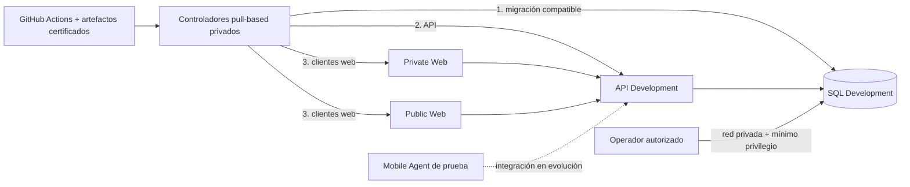

# Estado inicial del conocimiento

Esta nota fija la fotografía de partida del Vault. Resume evidencia versionada en el commit indicado en el frontmatter; no consulta el VPS en tiempo real y no sustituye los checks de salud.

## Lectura ejecutiva

- El monorepo tiene una API y una base lógica por ambiente para tres clientes.
- El ambiente Development dispone de CI/CD aceptado para base de datos, API, Private Web y Public Web.
- El acceso humano a SQL Development está controlado por red privada e identidades individuales de mínimo privilegio.
- Mobile Agent es una aplicación Expo/React Native ejecutable, pero todavía conserva integración prototipo y no tiene entrega APK automática completa.
- Production no está desplegada y su frontera permanece reservada.
- Alertas externas/heartbeats y protección técnica de ramas continúan diferidas.

## Matriz de capacidades

| Capacidad | Estado | Evidencia principal | Límite que no debe omitirse |
| --- | --- | --- | --- |
| Modelo de datos Development v1 | Verificado | [Database v1](../../docs/architecture/database-v1.md) y migraciones EF | La historia real del esquema son las migraciones |
| CI de base/API | Verificado | Workflows versionados y [release workflow](../../docs/workflows/release-workflow.md) | Un PR sin conflictos aún puede fallar validaciones |
| CD pull-based de base/API | Aceptado en Development | [Dokploy configuration](../../docs/deployment/dokploy-configuration.md) | Solo bundles certificados; DB precede a API |
| CD pull-based de ambas webs | Aceptado en Development | [Dokploy configuration](../../docs/deployment/dokploy-configuration.md) | Cada web conserva artefacto y controlador independientes |
| Acceso SSMS Development | Aceptado y privado | [Database access](../../docs/security/database-access.md) | CRUD de prueba no equivale a permiso de esquema o backup |
| Backup y restore-check | Aceptado en Development | [Dokploy configuration](../../docs/deployment/dokploy-configuration.md) | La salud se confirma con ejecución y evidencia, no por existencia del schedule |
| Mobile Agent | En evolución | [Mobile workflow](../../docs/workflows/mobile-workflow.md) | CI es plantilla; integración .NET y distribución APK siguen incompletas |
| Production | Diferido | [Environments](../../docs/deployment/environments.md) | No existe despliegue ni autorización para crearlo |
| Alertas externas por carril | Diferido | [Hardening backlog](../../docs/deployment/development-hardening-backlog.md) | Revisión manual actual no equivale a alerta automática |
| Protección técnica de ramas | Diferido | [Branch protection](../../.github/BRANCH_PROTECTION.md) | La disciplina por PR aún no es una barrera técnica completa |

## Topología conceptual de Development

El diagrama omite identificadores, IP y dominios deliberadamente. Los detalles operativos saneados viven en [Dokploy](../../docs/deployment/dokploy.md).

## Conocimiento confiable existente

- Historia observable y límites anteriores a Git: [Historia](../01-historia/README.md).
- Propósito, audiencias, capacidades y recorridos: [Producto](../02-producto/README.md).
- Lenguaje, contextos, relaciones e invariantes: [Dominio](../03-dominio/README.md).
- Componentes, dependencias, contratos y riesgos: [Arquitectura](../04-arquitectura/README.md).
- Responsabilidad y madurez de cada frontera ejecutable: [Aplicaciones](../05-aplicaciones/README.md).
- Preparación, cambio, validación y handoff local: [Desarrollo](../06-desarrollo/README.md).
- Workflows, artefactos, fallos y diseño APK diferido: [CI/CD y entrega](../07-entrega/README.md).
- Topología, schedules, backups, observabilidad y recuperación: [Operaciones](../09-operaciones/README.md).
- Perímetro, identidades, secretos y brechas: [Seguridad](../10-seguridad/README.md).
- Fuentes primarias y guías corregidas: [Referencia](../11-referencia/README.md).
- Decisiones y pruebas todavía pendientes: [Backlog transversal](../12-backlog/README.md).
- Límites de producto y reglas para agentes: [`AGENTS.md`](../../AGENTS.md).
- Arquitectura y dependencias: [`docs/architecture`](../../docs/architecture/system-overview.md).
- Decisiones aceptadas: [`docs/adr`](../../docs/adr/0001-use-monorepo.md).
- Esquema y migraciones: [`docs/database`](../../docs/database/migrations.md).
- Contratos y consumidores: [`docs/api`](../../docs/api/openapi-contract.md).
- Desarrollo y entrega: [`docs/workflows`](../../docs/workflows/release-workflow.md).
- Operación y recuperación: [`docs/deployment`](../../docs/deployment/dokploy-configuration.md) y [`ops/dokploy`](../../ops/dokploy/README.md).
- Seguridad: [`docs/security`](../../docs/security/secrets-management.md).

## Brechas conocidas del conocimiento

Estas brechas no deben rellenarse con narrativa inventada:

- La historia anterior al primer commit necesita testimonio de los participantes y debe identificarse como `unknown` hasta documentarlo.
- La sustitución completa de mocks por casos de uso reales no está terminada.
- La integración real del Mobile Agent con la API .NET y su estrategia APK/EAS están pendientes.
- Integración externa real, objetos/evidencias, chat/notificaciones y reglas finales de facturación permanecen incompletos o diferidos según las fuentes del área.
- Production necesita un plan y aceptación separados.
- Alertas externas y gobernanza técnica de ramas conservan criterios de aceptación abiertos.

## Regla de vigencia

Esta fotografía deja de ser suficiente cuando cambia cualquiera de estos elementos:

- un límite de producto o arquitectura;
- un contrato OpenAPI o una migración;
- un workflow que publica artefactos;
- el estado aceptado de un controlador, ambiente o frontera de red;
- una capacidad que pasa de `deferred` a implementada;
- el commit verificado que respalda esta nota.

En ese caso actualiza la matriz, sus fuentes, `last_verified` y `verified_commit` en el mismo PR. Sigue [Mantenimiento del Vault](../08-gobernanza/mantenimiento-del-vault.md).

Volver a [Home](home.md).
