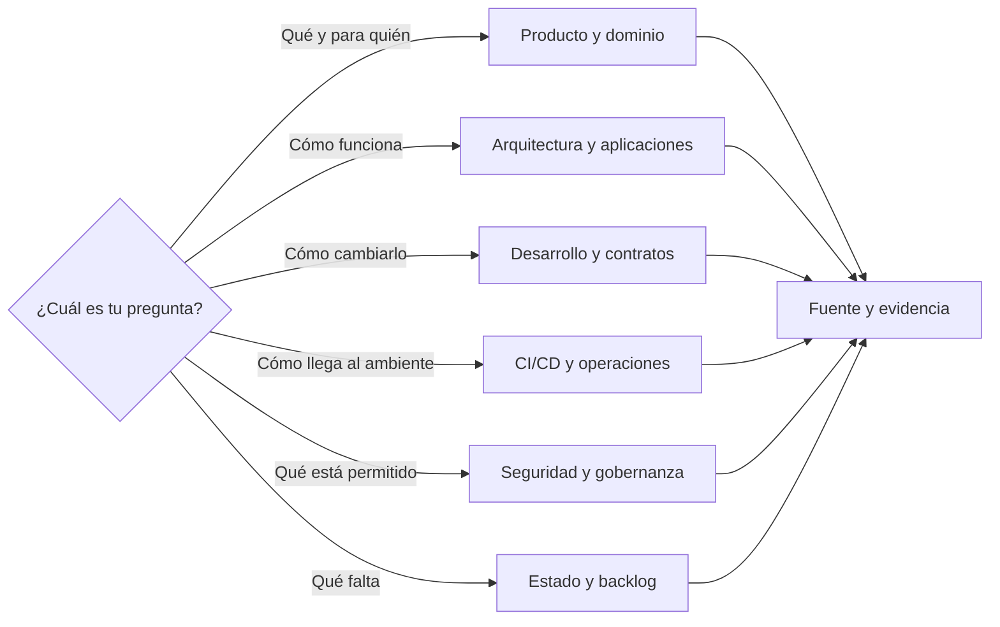
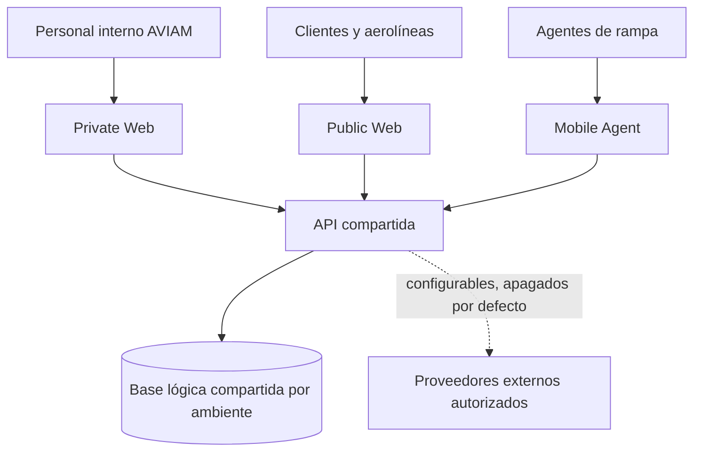

# Home

Bienvenido a la base de conocimiento de ELEVANT. Desde aquí puedes llegar a una respuesta por pregunta, por área o por nivel de evidencia.

> [!IMPORTANT]
> El Vault describe el sistema, pero no sustituye el código, las migraciones EF, OpenAPI, los workflows ni los runbooks operativos. Si una afirmación no puede demostrarse, usa `evidence: unknown`; si describe futuro, usa `evidence: planned` y el `status` correspondiente, como `deferred`.

## ¿Qué necesitas saber?

- Tengo una pregunta concreta: [Respuestas rápidas](respuestas-rapidas.md).
- No sé en qué área buscar: [Mapa de preguntas](mapa-de-preguntas.md).
- Quiero entender el estado actual: [Estado inicial](estado-inicial.md).
- Quiero distinguir las etapas documentales cerradas de las brechas abiertas: [Roadmap del Vault](roadmap-del-vault.md) y [Backlog transversal](../12-backlog/README.md).
- Perdí el contexto o cambié de colaborador/IA: [Protocolo de recuperación](protocolo-recuperacion-contexto.md).
- Quiero editar una nota: [Cómo usar el Vault](como-usar-el-vault.md).
- Quiero justificar una afirmación: [Política de evidencia y fuentes](../08-gobernanza/fuentes-y-evidencia.md).
- Quiero crear una nota: [Plantillas](../99-plantillas/README.md).

## Contexto esencial de ELEVANT

- [Producto](../02-producto/README.md): propósito observable, audiencias, capacidades, recorridos y preguntas abiertas.
- [Dominio](../03-dominio/README.md): lenguaje canónico, contextos, entidades, ciclos e invariantes.
- [Historia](../01-historia/README.md): cronología reproducible desde el primer commit y límites de lo que Git no puede contar.
- [Lienzo Producto · Dominio · Historia](../diagrams/producto-dominio-historia.md): vista interactiva para recorrer las tres capas como un solo sistema.
- [Arquitectura](../04-arquitectura/README.md): componentes, confianza, backend, persistencia, contratos e integraciones reales o futuras.
- [Aplicaciones](../05-aplicaciones/README.md): estado verificable de Private Web, Public Web, Mobile Agent, API y DevelopmentDB.
- [Desarrollo](../06-desarrollo/README.md): preparación local, comandos, flujo de PR, cambios seguros, pruebas y handoff.
- [Lienzo Arquitectura · Aplicaciones · Desarrollo](../diagrams/arquitectura-aplicaciones-desarrollo.md): recorrido visual desde el cliente hasta la evidencia de un cambio.
- [CI/CD y entrega](../07-entrega/README.md): workflows activos, artefactos certificados, gates y diseño diferido de APK móvil.
- [Operaciones](../09-operaciones/README.md): topología privada, schedules, backups, observabilidad y recuperación de Development.
- [Seguridad](../10-seguridad/README.md): acceso, secretos, permisos efectivos y controles pendientes.
- [Referencia](../11-referencia/README.md): rutas de fuentes primarias y reconciliación de `docs/`.
- [Backlog](../12-backlog/README.md): decisiones abiertas, dependencias y pruebas de cierre.
- [Lienzo Entrega · Operaciones · Seguridad](../diagrams/entrega-operaciones-seguridad.md): flujo entre certificación, promoción, observación y respuesta.

## Explora visualmente

- [Atlas general de ELEVANT](../diagrams/atlas-elevant.md)
- [Arquitectura de contexto](../diagrams/arquitectura-contexto.md)
- [Navegación por estado](../diagrams/navegacion-estado.md)
- [Producto, dominio e historia](../diagrams/producto-dominio-historia.md)
- [Arquitectura, aplicaciones y desarrollo](../diagrams/arquitectura-aplicaciones-desarrollo.md)
- [Entrega, operaciones y seguridad](../diagrams/entrega-operaciones-seguridad.md)
- [Leyenda y uso del Graph](../diagrams/leyenda-grafo.md)

Cada vista visual tiene un companion Markdown/Mermaid para conservar la lectura en GitHub y sin plugins.

## ELEVANT en una vista

Reglas estructurales:

- La arquitectura exige que los tres clientes usen la misma API versionada. *Posterior al commit verificado de esta nota (código de `39a85a46`):* los tres la consumen, Mobile Agent incluido; el [Mapa de capacidades](../02-producto/mapa-de-capacidades.md) dice hasta dónde.
- Existe una sola base lógica por ambiente; no una base por cliente.
- Los clientes no acceden directamente a SQL Server ni a proveedores externos.
- OpenAPI es el contrato cliente/servidor cuando un endpoint existe.
- Las migraciones EF Core son la historia del esquema.

Consulta las fuentes actuales en [`AGENTS.md`](../../AGENTS.md), [README del repositorio](../../README.md) y [Documentación ELEVANT](../../docs/README.md).

## Radar de estado

| Capacidad | Estado resumido | Leer antes de asumir |
| --- | --- | --- |
| Development: DB, API y webs | CI/CD aceptado para el alcance documentado | [Entrega](../07-entrega/README.md) y [Estado inicial](estado-inicial.md) |
| Acceso SQL de Development | Privado y controlado; no es un endpoint público | [Seguridad](../10-seguridad/README.md) |
| Mobile Agent | Aplicación ejecutable; integración API y entrega APK aún incompletas | [Diseño diferido de APK](../07-entrega/mobile-apk-ci-cd.md) |
| Production | Frontera futura, no desplegada | [Ambientes](../../docs/deployment/environments.md) |
| Alertas externas | Diferidas | [Observabilidad](../09-operaciones/observabilidad-y-alertas.md) |
| Protección técnica de ramas | Diferida por limitación vigente | [Riesgos y controles pendientes](../10-seguridad/riesgos-y-controles-pendientes.md) |

Este radar es una orientación, no evidencia operativa en tiempo real. La fotografía completa y su fecha están en [Estado inicial](estado-inicial.md).

## Navegación editorial

- [Política de evidencia y fuentes](../08-gobernanza/fuentes-y-evidencia.md)
- [Esquema de metadatos](../08-gobernanza/metadatos.md)
- [Mantenimiento del Vault](../08-gobernanza/mantenimiento-del-vault.md)
- [Plantilla general](../99-plantillas/pagina.md)
- [Plantilla ADR](../99-plantillas/adr.md)
- [Plantilla de runbook](../99-plantillas/runbook.md)
- [Plantilla de capacidad](../99-plantillas/capacidad.md)
- [Plantilla de incidente](../99-plantillas/incidente.md)
- [Auditoría documental](../11-referencia/reconciliacion-docs.md)
- [Pendientes transversales](../12-backlog/pendientes-transversales.md)

## Semáforo de confianza

| Etiqueta | Lectura correcta |
| --- | --- |
| `verified` + `repo-verified` | Contrastado con una fuente versionada vigente. |
| `verified` + `operator-recorded` | Aceptado mediante evidencia operativa saneada. |
| `documented` | Explicado y versionado; puede seguir evolucionando. |
| `draft` | Incompleto; no usar como contrato. |
| `deferred` | Acordado para después; no existe todavía. |
| `historical` | Describe un momento anterior, no el estado actual. |

La definición normativa vive en [Metadatos](../08-gobernanza/metadatos.md).
