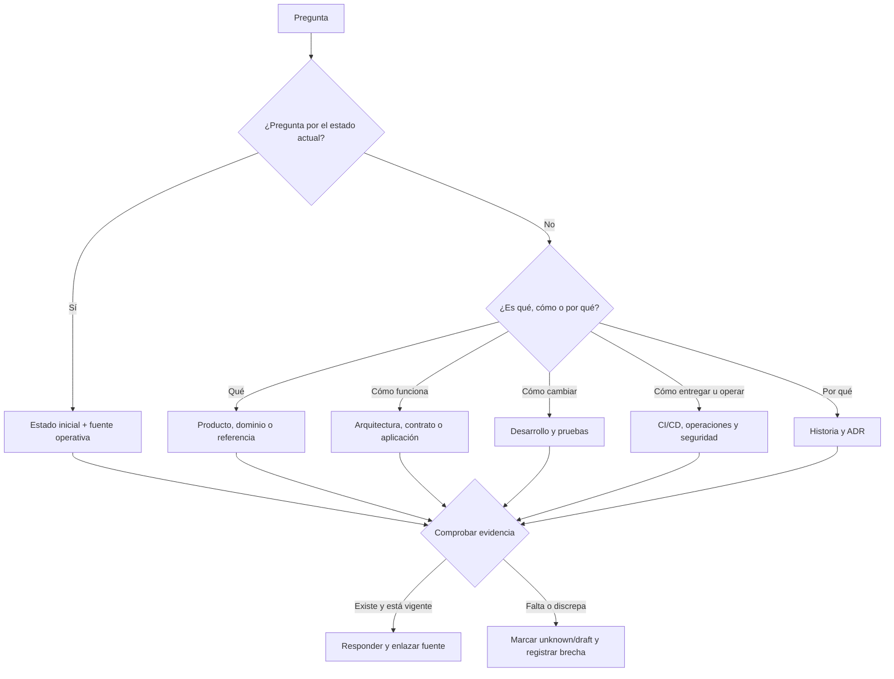

# Mapa de preguntas

Usa este mapa cuando conozcas la pregunta pero no la ubicación de la respuesta.

## Pregunta → destino

| Si preguntas… | Busca primero… | Fuente de comprobación |
| --- | --- | --- |
| ¿Qué problema resuelve? | [Producto](../02-producto/README.md) | Prototipos + decisiones aceptadas, diferenciando historia de implementación |
| ¿Quién puede hacer qué? | [Producto](../02-producto/README.md), [Dominio](../03-dominio/README.md) y [Seguridad](../10-seguridad/README.md) | Políticas de autorización, código y tests |
| ¿Qué significa este término? | [Dominio](../03-dominio/README.md) o Referencia | Modelo vigente y glosario |
| ¿Qué aplicación es responsable? | [Aplicaciones](../05-aplicaciones/README.md) y [Arquitectura](../04-arquitectura/README.md) | Límites del monorepo y reglas de dependencia |
| ¿Qué endpoint uso? | [OpenAPI, HTTP y SignalR](../04-arquitectura/openapi-http-y-signalr.md) | OpenAPI generado/compilado |
| ¿Qué tabla o relación existe? | [Datos, EF y migraciones](../04-arquitectura/datos-ef-migraciones-y-persistencia.md) | Migraciones EF Core |
| ¿Cómo agrego una capacidad? | [Desarrollo](../06-desarrollo/README.md) | `AGENTS.md`, README del área, tests y contratos |
| ¿Qué check debe pasar? | [Workflows y estado](../07-entrega/workflows-y-estado.md) | Workflow vigente y filtros de ruta |
| ¿Qué está desplegado? | [Estado](estado-inicial.md) y [Operaciones](../09-operaciones/README.md) | Aceptación fechada + comprobación nueva para salud actual |
| ¿Cómo recupero un fallo? | [Mantenimiento y recuperación](../09-operaciones/mantenimiento-reboot-y-recuperacion.md) | Runbook aceptado, precondiciones y rollback |
| ¿Cómo se compilaría una APK móvil? | [Diseño Mobile diferido](../07-entrega/mobile-apk-ci-cd.md) | Plantilla, configuración Expo y decisiones pendientes |
| ¿Por qué se eligió esta solución? | ADR e [Historia](../01-historia/README.md) | ADR aceptado y contexto de su fecha |
| ¿Qué todavía falta? | [Riesgos pendientes](../10-seguridad/riesgos-y-controles-pendientes.md) y [Roadmap](roadmap-del-vault.md) | Estado `deferred`/`draft` y criterios de aceptación |

## Atajos a las fuentes vigentes

| Tema | Fuente inicial |
| --- | --- |
| Límites del monorepo | [`AGENTS.md`](../../AGENTS.md) |
| Arquitectura general | [System overview](../../docs/architecture/system-overview.md) |
| Contrato HTTP | [OpenAPI contract](../../docs/api/openapi-contract.md) |
| Esquema persistente | [Migrations](../../docs/database/migrations.md) |
| Ambientes | [Environments](../../docs/deployment/environments.md) |
| CI/CD Development | [Release workflow](../../docs/workflows/release-workflow.md) |
| Operación VPS | [Dokploy configuration](../../docs/deployment/dokploy-configuration.md) |
| Seguridad de secretos | [Secrets management](../../docs/security/secrets-management.md) |
| Acceso SQL | [Database access](../../docs/security/database-access.md) |
| Decisiones | [ADR](../../docs/adr/0001-use-monorepo.md) |
| Riesgos diferidos | [Development hardening backlog](../../docs/deployment/development-hardening-backlog.md) |

## Preguntas que exigen contexto adicional

Antes de responder, fija estas dimensiones:

- **Ambiente:** local, Development o Production futura.
- **Momento:** estado actual o fotografía histórica.
- **Producto:** Private Web, Public Web, Mobile Agent o API compartida.
- **Tipo de cambio:** datos de prueba, esquema, contrato, código, infraestructura o documentación.
- **Autoridad:** lectura, PR de código, merge, despliegue u operación manual.
- **Evidencia:** repositorio, aceptación del operador, diseño o desconocido.

Una respuesta técnicamente correcta puede ser peligrosa si usa el ambiente, momento o nivel de autoridad equivocado.

## Si no hay respuesta

1. Comprueba las fuentes según la [política de evidencia](../08-gobernanza/fuentes-y-evidencia.md).
2. Busca decisiones históricas y PRs, sin tratarlos automáticamente como estado actual.
3. Marca explícitamente el vacío como `unknown`.
4. Registra qué evidencia permitiría resolverlo.
5. Crea o actualiza la nota correspondiente con la [plantilla general](../99-plantillas/pagina.md).

Volver a [Home](home.md).
