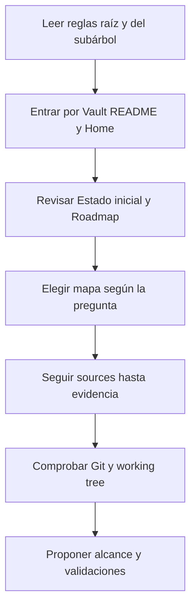

# Protocolo de recuperación de contexto

Este protocolo permite retomar ELEVANT sin depender de una conversación anterior, una memoria privada o un modelo de IA específico. El Vault conserva contexto durable; Git y las fuentes ejecutables prueban el estado exacto.

> [!IMPORTANT]
> Una conversación puede orientar, pero no es fuente de verdad. Si contradice código, migraciones, OpenAPI, workflows, ADR o evidencia operativa saneada, aplica la [política de evidencia](../08-gobernanza/fuentes-y-evidencia.md).

## Arranque en frío



1. Lee [`AGENTS.md`](../../AGENTS.md) y luego el `AGENTS.md` más cercano al área que cambiarás.
2. Abre [Vault ELEVANT](../README.md) y [Home](home.md).
3. Lee [Estado inicial](estado-inicial.md) para no confundir aceptación histórica con salud en tiempo real.
4. Lee [Roadmap](roadmap-del-vault.md) para distinguir documentación entregada, pendiente y deliberadamente separada.
5. Sigue el [Mapa de preguntas](mapa-de-preguntas.md) o [Respuestas rápidas](respuestas-rapidas.md).
6. Abre cada ruta de `sources` relevante y comprueba el commit indicado antes de afirmar que algo está vigente.
7. Revisa rama, cambios locales y último commit antes de editar.

Comprobación mínima, siempre de solo lectura:

```text
git status --short --branch
git log -1 --oneline --decorate
git diff --stat
npm run vault:check
```

## Lectura rápida por tipo de tarea

| Si necesitas… | Lee primero | Verifica después |
| --- | --- | --- |
| Entender el producto | Home → Producto/Dominio | Prototipos vigentes, ADR y contrato existente |
| Cambiar una aplicación | Mapa de la aplicación | README/AGENTS local, package scripts, OpenAPI |
| Cambiar API | Arquitectura/Backend | OpenAPI, tests, compatibilidad de consumidores |
| Cambiar esquema | Datos/Migraciones | Migraciones EF, pruebas y orden DB → API → clientes |
| Diagnosticar Development | Operaciones/Estado | Runbook aceptado y evidencia actual, sin asumir salud |
| Diseñar Mobile CI/CD | Mobile/Entrega | Estado Expo/EAS, firma, distribución, secretos y rollback |
| Entender una decisión | Historia/ADR | Fecha, alternativas, consecuencias y reemplazo vigente |

Las rutas de área se incorporan en las siguientes etapas del [Roadmap del Vault](roadmap-del-vault.md). Mientras una ruta no exista, usa los enlaces actuales de Home y `docs/`; no inventes su contenido.

## Contrato para otra IA o colaborador

Puedes iniciar una sesión nueva con esta instrucción, sin pegar historiales ni secretos:

```text
Trabaja en el repositorio ELEVANT. Lee primero AGENTS.md, Vault/README.md,
Vault/00-inicio/home.md, Vault/00-inicio/estado-inicial.md y el AGENTS.md
más cercano al área solicitada. Verifica las afirmaciones contra sources y Git.
No confundas planned/deferred con implementado, no despliegues ni fusiones sin
autorización explícita y preserva cambios ajenos del working tree. Antes de
editar, resume el alcance, la evidencia encontrada y las validaciones aplicables.
```

Después añade sólo el objetivo concreto de la sesión. El modelo debe consultar el repositorio, no pedir que el usuario reconstruya manualmente toda la historia.

## Qué debe quedar al terminar una sesión

- comportamiento durable actualizado en la nota del área;
- decisión importante registrada como ADR o backlog, no perdida en el chat;
- evidencia y fuentes actualizadas sin secretos;
- pruebas ejecutadas y resultado del handoff;
- qué no se implementó ni desplegó;
- siguiente paso explícito si el trabajo continúa.

## Señales de contexto insuficiente

Detente y marca la brecha cuando:

- la única fuente es una conversación o recuerdo;
- la nota no distingue estado actual de plan;
- `verified_commit` no contiene la fuente citada;
- el working tree tiene cambios ajenos que se solapan;
- una operación requiere acceso, secreto o autorización no concedidos;
- Production o datos reales aparecen implícitamente dentro de una tarea Development.

Relacionados: [Leyenda del grafo](../diagrams/leyenda-grafo.md), [Cómo usar el Vault](como-usar-el-vault.md), [Mantenimiento](../08-gobernanza/mantenimiento-del-vault.md).
