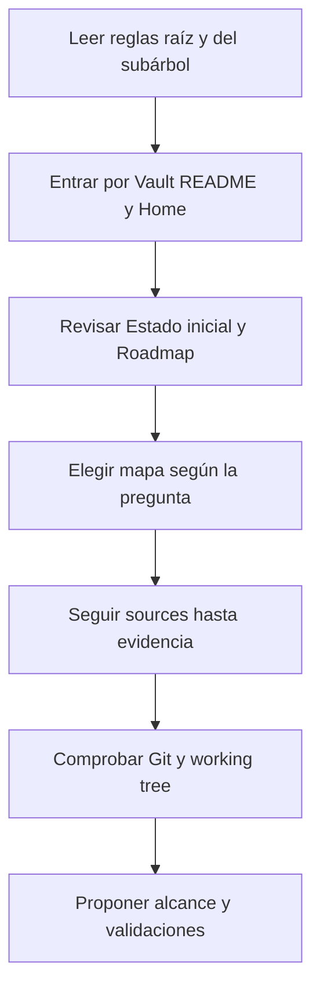

# Protocolo de recuperación de contexto

Este protocolo permite retomar ELEVANT sin depender de una conversación anterior, una memoria privada o un modelo de IA específico. El Vault conserva contexto durable; Git y las fuentes ejecutables prueban el estado exacto.

> [!IMPORTANT]
> Una conversación puede orientar, pero no es fuente de verdad. Si contradice código, migraciones, OpenAPI, workflows, ADR o evidencia operativa saneada, aplica la [política de evidencia](../08-gobernanza/fuentes-y-evidencia.md).

## Arranque en frío



1. Lee [`AGENTS.md`](../../AGENTS.md) y luego el `AGENTS.md` más cercano al área que cambiarás.
2. Abre [Vault ELEVANT](../README.md) y [Home](home.md).
3. Lee [Estado inicial](estado-inicial.md) para no confundir aceptación histórica con salud en tiempo real.
4. Recorre [Producto](../02-producto/README.md), [Dominio](../03-dominio/README.md) e [Historia](../01-historia/README.md) cuando necesites comprender el porqué y el vocabulario antes del código.
5. Recorre [Arquitectura](../04-arquitectura/README.md), [Aplicaciones](../05-aplicaciones/README.md) y [Desarrollo](../06-desarrollo/README.md) antes de proponer un cambio técnico.
6. Para entrega o seguridad, abre [CI/CD](../07-entrega/README.md), [Operaciones](../09-operaciones/README.md) y [Seguridad](../10-seguridad/README.md); separa aceptación fechada de salud actual.
7. Lee [Referencia](../11-referencia/README.md) para encontrar fuentes primarias y [Backlog](../12-backlog/README.md) para reconocer las brechas; luego revisa el [Roadmap](roadmap-del-vault.md).
8. Sigue el [Mapa de preguntas](mapa-de-preguntas.md) o [Respuestas rápidas](respuestas-rapidas.md).
9. Abre cada ruta de `sources` relevante y comprueba el commit indicado antes de afirmar que algo está vigente.
10. Revisa rama, cambios locales y último commit antes de editar.

Comprobación mínima, siempre de solo lectura:

```text
git status --short --branch
git log -1 --oneline --decorate
git diff --stat
npm run vault:check
```

## Lectura rápida por tipo de tarea

| Si necesitas… | Lee primero | Verifica después |
| --- | --- | --- |
| Entender el producto | [Producto](../02-producto/README.md) → [Dominio](../03-dominio/README.md) | Prototipos vigentes, ADR y contrato existente |
| Cambiar una aplicación | [Mapa de Aplicaciones](../05-aplicaciones/README.md) | README/AGENTS local, package scripts, OpenAPI |
| Cambiar API | [Arquitectura](../04-arquitectura/README.md) → [API compartida](../05-aplicaciones/api-compartida.md) | OpenAPI, tests, compatibilidad de consumidores |
| Cambiar esquema | [Datos y migraciones](../04-arquitectura/datos-ef-migraciones-y-persistencia.md) | Migraciones EF, pruebas y orden DB → API → clientes |
| Diagnosticar Development | [Operaciones](../09-operaciones/README.md) → [Estado](estado-inicial.md) | Runbook aceptado y evidencia actual, sin asumir salud |
| Diseñar Mobile CI/CD | [Diseño APK diferido](../07-entrega/mobile-apk-ci-cd.md) | Estado Expo, firma, distribución, secretos y rollback |
| Revisar un riesgo de acceso | [Seguridad](../10-seguridad/README.md) | Política real, prueba negativa y control pendiente |
| Entender una decisión | [Historia](../01-historia/README.md) → ADR | Fecha, alternativas, consecuencias y reemplazo vigente |
| Resolver una discrepancia de guías | [Reconciliación de `docs/`](../11-referencia/reconciliacion-docs.md) | Fuente ejecutable, fecha y alcance de cada texto |

Los mapas de Arquitectura, Aplicaciones, Desarrollo, Entrega, Operaciones, Seguridad, Referencia y Backlog ya son navegables. Una página disponible no certifica que su capacidad esté implementada; sigue su fuente y su estado.

## Contrato para otra IA o colaborador

Puedes iniciar una sesión nueva con esta instrucción, sin pegar historiales ni secretos:

```text
Trabaja en el repositorio ELEVANT. Lee primero AGENTS.md, Vault/README.md,
Vault/00-inicio/home.md, Vault/00-inicio/estado-inicial.md, los índices de
Producto, Dominio, Historia, Arquitectura, Aplicaciones, Desarrollo, Entrega,
Operaciones, Seguridad, Referencia y Backlog pertinentes,
y el AGENTS.md más cercano al área solicitada. Verifica las afirmaciones contra
sources y Git.
No confundas planned/deferred con implementado, no despliegues ni fusiones sin
autorización explícita y preserva cambios ajenos del working tree. Antes de
editar, resume el alcance, la evidencia encontrada y las validaciones aplicables.
```

Después añade sólo el objetivo concreto de la sesión. El modelo debe consultar el repositorio, no pedir que el usuario reconstruya manualmente toda la historia.

## Qué debe quedar al terminar una sesión

- comportamiento durable actualizado en la nota del área;
- decisión importante registrada como ADR o backlog, no perdida en el chat;
- evidencia y fuentes actualizadas sin secretos;
- pruebas ejecutadas y resultado del handoff;
- qué no se implementó ni desplegó;
- siguiente paso explícito si el trabajo continúa.

## Señales de contexto insuficiente

Detente y marca la brecha cuando:

- la única fuente es una conversación o recuerdo;
- la nota no distingue estado actual de plan;
- `verified_commit` no contiene la fuente citada;
- el working tree tiene cambios ajenos que se solapan;
- una operación requiere acceso, secreto o autorización no concedidos;
- Production o datos reales aparecen implícitamente dentro de una tarea Development.

Relacionados: [Leyenda del grafo](../diagrams/leyenda-grafo.md), [Cómo usar el Vault](como-usar-el-vault.md), [Mantenimiento](../08-gobernanza/mantenimiento-del-vault.md).
