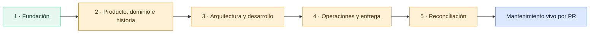

# Roadmap de construcción del Vault

Esta nota hace visible el alcance que todavía no forma parte de la fundación. Cada etapa se entrega en un PR independiente creado desde el `Development` actualizado y sólo avanza después del merge manual de la etapa anterior.

## Secuencia acordada

| Etapa | Resultado esperado | Estado al crear la fundación |
| --- | --- | --- |
| 1. Fundación | Navegación, evidencia, metadatos, plantillas, diagramas nativos, inventario y CI del Vault | Entregada |
| 2. Producto, dominio e historia | Visión, actores, vocabulario, capacidades, cronología Git y preguntas anteriores al repositorio | Entregada |
| 3. Arquitectura y desarrollo | Mapas por aplicación, backend, datos, OpenAPI, flujo local y guía de cambio seguro | Pendiente |
| 4. Operaciones y entrega | CI/CD Development, runbooks saneados, observabilidad, SQL privado y diseño de CI/CD/distribución APK del Mobile Agent | Pendiente |
| 5. Reconciliación | Auditoría de `docs/`, corrección de contradicciones, saneamiento y enlaces de reemplazo sin borrar historia útil | Pendiente |

## Alcances deliberadamente separados

- El Vault no implementa CI/CD móvil: primero documentará decisiones, requisitos de firma, ambientes, distribución, rollback y seguridad; la implementación requiere un cambio autorizado aparte.
- Production continúa como frontera futura y separada. Documentarla no autoriza crearla ni desplegarla.
- Alertas externas y simulacros operativos periódicos se documentarán con criterios de aceptación antes de ejecutarse.
- La historia anterior al primer commit sólo se incorporará mediante entrevista y evidencia identificada; mientras tanto permanece `unknown`.

## Criterio de cierre de cada etapa

Una etapa queda cerrada cuando sus notas son navegables desde [Home](home.md), distinguen presente de futuro, citan fuentes reproducibles, pasan `npm run vault:ci`, no contienen información sensible y el PR fue revisado y fusionado manualmente.

Volver a [Home](home.md) o consultar [Mantenimiento del Vault](../08-gobernanza/mantenimiento-del-vault.md).
