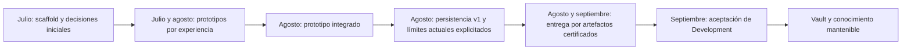

# Historia de ELEVANT

Este mapa reconstruye la evolución comprobable de ELEVANT desde el primer
objeto Git alcanzable hasta la aceptación del ambiente Development registrada
el 12 de septiembre de 2026. No pretende contar una historia corporativa ni
atribuir motivaciones personales: cuando el repositorio no permite demostrar
un origen, una autoría de decisión o un hecho operativo, se declara
explícitamente como desconocido.

## Recorridos

| Pregunta | Nota recomendada |
| --- | --- |
| ¿Qué ocurrió y en qué orden? | [Cronología versionada](cronologia-versionada.md) |
| ¿Cómo pasaron las pantallas y mocks a límites de producto explícitos? | [De prototipos a monorepo convergente](prototipos-y-convergencia.md) |
| ¿Cómo evolucionaron arquitectura, contrato y persistencia? | [Evolución de arquitectura y datos](evolucion-arquitectura-y-datos.md) |
| ¿Cómo llegó Development a CI/CD y aceptación operativa? | [Evolución de la entrega Development](evolucion-entrega-development.md) |
| ¿Qué no sabemos sobre el origen y por qué? | [Orígenes y límites de evidencia](origenes-y-limites-de-evidencia.md) |

## Vista compacta

La flecha representa orden documental, no una afirmación de causalidad humana.
La implementación de una capacidad, su merge y su aceptación operativa pueden
tener fechas distintas.

## Cómo leer esta historia

1. Los hashes cortos identifican commits reproducibles dentro de este
   repositorio; el SHA completo verificado está en el frontmatter.
2. Una fecha de ADR es la fecha que el propio documento declara. Solo la
   presencia en Git demuestra cuándo quedó versionado en este historial.
3. Un merge demuestra incorporación de código o documentación, no por sí solo
   un despliegue exitoso.
4. La operación del VPS se afirma únicamente cuando existe un registro saneado
   aceptado en el repositorio.
5. Los prototipos prueban exploración de flujo y vocabulario; no prueban un
   contrato HTTP, un esquema final ni controles de autorización.

## Corte de esta reconstrucción

El corte es el commit `0c39257`, que contiene la aceptación saneada de
Development y la base inicial del Vault. A esa fecha:

- base de datos, API, Private Web y Public Web tienen carriles CI/CD de
  Development aceptados;
- el acceso humano a datos sintéticos está aislado y acotado;
- Mobile Agent continúa como aplicación nativa en evolución, fuera del VPS y
  sin distribución APK automática completa;
- Production sigue reservada y no desplegada;
- alertas externas y otras medidas de hardening permanecen diferidas.

Para el estado vigente, no reutilices esta página histórica como monitor:
consulta [Estado inicial del conocimiento](../00-inicio/estado-inicial.md) y las
fuentes operativas enlazadas allí.

## Fuentes principales

- [Descripción vigente del producto](../../README.md).
- [Límites actuales del monorepo](../../AGENTS.md).
- [Estructura vigente](../../docs/architecture/repository-structure.md).
- [Decisión de monorepo](../../docs/adr/0001-use-monorepo.md).
- [Registro saneado de configuración y aceptación](../../docs/deployment/dokploy-configuration.md).
- [Decisión de acceso humano SSMS](../../docs/adr/0013-development-ssms-data-access.md).

Volver a [Home](../00-inicio/home.md).
