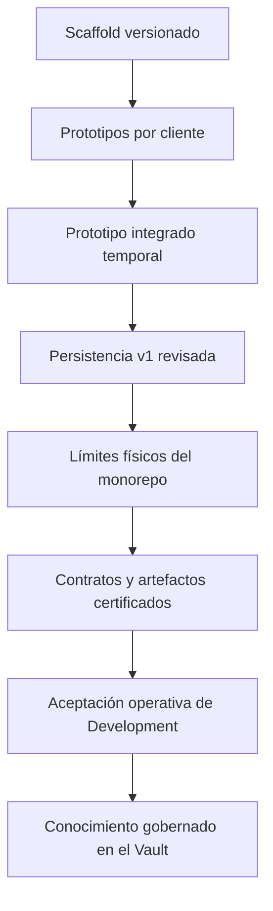

# Cronología versionada de ELEVANT

Esta cronología combina el grafo Git con documentos que explican el resultado
de cada etapa. Las fechas de la tabla son fechas de commit registradas por Git,
salvo cuando la celda dice expresamente «fecha declarada». Un asunto de commit
se usa como localizador, no como prueba suficiente de comportamiento.

## Antes del primer commit

Los ADR-0001 a ADR-0006 declaran decisiones aceptadas el 18 de julio de 2026.
Los seis documentos aparecen por primera vez en el commit raíz del 22 de julio.
Por tanto, es verificable que el repositorio **declara** esas decisiones con
fecha 18; este historial no demuestra cuándo ocurrió la conversación, quién
participó ni si existió material anterior fuera de Git. Véase
[Orígenes y límites de evidencia](origenes-y-limites-de-evidencia.md).

## Hitos comprobables

| Fecha Git | Commit o rango | Hito incorporado | Qué demuestra | Qué no demuestra |
| --- | --- | --- | --- | --- |
| 2026-07-22 | `8a1a1d8` | Primer snapshot: monorepo, API .NET mínima, pruebas, documentación, shells web/mobile y reglas de colaboración | Existe una base técnica común desde el primer objeto alcanzable | Origen humano del producto o trabajo anterior |
| 2026-07-22 | `e3fef04` | Corrección de pruebas de arquitectura para Linux | La portabilidad de CI se atendió desde el inicio | Que todo el sistema fuera funcional |
| 2026-07-25 | `3733416` | Preparación documental/técnica de Development con Dokploy | La topología remota empezó a modelarse | Que hubiera un despliegue ya aceptado |
| 2026-07-27 a 2026-08-12 | varios merges | Crecimiento de login, OCC, administración, contratos, finanzas, gestión humana, Mobile y portal público | Los clientes ejecutables exploraron flujos y vocabulario | Contratos de backend, persistencia definitiva o autorización real |
| 2026-08-13 a 2026-08-14 | `851618d` a `d2db81e` | Backend Node temporal y conexión progresiva de autenticación, planificación, móvil, revisión, finanzas, chat y reportes | Hubo una demostración integrada con persistencia local descartable | Que ese backend sea la arquitectura final o se despliegue en Development |
| 2026-08-16 | `2278e42` | Merge del prototipo integrado | La exploración multi-cliente quedó reunida en `Development` | Que todos sus casos de uso estén presentes en la API .NET |
| 2026-08-17 a 2026-08-18 | `e268dfd` a `1281bd1` | Plataforma de persistencia v1, identidad/catálogos, personal/comercial, operaciones, idempotencia móvil, auditoría, seed y certificación SQL | La primera cadena EF revisada convirtió conceptos seleccionados en esquema | Que todo campo mock se haya convertido en tabla |
| 2026-08-18 a 2026-08-20 | `3904232`, `86555b6` | Bootstrap privado de Dokploy y endurecimiento del firewall | Se versionaron controles operativos y de red | Aceptación final de todos los servicios |
| 2026-08-23 | `dfc494f`, `e55ac60` | Carril CI/CD de base y corrección de resolución del runtime Dokploy | El modelo pull-based comenzó a implementarse | Que API y webs ya tuvieran el mismo carril |
| 2026-08-30 | `5c6af69`, `e4ae11c` | Bundle OCI inmutable de base y compatibilidad con configuración Raw | Artefacto, manifiesto y Compose quedaron vinculados por contenido | Firma criptográfica o autorización para Production |
| 2026-08-31 | `4eb070f` y registro operator-recorded | Adopción y primera promoción viva de Database CD | DB quedó `succeeded/complete`; backup, restore-check, poll y persistencia tras reboot fueron validados | Salud futura ni aceptación de API o webs |
| 2026-08-31 | `ad00724`, `0517921` | Reorganización física y retiro de scaffold obsoleto | `backend`, `database/DevelopmentDB` y `frontend/private-web` adquieren sus límites actuales | Extracción a servicios independientes |
| 2026-08-31 a 2026-09-04 | `0669a69` a `1569606` | Implementación del CI/CD privado de API y cobertura automatizada del rollback sano | Existen publicación, promoción, recuperación y una prueba automatizada del mecanismo | Que el test de `1569606` sea un drill vivo o que la API ya estuviera aceptada en el VPS |
| 2026-09-05 | registro operator-recorded | Primera aceptación viva de API CD | Imagen por digest, estado, health, readiness, ping, Swagger, CORS, no-op y recuperación tras reboot fueron validados | Endpoints de negocio completos ni salud posterior al corte |
| 2026-09-05 | `023405f`, `8c88685`, `3531257` | CORS exacto, estabilización OpenAPI y cliente TypeScript compartido generado | El contrato HTTP ganó snapshot y generación reproducible | Migración inmediata de todos los adaptadores prototipo |
| 2026-09-05 a 2026-09-06 | `8bbe12b`, `c5c62b4` | Implementación de entrega web independiente y del mecanismo/pruebas de rollback seguro | Se incorporaron carriles web separados con dependencia explícita de API | Que esos commits demuestren por sí solos un drill o despliegue vivo |
| 2026-09-07 | registro operator-recorded | Aceptación viva de AVIAM Web y Public Web | Ambas previews quedaron healthy; drills B → A → B, rollback, repromoción y no-op fueron validados | Que las interfaces tengan autenticación y negocio definitivos |
| 2026-09-07 a 2026-09-09 | `1875fa6` a `a60b534` | Gate de Public Web, serialización DB y protección del transporte de credenciales SQL | Se cerraron carreras y exposiciones operativas concretas | Auditoría DML completa o eliminación de todo riesgo residual |
| 2026-09-10 | `45e1e02`, `72dec4c`, `1dae9ab` | Acceso humano SSMS, persistencia de configuración del gateway y red runtime dedicada | Se creó una excepción Development de mínimo privilegio sin publicar SQL directamente | Acceso de clientes a SQL ni permiso para cambiar esquema manualmente |
| 2026-09-12 | `1ed89a7` | Gate de publicación API contra el OpenAPI exacto | Una entrega API no puede anunciar contrato derivado obsoleto | Compatibilidad semántica automática de cambios breaking |
| 2026-09-12 | `bea325a` | Registro saneado de aceptación de Development | El repositorio conserva evidencia de runtime, reboot, recuperación y fronteras aceptadas | Telemetría en vivo posterior a ese corte |
| 2026-09-12 | `0c39257` | Fundación del Vault | El conocimiento inicia un ciclo mantenible y validado | Que todas las áreas posteriores estén ya completas |

## Secuencia de maduración



## Tres clases de hito

- **Incorporación:** el commit o merge vuelve el cambio parte del historial.
- **Decisión:** un ADR fija intención, alternativas y consecuencias; puede
  preceder a la implementación.
- **Aceptación operativa:** un registro saneado confirma que la capacidad se
  probó en el ambiente. Solo esta clase respalda «está desplegado».

Confundir estas capas produciría afirmaciones históricas falsas. Por ejemplo,
ADR-0012 definió la entrega web el 5 de septiembre y advirtió que el rollout
inicial seguía pendiente; el registro posterior es el que permite afirmar su
aceptación.

## Reproducción de la cronología

Desde un checkout que contenga el commit verificado:

```text
git rev-list --max-parents=0 HEAD
git log --first-parent --reverse --date=short --format="%h|%cs|%s"
git log --reverse --date=short --format="%h|%cs|%s" -- backend frontend database ops packages
git log --follow -- frontend/private-web/README.md
```

La primera consulta localiza la raíz; la segunda muestra la línea de integración;
la tercera expone commits internos que un merge resume; la cuarta conserva la
traza a través del antiguo nombre `frontend/web`. Las fechas Git siguen siendo
metadatos del repositorio y no sustituyen evidencia externa de hechos humanos.

## Relacionados

- [Índice de historia](README.md)
- [De prototipos a monorepo convergente](prototipos-y-convergencia.md)
- [Evolución de la entrega Development](evolucion-entrega-development.md)
- [Flujo de liberación vigente](../../docs/workflows/release-workflow.md)

## Fuentes verificadas

- [README vigente](../../README.md): límites y estado funcional del corte.
- [Reporte estructural](../../SETUP_REPORT.md): reorganización y estado verificable del monorepo.
- [Backend prototipo](../../backend-prototipo/README.md): alcance y persistencia temporal de la demostración integrada.
- [Database v1](../../docs/architecture/database-v1.md): selección de conceptos y cadena de migraciones.
- [Estructura del repositorio](../../docs/architecture/repository-structure.md): fronteras físicas posteriores a la reorganización.
- [Configuración de Dokploy](../../docs/deployment/dokploy-configuration.md): registro saneado de rollout y aceptación.
- [Flujo de liberación](../../docs/workflows/release-workflow.md): secuencia y carriles vigentes.
- [ADR-0001](../../docs/adr/0001-use-monorepo.md), [ADR-0007](../../docs/adr/0007-api-client-generation.md), [ADR-0009](../../docs/adr/0009-pull-based-database-development-cd.md), [ADR-0011](../../docs/adr/0011-pull-based-api-development-cd.md), [ADR-0012](../../docs/adr/0012-pull-based-web-development-cd.md) y [ADR-0013](../../docs/adr/0013-development-ssms-data-access.md): decisiones y enmiendas citadas.
