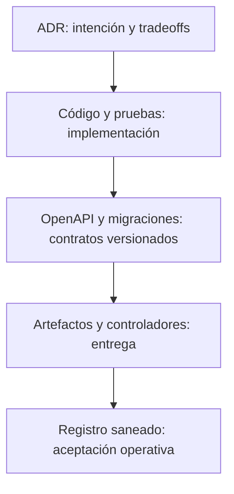

# Evolución de arquitectura, contrato y datos

La arquitectura de ELEVANT evolucionó por decisiones aditivas y enmiendas
acotadas, no por reemplazos totales. El monorepo y el monolito modular fijaron
el marco; los prototipos aportaron vocabulario; EF y OpenAPI convirtieron una
parte de ese conocimiento en contratos ejecutables; los ADR operativos
definieron cómo llevarlos a Development sin abrir el plano privado.

## Capas de evidencia arquitectónica

Una capa no permite saltar a la siguiente. Un ADR aceptado no prueba código; una
imagen construida no prueba despliegue; un despliegue histórico no prueba salud
presente.

## Decisiones fundacionales

Los ADR-0001 a ADR-0006 declaran aceptación el 18 de julio y quedaron
versionados en el primer commit del 22 de julio.

| ADR | Decisión que permanece | Evolución posterior |
| --- | --- | --- |
| [0001](../../docs/adr/0001-use-monorepo.md) | Código, documentación, infraestructura y paquetes en un monorepo | La reorganización del 31 de agosto clarificó límites sin dividir repositorios |
| [0002](../../docs/adr/0002-use-dotnet-10.md) | Backend y tooling productivo sobre .NET 10 con dependencias bloqueadas | CI y las imágenes certificadas prueban esa línea base |
| [0003](../../docs/adr/0003-use-modular-monolith.md) | Un backend desplegable con Clean Architecture y fronteras verificadas | No hay evidencia de una migración a microservicios |
| [0004](../../docs/adr/0004-centralize-external-api-access.md) | Proveedores externos solo detrás del backend | La integración real con el proveedor de aviación continúa pendiente |
| [0005](../../docs/adr/0005-use-remote-development-api.md) | API Development común para los tres clientes | ADR-0008 enmendó endpoint y topología; no cambió la API única |
| [0006](../../docs/adr/0006-separate-development-and-production.md) | Recursos y datos separados por ambiente | Production continúa sin despliegue y requiere plan propio |

Estas fechas son declaraciones dentro de los ADR. El repositorio no contiene
commits anteriores que prueben la sesión o las personas que decidieron.

## De vocabulario prototipo a esquema v1

Entre el 17 y 18 de agosto se incorporó una cadena de cinco migraciones:

1. plataforma y convenciones;
2. identidad y catálogos de referencia;
3. personal y comercial;
4. operaciones y revisión;
5. idempotencia móvil y auditoría.

La cadena estableció una sola base lógica por ambiente, schemas explícitos,
historia sin cascadas destructivas, concurrencia y un seed Development
sintético, determinista e idempotente. También dejó fuera capacidades con reglas
inmaduras. Esta selección es importante: el esquema no es una copia automática
de las formas de los mocks.

## Separación física sin fragmentación lógica

La reorganización del 31 de agosto movió Persistence y DatabaseTool a
`database/DevelopmentDB`, conservó la solución .NET común y reservó
`database/ProductionDB`. El resultado actual separa ownership y operaciones,
pero mantiene estas invariantes:

- una API compartida;
- una base lógica por ambiente;
- clientes sin conexión SQL;
- migraciones como historia del esquema;
- Production físicamente separada cuando exista.

## De intención HTTP a contrato reproducible

ADR-0007 fue aceptado el 5 de septiembre después de estabilizar la superficie
OpenAPI inicial. Desde entonces:

- `packages/api-client/openapi/elevant-v1.json` conserva el snapshot revisado y
  `source.json` declara su esquema, ruta y fingerprint canónico;
- Orval genera el cliente TypeScript compartido desde ese snapshot;
- los workflows de backend y API client reconstruyen la API y comparan la
  superficie publicada, el snapshot y la salida generada;
- los manifiestos de Vite, Next y Expo declaran el mismo paquete local y CI
  comprueba que puede integrarse en sus toolchains.

En el corte, el snapshot contiene sólo la operación técnica de ping. La
dependencia declarada y las pruebas de bundle no demuestran que los adaptadores
de negocio ya consuman operaciones generadas: autenticación y endpoints de
dominio siguen pendientes. El mecanismo sí fija cómo incorporar cada contrato
nuevo sin derivar DTOs desde entidades EF o mocks.

El 16 de septiembre, ADR-0014 cerró una circularidad de procedencia: un commit
no puede contener el digest de una imagen que ese mismo commit todavía no ha
producido. Desde esa enmienda, el descriptor versionado identifica el contrato;
el manifiesto OCI inmutable conserva commit, run e imagen de cada release. CI
exige igualdad entre descriptor, snapshot, Swagger servido y la etiqueta del
bundle, y Web CI comprueba además el linaje exacto de inputs API.

## Evolución operativa de las decisiones

| ADR | Fecha declarada | Alcance | Relación histórica |
| --- | --- | --- | --- |
| [0008](../../docs/adr/0008-docker-sql-dokploy-private-development.md) | 2026-08-17 | SQL Server Development privado en Docker/Dokploy | Estableció separación de runtime y prohibición de SQL público |
| [0009](../../docs/adr/0009-pull-based-database-development-cd.md) | 2026-08-23 | CD pull-based de base | Conserva modelo y secuencia; parte del empaquetado fue sustituida |
| [0010](../../docs/adr/0010-package-development-database-release-as-oci-bundle-v1.md) | 2026-08-30 | Bundle OCI v1 de base | Sustituyó solo el paquete/manifiesto de ADR-0009 |
| [0011](../../docs/adr/0011-pull-based-api-development-cd.md) | 2026-08-31 | CD pull-based de API | Añadió gate de compatibilidad DB, salud y rollback |
| [0012](../../docs/adr/0012-pull-based-web-development-cd.md) | 2026-09-05 | CD independiente de ambas webs | Dejó Mobile y Production fuera de alcance |
| [0013](../../docs/adr/0013-development-ssms-data-access.md) | 2026-09-10 | Acceso humano CRUD a Development | Modificó solo la ausencia de Service SQL humano de ADR-0008 |
| [0014](../../docs/adr/0014-bind-api-releases-to-openapi-fingerprint.md) | 2026-09-16 | Fingerprint OpenAPI cerrado y procedencia por release | Enmendó sólo la procedencia circular de ADR-0007; conservó manifiestos/controladores v1 |

ADR-0013 no revoca la frontera de datos: los productos siguen usando la API.
Autoriza a personas aprobadas a experimentar con datos sintéticos, no a editar
schema, migraciones, backups o configuración administrativa desde SSMS.

## Invariantes que sobrevivieron la evolución

- Los tres clientes convergen en la misma API versionada.
- La API es dueña de autorización, tenancy, reglas e integraciones.
- EF Core es dueño del esquema; OpenAPI es dueño del contrato HTTP.
- La identidad canónica del contrato se separa de la procedencia exacta de cada
  release, que permanece en su manifiesto inmutable.
- Los artefactos se identifican por contenido inmutable; los aliases solo sirven
  para descubrimiento.
- GitHub no inicia conexiones al VPS privado.
- Development y Production no comparten datos ni infraestructura.
- Mobile se distribuye como aplicación nativa y no como stack del VPS.

## Brechas al cierre

La arquitectura preparada es más amplia que la superficie de negocio
implementada. Autenticación completa, reemplazo general de mocks, integración
externa real, facturación final, chat/notificaciones y almacenamiento de
evidencias requieren contratos y pruebas posteriores. Ninguna de esas brechas
invalida la infraestructura aceptada, pero impide describir el producto como
funcionalmente completo.

## Relacionados

- [De prototipos a monorepo convergente](prototipos-y-convergencia.md)
- [Evolución de la entrega Development](evolucion-entrega-development.md)
- [Database v1](../../docs/architecture/database-v1.md)
- [Índice de historia](README.md)

## Fuentes verificadas

- [Database v1](../../docs/architecture/database-v1.md) y [estructura del repositorio](../../docs/architecture/repository-structure.md): esquema y límites físicos.
- [ADR-0001](../../docs/adr/0001-use-monorepo.md), [ADR-0002](../../docs/adr/0002-use-dotnet-10.md), [ADR-0003](../../docs/adr/0003-use-modular-monolith.md), [ADR-0004](../../docs/adr/0004-centralize-external-api-access.md), [ADR-0005](../../docs/adr/0005-use-remote-development-api.md) y [ADR-0006](../../docs/adr/0006-separate-development-and-production.md): decisiones fundacionales.
- [ADR-0007](../../docs/adr/0007-api-client-generation.md), [ADR-0008](../../docs/adr/0008-docker-sql-dokploy-private-development.md), [ADR-0009](../../docs/adr/0009-pull-based-database-development-cd.md), [ADR-0010](../../docs/adr/0010-package-development-database-release-as-oci-bundle-v1.md), [ADR-0011](../../docs/adr/0011-pull-based-api-development-cd.md), [ADR-0012](../../docs/adr/0012-pull-based-web-development-cd.md), [ADR-0013](../../docs/adr/0013-development-ssms-data-access.md) y [ADR-0014](../../docs/adr/0014-bind-api-releases-to-openapi-fingerprint.md): contrato, operación, excepciones y enmienda de procedencia posteriores.
- [CI de backend](../../.github/workflows/backend-ci.yml), [CI web](../../.github/workflows/web-ci.yml), [CI del cliente API](../../.github/workflows/api-client-ci.yml), [snapshot](../../packages/api-client/openapi/elevant-v1.json), [descriptor](../../packages/api-client/openapi/source.json) y [manifiesto del paquete](../../packages/api-client/package.json): implementación ejecutable del contrato reproducible y su unión con releases inmutables.
- Los manifiestos de [Private Web](../../frontend/private-web/package.json), [Public Web](../../frontend/public-web/package.json) y [Mobile Agent](../../frontend/mobile-agent/package.json): adopción de la dependencia compartida, no prueba de casos de uso de negocio completos.
