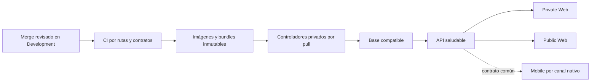

# Evolución de la entrega Development

El CI/CD de Development se construyó como varios carriles coordinados, no como
un único «deploy del monorepo». Base, API y cada web conservan artefactos,
estado y rollback propios. La tablet se valida y distribuye por otro canal. El
registro de aceptación del 12 de septiembre permite afirmar que los cuatro
deployables de servidor estaban operativos en ese corte; no equivale a una
garantía de salud futura ni a un rollout de Production.

## Principio de entrega

La secuencia expresa dependencia, no que todo cambio recree todos los servicios.
Los filtros por ruta y los manifiestos permiten que cada carril avance solo si
su producto cambió y sus dependencias exactas están disponibles.

## Etapa 1: SQL privado y operación reproducible

ADR-0008, aceptado el 17 de agosto, definió SQL Server 2022 en un contenedor
separado, volumen persistente, red interna, migrador/seed one-shot y acceso
privado al ambiente. El código incorporado el 18 de agosto y el hardening del 20
prepararon host, firewall, Tailscale, observabilidad y recuperación.

En ese momento había infraestructura revisada; todavía no existían todos los
carriles automáticos aceptados.

## Etapa 2: Database CD

El 23 de agosto, ADR-0009 fijó el patrón pull-based:

1. CI certifica cambios de migraciones, modelo, seed y tooling;
2. publica imágenes y un descriptor sin secretos;
3. el VPS privado descubre la candidata;
4. un lock serializa backup, migración, seed, verificación, backup posterior y
   restore-check;
5. el controlador conserva estado y no regresa a un run anterior.

ADR-0010, el 30 de agosto, reemplazó solo el empaquetado: el manifiesto y los
Compose exactos quedaron dentro de un bundle OCI v1 y se comparan
semánticamente contra la configuración viva. El controlador no reescribe el
recurso Raw.

Esa implementación no fue la aceptación viva. El registro operator-recorded
separa el corte: el 31 de agosto quedaron validadas la adopción y primera
promoción, backup, restore-check, poll, estado terminal y persistencia tras
reboot de Database CD.

## Etapa 3: API CD

ADR-0011 y los cambios del 31 de agosto añadieron un carril API separado. La
promoción exige una base compatible, despliega por digest, comprueba health,
readiness, ping y Swagger, y puede restaurar la última pareja imagen/Compose
sana. El cambio `1569606` del 4 de septiembre añadió una prueba automatizada del
camino de rollback sano; por sí solo no demuestra un drill ejecutado en el VPS.

La aceptación viva de API consta por separado el 5 de septiembre: imagen por
digest, estado `succeeded/complete`, health, readiness, ping, Swagger, CORS,
poll no-op y recuperación tras reboot fueron validados por el operador.

El 12 de septiembre se cerró una brecha adicional: una entrega API solo publica
su alias cuando el OpenAPI derivado de la imagen exacta coincide con el snapshot
revisado. Esto impide anunciar una imagen con contrato generado obsoleto.

## Etapa 4: clientes web independientes

El 5 de septiembre, ADR-0012 y el carril web añadieron dos promociones
independientes:

- Private Web: build Vite servido por runtime no privilegiado;
- Public Web: servidor Next standalone no privilegiado;
- un bundle, estado y rollback por perfil;
- dependencia de una API y un hash OpenAPI exactos;
- redes runtime separadas, sin acceso a SQL;
- exposición privada mediante el plano de acceso aprobado.

El cambio `c5c62b4` del 6 de septiembre incorporó el mecanismo de drill seguro y
su cobertura automatizada; no es por sí solo evidencia de un drill vivo. El
registro operator-recorded del 7 de septiembre confirma por separado que AVIAM
Web y Public Web quedaron healthy y que se validaron B → A → B, rollback,
repromoción, estados terminales, polls no-op y schedules. Ambas seguían siendo
previews técnicos: desplegar una interfaz no crea endpoints de negocio que la
API aún no implementa.

## Cortes de aceptación operativa

| Carril | Implementación y pruebas en Git | Aceptación operator-recorded |
| --- | --- | --- |
| Database CD | Controlador, bundle OCI y pruebas versionadas hasta el 30 de agosto | 31 de agosto: primera promoción, mantenimiento y reboot validados |
| API CD | Pipeline/controlador desde el 31 de agosto; test de rollback sano el 4 de septiembre | 5 de septiembre: despliegue, probes, CORS, no-op y recuperación validados |
| AVIAM/Public Web CD | Entrega el 5 de septiembre; mecanismo y tests de drill el 6 | 7 de septiembre: ambos drills y previews privadas aceptados |
| Conjunto Development | Gates y hardening siguieron evolucionando | 12 de septiembre: DB antes de API, cinco workloads, cuatro controladores, seis schedules, reboot y fronteras finales validados |

## Etapa 5: acceso SQL humano acotado

Entre el 10 y el 12 de septiembre se implementó y aceptó ADR-0013. Un gateway
sin credenciales conecta el Service privado con SQL sin publicar el puerto del
motor ni añadir SQL a una red de salida. Las identidades son individuales y el
rol de equipo permite CRUD en datos sintéticos, pero niega DDL, backup, restore,
administración y escritura de infraestructura/auditoría.

Este acceso no forma parte de los clientes ni de la ruta de schema. EF y
Database CD siguen siendo la única vía para tablas, columnas, claves, índices y
migraciones.

## Qué quedó aceptado el 12 de septiembre

El registro saneado versionado documenta, entre otros checks:

- base, API, Private Web, Public Web y gateway saludables y aislados;
- controladores persistentes, reanudados y sin recreaciones indebidas;
- estados aceptados exactos después de reboot;
- backup y restore-check exitosos;
- polls repetidos como no-op ante bundles ya aceptados;
- rollback de ambas webs ejercitado;
- API y superficies web accesibles por la vía privada prevista;
- SQL sin puerto publicado; el gateway escucha sólo en loopback y ni el motor ni
  el gateway son alcanzables directamente por la IP pública o la dirección
  Tailscale del host. La entrada remota es el Service privado dedicado;
- acceso SSMS individual con permisos efectivos acotados.

No se copian aquí nombres, direcciones, IDs de runtime ni credenciales. La
evidencia saneada detallada permanece en
[Configuración de Dokploy](../../docs/deployment/dokploy-configuration.md).

## Qué significa «automático»

- El merge a `Development` activa CI solo en carriles relevantes.
- Una publicación válida puede ser descubierta y promovida sin copiar digests
  manualmente.
- Compatibilidad, orden, locks, salud y rollback fallan cerrado.
- La instalación inicial, cambios de infraestructura Raw, secretos y ciertas
  reconciliaciones siguen requiriendo operación manual.
- Un PR sin conflictos puede fallar CI; ausencia de conflicto solo habla de la
  capacidad de Git para combinar texto.

## Límites pendientes

- Mobile Agent no tiene todavía entrega APK automática completa.
- Production no está autorizada ni desplegada.
- Las alertas externas/heartbeats por carril continúan diferidas; el registro
  indica observación y revisión manual donde corresponde.
- La protección técnica obligatoria de rama y la procedencia criptográfica
  requieren el hardening futuro documentado.
- Un commit histórico aceptado no sustituye monitoreo ni un nuevo restore test.

## Relacionados

- [Cronología versionada](cronologia-versionada.md)
- [Flujo de liberación](../../docs/workflows/release-workflow.md)
- [Backlog de hardening](../../docs/deployment/development-hardening-backlog.md)
- [Índice de historia](README.md)

## Fuentes verificadas

- [Flujo de liberación](../../docs/workflows/release-workflow.md): orden, dependencias y responsabilidades vigentes.
- [Topología Development](../../docs/deployment/dokploy.md) y [registro saneado de configuración](../../docs/deployment/dokploy-configuration.md): diseño y aceptación operativa.
- [Backlog de hardening](../../docs/deployment/development-hardening-backlog.md): controles todavía diferidos.
- [Acceso a base](../../docs/security/database-access.md): frontera humana, permisos y revocación.
- [ADR-0008](../../docs/adr/0008-docker-sql-dokploy-private-development.md), [ADR-0009](../../docs/adr/0009-pull-based-database-development-cd.md), [ADR-0010](../../docs/adr/0010-package-development-database-release-as-oci-bundle-v1.md), [ADR-0011](../../docs/adr/0011-pull-based-api-development-cd.md), [ADR-0012](../../docs/adr/0012-pull-based-web-development-cd.md) y [ADR-0013](../../docs/adr/0013-development-ssms-data-access.md): evolución de la entrega y su alcance.
