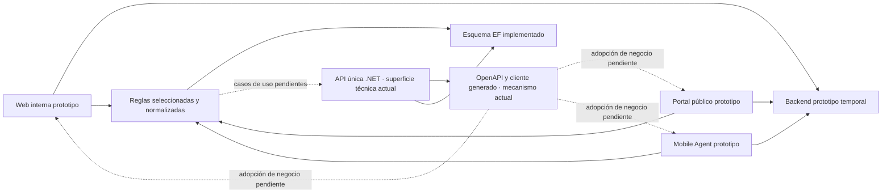

# De prototipos a monorepo convergente

ELEVANT no pasó de una especificación cerrada a una implementación lineal. El
historial muestra primero una base arquitectónica, después varias experiencias
ejecutables que exploraron operaciones y, finalmente, una selección explícita
de conceptos para la API, la persistencia y el contrato compartido. Esta nota
explica qué conocimiento aportó cada etapa sin elevar mocks a fuente de verdad.

## La base antes de los prototipos ricos

El primer snapshot del 22 de julio ya contenía:

- un monorepo con un backend .NET y proyectos de Clean Architecture;
- endpoints técnicos mínimos y pruebas;
- espacios documentales para una web y Mobile Agent;
- ADR sobre monorepo, monolito modular, acceso a proveedores y separación de
  ambientes;
- plantillas de CI para clientes, no pipelines de distribución completos.

El commit raíz no contiene `frontend/public-web` ni `backend-prototipo`. Tampoco
contiene una migración EF de negocio. Esto evita narrar el estado inicial como
si ya incluyera las capacidades que llegaron después.

## Exploración por experiencia

| Periodo Git | Superficie | Aporte observable | Límite histórico |
| --- | --- | --- | --- |
| 27 de julio a 12 de agosto | Web interna, entonces `frontend/web` | Login, shell departamental, OCC, planificación, posiciones, revisión, contratos, finanzas y gestión humana | Servicios y datos mayormente mock; la UI no autoriza |
| 8 a 14 de agosto | `frontend/mobile-agent` | Flujos nativos de agente, tareas, checklists, incidencias y sincronización, iniciados por el prototipo Expo de `201970e` | Cuenta, red y persistencia aún demostrativas; el placeholder del 31 de julio no prueba esos flujos |
| 9 de agosto en adelante | `frontend/public-web` | Landing y portal de aerolíneas con rutas comerciales y operativas | Tenant scope y sesión todavía no eran contratos reales |
| 13 y 14 de agosto | `backend-prototipo` | Persistencia local y demostración transversal entre departamentos, portal y móvil | Backend Node temporal, datos descartables, sin ser arquitectura final |

El merge del prototipo integrado del 16 de agosto reunió esa exploración. Su
valor histórico es mostrar relaciones de trabajo: una solicitud comercial puede
alimentar planificación, una ejecución móvil puede volver a OCC y ciertos
resultados pueden alimentar revisión o finanzas. No convierte cada pantalla,
campo o estado en requisito aprobado.

## Qué se conservó como conocimiento

La base v1 del 17 de agosto tomó del conjunto de prototipos conceptos que podían
normalizarse con reglas coherentes:

- organizaciones, membresías, personas, cuentas y perfiles laborales separados;
- estaciones y catálogos canónicos;
- contratos versionados y snapshot del servicio ejecutado;
- turnarounds, tramos, asignaciones, checklists e incidencias;
- historiales operativos append-only;
- idempotencia por dispositivo para escrituras móviles;
- auditoría y outbox como infraestructura.

La evidencia de esa selección está en [Database v1](../../docs/architecture/database-v1.md),
no en la forma de un objeto mock.

## Qué se descartó o mantuvo temporal

- Los identificadores, credenciales de demostración y filas del backend
  prototipo no son seed autorizado.
- `localStorage`, menús ocultos y filtros de cliente no son autorización.
- Arrays duplicados dentro de un vuelo mock no son relaciones persistentes.
- KPIs, contadores y etiquetas derivadas no son tablas autoritativas.
- Chat, notificaciones, facturación final y evidencia binaria quedaron
  incompletos o diferidos cuando sus reglas no alcanzaron consistencia.
- `backend-prototipo` permanece como material histórico de exploración y no se
  incluye en las imágenes certificadas.

## Convergencia de límites

El diagrama distingue dos rutas. `backend-prototipo` hizo posible la demostración
temprana. La ruta obligatoria de destino pasa por reglas seleccionadas, API .NET,
OpenAPI y EF, pero en el corte sólo están implementados el esquema persistente,
la superficie técnica de la API y el mecanismo reproducible del contrato. Los
casos de uso HTTP de negocio y la sustitución general de adaptadores/mocks siguen
pendientes. No existe una base o un backend distinto por cliente.

## Reorganización del 31 de agosto

El cambio `26e5833`, integrado en `ad00724`, hizo explícitos límites que ya se
venían decidiendo:

- `frontend/web` pasó a `frontend/private-web` para diferenciar la experiencia
  interna de `frontend/public-web`;
- Persistence y DatabaseTool pasaron físicamente a
  `database/DevelopmentDB` aunque continúan en la solución .NET;
- `database/ProductionDB` quedó reservado y vacío;
- el backend .NET adoptó su estructura plana actual;
- la automatización operativa se mantuvo en `ops/dokploy`.

La reorganización no creó microservicios ni bases por aplicación. Conservó el
monolito modular, una API y una base lógica por ambiente.

## Contrato común posterior

El 5 de septiembre, OpenAPI versionado y `packages/api-client` añadieron un
mecanismo reproducible compartido para Vite, Next y Expo. El workflow reconstruye
y compara snapshot y generación, y los tres manifiestos cliente declaran el
paquete. Esa conexión de build no prueba consumo end-to-end de negocio: la
adopción puede ser gradual y cada cliente mantiene adaptadores propios mientras
sustituye mocks, sin duplicar DTOs de operaciones que sí existan ni consultar SQL
o proveedores externos.

## Estado en el corte histórico

Según el [registro operativo saneado](../../docs/deployment/dokploy-configuration.md),
que es una capa de evidencia distinta del código y de los tests:

- Private Web y Public Web estaban desplegadas como previews técnicos privados.
- La API .NET expone la superficie técnica inicial, no todos los casos de uso
  observados en los prototipos.
- Mobile Agent es ejecutable, pero conserva integración prototipo y no tiene
  distribución APK automática completa.
- La persistencia v1 estaba implementada y aceptada en Development.
- Production no está desplegada.

## Relacionados

- [Cronología versionada](cronologia-versionada.md)
- [Evolución de arquitectura y datos](evolucion-arquitectura-y-datos.md)
- [Estructura vigente del repositorio](../../docs/architecture/repository-structure.md)
- [Índice de historia](README.md)

## Fuentes verificadas

- [Reglas del monorepo](../../AGENTS.md): precedencia de contratos y carácter descartable de los prototipos.
- [Backend prototipo](../../backend-prototipo/README.md): alcance original del servidor temporal.
- [Backend .NET](../../backend/README.md) y [contrato OpenAPI](../../docs/api/openapi-contract.md): en ese corte, superficie técnica disponible y casos de uso todavía ausentes; el estado vigente está en el [Mapa de capacidades](../02-producto/mapa-de-capacidades.md).
- [Private Web](../../frontend/private-web/README.md), [Public Web](../../frontend/public-web/README.md) y [Mobile Agent](../../frontend/mobile-agent/README.md): capacidades observadas y límites vigentes de cada cliente.
- [Database v1](../../docs/architecture/database-v1.md): conceptos seleccionados y capacidades diferidas.
- [Estructura del repositorio](../../docs/architecture/repository-structure.md): fronteras resultantes.
- [Workflow del cliente API](../../.github/workflows/api-client-ci.yml), [snapshot](../../packages/api-client/openapi/elevant-v1.json) y [manifiesto del paquete](../../packages/api-client/package.json): mecanismo reproducible y dependencia compartida.
- [Configuración de Dokploy](../../docs/deployment/dokploy-configuration.md): único respaldo operator-recorded de los despliegues y aceptaciones mencionados.
- [ADR-0001](../../docs/adr/0001-use-monorepo.md), [ADR-0003](../../docs/adr/0003-use-modular-monolith.md) y [ADR-0007](../../docs/adr/0007-api-client-generation.md): monorepo, backend y contrato compartido.
