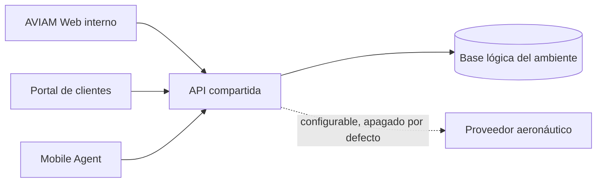

# Mapa de producto

ELEVANT se documenta en el repositorio como la plataforma de AVIAM para planificar y controlar asistencia en tierra. Tres clientes especializados comparten una API y una base lógica por ambiente. Esa descripción fija el límite del producto; no prueba todavía adopción, resultados de negocio ni una historia fundacional.

> [!IMPORTANT]
> Posterior al commit verificado de esta nota (código de `39a85a46`): la API publica los casos de uso de las cuatro fases del ciclo y los tres clientes los consumen; el [Mapa de capacidades](mapa-de-capacidades.md) dice qué está entregado, simulado, configurable o diferido. Aun así, una pantalla o una tabla no equivale por sí sola a una capacidad operativa completa ni a un despliegue.

## Cómo leer este mapa

| Señal | Qué permite afirmar | Qué no permite afirmar |
| --- | --- | --- |
| **Implementado** | Existe código, contrato o migración verificable | Que esté desplegado o adoptado por usuarios |
| **Prototipo ejecutable** | Existe un flujo navegable y vocabulario de producto | Que exista autorización, persistencia o contrato API real |
| **Planeado/diferido** | Hay una intención o límite documentado | Que tenga fecha, prioridad aprobada o implementación |
| **Desconocido** | Falta evidencia suficiente | No debe completarse por inferencia |

## Recorridos de lectura

### Para entender el producto

1. [Visión y problema](vision-y-problema.md)
2. [Actores y audiencias](actores-y-audiencias.md)
3. [Fronteras de los clientes](fronteras-de-clientes.md)

### Para convertir una necesidad en trabajo

1. [Recorridos de extremo a extremo](recorridos-end-to-end.md)
2. [Mapa de capacidades](mapa-de-capacidades.md)
3. [Alcance y no objetivos](alcance-y-no-objetivos.md)
4. [Preguntas abiertas](preguntas-abiertas.md)

## Regla de trazabilidad

Toda iniciativa funcional debería poder responder, antes de diseñar un endpoint:

1. qué actor obtiene qué resultado;
2. qué cliente presenta el flujo;
3. qué autorización y scope impone la API;
4. qué contrato OpenAPI lo representa;
5. qué reglas y datos canónicos lo sostienen;
6. qué estados offline, vacíos y de error deben observarse;
7. qué evidencia demuestra que funciona de extremo a extremo.

La ausencia de cualquiera de esas capas se registra como brecha, no se rellena con datos de mocks.

## Fuentes

- [README del monorepo](../../README.md): propósito, componentes y frontera compartida.
- [Guía raíz de agentes](../../AGENTS.md): fuentes de verdad y límites por cliente.
- [Private Web](../../frontend/private-web/README.md), [Public Web](../../frontend/public-web/README.md) y [Mobile Agent](../../frontend/mobile-agent/README.md): audiencias, flujos observados y estado de sus prototipos.
- [Backend](../../backend/README.md): alcance real del API en el commit verificado.
