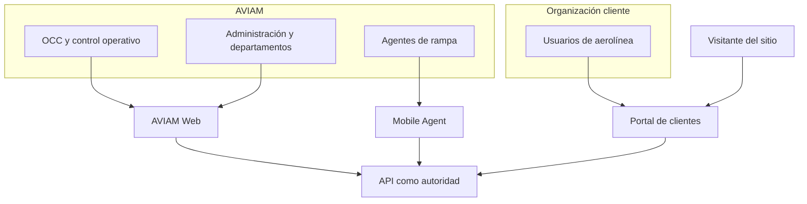

# Actores y audiencias

Esta página inventaría audiencias observables en las fuentes. No constituye investigación de usuarios ni un catálogo final de roles de autorización.

## Mapa de contexto humano

## Audiencias respaldadas por el repositorio

| Audiencia | Resultado que el prototipo representa | Cliente | Nivel de certeza |
| --- | --- | --- | --- |
| OCC/control operativo | planificar, monitorear, revisar y aprobar/devolver operaciones | AVIAM Web | Audiencia explícita; detalle de permisos aún no implementado en API |
| Administración y departamentos internos | trabajar con contratos, finanzas, gestión humana, reportes y operaciones según su función | AVIAM Web | Familias funcionales observadas; nombres exactos de roles son vocabulario de prototipo |
| Agente de rampa | consultar asignaciones, iniciar/cerrar atención, completar checklist/hitos, reportar incidencias y sincronizar | Mobile Agent | Audiencia y recorrido explícitos; autenticación e integración .NET pendientes |
| Usuario de aerolínea/cliente | consultar información limitada a su organización/estaciones y realizar escrituras expresamente autorizadas | Public Web | Frontera tenant explícita; sesión y mayoría de datos actuales son mock |
| Visitante | conocer la propuesta pública e intentar solicitar una demostración | Public Web | Landing ejecutable; formulario en modo preview sin transmisión backend |

## Actores del sistema que no son personas usuarias

| Actor | Responsabilidad | Estado |
| --- | --- | --- |
| API ELEVANT | autenticar, autorizar, aplicar scope, reglas y contratos | Scaffold técnico; autenticación y endpoints de negocio no implementados |
| SQL Server | persistir estado canónico de ELEVANT | Esquema v1 modelado; nunca es interfaz de cliente |
| Proveedor de información de vuelos | aportar información externa mediante un adaptador | Integración futura, no capacidad activa |
| Dispositivo móvil registrado | acotar identidad de dispositivo y reintentos idempotentes | Modelo persistente presente; flujo API pendiente |

## Identidades que no deben confundirse

El modelo canónico separa:

- **persona:** identidad humana;
- **cuenta:** credenciales y acceso;
- **membresía de organización:** relación con un tenant;
- **perfil de agente de rampa:** vínculo laboral/operativo;
- **scope de estación/terminal:** límite contextual de acceso.

Un nombre, correo, etiqueta de UI o ID enviado por el navegador no reemplaza esas relaciones. El portal no elige un tenant confiable y el móvil no amplía su agente o estación enviando otro identificador.

## Lo que los roles del prototipo sí y no prueban

Los menús y fixtures permiten descubrir tareas, lenguaje y posibles separaciones de responsabilidad. No prueban:

- una matriz RBAC aprobada;
- segregación de funciones reglamentaria;
- que todos los departamentos necesiten todos los módulos visibles;
- jerarquías, turnos de aprobación o delegaciones;
- personas, volúmenes o condiciones reales de trabajo.

La autorización final debe expresarse en casos de uso y pruebas de API, no en rutas ocultas o almacenamiento del navegador.

## Investigación pendiente por audiencia

| Audiencia | Pregunta mínima antes de cerrar su MVP |
| --- | --- |
| OCC | ¿Qué eventos requieren acción inmediata y qué evidencia permite aprobar/devolver una operación? |
| Departamentos internos | ¿Qué tareas y datos son propios, compartidos o incompatibles entre funciones? |
| Agente de rampa | ¿Qué pasos deben funcionar sin red y cómo se resuelven conflictos al reconectar? |
| Aerolínea/cliente | ¿Qué información, latencia y capacidad de respuesta son contractualmente necesarias? |
| Visitante | ¿Qué objetivo tiene la landing y cuál es el tratamiento autorizado de una solicitud comercial? |

## Fuentes

- [README del monorepo](../../README.md): audiencias principales.
- [Private Web](../../frontend/private-web/README.md), [Public Web](../../frontend/public-web/README.md) y [Mobile Agent](../../frontend/mobile-agent/README.md): módulos y recorridos observados.
- [Base de datos v1](../../docs/architecture/database-v1.md) y [esquema v1](../../docs/database/schema-v1.md): separación de persona, cuenta, membresía, agente y scopes.
- [Límite de FlightAware](../../backend/Elevant.Infrastructure/Integrations/FlightAware/README.md): estado futuro del proveedor de información de vuelos.

Relacionados: [Fronteras de los clientes](fronteras-de-clientes.md), [Preguntas abiertas](preguntas-abiertas.md) y [Mapa de producto](README.md).
