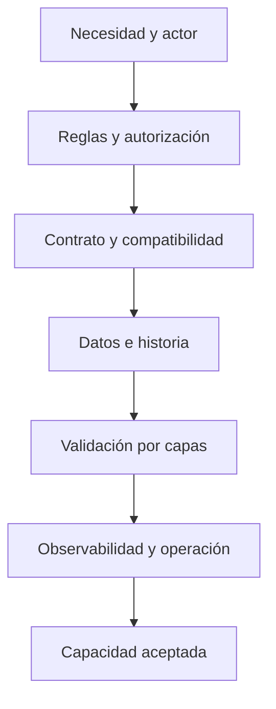

# Alcance, estados y no objetivos

## Corte verificable del repositorio

| Horizonte | Incluye | No implica |
| --- | --- | --- |
| Implementado | monorepo; tres clientes ejecutables; backend modular; health/ping/Swagger; esquema y migraciones v1; tooling y entrega de Development | negocio E2E, autenticación, adopción o Production |
| Prototipado | planificación/monitoreo/revisión interna; portal de aerolínea; ejecución móvil/offline; reportes, finanzas, chat y documentos como experiencias | contrato API, persistencia, permisos o datos reales |
| Siguiente capa necesaria | resultados priorizados, reglas, vertical slices, OpenAPI, integración de cliente y pruebas de aislamiento | fecha o prioridad ya aprobada |
| Diferido explícito | facturación documental/conciliación, chat/notificaciones, archivos/evidencias binarias y proyecciones analíticas materializadas | descarte definitivo |
| Futuro separado | Production, tiendas móviles e integración real de información de vuelos | que Development pueda promoverse sin un plan propio |

## No objetivos arquitectónicos y de producto

### No duplicar la autoridad

- No crear un backend o una base por cliente.
- No permitir que web o móvil se conecten directamente a SQL Server o a proveedores externos.
- No usar estado del navegador o del dispositivo como autoridad canónica.

### No convertir prototipos en contratos por accidente

- Un objeto mock, etiqueta de estado o nombre de rol no define por sí solo un DTO, enum o permiso.
- Un menú visible/oculto no implementa autorización.
- Un array embebido en una pantalla no obliga a persistir esa forma.
- Datos de prototipo, browser storage y fixtures son desechables y no se promueven como datos reales.

### No confundir infraestructura con capacidad

- Un healthcheck saludable no demuestra que un usuario pueda completar un recorrido.
- Una migración o entidad no demuestra que existan reglas, API y UX integradas.
- Un pipeline o imagen certificada demuestra reproducibilidad técnica, no aceptación funcional.
- Un hub SignalR reservado no define eventos de negocio.

### No adelantar lo diferido

- No almacenar fotos, PDF u otros binarios en SQL ni improvisar uploads sin object storage y retención.
- No persistir facturas, conciliaciones, chat o notificaciones tomando sus mocks como especificación.
- No activar tráfico real hacia un proveedor aeronáutico sin contrato, límites, resiliencia y manejo de secretos.

### No tratar Development como Production

- Public Web describe una audiencia; el preview de Development sigue siendo privado.
- Production requiere infraestructura, identidad, datos, privacidad, backups, observabilidad y distribución propios.
- Una APK de pruebas conectada a Development no es una aplicación de tienda ni debe compartir endpoint, firma o secretos con Production.

## Fuera de evidencia

Las fuentes revisadas no permiten afirmar:

- fecha, motivación personal o relato de creación de ELEVANT;
- tamaño de mercado, pricing o modelo comercial;
- acuerdos, SLAs o obligaciones contractuales con clientes;
- métricas objetivo o beneficios ya medidos;
- volumen real de usuarios, estaciones, vuelos o transacciones;
- prioridad final de módulos o fecha de lanzamiento;
- reemplazo total de herramientas/procesos existentes.

Esos datos requieren investigación o una decisión explícita y deben incorporarse con su evidencia, no como narrativa retrospectiva.

## Gate para ampliar alcance

Si el cambio requiere otra base, acceso directo desde un cliente, datos reales en Development o una capacidad marcada como diferida, se necesita una decisión de arquitectura/producto específica antes de implementar.

## Fuentes

- [README del monorepo](../../README.md) y [guía raíz](../../AGENTS.md): límites generales y fuentes de verdad.
- [Private Web](../../frontend/private-web/README.md), [Public Web](../../frontend/public-web/README.md) y [Mobile Agent](../../frontend/mobile-agent/README.md): estado y límites de cada cliente.
- [Backend](../../backend/README.md): API funcional disponible.
- [Base de datos v1](../../docs/architecture/database-v1.md): capacidades persistidas y diferidas.
- [Tiempo real](../../docs/architecture/realtime.md): hubs reservados y ausencia de contratos de eventos.
- [Ambientes](../../docs/deployment/environments.md): separación Development/Production y distribución móvil.

Relacionados: [Visión y problema](vision-y-problema.md), [Mapa de capacidades](mapa-de-capacidades.md), [Preguntas abiertas](preguntas-abiertas.md) y [Mapa de producto](README.md).
