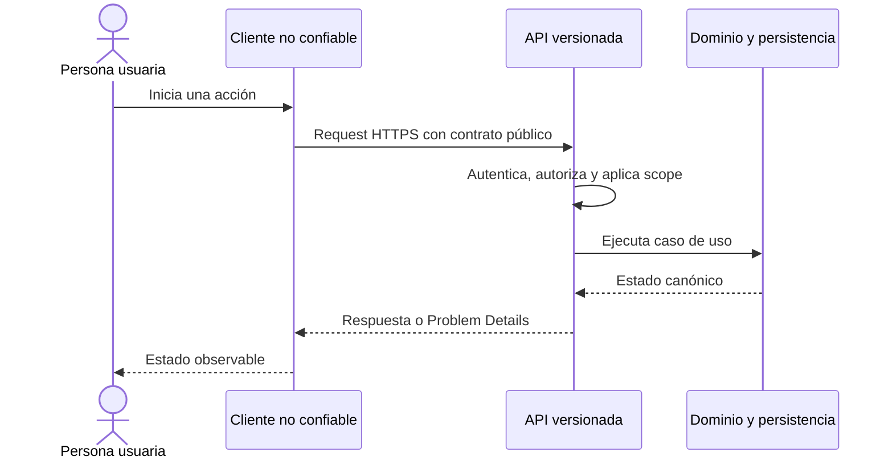

# Fronteras de los clientes

ELEVANT tiene tres clientes, pero no tres backends ni tres bases. Cada interfaz optimiza un contexto de trabajo y se mantiene fuera de la autoridad de datos.

## Responsabilidad por cliente

| Cliente | Audiencia y contexto | Puede responsabilizarse de | No puede ser autoridad de |
| --- | --- | --- | --- |
| AVIAM Web interno | OCC, administración y departamentos en navegador | interacción interna, composición de vistas, estados de carga/error, solicitud de comandos autorizados | identidad, permisos, tenant, reglas, SQL o proveedor externo |
| Public Web | visitantes y usuarios de aerolínea/cliente | landing y portal con vistas tenant-scoped; solicitudes/respuestas solo cuando el API las autorice | elegir tenant, editar historia operativa/tarifas/auditoría o persistir seguridad en el navegador |
| Mobile Agent | agentes de rampa en tablet nativa | interacción de campo, caché, outbox, reintentos y captura local controlada | estado canónico, ampliar agent/station scope, credenciales de infraestructura o confirmar éxito solo localmente |

## La frontera común

La secuencia es el diseño requerido. En el commit verificado, autenticación, autorización y casos de uso de negocio todavía no existen en el API; no debe leerse como un flujo ya operativo.

## Contratos y fuentes de verdad

1. Una necesidad comienza por resultado de usuario y reglas.
2. Un endpoint existente queda definido por OpenAPI, no por un tipo de pantalla.
3. El cliente generado adapta ese contrato para los tres consumidores.
4. El dominio aplica invariantes y la persistencia conserva historia.
5. REST confirma el estado canónico; un evento SignalR futuro solo avisa que conviene refrescar.

Los modelos EF no salen por la API y los fixtures no entran como contratos de persistencia.

## Aislamiento requerido

- **Public Web:** organización obtenida desde membresía autenticada y estación validada; el navegador no selecciona el tenant confiable.
- **AVIAM Web:** rol y scope de estación se validan en servidor; un menú oculto no autoriza.
- **Mobile Agent:** cuenta, perfil, estación y dispositivo se derivan/validan en servidor; cada escritura offline necesita idempotencia.
- **Todos:** sin conexión directa a SQL Server, FlightAware ni almacenamiento de objetos.

## Estado real de integración al commit verificado

| Capa | Estado demostrable |
| --- | --- |
| Private Web | Preview técnico con adaptadores heredados; las llamadas de negocio a la API real deben fallar de forma controlada |
| Public Web | Landing/portal demostrativos; sesión, autorización y mayoría de datos son mock/locales |
| Mobile Agent | Prototipo nativo; aún no consume contratos de negocio de la API .NET |
| API/OpenAPI | Health, readiness, Swagger y `system/ping`; sin autenticación ni endpoints de negocio |
| Persistencia | Modelo v1 amplio y compartido; una tabla no implica un caso de uso entregado |

Esta tabla describe evidencia del repositorio, no certifica qué artefactos están ejecutándose en un host.

## Regla para cambios coordinados

Una capacidad que toca varios clientes se entrega de manera compatible: migración aditiva si aplica, API, snapshot OpenAPI/cliente generado y luego consumidores independientes. Ningún cliente debe depender de un endpoint aún no publicado ni de una estructura interna de EF.

## Fuentes

- [Guía raíz](../../AGENTS.md): límites obligatorios del monorepo.
- [Private Web](../../frontend/private-web/README.md), [Public Web](../../frontend/public-web/README.md) y [Mobile Agent](../../frontend/mobile-agent/README.md): fronteras propias y madurez actual.
- [Backend](../../backend/README.md): superficie HTTP real.
- [Fronteras de integración](../../docs/architecture/integration-boundaries.md) y [contrato OpenAPI](../../docs/api/openapi-contract.md): autoridad y compatibilidad.

Relacionados: [Actores y audiencias](actores-y-audiencias.md), [Mapa de capacidades](mapa-de-capacidades.md) y [Mapa de producto](README.md).
