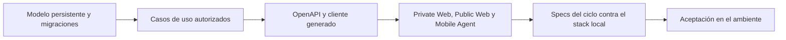

# Mapa de capacidades

Este inventario responde «¿qué existe hoy y hasta dónde llega?» para el código
del commit verificado. Cada fila nombra el controlador y una o más operaciones
(`operationId`) del [snapshot OpenAPI](../../packages/api-client/openapi/elevant-v1.json),
que en ese commit publica 404 operaciones en 352 rutas. Ninguna fila acredita
merge en otra rama, promoción ni despliegue en el VPS: eso solo lo respalda un
registro `operator-recorded`.

## Escala

| Estado | Qué exige |
| --- | --- |
| **Entregada** | Contrato OpenAPI, caso de uso autorizado en el servidor, cliente integrado y pruebas en el repositorio. |
| **Entregada con simulación** | Lo mismo, pero el efecto externo se simula y cada documento lo dice: «Simulación — sin validez fiscal». |
| **Parcial** | Hay API y cliente, pero falta una parte del recorrido, que la fila nombra. |
| **Configurable o solo Development** | El código existe, está apagado por defecto y una configuración explícita lo enciende. |
| **Diferido** | Excluido de forma deliberada; no hay implementación. |
| **Futuro** | Frontera reservada sin comportamiento. |

## Capacidades centrales

| Capacidad | Clientes | API de negocio | Estado | Lectura correcta |
| --- | --- | --- | --- | --- |
| Identidad, sesión y acceso por departamento | Las tres apps | `AuthenticationController` · `CreateSession`, `VerifyLoginCode`, `RefreshSession`; `DepartmentGovernanceController` · `GetMyDepartmentAccess` | Entregada | JWT de 15 minutos con refresh rotativo ([ADR-0021](../../docs/adr/0021-rotating-refresh-tokens.md)); el portal confirma el inicio con un código por correo ([ADR-0022](../../docs/adr/0022-portal-email-verification.md)); el servidor resuelve membresía, estaciones y permisos ([ADR-0015](../../docs/adr/0015-department-user-governance.md), [ADR-0019](../../docs/adr/0019-menu-option-permissions-and-department-notifications.md)). |
| Gobernanza de usuarios y aerolíneas | Private Web | `DepartmentGovernanceController` · `CreateDepartmentUser`, `CreateAccessProfile`; `CommercialAirlineManagementController` · `CreateManagedAirline` | Entregada | Altas, perfiles por plantilla, validación de altas y aerolíneas gestionadas; los permisos viven en el catálogo del servidor. |
| Catálogos y datos maestros | Private Web, Public Web | `CommercialCatalogManagementController` · `CreateCommercialService`; `OccMasterDataController` · `CreateOccStand`; `StationCatalogController` · `CreateGovernanceStation`; `PublicCommercialCatalogController` · `GetPublicCommercialCatalog` | Entregada | El catálogo público solo muestra servicios publicados; un cambio se anuncia por el hub público. |
| Personal, turnos y habilitaciones | Private Web, Mobile Agent | `HumanResourcesEmployeesController` · `CreateEmployee`; `HumanResourcesShiftsController` · `RecordHumanResourcesShift`; `HumanResourcesQualificationsController` · `RecordHumanResourcesQualification`; `WorkforceReadinessController` · `ListRampAgentReadiness` | Entregada | Elegibilidad del agente calculada en el servidor ([ADR-0017](../../docs/adr/0017-employees-positions-and-access.md), [ADR-0020](../../docs/adr/0020-position-checked-identity-documents.md), [ADR-0026](../../docs/adr/0026-ramp-staff-readiness-and-hr-shifts.md)). El tablero de Gestión Humana conserva un modo demo de solo lectura. |
| Solicitudes comerciales y alta de aerolíneas | Public Web, Private Web | `PublicCommercialRequestsController` · `SubmitCommercialRequest`; `CommercialRequestsManagementController` · `DecideCommercialRequest`; `CommercialProvisioningController` · `ProvisionCommercialAirline` | Entregada | Fase 1 del ciclo ([ADR-0037](../../docs/adr/0037-commercial-cycle-requests-drafts-amendments-and-portal-accounts.md)). |
| Contratos versionados, permisos y tarifas | Private Web, Public Web | `ContractDraftsController` · `ActivateManagedContractDraft`; `ContractDocumentsController` · `SignContractVersion`; `ContractLifecycleController` · `ApplyContractLifecycle`, `ReviewAirlinePermit`; `FinanceTariffBookController` · `DecideFinanceContractApproval` | Entregada | Vigencia, firmas dibujadas, permisos de operación y aprobación de precios por Finanzas ([ADR-0024](../../docs/adr/0024-airline-permits-and-contract-lifecycle.md), [ADR-0025](../../docs/adr/0025-contract-validity-and-drawn-signatures.md), [ADR-0038](../../docs/adr/0038-preoperation-contract-lifecycle-permits-master-data-and-workforce-readiness.md)). |
| Turnaround y vuelos | Private Web | `OccTurnaroundsController` · `RescheduleOccTurnaround`; `OccFlightFeedController` · `ImportOccFlight`, `RefreshOccFlightFeed`; `OccTrafficController` · `GetOccAircraftTraffic` | Entregada; el feed externo es configurable | El feed AeroDataBox está apagado sin `AeroDataBox:Enabled` y clave; el feed simulado solo arranca en Development o Test ([ADR-0028](../../docs/adr/0028-aerodatabox-flight-feed-with-unit-budget.md)). El tráfico OpenSky también está apagado por defecto. |
| Vuelos demo | Private Web | `DemoFlightsController` · `GetDemoFlightOptions`, `ListDemoFlights`, `CreateDemoFlight`, `CancelDemoFlight` | Configurable o solo Development | Superadministración dispara dos propuestas del proveedor «Demo» que OCC importa y opera como un vuelo real, sin gastar unidades de AeroDataBox. `DemoFlights:Mode` es `Disabled` por defecto y `Enabled` en `appsettings.Development.json`; fuera de Development, Test o Testing la API no arranca con él. *Posterior al commit verificado:* la decisión está en el [ADR-0041](../../docs/adr/0041-demo-flights-and-punta-cana-stands.md). |
| Planificación y cobertura | Private Web, Mobile Agent | `OccPlanningController` · `AssignOccPlanningOperation`; `OccPositionsController` · `AssignOccStand`; `OccCoverageController` · `CreateOccCoverage`; `OccAssignmentReadinessController` · `GetOccAssignmentReadiness` | Entregada | Posiciones combinadas, cobertura por turno y relevos ([ADR-0027](../../docs/adr/0027-occ-ready-contracts-and-stand-locations.md), [ADR-0030](../../docs/adr/0030-position-coverage-per-shift-and-combined-stands.md), [ADR-0039](../../docs/adr/0039-operation-planning-coverage-offline-tablet-occ-review-and-reports.md)). |
| Ejecución en rampa | Mobile Agent | `RampOperationsController` · `StartRampOperation`; `RampExecutionController` · `RecordRampMilestone`; `RampOperationServicesController` · `TransitionRampOperationService`; `RampServiceChargesController` · `ApplyRampServiceCharge` | Entregada | Captura del reporte de vuelo en la tableta ([ADR-0031](../../docs/adr/0031-flight-report-capture-on-the-tablet.md)). |
| Checklists, formularios y firmas | Mobile Agent, Private Web | `RampOperationChecklistsController` · `SubmitRampOperationChecklist`; `RampDocumentsController` · `SignRampOperationDocument`, `RecordRampDamageMark` | Entregada | Orden de Servicio y walk-around con fotos en almacenamiento privado ([ADR-0032](../../docs/adr/0032-aviam-forms-signatures-and-walkaround.md)). |
| Incidencias | Mobile Agent, Private Web | `RampIncidentsController` · `ReportRampIncident`; `OccIncidentsController` · `ReportOccIncident`, `ChangeOccIncidentStatus` | Entregada | OCC sigue y gestiona las incidencias dentro de Revisión y Planificación. |
| Envío y revisión OCC | Mobile Agent, Private Web | `RampOperationSubmissionsController` · `SubmitRampOperation`; `OccReviewController` · `DecideOccReview`, `ReopenOccReview`; `RampOperationCorrectionsController` · `ReopenRampOperationCorrection` | Entregada | Cada entrega es un envío nuevo; la aprobación alimenta «Por facturar» ([ADR-0034](../../docs/adr/0034-operational-close-occ-to-finance.md)). |
| Tabletas, offline e idempotencia | Mobile Agent, Private Web | `MobileDevicesController` · `RegisterMobileDevice`, `ReleaseMobileDevice`; `OccMobileDevicesController` · `RevokeOccMobileDevice` | Entregada | La cola de la tableta reenvía con la misma `Idempotency-Key` por instalación; el almacenamiento local es solo caché. |
| Charters sin contrato | Mobile Agent, Private Web, Public Web | `RampChartersController` · `AddRampCharterService`; `FinanceChartersController` · `ConfirmFinanceCharterPrepayment`, `ReopenFinanceCharterPrepayment` | Entregada | Tarifa base con prepago; el portal ve su factura y su prepago ([ADR-0033](../../docs/adr/0033-charter-flights-without-contract.md), [ADR-0040](../../docs/adr/0040-billing-cycle-invoicing-from-operations-card-collections-credit-notes-and-payables.md)). |
| Facturación de operaciones aprobadas | Private Web, Public Web | `FinanceInvoicingController` · `GetFinancePendingOperations`, `CloseOperationsWithoutCharge`; `FinanceInvoiceIssuanceController` · `IssueInvoiceFromOperations`; `FinanceInvoiceLedgerController` · `ListFinanceInvoices` | Entregada con simulación | e-NCF `E31` e ITBIS 18 % fijos, sin transmisión a la DGII ([ADR-0035](../../docs/adr/0035-direct-invoicing-simulated-ecf.md), [ADR-0040](../../docs/adr/0040-billing-cycle-invoicing-from-operations-card-collections-credit-notes-and-payables.md)). Ver [Finanzas](../03-dominio/finanzas-tarifas-cargos-y-cobros.md). |
| Notas de crédito y débito, cobros y estados de cuenta | Private Web, Public Web | `FinanceTreasuryController` · `IssueFinanceTreasuryAdjustment`, `RecordFinanceTreasuryReceipt`, `ApplyFinanceTreasuryReceipt`, `GetFinanceTreasuryStatement` | Entregada con simulación | Las notas sobre una factura E31 reciben e-NCF `E34` (crédito) o `E33` (débito) ([ADR-0040](../../docs/adr/0040-billing-cycle-invoicing-from-operations-card-collections-credit-notes-and-payables.md)). |
| Cobro con tarjeta | Public Web, Private Web | `CardPaymentsController` · `PayAirlineInvoiceByCard`, `GetAirlineCardPaymentAvailability` | Entregada con simulación | Siempre por el saldo completo. `CardPayments:Mode` es `Disabled` por defecto y `Simulated` solo arranca en Development, Test o Testing ([ADR-0036](../../docs/adr/0036-simulated-card-payment.md), [ADR-0040](../../docs/adr/0040-billing-cycle-invoicing-from-operations-card-collections-credit-notes-and-payables.md)). |
| Cartera del portal | Public Web | `AirlineTreasuryController` · `GetAirlineTreasuryStatement`, `GetAirlineTreasuryInvoice`; `AirlineFinancialDocumentsController` · `GetAirlineInvoiceDocumentById` | Entregada | Facturas, estado de cuenta con saldo a favor y documentos, filtrados por la organización y sus estaciones. |
| Cuentas por pagar y gastos | Private Web | `SuppliersController` · `RetireFinanceSupplier`; `FinancePayablesController` · `DecideFinancePayable`; `FinancePayablesPaymentsController` · `ReverseFinancePayablePayment`; `EmployeeExpensesController` · `DecideEmployeeExpense` | Entregada | Correcciones, anulaciones, reversos y segregación de funciones de la fase 4 ([ADR-0040](../../docs/adr/0040-billing-cycle-invoicing-from-operations-card-collections-credit-notes-and-payables.md)). |
| Reportes | Private Web | `FinanceReportsController` · `GetFinanceReport`, `ExportFinanceReport`; `OccReportsController` · `GetOccReport`; `HumanResourcesReportsController` · `ExportHumanResourcesReport` | Entregada | Calculados en el servidor; los PDF de Finanzas llevan el marco de simulación. |
| Auditoría | Private Web | `GovernanceController` · `GetGovernanceAudit`; `DepartmentGovernanceController` · `ListDepartmentActivity`; `HumanResourcesEmployeesController` · `ListHumanResourcesAudit` | Parcial | Los comandos escriben su auditoría en la misma transacción, pero se consulta por área: Superadministración lee la de gobernanza, comercial y Gestión Humana; las acciones de Operaciones y Finanzas no tienen una consulta general. |

## Capacidades periféricas, diferidas y futuras

| Capacidad | Superficie en el código | Estado |
| --- | --- | --- |
| Chat y presencia | `OperationalChatController` (`SendOperationalMessage`), `OperationalPresenceController` ([ADR-0029](../../docs/adr/0029-ramp-realtime-alerts-and-chat-read-state.md)) | Entregada; la presencia vive en memoria y se pierde al reiniciar la API. |
| Notificaciones y correo | `OperationalNotificationsController`, `DepartmentNotificationsController` y el outbox de correo (`ListEmailOutbox`) | Entregada; el correo sale por SMTP configurado. |
| Tiempo real | Hubs `/hubs/operations`, `/hubs/notifications` y `/hubs/public-catalog`, más el feed por cursor (`GetAccountChanges`) | Configurable: el despachador `Realtime:AccountChangeDispatcherEnabled` está apagado por defecto y encendido en `appsettings.Development.json`. Sin él, los clientes reconcilian por sondeo. |
| Medios y documentos | `CommercialMediaController` (`UploadCommercialMedia`), `RampDocumentsController` (`AttachRampDamagePhoto`), `OccOperationDocumentsController` (`GetOccOperationDocumentPdf`) | Entregada sobre un bucket S3 privado ([medios](../04-arquitectura/medios-comerciales-privados.md)). |
| Información externa de vuelos | AeroDataBox, OpenSky y FlightAware ([integraciones](../04-arquitectura/integraciones-externas.md)) | AeroDataBox y OpenSky configurables; FlightAware sigue como frontera futura sin adaptador. |
| Conectividad fiscal real con la DGII | Sin proveedor, certificado ni secuencias autorizadas | Diferido; el e-CF actual es simulación. |
| Conciliación bancaria, tasas automáticas y libro mayor | Ninguna | Diferido. |
| Production | `database/ProductionDB` solo contiene `.gitkeep` | Futuro: necesita su propio plan. |

## Madurez por capa

El repositorio cubre las cinco primeras etapas para las cuatro fases del ciclo
(comercial, pre-operación, operación, y facturación y cobro). La última,
aceptación en un ambiente, no la acredita esta nota.

## Regla de actualización

Una fila cambia de estado solo cuando la evidencia reúne contrato OpenAPI,
implementación, pruebas e integración del cliente. Cada fila de «Capacidades
centrales» cita al menos un `operationId` que exista en el snapshot, y ninguna
celda de «API de negocio» vuelve a decir que la API falta: `npm run vault:check`
lo comprueba. Lo simulado se etiqueta como simulación y lo configurable dice
su valor por defecto.

## Fuentes

- [Snapshot OpenAPI](../../packages/api-client/openapi/elevant-v1.json) y [cliente compartido](../../packages/api-client/src/client.ts): las operaciones citadas.
- [AuthenticationController](../../backend/Elevant.Api/Controllers/AuthenticationController.cs), [FinanceInvoiceIssuanceController](../../backend/Elevant.Api/Controllers/FinanceInvoiceIssuanceController.cs), [CardPaymentsController](../../backend/Elevant.Api/Controllers/CardPaymentsController.cs) y los demás controladores del frontmatter.
- [Composición de Infrastructure](../../backend/Elevant.Infrastructure/DependencyInjection.cs) y [configuración por defecto](../../backend/Elevant.Api/appsettings.json): lo que arranca apagado.
- [Catálogo de permisos](../../backend/Elevant.Domain/Governance/DepartmentPermissionCatalog.cs) y [menú de Finanzas](../../frontend/private-web/src/features/finance/shell/modules.js).

Relacionados: [Recorridos de extremo a extremo](recorridos-end-to-end.md), [Alcance y no objetivos](alcance-y-no-objetivos.md), [Brechas del dominio](../03-dominio/brechas-y-preguntas-abiertas.md) y [Mapa de producto](README.md).
