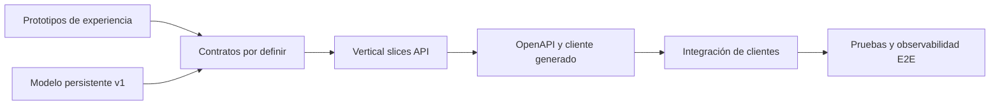

# Mapa de capacidades

Este inventario responde “¿qué existe en cada capa?” sin convertir cobertura parcial en una promesa funcional. El estado corresponde al commit verificado, no a un host vivo.

## Escala

| Estado | Interpretación |
| --- | --- |
| **Base** | Dominio/esquema ofrece conceptos persistentes |
| **Prototipo** | Uno o más clientes permiten explorar el flujo con mocks/adaptadores locales |
| **API mínima** | Solo infraestructura; no hay operación de negocio publicada |
| **Diferido** | El repositorio excluye explícitamente la capacidad de v1 |
| **Futuro** | Hay un límite o shell, pero no implementación funcional |

## Capacidades centrales

| Capacidad | Experiencia observable | Base canónica | API de negocio | Lectura correcta |
| --- | --- | --- | --- | --- |
| Identidad, tenant y scopes | Sesiones/roles mock en web y móvil | Cuentas, personas, membresías, permisos y scopes | Ausente | **Base + prototipo**, no seguridad E2E |
| Catálogos de aviación | Selectores y vistas internas | Aerolíneas, aeropuertos, estaciones, terminales, stands, aeronaves, servicios y equipos | Ausente | **Base + prototipo** |
| Personal, turnos y habilitaciones | Gestión humana y planificación interna | Agentes, scopes, turnos, disponibilidad, cobertura, permisos y habilitaciones | Ausente | **Base + prototipo**; estados derivados no son tablas |
| Solicitudes comerciales | Portal y gestión interna | Solicitudes, estaciones, ítems e historial comercial | Ausente | **Base + prototipo** |
| Contratos versionados y tarifas | Private Web y portal | Contratos, eventos, versiones, estaciones y tarifas | Ausente | **Base + prototipo** |
| Turnaround y vuelos | Monitoreo/planificación y vistas de cliente/móvil | Turnaround con tramos de llegada/salida e historial | Ausente | **Base + prototipo** |
| Planificación de recursos | Asignaciones de posición, agente y equipo | Relaciones temporales normalizadas | Ausente | **Base + prototipo**; reglas de conflicto pendientes |
| Ejecución de ground handling | Mobile Agent y control interno | Operación, servicios, estados, hitos y snapshots | Ausente | **Base + prototipo** |
| Checklists | Captura móvil y revisión interna | Template/versiones/ítems/instancia/respuestas | Ausente | **Base + prototipo** |
| Incidencias | Captura móvil y revisión interna | Incidencias ligadas a operación | Ausente | **Base + prototipo**; binarios no incluidos |
| Envío y revisión OCC | Cola/detalle de revisión interno | Submissions y decisiones; historial esperado, con append-only pendiente de enforcement | Ausente | **Base + prototipo** |
| Offline e idempotencia móvil | Cola/sincronización demostrativa | Dispositivo, binding de cuenta y recibos de comandos | Ausente | **Base + prototipo**; protocolo no entregado |
| Auditoría | Vistas/fixtures puntuales | Entradas y cambios con contexto | Ausente | **Base**, no auditoría E2E de casos aún inexistentes |

## Capacidades periféricas o diferidas

| Capacidad | Evidencia actual | Clasificación |
| --- | --- | --- |
| Reportes/KPIs | Pantallas y cálculos mock; KPIs definidos como read models, no tablas autoritativas | Prototipo; diseño de consultas/indicadores pendiente |
| Facturas, prefacturas y conciliación | Flujos de interfaz pública/privada | **Diferido** de persistencia v1 |
| Documentos y fotos | Selección/consulta demostrativa | **Diferido** hasta storage, retención y autorización |
| Chat y notificaciones | Pantallas mock y hubs reservados | **Diferido/futuro**; sin contrato de eventos |
| Tiempo real | Hubs técnicos reservados | **Futuro**; REST sigue siendo canónico |
| Información externa de vuelos | Puerto y configuración reservados | **Futuro**; sin adaptador, cliente HTTP ni tráfico real |
| Producción | Límite de directorio y decisiones preparatorias | **Futuro**; no es alcance del ambiente Development |

## Visualización de madurez por capa

El repositorio aporta los dos orígenes del diagrama —experiencias prototipadas y base persistente— y una API técnica certificable. La brecha funcional observable es convertir resultados de usuario en vertical slices autorizados y contratos públicos.

## Regla de actualización

Al entregar una capacidad, actualiza su fila solo si la evidencia incluye el contrato OpenAPI, implementación, pruebas relevantes e integración del cliente. Un nuevo componente visual o una nueva tabla por sí solos no cambian “API ausente” ni demuestran E2E.

## Fuentes

- [Private Web](../../frontend/private-web/README.md), [Public Web](../../frontend/public-web/README.md) y [Mobile Agent](../../frontend/mobile-agent/README.md): superficie de prototipos.
- [Módulos internos](../../frontend/private-web/src/features/shell/modules.js), [repositorio mock del portal](../../frontend/public-web/src/lib/portal/repository.ts), [inicio móvil](../../frontend/mobile-agent/src/app/home.tsx) y [outbox móvil](../../frontend/mobile-agent/src/storage/prototype-storage.ts): cobertura ejecutable sin convertirla en contrato servidor.
- [Backend](../../backend/README.md) y [OpenAPI versionado](../../packages/api-client/openapi/elevant-v1.json): superficie HTTP real.
- [Base de datos v1](../../docs/architecture/database-v1.md) y [esquema v1](../../docs/database/schema-v1.md): cobertura persistente y diferidos.
- [Tiempo real](../../docs/architecture/realtime.md) e [integración de vuelos](../../backend/Elevant.Infrastructure/Integrations/FlightAware/README.md): shells futuros y sus límites.

Relacionados: [Recorridos de extremo a extremo](recorridos-end-to-end.md), [Alcance y no objetivos](alcance-y-no-objetivos.md) y [Mapa de producto](README.md).
