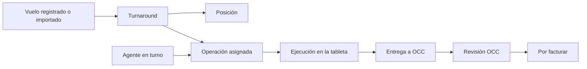
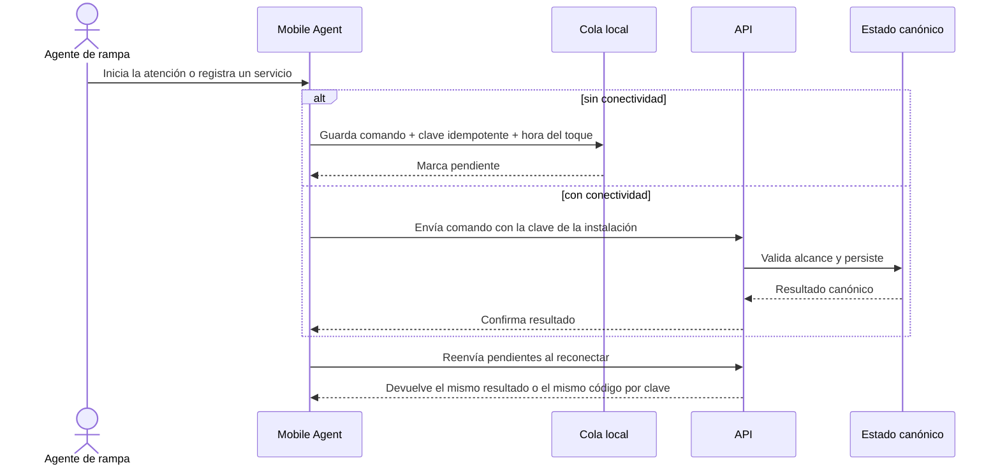

# Recorridos de extremo a extremo

Los recorridos siguen el ciclo operativo de AVIAM en sus cuatro fases:
comercial, pre-operación, operación, y facturación y cobro. Cada paso nombra
las operaciones del [snapshot OpenAPI](../../packages/api-client/openapi/elevant-v1.json)
que lo sirven y el spec del ciclo que lo recorre. Esta nota describe el código
del commit verificado; no acredita la última corrida de esos specs ni un
despliegue.

## Leyenda de cobertura

- **P:** experiencia observable en un cliente que consume la API.
- **D:** concepto respaldado por el dominio y el esquema.
- **A:** operación de negocio publicada en OpenAPI y autorizada en el servidor.
- **E2E:** paso cubierto por un spec de
  [`tests/e2e-cycle`](../../frontend/public-web/playwright.cycle.config.ts), que
  corre contra el stack local completo y no en CI.
- **?:** regla o decisión que sigue abierta.

En el commit verificado, los pasos de las cuatro fases tienen **P + D + A**.

## Fase 1 — solicitar y contratar servicios

**Actores:** visitante o aerolínea, Contratos, Superadministración y Finanzas
([ADR-0037](../../docs/adr/0037-commercial-cycle-requests-drafts-amendments-and-portal-accounts.md)).

| Paso | Operaciones | Cobertura |
| --- | --- | --- |
| Finanzas publica la tarifa base | `PublishFinanceServiceTariff` | P + D + A + E2E |
| La aerolínea pide servicios desde el sitio público | `SubmitCommercialRequest` | P + D + A + E2E |
| Contratos verifica la aerolínea y decide | `VerifyCommercialRequestAirline`, `DecideCommercialRequest` | P + D + A + E2E |
| Superadministración da de alta la aerolínea y su cuenta del portal | `ProvisionCommercialAirline`, `ActivatePortalAccount` | P + D + A + E2E |
| Borrador comentado, completado y enviado | `CommentAirlineContractDraft`, `UpdateManagedContractDraft` | P + D + A + E2E |
| Finanzas aprueba los precios | `DecideFinanceContractApproval` | P + D + A + E2E |

Spec: [fase 1](../../frontend/public-web/tests/e2e-cycle/fase1-comercial.spec.ts).
Abierto (**?**): el paso «contract» que volverá obligatoria la clave de
idempotencia que estos comandos aceptan opcional.

## Fase 2 — dejar lista la operación

**Actores:** Contratos, la aerolínea, Gestión Humana y OCC
([ADR-0038](../../docs/adr/0038-preoperation-contract-lifecycle-permits-master-data-and-workforce-readiness.md)).

| Paso | Operaciones | Cobertura |
| --- | --- | --- |
| Vigencia y renovación del contrato | `SetContractValidity` | P + D + A + E2E |
| Firma dibujada de la aerolínea y contrafirma de AVIAM | `SignContractVersion` | P + D + A + E2E |
| Permiso de operación enviado y verificado | `SubmitAirlinePermit`, `ReviewAirlinePermit` | P + D + A + E2E |
| Gestión Humana confirma al agente y programa su turno | `ListRampAgentReadiness`, `RecordHumanResourcesShift` | P + D + A + E2E |
| OCC ve el contrato listo, las posiciones y el feed | `ListOccReadyContracts`, `GetOccPositions`, `GetOccFlightFeed` | P + D + A + E2E |

Spec: [fase 2](../../frontend/public-web/tests/e2e-cycle/fase2-preoperacion.spec.ts),
que lee el feed sin llamar al proveedor de pago.

## Fase 3 — la operación

**Actores:** OCC, el agente de rampa y el representante de la aerolínea
([ADR-0039](../../docs/adr/0039-operation-planning-coverage-offline-tablet-occ-review-and-reports.md)).

| Paso | Operaciones | Cobertura |
| --- | --- | --- |
| OCC registra el vuelo y lo asigna dentro del turno del agente | `CreateManualTurnaround`, `AssignOccPlanningOperation` | P + D + A + E2E |
| Posición, llegada y relevo | `AssignOccStand`, `RecordOccArrival`, `HandOverOccOperation` | P + D + A + E2E |
| El agente inicia, registra hitos, servicios y checklist | `StartRampOperation`, `RecordRampMilestone`, `TransitionRampOperationService`, `SubmitRampOperationChecklist` | P + D + A + E2E |
| Firmas de la Orden de Servicio y formularios AVIAM | `SignRampOperationDocument` | P + D + A + E2E |
| Entrega, revisión y reapertura | `SubmitRampOperation`, `DecideOccReview`, `ReopenOccReview` | P + D + A + E2E |
| La aerolínea ve la operación aprobada | `GetAirlineOperation`, `GetAirlineServiceOrder` | P + D + A + E2E |

Con red intermitente, la tableta guarda cada comando con su clave y lo reenvía
al reconectar:

Spec: [fase 3](../../frontend/public-web/tests/e2e-cycle/fase3-operacion.spec.ts),
incluida la cola sin conexión. Abierto (**?**): el servidor no exige las firmas
al entregar y la asignación de equipos no tiene comando.

## Fase 4 — facturar y cobrar

**Actores:** Finanzas y la aerolínea
([ADR-0035](../../docs/adr/0035-direct-invoicing-simulated-ecf.md),
[ADR-0036](../../docs/adr/0036-simulated-card-payment.md) y
[ADR-0040](../../docs/adr/0040-billing-cycle-invoicing-from-operations-card-collections-credit-notes-and-payables.md)).

| Paso | Operaciones | Cobertura |
| --- | --- | --- |
| «Por facturar» lista lo aprobado por OCC | `GetFinancePendingOperations` | P + D + A + E2E |
| Emisión del e-CF simulado | `IssueInvoiceFromOperations` | P + D + A + E2E |
| Cierre sin cargo de un total 0, con motivo | `CloseOperationsWithoutCharge` | P + D + A; ningún spec del ciclo lo recorre |
| La aerolínea paga con tarjeta el saldo completo | `PayAirlineInvoiceByCard`, `GetAirlineCardPaymentReceipt` | P + D + A + E2E |
| Nota de crédito E34 y estado de cuenta con saldo a favor | `IssueFinanceTreasuryAdjustment`, `GetAirlineTreasuryStatement` | P + D + A + E2E |
| Charter: factura saldada con el prepago | `ConfirmFinanceCharterPrepayment` | P + D + A; el spec la omite cuando la corrida no deja un charter facturado |
| Cuentas por pagar y gastos | `DecideFinancePayable`, `ReverseFinancePayablePayment`, `DecideEmployeeExpense` | P + D + A + E2E |

Spec: [fase 4](../../frontend/public-web/tests/e2e-cycle/fase4-facturacion.spec.ts).
El e-CF y la pasarela son simulación: «Simulación — sin validez fiscal».
Abierto (**?**): conectividad fiscal real, pasarela real, conciliación bancaria
y el paso «contract» que volverá obligatorio `operationVersions` en la emisión.

## Consultar como cliente

**Actor:** usuario de aerolínea autenticado. El portal ve su arranque,
operaciones, solicitudes, contratos, facturas y estado de cuenta
(`GetAirlinePortalBootstrap`, `GetAirlineOperations`, `GetAirlineContracts`,
`GetAirlineTreasuryStatement`). El servidor resuelve la organización y las
estaciones de cada lectura desde las membresías vigentes; el navegador no elige
el tenant.

## Criterio para declarar un recorrido completo

Un recorrido pasa de mapa a capacidad aceptada cuando existen, como mínimo:

- actor, resultado y reglas de autorización aprobados;
- estados de carga, vacío, sin conexión, error recuperable y sin permiso;
- contrato OpenAPI versionado y cliente generado;
- reglas de dominio y persistencia, con migración compatible si corresponde;
- pruebas de aislamiento, idempotencia y concurrencia, y de la experiencia del cliente;
- evidencia de despliegue y observabilidad en el ambiente objetivo, que esta nota no acredita.

## Fuentes

- [Snapshot OpenAPI](../../packages/api-client/openapi/elevant-v1.json): las operaciones de cada paso.
- [Configuración del ciclo](../../frontend/public-web/playwright.cycle.config.ts) y sus cuatro specs: el recorrido ejecutable contra el stack local.
- Controladores del frontmatter, como [emisión](../../backend/Elevant.Api/Controllers/FinanceInvoiceIssuanceController.cs) y [cobro con tarjeta](../../backend/Elevant.Api/Controllers/CardPaymentsController.cs).

Relacionados: [Mapa de capacidades](mapa-de-capacidades.md), [Alcance y no objetivos](alcance-y-no-objetivos.md) y [Mapa de producto](README.md).
