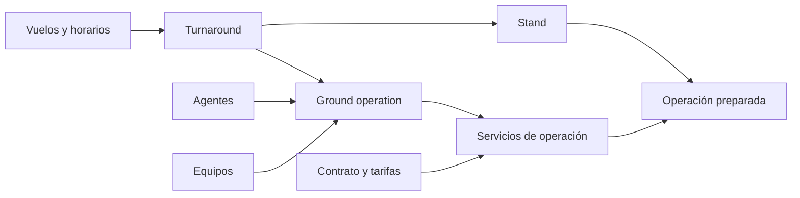
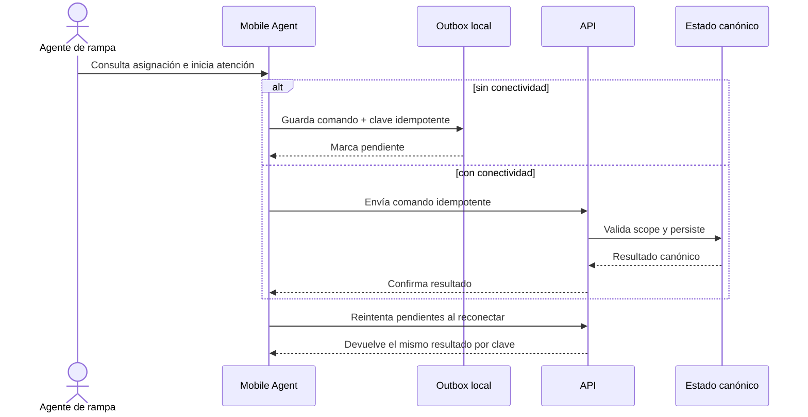

# Recorridos de extremo a extremo

Los recorridos siguientes conectan vocabulario de los prototipos con conceptos persistentes. Son un mapa para diseñar capacidades; **ninguno es un recorrido de negocio completo en la API del commit verificado**.

## Leyenda de cobertura

- **P:** experiencia observable en un prototipo ejecutable.
- **D:** concepto respaldado por dominio/esquema v1.
- **A:** endpoint de negocio publicado en OpenAPI.
- **?** regla o decisión que todavía requiere definición.

En este corte existen combinaciones **P + D**, pero no **A** para negocio.

## Recorrido 1 — preparar una escala

**Actor primario:** OCC/control operativo.

**Resultado intentado:** convertir información de vuelo y demanda de servicio en una operación preparada con recursos y ubicación.

| Paso | Cobertura | Brecha principal |
| --- | --- | --- |
| Consultar/monitorear vuelo | P + D | Fuente externa y endpoint canónico pendientes |
| Crear o actualizar turnaround/operación | P + D | Caso de uso, transición y concurrencia pendientes |
| Asignar stand, agentes y equipos | P + D | Elegibilidad, conflictos y permisos pendientes |
| Verificar cobertura/habilitaciones | P + D | Reglas calculadas y criterios de excepción pendientes |

## Recorrido 2 — ejecutar trabajo en rampa con red intermitente

**Actor primario:** agente de rampa.

**Resultado intentado:** registrar ejecución y evidencia estructurada sin perder comandos durante una desconexión.

| Paso | Cobertura | Brecha principal |
| --- | --- | --- |
| Ver asignaciones | P + D | Autenticación, endpoint y política de actualización pendientes |
| Iniciar/finalizar atención | P + D | Máquina de estados y autorización no acordadas |
| Completar checklist/hitos | P + D | Contratos, validaciones y versionado de payload pendientes |
| Reportar incidencia/foto | P + D parcial | Binarios deshabilitados; falta storage, retención y permisos |
| Reintentar offline | P + D | API idempotente e intervención por conflicto pendientes |

## Recorrido 3 — enviar y revisar una operación

**Actores:** agente/equipo operativo y OCC.

**Resultado intentado:** conservar qué se ejecutó, someterlo a control y registrar decisiones sin borrar la historia.

1. La ejecución consolida servicios, checklist, hitos e incidencias.
2. Una entrega crea un `operation_submission` en lugar de sobrescribir historia.
3. OCC revisa planificación frente a ejecución.
4. Una decisión aprueba o devuelve; una corrección crea nuevos registros.
5. El estado aceptado queda disponible para proyecciones y procesos posteriores aún por definir.

Cobertura: **P + D**. Faltan endpoints, permisos, transiciones válidas, criterios de aceptación, notificaciones y tratamiento de concurrencia.

## Recorrido 4 — solicitar y contratar servicios

**Actores:** usuario autorizado de aerolínea y equipos internos comerciales/administrativos.

**Resultado intentado:** registrar demanda por estación y convertir acuerdos aprobados en versiones/tarifas históricas.

| Momento | Fuente de prototipo | Persistencia canónica | Brecha |
| --- | --- | --- | --- |
| Consultar/crear solicitud | Portal y Private Web | solicitud comercial, estaciones, ítems y eventos | API, permisos y estados aprobados |
| Evaluar solicitud | Private Web | historial de solicitud | reglas de aceptación/rechazo |
| Consultar contrato vigente | Portal | contrato, versión, estaciones y tarifas | API de lectura tenant-scoped |
| Versionar/aprobar contrato | Private Web | contrato, eventos, versiones, estaciones y tarifas | workflow interno de aprobación y vigencia |
| Ejecutar servicio contratado | Interfaces operativas | snapshot comercial en servicio de operación | regla exacta de elegibilidad/valoración |

Cobertura: **P + D**. Los flujos financieros documentales derivados siguen diferidos.

## Recorrido 5 — consultar como cliente

**Actor primario:** usuario de aerolínea autenticado.

**Resultado intentado:** obtener visibilidad de su organización y estaciones sin acceder a información de otros tenants.

El prototipo presenta vuelos, operaciones, solicitudes, contratos, documentos, finanzas, reportes y perfil. El alcance persistente v1 solo respalda parte de ese vocabulario. Documentos binarios, facturación documental, conciliación y notificaciones no forman parte de la v1 canónica. Además, la API todavía carece de autenticación y endpoints de negocio, así que el aislamiento real no puede darse por completado.

## Criterio para declarar un recorrido completo

Un recorrido cambia de mapa a capacidad entregada cuando existen, como mínimo:

- actor, resultado y reglas de autorización aprobados;
- estados felices, vacíos, offline y de error;
- contrato OpenAPI versionado y cliente generado;
- reglas de dominio/persistencia y migración compatible si corresponde;
- pruebas de aislamiento, idempotencia/concurrencia y UX del cliente;
- evidencia de despliegue y observabilidad en el ambiente objetivo.

## Fuentes

- [Private Web](../../frontend/private-web/README.md), [Public Web](../../frontend/public-web/README.md) y [Mobile Agent](../../frontend/mobile-agent/README.md): recorridos prototipados.
- [Planificación interna](../../frontend/private-web/src/features/planning/PlanningPage.jsx), revisión OCC, repositorio mock del portal, [inicio móvil](../../frontend/mobile-agent/src/app/home.tsx) y outbox móvil: evidencia ejecutable de los recorridos y de su carácter local/prototipado.
- [Backend](../../backend/README.md): ausencia actual de endpoints funcionales.
- [Base de datos v1](../../docs/architecture/database-v1.md) y [esquema v1](../../docs/database/schema-v1.md): agregados, relaciones e historia canónica.

Relacionados: [Mapa de capacidades](mapa-de-capacidades.md), [Alcance y no objetivos](alcance-y-no-objetivos.md) y [Mapa de producto](README.md).
