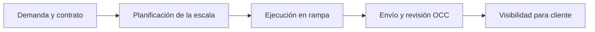

# Visión y espacio de problema

## Afirmación de producto respaldada

El repositorio define a ELEVANT como la plataforma de AVIAM para **planificar y controlar asistencia en tierra**. La solución se divide en una experiencia interna, un sitio y portal para clientes, y una aplicación nativa para agentes de rampa. Las tres experiencias convergen en una sola autoridad de negocio: API y base lógica compartidas por ambiente.

Esta es la visión documentada. No hay evidencia versionada suficiente para reconstruir quién originó la idea, cuándo nació, qué investigación la precedió o qué resultado comercial se prometió.

## Espacio de problema representado

El código y el modelo de datos representan un ciclo distribuido entre diferentes actores y momentos:

| Momento | Información que el producto intenta conectar | Evidencia disponible |
| --- | --- | --- |
| Demanda comercial | solicitudes, estaciones, servicios, contratos, versiones y tarifas | Modelo persistente y prototipos web |
| Preparación | vuelos/turnarounds, stands, agentes, equipos, cobertura y habilitaciones | Modelo persistente y prototipo interno |
| Ejecución | operación, servicios, hitos, checklist, incidencias y asignaciones | Modelo persistente y prototipos interno/móvil |
| Control | envío de operación, evidencia estructurada, decisión y corrección OCC | Modelo persistente y prototipo interno |
| Relación con aerolínea | consulta de vuelos, solicitudes, contratos, reportes y respuestas permitidas | Prototipo de portal; varias áreas están diferidas |

## Hipótesis de valor, no resultados demostrados

Las siguientes formulaciones son inferencias razonables del diseño, no beneficios medidos ni compromisos comerciales:

- **Hipótesis:** una fuente canónica compartida puede reducir discrepancias entre planificación, ejecución y revisión.
- **Hipótesis:** historial, snapshots e idempotencia pueden mejorar trazabilidad frente a estados sobrescritos o reintentos móviles.
- **Hipótesis:** clientes separados por contexto pueden presentar la misma verdad con permisos y detalle apropiados.
- **Hipótesis:** el trabajo offline-first puede sostener la captura operativa durante conectividad intermitente.

No se encontraron en las fuentes métricas base, entrevistas, estudios de tiempo, tasa de errores, objetivos de adopción, ahorro esperado o validación de estas hipótesis con usuarios.

## Principios de producto ya fijados

1. Una API y una base lógica sirven a los tres clientes dentro de cada ambiente.
2. Ningún cliente decide por sí solo identidad, tenant, estación o permisos.
3. Los mocks describen vocabulario y recorridos; OpenAPI define el contrato cuando un endpoint existe.
4. La historia operacional, contractual y de auditoría no debe reducirse a la última pantalla visible.
5. El dispositivo móvil mantiene caché y outbox; el servidor conserva el estado canónico.
6. Development y Production son fronteras separadas; un preview no demuestra preparación productiva.

## Qué falta validar con personas

- cuál es el problema más costoso para cada audiencia y cómo se resuelve hoy;
- qué decisión debe acelerarse en OCC, rampa y aerolínea;
- qué información debe verse en tiempo real y cuál admite demora;
- qué evidencia hace aceptable una operación y quién resuelve una discrepancia;
- qué métrica define éxito del primer piloto.

Estas brechas están registradas en [Preguntas abiertas](preguntas-abiertas.md). El detalle de los flujos técnicos y funcionales se encuentra en [Recorridos de extremo a extremo](recorridos-end-to-end.md).

## Fuentes

- [README del monorepo](../../README.md): definición de la plataforma y frontera compartida.
- [Private Web](../../frontend/private-web/README.md), [Public Web](../../frontend/public-web/README.md) y [Mobile Agent](../../frontend/mobile-agent/README.md): problemas y flujos representados por cada experiencia.
- [Decisiones de base v1](../../docs/architecture/database-v1.md): conceptos canónicos e historia requerida.

[Volver al mapa de producto](README.md).
