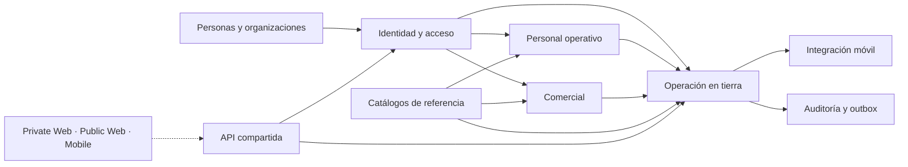

# Dominio ELEVANT

Este mapa organiza el lenguaje de ELEVANT para planificar y controlar servicios de asistencia en tierra. Conecta el modelo persistente v1, las fronteras de autorización y el vocabulario observado en las tres experiencias, sin convertir una pantalla o un mock en contrato.

> [!IMPORTANT]
> Las entidades .NET y las migraciones EF describen el modelo persistente. OpenAPI será el contrato cliente/servidor cuando exista cada operación. Hoy la API sólo expone contratos útiles de sistema; autenticación y casos de uso de negocio siguen pendientes. Los clientes son consumidores, nunca fuentes autónomas de autorización ni propietarios de SQL.

## Mapa de lectura

| Pregunta | Nota |
| --- | --- |
| ¿Qué significa cada término y cuáles no deben confundirse? | [Glosario canónico](glosario-canonico.md) |
| ¿Cuáles son los contextos y cómo dependen entre sí? | [Contextos y límites](contextos-y-limites.md) |
| ¿Qué entidades existen y cómo se relacionan? | [Entidades y relaciones v1](entidades-y-relaciones-v1.md) |
| ¿Qué representa una escala y cómo se registra su ejecución? | [Turnaround y operación en tierra](turnaround-y-operacion.md) |
| ¿Cómo se diferencian solicitudes comerciales y operativas? | [Solicitudes, contratos y servicios](solicitudes-contratos-y-servicios.md) |
| ¿Cómo se deriva tenant, cuenta, estación y autorización? | [Identidad, tenancy y autorización](identidad-tenancy-y-autorizacion.md) |
| ¿Quién crea usuarios internos y con qué permisos? | [Gobernanza de usuarios por departamento](gobernanza-por-departamento.md) |
| ¿Cómo se fijan precios y cargos, y cómo se factura y cobra? | [Finanzas: tarifarios, cargos y cobros](finanzas-tarifas-cargos-y-cobros.md) |
| ¿Cómo se separan roles, puestos, asignaciones y departamentos? | [Personal, roles y departamentos](personal-roles-y-departamentos.md) |
| ¿Qué significan fechas, instantes, estados e historia? | [Tiempo, estados y trazabilidad](tiempo-estados-y-trazabilidad.md) |
| ¿Qué todavía no está decidido o implementado? | [Brechas y preguntas abiertas](brechas-y-preguntas-abiertas.md) |

## Semáforo del conocimiento de dominio

| Capa | Estado comprobado | Lectura correcta |
| --- | --- | --- |
| Entidades, enums y esquema v1 | Implementados y versionados | Definen nombres, relaciones y restricciones persistentes actuales. |
| Casos de uso HTTP de negocio | No implementados | No existe todavía un contrato para operar el modelo desde los clientes. |
| Private Web, Public Web y Mobile Agent | Experiencias ejecutables con adaptadores de prototipo | Sus recorridos y términos ayudan a descubrir necesidades; sus objetos y permisos no son contratos. |
| Production | Diferida y separada | No se infiere estado productivo desde Development ni desde el modelo v1. |

## Contexto en una vista

Las flechas indican dependencias conceptuales y persistentes, no que todos esos recorridos estén disponibles por HTTP. El [mapa de contextos](contextos-y-limites.md) detalla esa diferencia.

## Reglas rápidas

- Un `turnaround` es la escala que agrupa llegada, salida y atención; un `flight_leg` es sólo uno de sus tramos.
- `GroundOperation` registra la ejecución en tierra; no es sinónimo de vuelo ni de contrato.
- Persona, cuenta, membresía, rol y perfil de agente son identidades distintas.
- Organización/aerolínea y estación forman parte del scope confiable que debe resolver la API.
- Una solicitud comercial y una solicitud operativa son procesos diferentes.
- Catálogos, foreign keys, eventos de estado y snapshots reemplazan textos y arrays duplicados de mocks.
- KPI, elegibilidad, vencimiento, cobertura y alertas son proyecciones calculadas, no tablas autoritativas.
- Un enum enumera valores persistibles; no demuestra por sí solo transiciones válidas.

## Fuentes de verdad

- [Modelo de base de datos v1](../../docs/architecture/database-v1.md)
- [Inventario del esquema](../../docs/database/schema-v1.md)
- [Estado real del backend](../../backend/README.md)
- [Vocabulario de Private Web](../../frontend/private-web/README.md)
- [Vocabulario de Public Web](../../frontend/public-web/README.md)
- [Vocabulario de Mobile Agent](../../frontend/mobile-agent/README.md)

Volver a [Home](../00-inicio/home.md).
