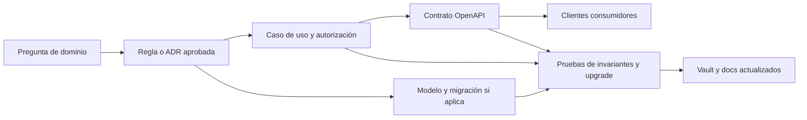

# Brechas y preguntas abiertas del dominio

Esta lista evita que un vacío se convierta en una suposición. «Brecha» no
significa necesariamente defecto: nombra una decisión, una regla o una
capacidad que el código del commit verificado todavía no demuestra. Lo que las
cuatro fases del ciclo ya resolvieron sale de la lista con la decisión que lo
cerró.

## Estado honesto

| Capa | Existe en el commit verificado | Sigue abierto |
| --- | --- | --- |
| Persistencia | 57 migraciones EF sobre los ocho schemas, `rowversion` en los agregados mutables, auditoría y outbox en la misma transacción | Datos heredados que ninguna migración corrige y algunas coherencias que solo exige la aplicación (ver abajo) |
| Backend HTTP | JWT de 15 minutos con refresh rotativo, política fallback autenticada, 400 operaciones de las cuatro fases, Problem Details con `code`, `Idempotency-Key` y versión esperada en los comandos | El paso «contract» de la clave opcional y una consulta general de auditoría |
| OpenAPI y cliente | Snapshot revisado con su digest, cliente Orval y validadores manuales que rechazan claves desconocidas | Nada propio: cada endpoint nuevo repite el flujo de snapshot y generación |
| Private Web | OCC, Gestión Humana, Contratos, Finanzas y Superadministración contra la API, con el menú que permite el servidor | Adaptadores heredados del prototipo (`NEXT_PUBLIC_PROTOTYPE_API_URL`), el modo demo de solo lectura del tablero de Gestión Humana y la zona horaria de cada estación |
| Public Web | Sesión con código por correo, solicitudes, contratos, operaciones, facturas y cobro con tarjeta, filtrados por el servidor | Los tipos de solicitud del prototipo que nadie decidió (abajo) |
| Mobile Agent | Sesión, tableta vinculada, cola offline por instalación con recibos idempotentes y feed de cambios | Entrega de avisos con la aplicación cerrada y latencia medida |
| Production | Frontera reservada: `database/ProductionDB` solo contiene `.gitkeep` | Infraestructura, datos, secretos, despliegue y políticas aprobadas |

## Cerradas por las fases del ciclo

- **Autenticación, invitación, recuperación y sesión.** Refresh rotativo con
  revocación por familia ([ADR-0021](../../docs/adr/0021-rotating-refresh-tokens.md)),
  código por correo en el portal ([ADR-0022](../../docs/adr/0022-portal-email-verification.md)),
  cambio de contraseña ([AuthenticationController](../../backend/Elevant.Api/Controllers/AuthenticationController.cs))
  y activación y restablecimiento de la cuenta
  ([PortalAccountController](../../backend/Elevant.Api/Controllers/PortalAccountController.cs)).
- **Catálogo de permisos.** Vive en el servidor por departamento, módulo y
  acción; un código retirado se conserva como alias para no romper perfiles
  guardados ([gobernanza](gobernanza-por-departamento.md)).
- **Dispositivos.** Una tableta pasa al agente que inicia sesión, se libera al
  cerrarla y OCC la desvincula o revoca
  ([ADR-0038](../../docs/adr/0038-preoperation-contract-lifecycle-permits-master-data-and-workforce-readiness.md)).
- **Transiciones del ciclo comercial y del contrato.** Solicitud, alta de
  aerolínea, cuenta del portal, borrador, enmienda, vigencia, firmas,
  suspensión y terminación
  ([ADR-0024](../../docs/adr/0024-airline-permits-and-contract-lifecycle.md),
  [ADR-0037](../../docs/adr/0037-commercial-cycle-requests-drafts-amendments-and-portal-accounts.md),
  ADR-0038).
- **Cancelación, reapertura y corrección sin borrar historia.** En la
  operación, OCC cancela o desvía una escala, corrige la llegada, reabre una
  aprobación sin facturar y corrige la Orden de Servicio con una versión nueva
  ([ADR-0039](../../docs/adr/0039-operation-planning-coverage-offline-tablet-occ-review-and-reports.md)).
  En Finanzas, anular, corregir, revertir, retirar y cerrar sin cargo son
  cambios de estado con motivo y auditoría ([Finanzas](finanzas-tarifas-cargos-y-cobros.md)).
- **Estado, evento, auditoría y outbox atómicos.** Cada comando los escribe en
  su transacción; el feed solo anuncia y el cliente relee por REST
  ([feed de cambios](../04-arquitectura/feed-de-cambios-operativos.md),
  [ADR-0029](../../docs/adr/0029-ramp-realtime-alerts-and-chat-read-state.md)).
- **Turnos que cruzan medianoche.** Se evalúan como instantes en la zona de la
  estación ([reglas de ajuste](../../backend/Elevant.Application/Identity/ShiftAdjustmentRules.cs)).
- **Solapamientos de posición y de agente.** El mapa de posiciones bloquea la
  posición en una transacción serializable y una regla limita al agente a tres
  operaciones simultáneas (ADR-0039).
- **Qué se exige antes de enviar.** La APK no entrega con registros pendientes
  ni con la Orden de Servicio sin las dos firmas, y OCC solo aprueba una Orden
  firmada (ADR-0039, [ADR-0032](../../docs/adr/0032-aviam-forms-signatures-and-walkaround.md)).
- **Reconciliación tras reconectar.** La tableta y las webs reconcilian el
  cursor del feed y releen por REST; SignalR solo acelera el aviso.
- **Comandos sin conexión.** La tableta guarda sus comandos en una sola cola
  por cuenta, FIFO por operación, y los reenvía con su clave; el inicio y los
  servicios llevan la hora del toque, y el recibo repite el mismo resultado o el
  mismo código. El detalle, con sus excepciones, está en
  [Mobile Agent](../05-aplicaciones/mobile-agent.md) (ADR-0039).
- **Precedencia de la llegada.** La llegada que registra OCC prevalece sobre
  la del proveedor, y la importación del feed se vincula a la escala del mismo
  vuelo en lugar de duplicarla (ADR-0039).
- **Feed de vuelos de un proveedor.** AeroDataBox, con presupuesto de unidades
  y apagado por defecto ([ADR-0028](../../docs/adr/0028-aerodatabox-flight-feed-with-unit-budget.md)).
- **Facturación, cobro y correcciones.** La prefactura es un paso interno de la
  emisión desde operaciones aprobadas, sin aceptación ni disputa de la
  aerolínea; una corrección es una nota de crédito y el cobro con tarjeta es
  siempre por el saldo completo ([ADR-0035](../../docs/adr/0035-direct-invoicing-simulated-ecf.md),
  [ADR-0036](../../docs/adr/0036-simulated-card-payment.md)). No hay reclamos ni
  disputas en el sistema, por decisión de producto. La fase 4 cerró los huecos
  de facturación, cobro y cuentas por pagar: emisión atómica, cierre sin cargo,
  día hábil de Santo Domingo, notas con su e-NCF, pasarela elegida por
  configuración, pagos a proveedores que se revierten, segregación de funciones
  y gastos que se retiran y se escalan
  ([ADR-0040](../../docs/adr/0040-billing-cycle-invoicing-from-operations-card-collections-credit-notes-and-payables.md)).

## Siguen abiertas

### Comandos y contrato

- El paso «contract» que vuelva obligatoria la `Idempotency-Key` en los
  comandos que hoy la aceptan opcional, sobre todo los comerciales, de
  gobernanza y de OCC ampliados en las fases 1 a 3, la versión esperada en los
  que todavía no la exigen y `operationVersions` en la emisión de facturas, que
  la fase 4 añadió opcional. Es un cambio coordinado con los clientes
  desplegados.
- Las respuestas `401` de Facturación, Tesorería, la cartera del portal y la
  tarjeta no llevan `code`, como en la mayoría de los controladores del
  repositorio; las de cuentas por pagar y gastos y la del estado de la
  aerolínea en el portal (`GET airline/portal/standing`) llevan
  `unauthorized` cuando la cuenta del token ya no resuelve un actor. Los
  clientes las tratan por su estado HTTP como sesión vencida.
- Una consulta general de auditoría: hoy se lee por área y Superadministración
  solo ve la de gobernanza, comercial y Gestión Humana
  ([almacén](../../database/DevelopmentDB/Elevant.Persistence/Identity/EfGovernanceStore.cs)).

### Tenant y autorización

- El modelo permite membresías activas simultáneas en organizaciones
  distintas; falta decidir cómo se elige el contexto y fallar de forma cerrada
  ante ambigüedad.
- Documentar la precedencia entre membresía, alcance de estación de la cuenta,
  alcance laboral del agente y terminal.
- Especificar el acceso interno entre aerolíneas y sus pruebas negativas de
  aislamiento.

### Planificación y tiempo

- La asignación de equipos existe en el modelo y en la lectura de
  Planificación, pero ningún comando la escribe: faltan su caso de uso y su
  regla de solapamiento.
- Exigir la coherencia estación-terminal-posición-equipo-turnaround con
  restricciones adicionales o en cada caso de uso.
- Acordar SLA, tolerancias y cálculo de puntualidad sobre los hitos.
- Mostrar en Private Web la hora de cada estación en su propia zona.

### Comercial y Finanzas

- Exigir que `OriginatingServiceRequestId`, cuando exista, apunte a una
  solicitud aprobada de la misma aerolínea del contrato.
- Al vincular un servicio ejecutado con su tarifa, exigir precio y moneda
  completos, la misma definición de servicio y aerolínea, cobertura de
  estación y una versión aprobada y vigente.
- Normalizar o gobernar los textos abiertos: categoría, estado de equipo, rol
  de asignación y tipo de incidente.
- **Unidad de cobro.** El ciclo comercial guarda el código de
  `ref.billing_units`, pero las filas heredadas conservan el nombre
  («operación») y la valoración de paquetes compara la unidad como texto, así
  que puede bloquear con `package_unit_mismatch`
  ([`FinancePackageValuation`](../../database/DevelopmentDB/Elevant.Persistence/Finance/FinancePackageValuation.cs)).
- Decidir «Schedule Change», «Special Assistance» y los demás tipos de
  solicitud que mostraba el prototipo de Public Web; el código no los tiene.
- Decidir si Superadministración archiva o conserva el perfil comercial sin
  verificar (`OCC-…`) que OCC creó para un charter, una vez que la aprobación
  comercial vincula la aerolínea ([pendientes](../12-backlog/pendientes-transversales.md)).
- **Fiscal real.** El e-CF es una simulación sin validez fiscal: no hay
  proveedor ni transmisión a la DGII, certificado, firma, secuencias
  autorizadas ni el RNC real del emisor, que se imprime simulado
  ([política](../../backend/Elevant.Application/Finance/FinanceInvoicePolicy.cs)).
- Conciliación bancaria, obtención automática de tasas de cambio (hoy se
  registran a mano) y libro mayor.
- La pasarela de tarjeta real: el código solo compone la simulada, que no
  arranca fuera de Development, Test o Testing, o ninguna
  ([composición](../../backend/Elevant.Infrastructure/DependencyInjection.cs)).
- Los datos heredados que ninguna migración corrige, como las versiones de
  contrato que una aprobación anterior ya recortó o un borrador interno antiguo
  sin factura que sigue reteniendo sus servicios (`pending_preinvoice`):
  liberarlo es una decisión sobre los datos.
- «Por facturar» trae todas las operaciones pendientes de la estación, las
  ordena y las pagina en memoria: alcanza con el volumen actual, y falta
  medirla con datos reales.
- El recorrido E2E todavía no pasa por un charter: su paso se salta mientras la
  corrida de la fase 3 no deje un charter facturado, y las pruebas SQL cubren
  su factura en el portal y el prepago aplicado una sola vez.

### Operación, evidencia y revisión

- Definir cuándo nace una `GroundOperation` y cómo se relacionan los estados
  del turnaround y de la ejecución.
- El servidor no exige las firmas de la Orden de Servicio al entregar, para no
  cambiar lo que envía la APK desplegada; la regla vive en la APK y en la
  aprobación de OCC.
- Exigir que cada `ChecklistAnswer` use un ítem de la misma versión del
  checklist instanciado y que cada `OperationSubmission` use un checklist de su
  misma operación.
- Alinear el resultado de `ReviewDecision` con el estado de `OperationSubmission`.
- Retención y antivirus de fotos y PDF; los bytes viven en almacenamiento S3
  privado y SQL guarda metadatos y hash.
- `OperationalServiceRequest` solo tiene la lectura del portal
  (`GetAirlineOperationalRequests`): faltan su creación y cancelación, qué
  solicita, su historia de estados, su relación con una línea ejecutada y sus
  validaciones de membresía, estación y tiempos.

### Mobile e integraciones

- Versionar los payloads offline y fijar la expiración de un comando que nunca
  se pudo enviar.
- Medir la entrega de avisos con la aplicación cerrada y la latencia en el VPS.
- FlightAware sigue como frontera futura sin adaptador.

### Auditoría, privacidad y retención

- Política de acceso y retención de la auditoría.
- Redactar secretos, tokens, documentos y PII en errores, outbox, auditoría y
  metadatos JSON de forma uniforme. Los datos de tarjeta ya cumplen la regla:
  solo se guardan la marca y los últimos cuatro dígitos.
- Derecho de corrección o eliminación sin romper la historia regulatoria u
  operacional.
- Observabilidad y alertas sin duplicar la auditoría como log técnico.

## Pruebas negativas que siguen siendo criterio

- Rechazar una respuesta cuyo ítem pertenezca a otra versión del checklist y un
  envío cuyo checklist pertenezca a otra operación.
- Rechazar precio o moneda incompletos, una tarifa de otra definición,
  aerolínea o estación y una versión no aprobada o no vigente.
- Rechazar un contrato originado por una solicitud no aprobada o de otra
  aerolínea.
- Rechazar un recibo móvil con una cuenta distinta del vínculo, un vínculo
  cerrado, una cuenta deshabilitada o un dispositivo revocado.
- Rechazar la modificación o el borrado de eventos, respuestas, envíos y
  decisiones que el diseño declara históricos.

## Vocabulario del prototipo

| Fuente de prototipo | Diferencia respecto al modelo | Tratamiento actual |
| --- | --- | --- |
| Public Web | Tipos de solicitud adicionales; objetos de disputa y conciliación | Facturas, documentos, notificaciones y cobro existen en la API. La disputa y la conciliación del prototipo no se implementan, por decisión: Finanzas corrige con notas de crédito. Los tipos de solicitud siguen sin decidir. |
| Mobile Agent | Estados de vuelo en español y granularidad aeronáutica distinta de `TurnaroundStatus` | No se mapean uno a uno; la traducción vive en cada caso de uso. |
| Private Web | Departamentos y roles detallados como textos de interfaz | El catálogo del servidor es la autoridad; el menú solo oculta lo que el servidor ya niega. |
| Tableros | KPI, conteos, alertas, cobertura y elegibilidad | Proyecciones calculadas en el servidor, no tablas autoritativas. |

## Fuera de alcance v1 explícito

- conectividad fiscal real con la DGII y conciliación bancaria;
- proyecciones analíticas materializadas;
- endpoints de negocio inferidos directamente de entidades EF;
- acceso directo de cualquier cliente a SQL Server o a un proveedor externo;
- reutilizar datos, credenciales o archivos del prototipo como seed real;
- tratar Production como una extensión del host Development.

## Criterio para cerrar una brecha

Una pantalla terminada o un campo agregado no cierra por sí solo una brecha.
Debe existir decisión verificable, comportamiento ejecutable, contrato cuando
cruza la API y pruebas proporcionales al riesgo.

## Relacionados

- [Índice de dominio](README.md)
- [Mapa de capacidades](../02-producto/mapa-de-capacidades.md)
- [Contextos y límites](contextos-y-limites.md)
- [Identidad, tenancy y autorización](identidad-tenancy-y-autorizacion.md)
- [Tiempo, estados y trazabilidad](tiempo-estados-y-trazabilidad.md)

## Fuentes

- [Límites v1](../../docs/architecture/database-v1.md) y [estado del backend](../../backend/README.md).
- [Snapshot OpenAPI](../../packages/api-client/openapi/elevant-v1.json) y [cliente compartido](../../packages/api-client/src/client.ts).
- [Composición de la API](../../backend/Elevant.Api/Extensions/ServiceCollectionExtensions.cs): autenticación y política fallback.
- [Modo demo de Gestión Humana](../../frontend/private-web/src/config/hrDemoMode.js) y [adaptador heredado de notificaciones](../../frontend/private-web/src/services/notificationsService.js).
