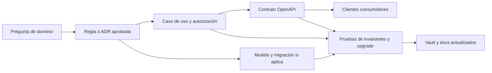

# Brechas y preguntas abiertas del dominio

Esta lista evita que un vacío se convierta en una suposición. “Brecha” no significa necesariamente defecto: identifica una decisión, regla o capacidad que el repositorio todavía no demuestra.

## Estado honesto

| Capa | Existe | Falta |
| --- | --- | --- |
| Persistencia | Entidades, enums, configuraciones y cinco migraciones v1 | Algunas invariantes de aplicación, transiciones y políticas temporales |
| Backend HTTP | Salud, readiness, ping y Swagger | Autenticación y todos los endpoints/casos de uso de negocio |
| OpenAPI | Scaffold y proceso de snapshot/generación | DTOs y operaciones del dominio |
| Private Web | Recorridos internos ejecutables | Sustitución general de mocks y autorización real |
| Public Web | Landing/portal demostrativo | Sesión real, tenant enforcement y operaciones API |
| Mobile Agent | Recorrido nativo y cola local demostrativa | Integración .NET, autenticación segura y sync contractual |
| Production | Frontera reservada | Infraestructura, datos, secretos, despliegue y políticas aprobadas |

## Decisiones de negocio prioritarias

### Estados y comandos

- Definir matriz de transición por turnaround, operación, servicio, solicitud, contrato, checklist, incidente y revisión.
- Definir actor, permiso, precondición, idempotencia y efecto secundario de cada comando.
- Resolver cómo se mantienen atómicamente estado actual, evento histórico, auditoría y outbox.
- Acordar cancelación, devolución, reapertura y corrección sin borrar historia.

### Tenant y autorización

- Fijar catálogo de permisos y su asignación a roles por portal.
- El modelo ya permite membresías activas simultáneas en organizaciones distintas; definir cómo se elige y valida el contexto y fallar de forma cerrada ante ambigüedad.
- Definir precedencia entre membresía, scope de cuenta, scope laboral de agente y terminal.
- Especificar acceso interno entre aerolíneas y pruebas de aislamiento negativas.
- Diseñar autenticación, invitación, recuperación, bloqueo, revocación de sesión y dispositivo.

### Planificación y tiempo

- Representar turnos que cruzan medianoche y cambios de zona/DST.
- Detectar solapamientos de turnos, stands, agentes y equipos que los índices actuales no cubren.
- Definir algoritmo de elegibilidad y razones explicables.
- Exigir coherencia estación-terminal-stand/equipo/turnaround mediante aplicación o constraints adicionales.
- Acordar códigos de hito, SLA, tolerancias y cálculo de puntualidad/cumplimiento.

### Comercial

- Exigir que `OriginatingServiceRequestId`, cuando exista, apunte a una solicitud aprobada de la misma aerolínea del contrato.
- Al vincular `OperationService` con una tarifa, exigir precio/moneda all-or-none, enlace de tarifa cuando corresponda, la misma definición de servicio y aerolínea, cobertura de estación, versión aprobada y vigente, y copia consistente e histórica de unidad/precio/moneda.
- Normalizar o gobernar strings todavía abiertos: categoría, estado de equipo, rol de asignación y tipo de incidente.
- Unidad de cobro (acotada el 6 de noviembre de 2026, después del commit verificado de esta nota): el ciclo comercial guarda el código de `ref.billing_units`, pero las filas heredadas conservan el nombre («operación»), la valoración de paquetes de la emisión de facturas compara la unidad como texto y puede bloquear con `package_unit_mismatch` ([`FinancePackageValuation`](../../database/DevelopmentDB/Elevant.Persistence/Finance/FinancePackageValuation.cs)), y OCC y Revisión muestran el código ([ADR-0037](../../docs/adr/0037-commercial-cycle-requests-drafts-amendments-and-portal-accounts.md)). Desde el 8 de noviembre de 2026, Revisión y el detalle del vuelo de Planificación muestran la unidad con su nombre, pero el panel de asignación de Planificación todavía muestra el código ([ADR-0039](../../docs/adr/0039-operation-planning-coverage-offline-tablet-occ-review-and-reports.md)).
- Decidir Schedule Change, Special Assistance y otros tipos observados en Public Web sin asumir que ya existen.
- Prefacturas, disputas, factura no fiscal, pagos parciales, notas de crédito, tarifarios y cargos ya tienen modelo (ver [Finanzas: tarifarios, cargos y cobros](finanzas-tarifas-cargos-y-cobros.md)); siguen abiertos impuestos y documento fiscal (ITBIS, NCF), conciliación bancaria y obtención automática de tasas.

Posterior al commit verificado de esta nota, el 6 de noviembre de 2026 salió de esta lista la definición de las transiciones entre solicitud aprobada, alta de aerolínea, cuenta del portal y contrato ([ADR-0024](../../docs/adr/0024-airline-permits-and-contract-lifecycle.md) y [ADR-0037](../../docs/adr/0037-commercial-cycle-requests-drafts-amendments-and-portal-accounts.md)). De ese trabajo siguen abiertos la unidad de cobro, acotada arriba, y el paso «contract», que hará obligatoria la `Idempotency-Key` en los comandos comerciales que hoy la aceptan opcional, y también la versión esperada en los que todavía no la exigen.

El 7 de noviembre de 2026, también después del commit verificado, la fase 2 «Pre-operación» sacó de esta lista los solapamientos entre versiones y la suspensión y terminación del contrato ([ADR-0038](../../docs/adr/0038-preoperation-contract-lifecycle-permits-master-data-and-workforce-readiness.md)). Una versión nueva rige solo desde su segunda firma, y esa firma termina la anterior, a más tardar, la víspera de su inicio. La terminación respeta el preaviso firmado o pide una causa inmediata, y revocar el permiso de operación suspende los contratos que se quedan sin uno usable. Siguen abiertos:

- el paso «contract» de los comandos que la fase 2 amplió con una `Idempotency-Key` opcional;
- los datos heredados que ninguna migración corrige, como las versiones que una aprobación anterior ya recortó.

### Operación, evidencia y revisión

- Definir cuándo nace una `GroundOperation` y cómo se relacionan estados de turnaround y ejecución.
- Acordar obligatoriedad de servicios, checklist, firmas/evidencias e incidentes antes de enviar.
- Exigir que cada `ChecklistAnswer` use un ítem de la misma versión instanciada por su `OperationChecklist` y que cada `OperationSubmission` use un checklist de su misma `GroundOperation`.
- Precisar devolución y nueva revisión: hoy el envío no snapshottea respuestas, varios envíos pueden apuntar al mismo checklist y sus respuestas siguen mutables. Hace falta versionado/snapshot y enforcement append-only.
- Alinear outcome de `ReviewDecision` con el estado de `OperationSubmission`.
- Diseñar metadatos, object keys, tipos, tamaño, retención, antivirus y permisos para fotos/PDF; SQL no almacenará binarios.
- Definir qué solicita `OperationalServiceRequest`, su historia de estados y relación con una línea ejecutada.
- En `OperationalServiceRequest`, validar membresía activa y autorización del solicitante/resolutor, scope de estación, aplicabilidad del servicio y coherencia de aerolínea/estación con turnaround; exigir además `NeededAt >= RequestedAt` y coherencia entre estado, resolutor, nota y fecha. Las FKs y el único check temporal actual no lo garantizan.

El 8 de noviembre de 2026, también después del commit verificado, la fase 3 «La operación» acotó varias de estas brechas ([ADR-0039](../../docs/adr/0039-operation-planning-coverage-offline-tablet-occ-review-and-reports.md)):

- **Cancelación, reapertura y corrección sin borrar historia** («Estados y comandos»). OCC cancela o desvía una escala antes de que su operación inicie, corrige la llegada hasta la primera entrega, reabre como envío nuevo una aprobación de la que nada se facturó y corrige la Orden de Servicio firmada con una versión nueva y su motivo. Lo ya facturado se corrige con una nota de crédito.
- **Solapamientos** («Planificación y tiempo»). El mapa de posiciones bloquea la posición dentro de una transacción serializable, y una sola regla limita al agente a tres operaciones simultáneas.
- **Qué se exige antes de enviar** (esta sección). La APK nueva no entrega con registros pendientes ni con la Orden de Servicio sin las dos firmas, y OCC solo aprueba una Orden firmada; el servidor no exige la firma al entregar, para no cambiar lo que envía la APK desplegada.
- **Comandos sin conexión** («Mobile e integraciones»). Todas las escrituras de la operación salen por una sola cola, por cuenta y en orden por operación, con la hora del toque, y el recibo repite el mismo resultado o el mismo código.
- **Precedencia de fuentes** («Mobile e integraciones»). La llegada que registra OCC prevalece sobre la del proveedor, y la importación del feed se vincula a la escala del mismo vuelo en lugar de duplicarla.

Siguen abiertos el paso «contract» de los comandos que la fase 3 amplió con una `Idempotency-Key` opcional, la zona horaria de cada estación en Private Web, la decisión sobre el perfil `OCC-` de una aerolínea charter ya vinculada y los huecos de la fase 4 «Facturación».

### Mobile e integraciones

- Versionar payloads/comandos offline, respuesta repetible, expiración y resolución de conflictos.
- Definir registro/revocación de dispositivos, almacenamiento seguro de tokens y pérdida de tablet. *Posterior al commit verificado: desde la fase 2 una tablet pasa al agente que inicia sesión y se libera al cerrarla, y OCC la desvincula o revoca una perdida ([ADR-0038](../../docs/adr/0038-preoperation-contract-lifecycle-permits-master-data-and-workforce-readiness.md)).*
- Exigir al procesar cada comando un binding activo cuya cuenta coincida con el recibo, una cuenta habilitada y un dispositivo no revocado; de estas coherencias sólo está materializado el dedupe dispositivo-clave.
- Alinear estado del recibo con `ProcessedAt`, resultado y error, y devolver exactamente el resultado persistido en un reintento sin duplicar trabajo.
- Establecer reconciliación tras reconexión; SignalR sólo puede acelerar avisos, no ser fuente de verdad.
- Acordar precedencia y reconciliación de datos `Internal`, `Manual`, `AirlineClient` y `ExternalProvider`.
- Completar puertos/use cases para FlightAware u otros proveedores antes de declarar integración real.

### Auditoría, privacidad y retención

- Definir catálogo de acciones auditables y política de acceso/retención.
- Redactar secretos, tokens, documentos, payloads y PII en errores, outbox, audit y metadata JSON.
- Definir derecho de corrección/eliminación sin romper historia regulatoria u operacional.
- Establecer observabilidad y alertas sin duplicar auditoría como log técnico.

## Pruebas negativas mínimas para estas coherencias

- rechazar una respuesta cuyo ítem pertenezca a otra versión de template y un envío cuyo checklist pertenezca a otra operación;
- rechazar precio/moneda incompletos, tarifa ausente o de otra definición, aerolínea o estación, versión no aprobada/no vigente y snapshots que no coincidan al crear la línea;
- rechazar contrato originado por una solicitud no aprobada o de otra aerolínea;
- rechazar creación o resolución de solicitud operativa fuera de tenant/scope, con referencias incoherentes, tiempos invertidos o resolución incompatible con su estado;
- rechazar recibo móvil con cuenta distinta del binding, binding cerrado, cuenta deshabilitada o dispositivo revocado;
- rechazar recibos con estado/resultado/error incoherentes y comprobar replay exacto sin repetir efectos;
- rechazar modificación o borrado de eventos, respuestas, envíos y decisiones que el diseño declare históricos.

## Contradicciones de vocabulario que deben resolverse

| Fuente de prototipo | Diferencia respecto al modelo | Tratamiento actual |
| --- | --- | --- |
| Public Web | Tipos de solicitud adicionales; objetos de factura, conciliación, documento, disputa y notificación | Conservar como exploración; módulos no modelados siguen diferidos. |
| Mobile Agent | Estados de vuelo en español y granularidad aeronáutica distinta de `TurnaroundStatus` | No mapear uno-a-uno; definir traducción/procedencia en un caso de uso. |
| Private Web | Departamentos y roles detallados; permisos como textos de interfaz | No convertir en autorización hasta tener catálogo servidor y pruebas. |
| Dashboards | KPI, conteos, alertas, cobertura y elegibilidad | Implementar como read models derivados, no tablas por conveniencia. |

## Fuera de alcance v1 explícito

- facturación fiscal (ITBIS, NCF) y conciliación bancaria;
- notificaciones y chat;
- documentos y evidencia binaria;
- proyecciones analíticas materializadas;
- endpoints de negocio inferidos directamente de entidades EF;
- acceso directo de cualquier cliente a SQL Server o proveedor externo;
- reutilizar datos, credenciales o archivos del prototipo como seed real;
- tratar Production como una extensión del host Development.

## Criterio para cerrar una brecha

Una pantalla terminada o un campo agregado no cierra por sí solo una brecha. Debe existir decisión verificable, comportamiento ejecutable, contrato cuando cruza la API y pruebas proporcionales al riesgo.

## Relacionados

- [Índice de dominio](README.md)
- [Contextos y límites](contextos-y-limites.md)
- [Identidad, tenancy y autorización](identidad-tenancy-y-autorizacion.md)
- [Tiempo, estados y trazabilidad](tiempo-estados-y-trazabilidad.md)

## Fuentes

- [Límites v1](../../docs/architecture/database-v1.md)
- [Contrato OpenAPI](../../docs/api/openapi-contract.md)
- [Estado del backend](../../backend/README.md)
- [Límites de Public Web](../../frontend/public-web/README.md)
- [Límites de Mobile Agent](../../frontend/mobile-agent/README.md)
