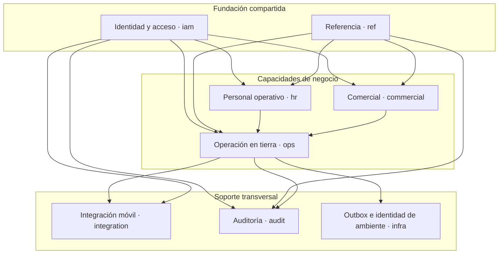

# Contextos y límites del dominio

El modelo v1 divide responsabilidades mediante namespaces, configuraciones EF y schemas SQL. Este mapa usa “contexto” como frontera práctica de lenguaje y datos; no afirma que ya existan agregados ricos, handlers o APIs independientes para cada módulo.

## Mapa de contextos

## Responsabilidad por contexto

| Contexto | Posee | No debe poseer |
| --- | --- | --- |
| Identidad y acceso | personas, cuentas, organizaciones, membresías, roles, permisos y scopes de cuenta | perfil laboral, itinerarios o reglas de facturación |
| Referencia | aerolíneas, aeropuertos, estaciones, terminales, stands, servicios, equipos, aeronaves y posiciones | estado de una operación concreta |
| Personal operativo | perfil de agente, scopes laborales, turnos, disponibilidad, cobertura, permisos y habilitaciones | credenciales o roles de acceso |
| Comercial | solicitudes de afiliación/servicio, contratos, versiones, estaciones y tarifas | ejecución real o factura documental |
| Operación en tierra | turnaround, tramos, asignaciones, servicios ejecutados, hitos, checklist, incidentes, envíos y revisión | identidad maestra o edición de tarifas históricas |
| Integración móvil | dispositivos registrados, vínculo con cuenta e idempotencia de comandos | fuente canónica offline o autorización decidida por el dispositivo |
| Auditoría e infraestructura | cambios atribuibles, correlación, outbox e identidad del ambiente | payloads sensibles, archivos o lógica de interfaz |

## Una fuente por ambiente

Private Web, Public Web y Mobile Agent son fronteras de experiencia. Las tres consumen una API compartida y una sola base lógica por ambiente. La API es propietaria de las transacciones e invariantes; los clientes no consultan tablas ni proveedores externos directamente.

Esta regla evita tres errores:

1. crear un backend o una base por cliente;
2. usar un identificador de organización o estación enviado por el navegador como autorización;
3. confundir una caché móvil o un fixture con la fuente canónica.

## Dependencias aceptables

- `ops` referencia catálogos, cuentas, agentes y tarifas; conserva snapshots cuando una ejecución no debe revalorizarse.
- `commercial` puede comenzar con una aerolínea todavía no canónica, por eso una solicitud conserva nombre/contacto y su `AirlineId` es opcional.
- `hr` enlaza a `iam.Person`, pero `RampAgent` no reemplaza la cuenta de acceso.
- `integration` enlaza dispositivo y cuenta para deduplicar escrituras; no convierte al dispositivo en tenant.
- `audit` guarda contexto de cuenta, organización, estación y correlación de forma opcional; no sustituye las historias de estado de los agregados.

## Límite de implementación actual

El `ElevantDbContext` reúne los módulos en una sola unidad de persistencia y las migraciones materializan sus relaciones. Posterior al commit verificado de esta nota (código de `39a85a46`): `Elevant.Application` contiene los casos de uso de Operations, Commercial, Finance, Identity e Integration, y `Elevant.Api` los expone con autenticación JWT en 400 operaciones ([API compartida](../05-aplicaciones/api-compartida.md)). Este mapa sigue describiendo el modelo; la superficie HTTP vive en OpenAPI.

Cada caso de uso respeta estas fronteras sin exponer entidades EF directamente. Una ruptura coordinada requiere contrato OpenAPI, autorización server-side, migración compatible y pruebas de aislamiento.

## Relacionados

- [Índice de dominio](README.md)
- [Entidades y relaciones v1](entidades-y-relaciones-v1.md)
- [Identidad, tenancy y autorización](identidad-tenancy-y-autorizacion.md)
- [Brechas y preguntas abiertas](brechas-y-preguntas-abiertas.md)

## Fuentes

- [Base de datos ELEVANT v1](../../docs/architecture/database-v1.md)
- [Inventario del esquema v1](../../docs/database/schema-v1.md)
- [Propiedad de la base](../../docs/database/database-ownership.md)
- [DbContext compartido](../../database/DevelopmentDB/Elevant.Persistence/Persistence/ElevantDbContext.cs)
- [Estado del backend](../../backend/README.md)
