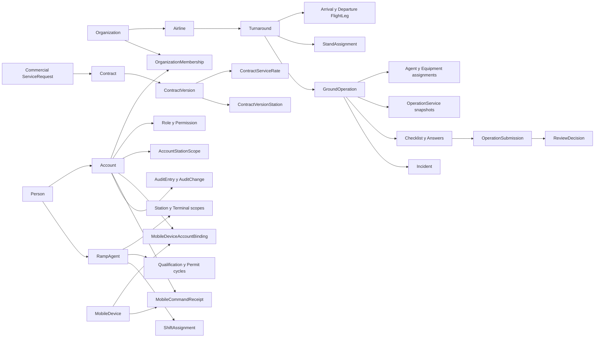

# Entidades y relaciones v1

El snapshot v1 contiene 67 tablas lógicas contando el marcador pre-EF: 66 tablas creadas por migraciones más `infra.database_instances`. Esta nota ofrece un mapa conceptual; el snapshot EF y sus configuraciones siguen siendo la especificación exacta de columnas, índices y foreign keys.

## Mapa relacional principal

## Identidad, referencia y personal

| Relación | Cardinalidad o restricción persistente |
| --- | --- |
| `Person` → `Account` | Uno a cero/uno: `accounts.person_id` es único. |
| `Person` → `RampAgent` | Uno a cero/uno: `ramp_agents.person_id` es único. |
| `Account` ↔ `Organization` | Muchos a muchos mediante membresías; una pareja cuenta-organización es única. |
| `Role` ↔ `Permission` | Muchos a muchos mediante clave compuesta. Cuenta-rol usa las tablas de Identity. |
| `Account` → `Station` | Múltiples scopes históricos; sólo un scope no revocado por pareja. |
| `Organization` → `Airline` | Uno a cero/uno: el `organization_id` de aerolínea es único. |
| `Airport` → `Station` | La estación exige aeropuerto y el índice actual hace único `airport_id`. |
| `Station` → `Terminal`/`Stand`/`EquipmentAsset` | Uno a muchos; códigos son únicos dentro de su scope correspondiente. |
| `RampAgent` → scopes | Historia por estación/terminal; sólo un scope abierto por pareja. |
| `RampAgent` → habilitación/permiso | Ciclos numerados y enlazables al ciclo reemplazado; sólo uno marcado actual por tipo. |
| `RampAgent` → `ShiftAssignment` | Máximo un turno por agente y fecha en v1. |

## Comercial

- Una `ServiceRequest` posee muchas estaciones, ítems y entradas de historia de estado.
- `AirlineId` y `ServiceDefinitionId` pueden ser nulos en la solicitud: el nombre pedido se conserva aunque la aerolínea o servicio aún no estén canonizados.
- Un `Contract` pertenece a una aerolínea y puede referenciar la solicitud que lo originó.
- La pareja contrato-número de versión es única. Cada versión tiene vigencia, moneda, estaciones y una tarifa por definición de servicio.
- Los eventos de estado de solicitud y contrato registran `from`, `to`, instante, actor opcional y razón; no se borran por cascada. Su uso append-only es un diseño pendiente de enforcement, no una consecuencia de `NO ACTION`.

## Turnaround y ejecución

| Relación | Regla v1 |
| --- | --- |
| `Turnaround` → `FlightLeg` | Máximo un `Arrival` y un `Departure`, por unicidad de turnaround-dirección. |
| `Turnaround` → `GroundOperation` | Uno a cero/uno, por `ground_operations.turnaround_id` único. |
| `Turnaround` → `StandAssignment` | Historia temporal; máximo una asignación abierta por turnaround. |
| `GroundOperation` → agente | Muchas asignaciones; una pareja operación-agente no puede repetirse mientras esté abierta. |
| `GroundOperation` → equipo | Muchas asignaciones; un activo sólo puede tener una asignación abierta global. |
| `GroundOperation` → servicio | Muchas líneas; `line_number` es positivo y único dentro de la operación. |
| `GroundOperation` → hito | Un código de hito por operación. |
| `GroundOperation` → checklist | Una instancia por pareja operación-versión de template. |
| Checklist → respuesta | La pareja `(operation_checklist_id, checklist_template_item_id)` es única; las dos FKs existen por separado. El esquema no prueba que el ítem pertenezca a la versión instanciada por el checklist. |
| `GroundOperation` → envío | Las revisiones son positivas y únicas por operación; las FKs a operación y checklist existen por separado. El esquema no prueba que el checklist pertenezca a esa misma operación. El envío tampoco captura un snapshot de respuestas y varios envíos pueden apuntar al mismo checklist mutable. |
| Envío → decisión | La unicidad de `operation_submission_id` permite como máximo una decisión por envío. No se exige coherencia entre outcome y estado del envío; conservar una corrección en otra revisión es diseño pendiente de enforcement. |

Las fechas finales no pueden preceder a las iniciales donde existe constraint. Cantidades y precios ejecutados no pueden ser negativos. La ruta de un tramo exige origen distinto de destino.

## Mobile, auditoría e infraestructura

- `MobileDevice`, `MobileDeviceAccountBinding`, `Account` y `MobileCommandReceipt` son registros distintos. `MobileDevice.InstallationId` es único y un dispositivo sólo puede tener un binding no cerrado.
- `MobileCommandReceipt` referencia por separado al dispositivo y a la cuenta y es único por dispositivo y clave de idempotencia. El hash tiene 64 caracteres y las fechas de proceso/expiración están acotadas. El esquema no exige que la cuenta del recibo coincida con el binding activo ni que cuenta, binding y dispositivo estuvieran habilitados al ejecutar el comando.
- `AuditEntry` registra actor, acción, tipo/identidad pública de entidad, organización, estación, fuente, correlación y razón; `AuditChange` separa cambios por propiedad.
- `OutboxMessage` conserva evento, payload, `ProcessedAt`, cantidad de intentos y último error para integración transaccional; no posee un campo de resultado.

## Convenciones transversales

- Clave interna `bigint identity`; las entidades mutables expuestas poseen `PublicId` GUID único.
- `CreatedAt`, `UpdatedAt` y `RowVersion` soportan auditoría básica y concurrencia optimista.
- Tablas/columnas usan `snake_case`; las clases C# usan singular.
- Todas las foreign keys del modelo de negocio usan `NO ACTION`; retirar historia exige una política explícita.
- Instantes usan precisión de milisegundo; fechas civiles y horas locales se modelan por separado.

## Lo que este mapa no demuestra

El esquema no prueba que una transición de estado sea válida, que un actor tenga permiso, que dos intervalos no se solapen, que FKs independientes sean coherentes entre sí ni que un endpoint aplique el tenant correcto. Esas reglas deben vivir en casos de uso y pruebas, hoy todavía incompletos. Entre las pruebas negativas pendientes están rechazar una respuesta cuyo ítem sea de otra versión y un envío cuyo checklist pertenezca a otra operación.

## Relacionados

- [Índice de dominio](README.md)
- [Contextos y límites](contextos-y-limites.md)
- [Turnaround y operación](turnaround-y-operacion.md)
- [Solicitudes, contratos y servicios](solicitudes-contratos-y-servicios.md)

## Fuentes

- [Inventario del esquema](../../docs/database/schema-v1.md)
- [Modelo de base de datos](../../docs/architecture/database-v1.md)
- [DbContext](../../database/DevelopmentDB/Elevant.Persistence/Persistence/ElevantDbContext.cs)
- [Configuración de operaciones](../../database/DevelopmentDB/Elevant.Persistence/Persistence/Configurations/OperationsConfiguration.cs)
- [Configuración de integración y auditoría](../../database/DevelopmentDB/Elevant.Persistence/Persistence/Configurations/IntegrationAuditConfiguration.cs)
- [Configuración de plataforma y outbox](../../database/DevelopmentDB/Elevant.Persistence/Persistence/Configurations/PlatformConfiguration.cs)
