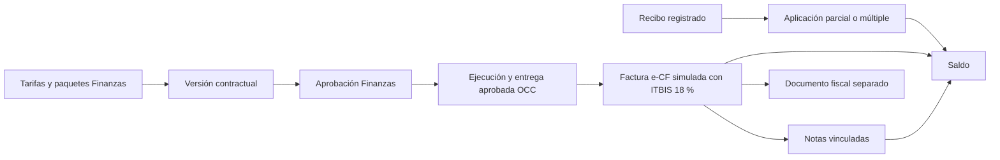

# Finanzas: precios, cartera, proveedores, gastos y simulación fiscal

> [!NOTE]
> La revisión docente de octubre de 2026 cambió validaciones, permisos, notificaciones y otros comportamientos descritos aquí. El estado actual de cada punto está en [Correcciones de la revisión docente](../05-aplicaciones/correcciones-revision-docente-2026-10.md).

> [!NOTE] Alcance editorial y de entrega
> Esta ampliación describe el código local de integración del plan aprobado el 2026-10-18. No acredita merge, promoción, despliegue ni emisión fiscal real. La nota queda `documented`; `last_verified` y `verified_commit` conservan la verificación integral anterior hasta que el responsable cierre QA y compruebe el commit fuente. Véanse [ADR-0018](../../docs/adr/0018-finance-commercial-platform-and-fiscal-simulation.md) y el [runbook fiscal](../../docs/runbooks/finance-fiscal-activation.md).

Finanzas gobierna catálogo, precios y paquetes; Contratos negocia y propone versiones; Finanzas aprueba el contrato y OCC valida la ejecución. El agente registra hechos y tipos de cargo. La API compartida valora, congela documentos y calcula saldos desde persistencia.

## Recorrido comercial

La factura comercial, el cobro y el resultado fiscal tienen estados independientes. Un recibo no prueba aceptación DGII ni confirmación bancaria. Una nota de crédito no devuelve efectivo.

## Tarifas, contratos y paquetes

- Tarifas base y de cargos se publican por versiones y moneda USD/DOP; las publicadas conservan su historia. La tarifa de estación prevalece sobre la general.
- Cargos admiten importe fijo, porcentaje, hora, minuto o unidad; sus reglas de cantidad, gracia, redondeo y mínimo se aplican en el servidor.
- Contratos puede negociar excepciones; la revisión de Finanzas conserva la comparación. Una enmienda crea otra versión y no cambia ejecución o facturas anteriores.
- Los paquetes congelan base, componentes incluidos y bloques de excedente por turnaround, tramo o período. El consumo se reserva bajo transacción serializable y no vuelve a cobrar el mismo bloque comenzado.
- Ejemplo sintético GPU: base 500, 60 minutos incluidos, bloque de 15 a 20; 60/61/75/76/83 minutos producen 500/520/520/540/540.
- Un ámbito con prefactura activa sin emitir bloquea otra con `package_scope_has_unissued_preinvoice`. Anular conserva historia y libera reservas; el consumo facturado permanece.
- Los mínimos de cantidad generan un complemento trazable solo en versiones modernas con `PricingPolicyVersion > 0`. La cobertura de paquete no recibe otro mínimo de servicio. El legado conserva su semántica.
- Falta de tarifa/FX, cobertura ambigua o base porcentual de paquete sin definir bloquea; no se convierte en precio cero.

La evidencia OCC y las marcas de cargo deben coincidir con la entrega aprobada. Una marca posterior que altere esa evidencia bloquea la valoración. El móvil sigue enviando marcas mediante su endpoint e idempotencia de instalación, sin recibir precios.

## Facturación directa e-CF simulada

Desde la fase 4 ([ADR-0035](../../docs/adr/0035-direct-invoicing-simulated-ecf.md)) Finanzas factura directamente las operaciones aprobadas por OCC, sin prefactura visible ni aceptación de la aerolínea:

- **Por facturar** agrupa por operación; se emite una sola o varias de la misma aerolínea y moneda (`POST finance/invoices/from-operations`, permiso `finance.invoicing.issue`).
- La emisión reutiliza el borrador de prefactura como paso interno de una transacción serializable: valora paquetes, mínimos y recargos, aplica **ITBIS 18 %** fijo a cada línea y emite.
- Cada factura recibe un **e-NCF `E31` + 10 dígitos** consecutivo, un código de seguridad y su fecha de firma. El PDF tiene formato de factura de crédito fiscal y dice «Simulación — sin validez fiscal».
- Un charter con prepago confirmado queda saldado al emitir: se registra el cobro `PREPAGO {referencia}` y se aplica hasta el total.
- La aerolínea recibe el correo «Factura emitida» con el PDF.
- Se rechaza una operación no aprobada o ya facturada (`409`) y una mezcla de aerolíneas (`422`).

La prefactura, su disputa y los tratamientos tributarios configurables siguen en el código hasta el bloque 3 de la fase 4, pero ya no están en el menú ni en el portal. Lo que sigue describe ese modelo heredado.

## Prefactura, impuesto explícito y emisión comercial (heredado)

En borrador, Finanzas puede ajustar o excluir con motivo y versión, conservando cálculo original. Recalcular es una acción explícita; la disputa bloquea facturar. La factura congela líneas de servicio, cargo, ajuste, mínimo, paquete y excedente, con jerarquía y razones.

Los tratamientos tributarios son políticas publicadas por aerolínea, estación, moneda, concepto y vigencia. Se conserva por línea política, tasa o fundamento, neto, descuento, impuesto, bruto y captura. `Unconfigured` significa desconocido: el impuesto permanece null, no cero. Exención o no sujeción requieren fundamento; la ambigüedad bloquea.

La compatibilidad comercial mantiene documentos históricos sin completarles impuestos desde políticas actuales. La preparación fiscal exige el snapshot emitido configurado. La identidad comercial de emisor/cliente se congela al emitir; sus registros tributarios permanecen `null` si no hay fuente revisada. No se inventan RNC, domicilios o secuencias.

## Cartera y tesorería

- Recibo, aplicación, reverso, devolución y nota son registros separados.
- Un recibo puede ser anticipo, aplicarse parcialmente a varias facturas y conservar remanente; cada aplicación comprueba saldo, moneda/FX y versión.
- Las notas de crédito/débito vinculan factura y líneas originales; una devolución de dinero requiere su propio movimiento y permiso.
- Pagos y créditos heredados se incluyen una vez, sin copiarlos al modelo nuevo ni sumar un pago nuevamente como efectivo y como aplicación.
- Estado de cuenta y aging se calculan a fecha de corte desde hechos persistentes; los saldos no se obtienen del navegador.
- USD/DOP no se suman sin conversión explícita. Dinero usa decimal(19,4), cantidades decimal(18,4).

El portal deriva tenant/estación de membresías del servidor. Las nuevas lecturas de cartera no publican cuentas, soportes o PII de empleados.

## Proveedores y cuentas por pagar

Proveedor tiene alta, edición y retiro lógico con motivo/versionado. Su factura pasa de Draft a Submitted y después Approved o Rejected; el rechazo exige razón y las líneas dejan de editarse al presentar. La referencia normalizada del documento es única por proveedor mediante índice SQL.

Pago CxP y aplicaciones son distintos: admiten varias facturas, parcialidad y remanente, sin sobreaplicación bajo carrera SQL. Soportes privados guardan metadatos y hash; las dimensiones opcionales estación, aerolínea, turnaround y servicio deben relacionarse correctamente con el ámbito autorizado.

## Gastos propios y revisiones

La cuenta con Employee activo y membresía AVIAM/InternalStaff puede crear, presentar y leer sus propios gastos **sin permisos de Finanzas**. El empleado se deriva de la cuenta; la petición no elige a quién representar. Las opciones API devuelven capacidades de gasto propio, revisión departamental y acciones finales.

1. El empleado crea borrador y agrega soportes privados.
2. Presenta el gasto con versión e intención estable.
3. El administrador efectivo revisa solo su departamento, sin autoaprobación.
4. Finanzas aprueba o rechaza después; la persona no puede aprobar su propio gasto ni actuar como ambas revisoras.
5. Finanzas registra reembolso separado, parcial o total, sin pagarse a sí misma.

Lecturas propias se filtran por Employee; la cola departamental, por departamento del actor; los filtros recibidos solo restringen. El componente reutilizable [DepartmentExpensesPage](../../frontend/private-web/src/features/finance/payables/DepartmentExpensesPage.jsx) consume estas capacidades para el recorrido «Mis gastos». El soporte se descarga por la API privada, sin URL pública o clave de objeto elegida por el navegador.

## Fiscal: estado implementado y pendiente

| Capacidad | Estado local |
| --- | --- |
| Off | Modo predeterminado; sin creación/ejecución de trabajos |
| LocalSimulation | Solo Development/Test; resultados sintéticos sin red fiscal |
| ProviderSandbox | Bloqueado, proveedor sin seleccionar |
| Canónico e intención | Persistidos desde datos emitidos, sin revalorar historia |
| Archivo | Originales/manifest antes del intento; hash y lectura de verificación |
| Timeout/Unknown | Conserva incertidumbre y no reenvía a ciegas |
| Callbacks | Puerto e historial idempotente; autenticador runtime actual rechaza todos |
| XSD E31/E32/E33/E34 | Preflight offline con fuentes oficiales fijadas; separado del simulador |
| Firma criptográfica / aceptación | NotPerformed; sin certificado, firma o QR oficial |

El archivo predeterminado es S3 privado (`PrivateObjectStore`). La opción explícita `LocalDirectory` requiere directorio privado persistente, solo Development/Test, y se rechaza al arrancar en Production. Permite QA fiscal sin S3; no reemplaza el almacenamiento de soportes de gastos o PDFs comerciales. El ambiente fiscal se resuelve desde DOTNET_ENVIRONMENT, luego ASPNETCORE_ENVIRONMENT, por defecto Production.

Los documentos llevan `SIMULATION WITHOUT FISCAL VALIDITY`; el XML neutral FiscalSimulation no es un e-CF. e-NCF y respuesta DGII permanecen null. El [preflight DGII](../../docs/reference/dgii-ecf-schema-sources.md) separa XSD, presencia de firma, criptografía, reglas de negocio y aceptación. Un XSD válido no acredita las otras capas.

Una conexión real requiere autorización posterior, proveedor/contrato versionado, identidad y datos fiscales revisados, idempotencia/consulta tras timeout, autenticación de callbacks, secuencias autorizadas, certificados/firma, validación por tipo y backup/restore de SQL y bytes. Los detalles y bloqueos están en el [runbook](../../docs/runbooks/finance-fiscal-activation.md).

## Permisos, auditoría y reportes

La [matriz del servidor](../../backend/Elevant.Domain/Governance/DepartmentPermissionCatalog.cs) conserva tarifas/cargos/tasas, contratos, prefacturas y conciliación; agrega catálogo, paquetes, impuestos, recibos, ajustes, proveedores, CxP, gastos y fiscal. Códigos de rol o departamento enviados por el cliente no autorizan nada. La excepción de gasto propio no concede lectura general ni decisión final de Finanzas.

Las mutaciones usan intención/hash, expectedVersion donde corresponde y transacción con auditoría e invalidaciones dirigidas. El feed revalida destinatario y ámbito; los replays no duplican el hecho de negocio.

Los [reportes](../../backend/Elevant.Application/Abstractions/Finance/IFinanceReportStore.cs) incluyen cartera, cobranza, pipeline, cargos, disputas, tarifas, notas de crédito/débito, tesorería, proveedores/CxP, gastos, paquetes, estado fiscal y simulación. Los dos últimos están separados. Exportaciones CSV/XLSX/PDF requieren permiso/auditoría; conciliación documental no equivale a conciliación bancaria.

## Reglas de cierre y recargos automáticos

Finanzas define las reglas con las que se cierra cada operación ([ADR-0034](../../docs/adr/0034-operational-close-occ-to-finance.md)):

- **Tiempo en tierra permitido por categoría de avión** (estrecho o ancho, de 15 a 720 minutos, con versión optimista). Es el umbral del recargo por tiempo extra (paquete excedido).
- **Calendario de festivos.** En un festivo o domingo, de 06:00 a 21:59, aplica el recargo por día festivo.

Se gestionan en el módulo «Reglas de cierre» con `finance.close_rules.read` y `.update`, y cada cambio queda auditado.

**Cómo llegan los recargos a Finanzas.**

- ELEVANT marca el nocturno, el festivo, el tiempo extra y la demora al entregar; OCC puede ajustarlos con motivo.
- Finanzas valora la evidencia aprobada por OCC (`approved_evidence_json`), con la de la entrega como respaldo para aprobaciones anteriores.
- En «Servicios aprobados» cada servicio muestra sus recargos con su origen, y hay atajos de semana de domingo a sábado.
- El seed de Development usa 15 % para el nocturno y el festivo, como el formulario de AVIAM.

## Charters sin contrato

Un vuelo de una aerolínea sin contrato se cobra a la tarifa base, con prepago ([ADR-0033](../../docs/adr/0033-charter-flights-without-contract.md)). El agente agrega los servicios en rampa con el precio en instantánea, y la Solicitud de Servicio firmada hace de contrato del vuelo.

El módulo «Charters sin contrato» de Finanzas:

- requiere `finance.charters.read` y lista los charters de las estaciones de la cuenta;
- muestra el total de servicios y si la Solicitud está firmada por los dos roles;
- con `finance.charters.confirm`, registra el monto y la referencia del prepago. Repetir con los mismos datos es idempotente, con otros datos da conflicto, y queda auditado.

Los recargos de un charter llegan con el cierre OCC → Finanzas (fase 3, bloque 5). Al facturarlo, el prepago confirmado salda la factura ([ADR-0035](../../docs/adr/0035-direct-invoicing-simulated-ecf.md)). No se ha verificado en el VPS.

## Límites y referencias

No hay conectividad fiscal real, aceptación DGII, cobro electrónico, conciliación bancaria, libro mayor, obtención automática de FX ni despliegue acreditado por esta nota. Odoo es referencia de negocio fijada y revisada; ELEVANT conserva implementación C#/React y su UI.

- [Plan aprobado](../../docs/superpowers/plans/2026-10-18-finance-platform.md)
- [ADR-0018](../../docs/adr/0018-finance-commercial-platform-and-fiscal-simulation.md)
- [Matriz Odoo y licencias](../../docs/reference/odoo-finance-adaptation.md)
- [Runbook fiscal y recuperación](../../docs/runbooks/finance-fiscal-activation.md)
- [Backend y contratos actuales](../../backend/README.md)
- [Migraciones de DevelopmentDB](../../database/DevelopmentDB/README.md)
- [Gobernanza por departamento](gobernanza-por-departamento.md)
- [Solicitudes, contratos y servicios](solicitudes-contratos-y-servicios.md)
