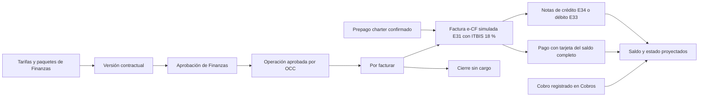

# Finanzas: precios, facturación e-CF simulada, cobro con tarjeta, proveedores y gastos

> [!NOTE]
> La revisión docente de octubre de 2026 cambió validaciones, permisos, notificaciones y otros comportamientos descritos aquí. El estado actual de cada punto está en [Correcciones de la revisión docente](../05-aplicaciones/correcciones-revision-docente-2026-10.md).

Esta nota describe el código del commit verificado, con las cuatro fases del
ciclo. No acredita merge en otra rama, despliegue, emisión fiscal real ni cobro
real: la factura e-CF y la pasarela de tarjeta son simulaciones y cada documento
lo dice con «Simulación — sin validez fiscal». Las decisiones de la fase 4
«Facturación» están en
[ADR-0040](../../docs/adr/0040-billing-cycle-invoicing-from-operations-card-collections-credit-notes-and-payables.md),
y lo que cambió después del commit verificado se señala como «Posterior al
commit verificado».

Contratos gobierna el catálogo de servicios y negocia y propone las versiones
del contrato; Finanzas gobierna precios y paquetes, aprueba los precios de cada
versión, factura y cobra; OCC valida la ejecución. El agente registra hechos y
tipos de cargo. La API compartida valora, congela documentos y calcula saldos
desde persistencia.

## Recorrido comercial

La factura, el cobro y el saldo tienen estados independientes. Un cobro
registrado no prueba una confirmación bancaria y una nota de crédito reduce el
saldo, pero no devuelve efectivo.

## Tarifas, contratos y paquetes

- Tarifas base y de cargos se publican por versiones y moneda USD/DOP; las publicadas conservan su historia. La tarifa de estación prevalece sobre la general.
- Cargos admiten importe fijo, porcentaje, hora, minuto o unidad; sus reglas de cantidad, gracia, redondeo y mínimo se aplican en el servidor.
- Contratos puede negociar excepciones; la revisión de Finanzas conserva la comparación. Una enmienda crea otra versión y no cambia ejecución o facturas anteriores.
- Los paquetes congelan base, componentes incluidos y bloques de excedente por turnaround, tramo o período. El consumo se reserva bajo transacción serializable y no vuelve a cobrar el mismo bloque comenzado.
- Ejemplo sintético GPU: base 500, 60 minutos incluidos, bloque de 15 a 20; 60/61/75/76/83 minutos producen 500/520/520/540/540.
- El consumo de un paquete cuenta cuando lo retiene una factura o un cierre sin cargo. *Posterior al commit verificado de esta nota (revisión del bloque A de la fase 4, `8b61f567`):* un borrador anterior sin factura que retiene, en la estación, consumo de un paquete de la versión de contrato que se factura ya no bloquea: la emisión y el cierre sin cargo lo anulan y liberan antes de valorar, con la auditoría `finance.invoicing.stale_draft_released` ([liberación](../../database/DevelopmentDB/Elevant.Persistence/Finance/StaleInternalDrafts.cs)). `package_scope_has_unissued_preinvoice` queda para un borrador con factura emitida que todavía retiene ese consumo, y la pantalla pide avisar a soporte técnico ([valoración](../../database/DevelopmentDB/Elevant.Persistence/Finance/FinancePackageValuation.cs)).
- Los mínimos de cantidad generan un complemento trazable solo en versiones modernas con `PricingPolicyVersion > 0`. La cobertura de paquete no recibe otro mínimo de servicio. El legado conserva su semántica.
- Falta de tarifa/FX, cobertura ambigua o base porcentual de paquete sin definir bloquea; no se convierte en precio cero.

### Fase 1 del ciclo: aprobación, enmiendas, unidades y paquetes

Desde [ADR-0037](../../docs/adr/0037-commercial-cycle-requests-drafts-amendments-and-portal-accounts.md):

- **Unidad como código.** Catálogo, solicitud, borrador, enmienda, tarifas, cargos y paquetes guardan el código de `ref.billing_units`. Un nombre heredado («operación») se traduce al leer y al guardar, sin reescribir filas, y una unidad desconocida responde `billing_unit_unknown`. Las pantallas proponen una unidad activa y la muestran en español. Queda abierta la valoración de paquetes de la emisión ([`FinancePackageValuation`](../../database/DevelopmentDB/Elevant.Persistence/Finance/FinancePackageValuation.cs)): compara como texto la unidad congelada del servicio con la del componente, así que un servicio que conserva «operación», cubierto por un componente `operation`, bloquea la emisión con `package_unit_mismatch` (ver [brechas del dominio](brechas-y-preguntas-abiertas.md)).
- **Tarifa base sembrada.** El seed de Development publica, solo insertando, la tarifa base en USD y DOP de los servicios públicos `RAMP-*`.
- **Aprobación de precios.** Aprobar no activa el contrato: después vienen la vigencia, las dos firmas y el permiso de operación ([ADR-0024](../../docs/adr/0024-airline-permits-and-contract-lifecycle.md)). La decisión exige la versión esperada y acepta `Idempotency-Key`. Se bloquea con un código por causa: paquete retirado o fuera de la moneda o la vigencia, cobertura ambigua, paquete con un servicio que no está en el contrato, servicio dado de baja o inicio no posterior a la versión aprobada vigente. La aerolínea no ve el motivo de una devolución.
- **Revisores por estación.** Contratos solo envía un borrador si alguien con `finance.contract_approvals.decide` cubre todas sus estaciones. El aviso llega a las cuentas con `finance.contract_approvals.read` que cubren todas las estaciones de la versión, aunque no puedan decidir.
- **Precio base único.** Alta del borrador, editor de Contratos y comparación de Finanzas usan la misma estación base: la única de la versión, o la tarifa general si tiene varias.
- **Enmienda.** Contratos la crea sobre un contrato activo o suspendido (`POST contracts/versions/{id}/amendments`). Parte de la versión que rige, hereda su fin, estaciones, cargos y paquetes, copia las tarifas sin confirmar y solo pide «Vigente desde», que debe caer después del inicio de esa versión y no después de su fin. Desde la fase 2, la que rige es la aprobada y firmada por ambas partes, o la heredada con la que el contrato se activó (ver abajo).
- **Paquetes.** Finanzas descarta un borrador (`finance.packages.delete`, queda `Discarded`) o retira una versión publicada (`finance.packages.retire`, queda `Retired`), siempre con motivo. Una versión retirada ya no se vincula y bloquea el envío y la aprobación de los borradores que la usan; los contratos aprobados conservan su paquete congelado y retirar no revive la versión anterior.
- **Tarifarios.** Tarifas, cargos, unidades y tasas responden un código por causa, y sus listas distinguen error recuperable, falta de permiso y vacío. Finanzas traduce el ámbito del paquete y los estados `Superseded`, `Discarded` y `Retired`.

### Fase 2 del ciclo: qué versión se factura

Desde [ADR-0038](../../docs/adr/0038-preoperation-contract-lifecycle-permits-master-data-and-workforce-readiness.md):

- **Aprobar no reemplaza.** La aprobación de Finanzas ya no marca `Superseded` ni recorta la versión en vigor: esa versión sigue rigiendo y facturándose hasta la segunda firma de la nueva, sobre la misma huella ([regla](../../database/DevelopmentDB/Elevant.Persistence/Commercial/GoverningContractVersions.cs)). Una enmienda retroactiva no cambia precios antes de firmarse, y un servicio ya ejecutado conserva la tarifa con la que se capturó.
- **Frontera de los paquetes.** La valoración de paquetes toma la segunda firma de la versión que reemplaza como frontera; una versión heredada sin firmas usa su aprobación.
- **Contenido firmado.** Aprobar fija `PricingPolicyVersion = 2`: los recargos congelados y los paquetes vinculados entran en la huella y en el PDF, y la aerolínea los ve en «Recargos y paquetes».
- **Contratos terminados.** Finanzas no aprueba una versión de un contrato terminado, ni una que empieza en la fecha de una terminación programada o después (`contract_terminated`, `termination_scheduled`); devolverla sigue siendo posible.
- **Renovaciones.** Una renovación copia los recargos negociados y las exenciones de la versión en vigor, pero no los que Finanzas solo heredó de la tarifa base, que se vuelven a tomar al aprobar la renovación.

La evidencia OCC y las marcas de cargo deben coincidir con la entrega aprobada.
Una marca posterior que altere esa evidencia bloquea la valoración. El móvil
sigue enviando marcas mediante su endpoint e idempotencia de instalación, sin
recibir precios.

## Reglas de cierre y recargos automáticos

Finanzas define las reglas con las que se cierra cada operación ([ADR-0034](../../docs/adr/0034-operational-close-occ-to-finance.md)):

- **Tiempo en tierra permitido por categoría de avión** (estrecho o ancho, de 15 a 720 minutos, con versión optimista). Es el umbral del recargo por tiempo extra (paquete excedido).
- **Calendario de festivos.** En un festivo o domingo, de 06:00 a 21:59, aplica el recargo por día festivo.

Se gestionan en «Configuración → Reglas de cierre» con `finance.close_rules.read`
y `.update`, y cada cambio queda auditado. ELEVANT marca el nocturno, el
festivo, el tiempo extra y la demora al entregar, y OCC puede ajustarlos con
motivo. Finanzas valora la evidencia aprobada por OCC (`approved_evidence_json`),
con la de la entrega como respaldo para aprobaciones anteriores. El seed de
Development usa 15 % para el nocturno y el festivo, como el formulario de AVIAM.

### Fase 3 del ciclo: qué se factura de la operación

Desde [ADR-0039](../../docs/adr/0039-operation-planning-coverage-offline-tablet-occ-review-and-reports.md):

- **Una sola regla de lo facturable.** Se factura un servicio completado o en excepción, con cantidad ejecutada, que OCC no excluyó en la revisión ([`ServiceBillability`](../../backend/Elevant.Application/Finance/ServiceBillability.cs)). La aplican «Por facturar», el borrador interno, la emisión e-CF, los recargos automáticos y los reportes, también «Servicios ejecutados por aerolínea» de OCC.
- **Exclusión de OCC.** OCC excluye de la facturación, con motivo, un servicio en excepción con cantidad mientras la revisión sigue abierta.
- **Cargos que el contrato excluye.** OCC ya no los ve ni los añade. Un cargo heredado de ese tipo bloquea el servicio, y con él su operación, en «Por facturar» y en la emisión con `charge_excluded_by_contract`, hasta que OCC reabra la revisión y lo quite: nunca se valora en 0 sin aviso ([política](../../backend/Elevant.Application/Finance/FinanceApprovedServicePolicy.cs)).
- **Lo firmado.** OCC solo aprueba la Orden de Servicio firmada o corregida por OCC, y los recargos automáticos se proyectan en la Orden antes de la firma: Finanzas factura lo que firmó la aerolínea. Una aprobación de la que nada se facturó se reabre en OCC; una ya facturada se corrige con una nota de crédito.
- **Recargos recalculados.** El reenvío de una corrección mide el tiempo en tierra hasta la primera entrega y retira solo los recargos automáticos que ya no se detectan, y la evidencia que llega mientras OCC revisa los recalcula.

Posterior al commit verificado de esta nota: la integración de Development en
la rama de la fase 4 (`cbd52512`) trajo la corrección de la revisión del bloque
D de la fase 3 (`3b749a94`), que esa verificación no cubre:

- El tiempo extra y la demora que marca ELEVANT van a un servicio completado
  antes que a uno en excepción, y si OCC excluye el servicio que los lleva pasan
  al siguiente servicio facturable que los admite: la operación los sigue
  facturando una vez ([recargos](../../database/DevelopmentDB/Elevant.Persistence/Operations/AutomaticSurchargeApplier.cs)).
- La Orden de Servicio de una ronda de corrección proyecta los recargos como
  la reentrega, así que OCC aprueba la reentrega firmada.
- El cliente compartido conserva el motivo `charge_excluded_by_contract` o
  `excluded_in_review` de una emisión rechazada, y la web lo explica en
  español ([códigos](../../packages/api-client/src/errors.ts)).

## Facturación de operaciones aprobadas

Desde la fase 4 ([ADR-0035](../../docs/adr/0035-direct-invoicing-simulated-ecf.md)
y [ADR-0040](../../docs/adr/0040-billing-cycle-invoicing-from-operations-card-collections-credit-notes-and-payables.md))
Finanzas factura directamente las operaciones aprobadas por OCC, sin prefactura
visible ni aceptación de la aerolínea.

### «Por facturar»

`GET finance/invoicing/pending-operations` ([controlador](../../backend/Elevant.Api/Controllers/FinanceInvoicingController.cs),
[lectura](../../database/DevelopmentDB/Elevant.Persistence/Finance/EfFinancePendingOperationsReadStore.cs))
devuelve una fila por operación pendiente de la estación, de la más antigua a
la más reciente, con cursor, faceta de aerolíneas y el total pendiente. Lo que
ya retiene una factura o un cierre sin cargo nunca vuelve, y una operación no
se parte entre páginas. Cada fila trae su versión, las líneas y el neto
estimados y **todos** sus motivos de bloqueo, incluida la valoración de sus
cargos (`exchange_rate_missing`, `contract_charge_*`, `package_*`…). La
pantalla los explica en español, ofrece atajos de semana (domingo a sábado) y
de mes, «Toda la aerolínea del período», «Cargar más» y «Mostrando N de M».

Los límites de una factura son uno solo y el servidor los publica en la misma
respuesta ([política](../../backend/Elevant.Application/Finance/FinanceInvoicePolicy.cs)):
100 operaciones, 500 líneas y 31 días (`too_many_operations`, `too_many_lines`,
`date_window_exceeded`). Nada se recorta en silencio.

Posterior al commit verificado de esta nota, la revisión del bloque A de la
fase 4 (`8b61f567`) cambió tres cosas de «Por facturar»:

- Un borrador interno antiguo sin factura, o una prefactura del módulo
  retirado en `Draft`, `Submitted`, `Disputed` o `Accepted`, no bloquea la
  operación: la emisión y el cierre sin cargo lo anulan y liberan dentro de su
  transacción, con la auditoría `finance.invoicing.stale_draft_released` y el
  estado que tenía ([liberación](../../database/DevelopmentDB/Elevant.Persistence/Finance/StaleInternalDrafts.cs)).
  Solo un borrador con factura emitida que todavía retiene un servicio muestra
  la operación bloqueada con `pending_preinvoice`, y la pantalla pide avisar a
  soporte técnico.
- «Toda la aerolínea del período» cuenta todo el período, no solo las filas
  cargadas: limpia la búsqueda y, si quedan páginas, lee antes de elegir las
  pendientes de esa aerolínea. Avisa si no pudo leerlas, si el resto no cabe
  en una factura o si quedan pendientes sin revisar.
- Cambiar de estación, aerolínea o período vacía la tabla y muestra la carga
  y, si falla, el error, nunca los datos anteriores; solo la revalidación de
  los mismos filtros conserva las filas, y si falla las marca como no
  actualizadas.

### Emisión

- `POST finance/invoices/from-operations` (`IssueInvoiceFromOperations`, permiso `finance.invoicing.issue`) emite una factura para una operación o para varias de la misma aerolínea y moneda.
- La emisión es **una sola transacción serializable** ([almacén](../../database/DevelopmentDB/Elevant.Persistence/Finance/EfInvoiceIssuanceStore.cs)): crea el borrador interno, valora paquetes, mínimos y recargos, aplica **ITBIS 18 %** fijo a cada línea y emite. Cualquier fallo hace rollback completo: el borrador nunca queda confirmado y las operaciones siguen en «Por facturar». Estación, aerolínea y organización activas se validan antes de escribir (`station_inactive`, `airline_inactive`).
- Cada factura recibe un **e-NCF `E31` + 10 dígitos** consecutivo, un código de seguridad, su fecha de firma y el RNC simulado del emisor. El PDF tiene formato de factura de crédito fiscal, con las horas en hora RD, y dice «Simulación — sin validez fiscal».
- Se rechaza una operación no aprobada (`operation_not_approved`) o ya facturada (`already_invoiced`), una mezcla de aerolíneas (`mixed_airline`) y una selección sin nada facturable (`nothing_to_invoice`); cada salida lleva Problem Details con `code` y conserva `reasons` para los clientes anteriores ([códigos](../../backend/Elevant.Application/Finance/InvoicingCodes.cs)). *Posterior al commit verificado de esta nota (`8b61f567`):* por HTTP, más de 100 operaciones en la emisión o en el cierre sin cargo responde `400 too_many_operations` desde el filtro de binding ([filtro](../../backend/Elevant.Api/Controllers/InvoicingProblems.cs)), no el genérico `invalid_invoice_request`.
- **Idempotencia.** La emisión conserva el `requestId` del cuerpo: el mismo cuerpo responde `200` con la factura ya emitida (`replayed`); el mismo `requestId` con otra cuenta, estación u operaciones, o ya usado en un cierre sin cargo, da `409 idempotency_conflict`. `operationVersions`, opcional, sirve como versión esperada (`version_conflict`). *Posterior al commit verificado de esta nota (`8b61f567`):* la emisión guarda ese cuerpo, con sus `operationVersions`, en el recibo `finance.invoice.issue` de `commercial.finance_pricing_commands`, así que el mismo `requestId` con otras versiones, o sin ellas cuando la primera las llevaba (y al revés), también da `409 idempotency_conflict`; una factura emitida antes de ese recibo se sigue comparando por su cuenta, su estación y sus operaciones.
- **Total 0.** Una factura nunca se emite por 0: responde `422 zero_total` sin consumir e-NCF ni encolar correo. Esas operaciones se cierran con `POST finance/invoicing/no-charge-closures` (`CloseOperationsWithoutCharge`): `Idempotency-Key`, la versión de cada operación, un motivo de 5 a 500 caracteres y `finance.invoicing.issue`. Deja el borrador interno en `NoCharge` con la auditoría `finance.invoicing.closed_no_charge`, conserva el consumo del paquete y no tiene reversa, como una factura emitida. Una operación con importe responde `422 operation_has_charge`.
- **Charter.** Si la escala tiene un charter con el prepago confirmado en la moneda de la factura, la emisión registra el cobro `PREPAGO {referencia}` y lo aplica hasta el total ([prepago](../../database/DevelopmentDB/Elevant.Persistence/Finance/CharterPrepaymentPosting.cs)); el excedente queda como saldo a favor.
- **Correo.** La aerolínea recibe «Factura emitida» con el PDF: indica el total, el vencimiento y el prepago aplicado, nunca el saldo. Desde la fase 1, la factura muestra el estado real de esos correos (`GET finance/invoices/{id}/email-deliveries`): en cola, enviado, fallido con su motivo o sin destinatarios, y en ese caso pide entregar el PDF por otro canal.
- **Aviso a Finanzas.** Cuando OCC aprueba una operación con servicios facturables se crea la alerta de departamento `operation_ready_to_invoice`, una por aerolínea, estación y día hábil, para quien tiene `finance.invoicing.read` y `finance.notifications.read`; abre «Por facturar».

### Día hábil de Finanzas

Todo día de Finanzas es el día hábil de `America/Santo_Domingo`, nunca el UTC
ni el de la estación ([`BusinessCalendar`](../../backend/Elevant.Application/Common/BusinessCalendar.cs)):
emisión y vencimiento, PDF, reportes, tesorería, estados de cuenta, tarjeta,
correos, aviso de vencida, cuentas por pagar y tasas. Una aplicación o una nota
fechada antes del día hábil en que se emitió la factura responde
`400 effective_before_invoice`, y una aplicación, un reverso o una devolución
anterior a su cobro, `400 effective_before_receipt`.

## Cobros, notas y estados de cuenta

- **Cobros y aplicaciones.** Un cobro registrado por Finanzas (transferencia, cheque, efectivo u otro, `finance.receipts.create`) puede quedar sin aplicar, aplicarse parcialmente a varias facturas y conservar remanente; cada aplicación comprueba saldo, moneda/FX y versión. Revertir una aplicación, revertir un cobro y devolver remanente son movimientos separados con su permiso.
- **Tarjeta.** Un cobro con tarjeta nace solo del portal; Finanzas no registra cobros `Card` a mano, y Tesorería no los revierte ni los devuelve (`409 card_payment_not_reversible`, [comandos](../../database/DevelopmentDB/Elevant.Persistence/Finance/FinanceTreasuryStore.Commands.cs)): se corrigen con una nota de crédito.
- **Notas de crédito y débito.** Vinculan la factura y sus líneas originales y comparten el límite de crédito de la factura. Sobre una factura E31, cada nota recibe su propio e-NCF simulado: `E34` si es de crédito y `E33` si es de débito, con el ITBIS congelado por línea (el último crédito de una línea toma el ITBIS restante exacto) y su PDF con «Simulación — sin validez fiscal». La aerolínea recibe el correo de la nota con su PDF. Las facturas anteriores sin e-NCF conservan sus notas `TC-`/`TD-`.
- **Estado proyectado** ([estados](../../backend/Elevant.Application/Finance/FinanceInvoiceStatus.cs)): pendiente, parcial, pagada o vencida; una factura sin cobros que las notas de crédito llevaron a 0 queda «Anulada» (`Voided`), y si hubo algún cobro queda «Pagada».
- **Factura vencida.** Un único aviso por correo, el primer día hábil después del vencimiento si queda saldo, con una marca de auditoría que impide repetirlo ([aviso](../../database/DevelopmentDB/Elevant.Persistence/Finance/EfInvoiceOverdueNoticeStore.cs)).
- **Saldos.** Estado de cuenta y antigüedad se calculan a fecha de corte desde hechos persistentes ([saldos](../../database/DevelopmentDB/Elevant.Persistence/Finance/FinanceTreasuryBalances.cs)); los pagos y créditos heredados se incluyen una vez. USD/DOP no se suman sin conversión explícita. Dinero usa decimal(19,4), cantidades decimal(18,4).
- **Identificación.** El e-NCF, con el número interno de respaldo, identifica la factura en el estado de cuenta, en «Aplicar cobro», en Facturas y en los reportes. «Facturas» pagina de 25 en 25 y busca por e-NCF, número o aerolínea (`invalid_invoice_query`).

El portal deriva tenant y estaciones de las membresías del servidor y nunca
publica cuentas, soportes ni datos de empleados.

## Pago con tarjeta simulado

La aerolínea paga su factura desde el portal, siempre por el saldo completo ([ADR-0036](../../docs/adr/0036-simulated-card-payment.md)):

- La pasarela se elige con `CardPayments:Mode`: `Disabled` por defecto; `Simulated` solo arranca en Development, Test o Testing, y en otro entorno la API no inicia ([composición](../../backend/Elevant.Infrastructure/DependencyInjection.cs)). Sin pasarela, `GET airline/portal/card-payments/availability` dice que no está disponible y el pago responde `409 card_payments_unavailable` antes de mirar la tarjeta.
- `POST airline/portal/invoices/{id}/card-payments` con `Idempotency-Key`; un monto distinto del saldo da `409 amount_mismatch` y una factura saldada `409 invoice_paid`.
- La [pasarela simulada](../../backend/Elevant.Infrastructure/Finance/SimulatedCardGateway.cs) aprueba 4111 1111 1111 1111 y 5555 5555 5555 4444, rechaza 4000 0000 0000 0002 (fondos) y 0069 (vencida), responde error de procesador con 0119 y rechaza cualquier otra.
- Un pago aprobado crea un cobro con método `Card` aplicado a la factura, el correo «Pago recibido» con recibo PDF y el aviso `invoice_paid` para quien abre «Facturas». Rechazos y errores quedan como intentos en `commercial.card_payment_attempts`.
- Solo se guardan la marca, los últimos 4 dígitos y la autorización: nunca el número, el CVV, el vencimiento ni el titular, tampoco en auditoría, correos o avisos.

Posterior al commit verificado de esta nota (`6cbfb273`): el entorno con el que
la API compara `CardPayments:Mode` sale de `DOTNET_ENVIRONMENT`, de
`ASPNETCORE_ENVIRONMENT` o, si faltan, de la clave `environment` del host, la
que fija `UseEnvironment`; sin ninguno es `Production`.

## Charters sin contrato

Un vuelo de una aerolínea sin contrato se cobra a la tarifa base, con prepago ([ADR-0033](../../docs/adr/0033-charter-flights-without-contract.md)). El agente agrega los servicios en rampa con el precio en instantánea, y la Solicitud de Servicio firmada hace de contrato del vuelo.

En «Facturación → Charters»:

- con `finance.charters.read` se listan los charters de las estaciones de la cuenta, con el total de servicios y si la Solicitud está firmada por los dos roles;
- con `finance.charters.confirm` se confirma el prepago (`PUT finance/charters/{id}/prepayment`) con `Idempotency-Key` y la versión leída. Repetir los mismos datos no cambia nada; otro monto o referencia corrige el prepago con motivo mientras no se haya aplicado, y si ya se aplicó responde `409 charter_prepayment_applied`: hay que revertir el cobro, reabrir y confirmar de nuevo ([almacén](../../database/DevelopmentDB/Elevant.Persistence/Operations/EfCharterStore.cs));
- un prepago confirmado después de facturar se aplica una sola vez a la factura abierta y el excedente queda como saldo a favor;
- un servicio que el agente marca como no realizado deja de sumar al prepago, y la Orden lo imprime en 0;
- con el prepago confirmado la tablet ya no agrega servicios (`charter_prepayment_confirmed`) hasta que Finanzas reabre la cotización con motivo y la versión leída (`POST finance/charters/{id}/prepayment/reopening`); la reapertura devuelve el prepago a `Pending` y conserva el monto y la referencia;
- Finanzas recibe `charter_cancelled` cuando OCC cancela o desvía un charter con prepago; la devolución sigue por Cobros y nunca es automática.

El portal de la aerolínea del charter ve su factura y su cobro `PREPAGO`, y
paga el resto con tarjeta.

## Proveedores y cuentas por pagar

- **Proveedor.** Alta, edición y retiro lógico con motivo y versión. Retirar un proveedor con borradores, saldo o pagos sin aplicar, también al desmarcar «Proveedor activo», da `supplier_has_open_balance`; operar uno retirado da `supplier_inactive`.
- **Factura de proveedor** ([política](../../backend/Elevant.Application/Finance/FinancePayablesPolicy.cs)): pasa de `Draft` a `Submitted` y después a `Approved` o `Rejected`; el rechazo exige motivo. Una rechazada vuelve a `Draft` para corregirla. Un borrador, una rechazada o una aprobada sin aplicaciones activas se anulan (`Voided`) con motivo; anular una aprobada exige `finance.payables.reverse`. Una aprobada nunca se reabre. La referencia normalizada del documento es única por proveedor entre las facturas no anuladas, así que anular libera el NCF (`duplicate_reference`).
- **Pagos** ([pagos](../../database/DevelopmentDB/Elevant.Persistence/Finance/FinancePayablesStore.Payments.cs)): un pago admite varias facturas, parcialidad y remanente, sin sobreaplicación bajo carrera SQL. `POST finance/payable-payments/{id}/reversals` revierte una aplicación o anula el pago como fila vinculada e inmutable, con motivo y `finance.payables.reverse`; saldos, pagos pendientes y el reporte de cuentas por pagar excluyen lo revertido.
- **Segregación de funciones** (`segregation_of_duties`, por persona): quien crea o envía una factura no la aprueba, y quien la aprueba no registra ni aplica pagos contra ella.
- **Soportes.** Se guardan en almacenamiento privado con metadatos y hash. En borrador, un soporte se quita con confirmación: la fila se conserva marcada con quién y cuándo, y sus bytes se borran solo si nunca se presentaron. Las dimensiones opcionales estación, aerolínea, turnaround y servicio deben relacionarse con el ámbito autorizado.

Cada error de cuentas por pagar y gastos lleva un `code` estable que la web
traduce al español.

## Gastos propios y revisiones

Cualquier cuenta con un empleado activo y membresía interna de AVIAM registra,
presenta y lee sus propios gastos **sin permisos de Finanzas**; Finanzas tiene
también «Mis gastos». El empleado se deriva de la cuenta y la petición no elige
a quién representar ([gastos](../../database/DevelopmentDB/Elevant.Persistence/Finance/FinancePayablesStore.Expenses.cs)).

1. El empleado crea el borrador y agrega soportes privados; mientras está en borrador puede quitarlos, y sus bytes se borran solo si nunca se presentaron.
2. Presenta el gasto con versión e intención estable. Mientras su departamento no decide, puede retirarlo con motivo; corrige uno rechazado y descarta un borrador o un rechazado (`Cancelled`), siempre con motivo.
3. Lo revisa un administrador efectivo de su departamento, sin autoaprobación. Si no hay otro administrador elegible en la estación, lo revisa un administrador de Finanzas (etapa `Escalation`) y la aprobación final la da otra persona; sin nadie, `reviewRoute` es `None` y se pide a Gobernanza que asigne un revisor.
4. Finanzas aprueba o rechaza después; nadie aprueba su propio gasto ni actúa como ambas revisoras.
5. Finanzas registra el reembolso, parcial o total, sin pagarse a sí misma.

El componente [DepartmentExpensesPage](../../frontend/private-web/src/features/finance/payables/DepartmentExpensesPage.jsx)
sirve «Mis gastos» en cada departamento. El soporte se descarga por la API
privada, sin URL pública ni clave de objeto elegida por el navegador.

## Permisos, menú, auditoría y reportes

El [menú de Finanzas](../../frontend/private-web/src/features/finance/shell/modules.js)
es Inicio · Facturación (Por facturar, Facturas con sus pestañas Cobros y
Estados de cuenta, Charters) · Cuentas por pagar (Facturas de proveedores,
Proveedores, Gastos de empleados, Mis gastos) · Reportes · Configuración
(Tarifario de servicios, Tarifario de cargos, Paquetes, Reglas de cierre,
Aprobación de contratos, Tasas de cambio, Unidades de cobro) · Usuarios del
departamento.

La [matriz del servidor](../../backend/Elevant.Domain/Governance/DepartmentPermissionCatalog.cs)
define un módulo por opción. «Por facturar» depende de `finance.invoicing.read`,
y su emisión, de `finance.invoicing.issue`; Inicio, con su propio permiso de
lectura, muestra cada sección según el permiso de su módulo. *Posterior al
commit verificado de esta nota (revisión del bloque B de la fase 4,
`54e0e8a1`):* el PDF de una factura lo abre «Facturas»
(`finance.reconciliation.read`) para toda factura de sus estaciones, y
`finance.invoicing.issue` solo para las que emitió la propia cuenta
([política](../../backend/Elevant.Application/Finance/FinanceInvoicePolicy.cs));
leer «Por facturar» sin emitir no abre ninguna, aunque sí el estado de sus
correos (`GET finance/invoices/{id}/email-deliveries`). Los códigos de módulos
retirados se conservan como alias para no romper perfiles guardados:
`finance.approved_services.read` y `finance.preinvoices.read` resuelven a
`finance.invoicing.read`; `finance.preinvoices.issue` y `.manage`, a
`finance.invoicing.issue`; los de tributarios, fiscal, el registro heredado de
pagos y notas (`finance.reconciliation.create`) y `finance.expenses.create`,
`.update` y `.manage` no conceden nada. La única acción nueva de la fase 4 es
`finance.payables.reverse`. Los códigos de rol o departamento que envía el
cliente no autorizan nada, y la excepción del gasto propio no concede lectura
general ni decisión final de Finanzas.

Las mutaciones usan intención o `Idempotency-Key`, versión esperada donde
corresponde y una transacción con auditoría e invalidaciones dirigidas; los
replays no duplican auditoría, correos ni avisos. El tiempo real anuncia
`finance_invoices` (emisión, pago con tarjeta, aplicación, reverso, nota y
prepago tardío) a quien lee `finance.invoicing.read` o `finance.reconciliation.read`,
y `finance_approved_services` solo a quien lee «Por facturar».

Los [reportes](../../backend/Elevant.Application/Abstractions/Finance/IFinanceReportStore.cs)
son seis, calculados en el servidor: Ingresos por período (neto de notas, con
ITBIS y consolidado en USD con la tasa registrada), Cuentas por cobrar y
antigüedad, Cobranza, Cuentas por pagar, Recargos y Ventas (e-CF simulado). Se
exportan en CSV, XLSX o PDF con permiso y auditoría, y los PDF llevan el marco
«Simulación — sin validez fiscal». Inicio (`GET finance/home`) muestra los
indicadores de la estación que el servidor calcula, cada sección según el
permiso de su módulo.

## Historia: prefactura, factura no fiscal y simulación fiscal (retiradas del producto)

La fase 4 retiró del producto, no de la base:

- **La prefactura y su disputa.** Antes, Finanzas armaba una prefactura con los
  servicios aprobados, la ajustaba o excluía líneas con motivo, la enviaba a la
  aerolínea, que la aceptaba o la disputaba, y emitía una factura no fiscal
  `NF-…` sin impuestos. Hoy la prefactura es solo el borrador interno de la
  emisión ([borrador](../../database/DevelopmentDB/Elevant.Persistence/Finance/EfPreinvoiceDraftStore.cs),
  [emisión interna](../../database/DevelopmentDB/Elevant.Persistence/Finance/EfFinanceInvoiceIssueStore.cs)),
  sin endpoint ni permiso propios. No hay reclamos ni disputas en el sistema:
  Finanzas corrige con notas de crédito.
- **Las escrituras heredadas.** `POST finance/invoices`, `POST finance/invoices/{id}/credit-notes`
  y `POST finance/payments` (el pago manual completo de prueba) responden
  `410 legacy_finance_route_retired` sin escribir nada
  ([resultado](../../backend/Elevant.Api/Controllers/FinanceResults.cs),
  [ruta retirada](../../backend/Elevant.Api/Controllers/FinanceInvoicesController.cs)).
  El pago heredado se sigue leyendo por la factura para conservar su historia.
  Las rutas de prefacturas, aceptación, disputa, conciliación, servicios
  aprobados, tratamientos tributarios y documentos fiscales se borraron y
  responden 404.
- **Los tratamientos tributarios.** Eran políticas publicadas por aerolínea,
  estación, moneda, concepto y vigencia; el ITBIS 18 % fijo de la factura
  simulada los reemplazó.
- **La simulación fiscal de [ADR-0018](../../docs/adr/0018-finance-commercial-platform-and-fiscal-simulation.md).**
  «Documentos fiscales», sus modos `Off`/`LocalSimulation`/`ProviderSandbox`, el
  archivo fiscal y el preflight XML se retiraron con su configuración
  `FinanceFiscal:*`; el [runbook](../../docs/runbooks/finance-fiscal-activation.md)
  y las [fuentes del esquema DGII](../../docs/reference/dgii-ecf-schema-sources.md)
  se conservan como historia. El e-NCF actual es el de la factura simulada de
  ADR-0035.

Las tablas y las migraciones aplicadas se conservan, entre ellas las de la
[plataforma de Finanzas](../../database/DevelopmentDB/Elevant.Persistence/Persistence/Migrations/20261019033625_AddFinanceCommercialPlatform.cs)
y los [snapshots tributarios](../../database/DevelopmentDB/Elevant.Persistence/Persistence/Migrations/20261019041554_AddFinanceTaxSnapshotsAndCorrections.cs).
La fase 4 solo agregó dos migraciones aditivas, con el `Down` protegido:
[ITBIS de las notas y vínculo del prepago charter](../../database/DevelopmentDB/Elevant.Persistence/Persistence/Migrations/20261109030826_AddAdjustmentNoteTaxAndCharterPrepaymentLink.cs)
y [correcciones de cuentas por pagar](../../database/DevelopmentDB/Elevant.Persistence/Persistence/Migrations/20261109064156_AddPayablesCorrections.cs).

## Límites y referencias

No hay conectividad fiscal real ni aceptación de la DGII: no hay proveedor,
certificado, firma, secuencias autorizadas ni el RNC real del emisor. Tampoco
hay pasarela de tarjeta real, conciliación bancaria, libro mayor ni obtención
automática de tasas, y esta nota no acredita despliegue. Odoo es referencia de
negocio fijada y revisada; ELEVANT conserva su implementación C#/React y su UI.

- [ADR-0016](../../docs/adr/0016-finance-tariffs-charges-and-receivables.md), [ADR-0035](../../docs/adr/0035-direct-invoicing-simulated-ecf.md), [ADR-0036](../../docs/adr/0036-simulated-card-payment.md) y [ADR-0040](../../docs/adr/0040-billing-cycle-invoicing-from-operations-card-collections-credit-notes-and-payables.md), que recoge las decisiones de la fase 4
- [Plan de la plataforma de Finanzas](../../docs/superpowers/plans/2026-10-18-finance-platform.md), histórico
- [Matriz Odoo y licencias](../../docs/reference/odoo-finance-adaptation.md)
- [Backend y contratos actuales](../../backend/README.md)
- [Migraciones de DevelopmentDB](../../database/DevelopmentDB/README.md)
- [Gobernanza por departamento](gobernanza-por-departamento.md)
- [Solicitudes, contratos y servicios](solicitudes-contratos-y-servicios.md)
- [Cobros, aplicaciones y consulta de aerolínea](../05-aplicaciones/tesoreria-cobros-y-portal.md)
