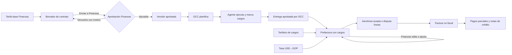

# Finanzas: tarifarios, cargos de rampa y cuentas por cobrar

> [!note] Estado
> Esta nota describe la rama de integración `feat/finance-refinement`, que está
> verificada con pruebas locales. No acredita fusión a Development, despliegue
> al VPS ni facturación tributaria. La decisión de diseño está en
> [ADR-0016](../../docs/adr/0016-finance-tariffs-charges-and-receivables.md).

Finanzas gobierna los precios, valora los cargos que marcan los agentes de
rampa, corrige la prefactura y lleva la cartera no fiscal en USD y DOP.

## Tarifarios

### Tarifa base de servicios

- Hay una versión por moneda, con el ciclo `Draft → Published → Superseded`.
- Cada tarifa indica servicio, estación opcional, unidad del catálogo
  `ref.billing_units`, precio y mínimo.
- Una tarifa de estación gana a la general.
- Publicar cierra la versión anterior. Las versiones publicadas no se editan.

### Catálogo de cargos

CRUD de cargos y recargos. Cada cargo declara:
- categoría;
- método: importe fijo, % del servicio, por hora, por minuto o por unidad;
- regla de cantidad: una vez, duración del servicio, exceso sobre el fin
  planificado, demora de la llegada o cantidad del servicio;
- gracia, redondeo, alcance, si admite varias aplicaciones y si es visible para
  los agentes.

### Tarifario de cargos

Importe o porcentaje de cada cargo, con mínimo, en versiones por moneda.

### Tasas de cambio

- Tasa diaria USD→DOP registrada a mano por Finanzas, con su fuente.
- Corregir una tasa crea una fila nueva que reemplaza a la anterior. La
  historia se conserva.

## Contratos y aprobación de Finanzas

- El borrador hereda de la tarifa base, en su moneda, el precio y la unidad de
  cada servicio.
- Contratos puede negociar precios y excluir o negociar cargos.
- «Enviar a Finanzas» deja la versión en `PendingFinanceApproval`.
- Finanzas ve cada precio frente a la base, con la diferencia porcentual y los
  cargos negociados, y decide:
  - **Aprobar:** activa el contrato.
  - **Devolver:** exige un motivo y la versión vuelve a `Draft`.
- La comparación queda guardada con la decisión. OCC solo opera versiones
  aprobadas.

## Cargos en rampa

- **Qué marca el agente:** en Mobile Agent («Cargos aplicados») marca solo el
  tipo de cargo de un servicio en curso, completado o en excepción. Nunca ve
  precios ni escribe cantidades.
- **Cómo se protege el envío:** cada marca o retirada usa una clave
  idempotente estable por servicio, cargo y acción, y la instalación del
  dispositivo. La lista se guarda como caché para consultarla sin conexión.
- **Qué pasa al aprobar:** las marcas viajan en la evidencia de entrega
  (versión 2). Si cambian después de la aprobación, Finanzas no puede valorar
  la entrega (`approved_evidence_mismatch`).

## Valoración y prefactura

### Cálculo del importe de un cargo

1. La cantidad se mide con los tiempos registrados, menos la gracia, y se
   redondea hacia arriba.
2. El importe sale de la tarifa negociada del contrato; si no la hay, del
   tarifario de cargos.
3. Si falta tarifa en la moneda, se convierte con la tasa del día.
4. Se aplica el mínimo.
5. Si falta la tarifa o la tasa, la línea queda bloqueada con motivo.

### Edición en borrador

- Las líneas son de servicio, cargo o ajuste. Los cargos y ajustes cuelgan de
  su servicio.
- En `Draft`, Finanzas puede cambiar importes, excluir cargos o añadir ajustes
  (también negativos).
- Cada cambio exige motivo y versión esperada, y queda auditado. Se conserva
  el valor calculado.

### Lo que ve la aerolínea

- Cada cargo y ajuste aparece como una línea propia, con su motivo.
- Puede disputar cada línea por separado.
- Las líneas excluidas no se muestran.

## Cuentas por cobrar no fiscales

- La factura tiene vencimiento según el plazo del perfil de facturación de la
  aerolínea (30 días por defecto).
- Admite varios pagos (método y fecha) y notas de crédito idempotentes.
- El saldo es total − pagos − notas y nunca queda negativo.
- El estado (`Pending`, `PartiallyPaid`, `Paid`, `Overdue`) se calcula; no se
  guarda.
- La aerolínea consulta su estado de cuenta en el portal.
- Ningún documento es fiscal ni confirma fondos bancarios.

## Reportes

- **Disponibles:** ingresos, cuentas por cobrar y antigüedad, cobranza,
  pipeline, cargos y ajustes, disputas, uso de tarifas y notas de crédito.
- **Cálculo:** se hacen en el servidor, sobre las estaciones del actor. Los
  consolidados en USD usan la tasa registrada.
- **Exportación:** CSV o PDF no fiscal, con permiso y auditoría.

## Permisos

| Módulo | Lectura | Gestión |
| --- | --- | --- |
| Tarifario de servicios | `finance.tariffs.read` | `finance.tariffs.manage` |
| Tarifario de cargos | `finance.charges.read` | `finance.charges.manage` |
| Tasas de cambio | `finance.exchange_rates.read` | `finance.exchange_rates.manage` |
| Aprobación de contratos | `finance.contract_approvals.read` | `finance.contract_approvals.decide` |
| Prefacturas | `finance.preinvoices.read` | `finance.preinvoices.manage` |
| Facturas y cobros | `finance.reconciliation.read` | `finance.reconciliation.record` |
| Reportes | `finance.reports.read` | `finance.reports.export` |

## Fuera de alcance

- Facturación fiscal (ITBIS, NCF).
- Conciliación bancaria.
- Obtención automática de tasas.
- Cobro electrónico.

## Relacionados

- [Solicitudes, contratos y servicios](solicitudes-contratos-y-servicios.md)
- [Gobernanza de usuarios por departamento](gobernanza-por-departamento.md)
- [Brechas y preguntas abiertas](brechas-y-preguntas-abiertas.md)

## Fuentes

- [ADR-0016](../../docs/adr/0016-finance-tariffs-charges-and-receivables.md)
- [Política de valoración de cargos](../../backend/Elevant.Application/Finance/FinanceChargePricingPolicy.cs)
- [Valoración en persistencia](../../database/DevelopmentDB/Elevant.Persistence/Finance/FinanceChargeValuation.cs)
- [API de tarifarios](../../backend/Elevant.Api/Controllers/FinanceTariffBookController.cs)
- [API de cargos de rampa](../../backend/Elevant.Api/Controllers/RampServiceChargesController.cs)
- [Cartera no fiscal](../../database/DevelopmentDB/Elevant.Persistence/Finance/EfFinanceInvoiceLedgerStore.cs)
- [Reportes](../../database/DevelopmentDB/Elevant.Persistence/Finance/EfFinanceReportStore.cs)
