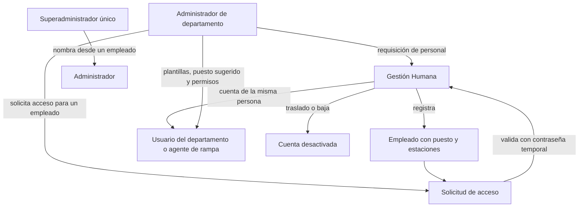

# Gobernanza de usuarios por departamento

Las cuentas internas de AVIAM se administran en dos niveles: un
superadministrador único y administradores por departamento. Gestión Humana
es dueña de las personas: solo un empleado registrado por ella puede recibir
acceso, y valida cada alta que piden los administradores. Las decisiones están
en [ADR-0015](../../docs/adr/0015-department-user-governance.md) y
[ADR-0017](../../docs/adr/0017-employees-positions-and-access.md).

| Concepto | Dueño | Qué es |
| --- | --- | --- |
| Empleado | Gestión Humana | Expediente de la persona: identificación, departamento, puesto, estaciones, ingreso y baja. |
| Puesto | Gestión Humana | Cargo del organigrama de un departamento; los de rampa existen solo en Operaciones. |
| Perfil de acceso | Administrador del departamento | Plantilla o permisos que definen qué ve la persona en ELEVANT. |

## Niveles

| Nivel | Puede | No puede |
| --- | --- | --- |
| Superadministrador | Ver todos los departamentos, solicitudes y actividad; nombrar administradores desde un empleado registrado sin validación; gestionar usuarios de aerolíneas; convertir roles heredados. | Transferirse ni ser duplicado (índice único filtrado). Operar Finanzas u OCC. |
| Administrador | Todos los módulos de su departamento; pedir personal; solicitar acceso para sus empleados; elegir la plantilla sugerida de sus puestos; editar permisos y estaciones; desactivar, reactivar y restablecer claves de sus miembros; leer la actividad del departamento. | Crear administradores, personas o puestos; editar nombre o correo (son del expediente); gestionarse a sí mismo u otros administradores; conceder estaciones que no tiene el empleado o él mismo. |
| Miembro | Lo que su plantilla o sus permisos explícitos conceden. | Nada fuera de su departamento. |

## Permisos

Gestión Humana no programa turnos. `human_resources.schedules` solo concede
lectura, porque el OCC programa los turnos con `operations.planning.assign`.
Gestión Humana decide la disponibilidad con `human_resources.availability.decide`.

El catálogo vive en código (`DepartmentPermissionCatalog`) con el formato
`<departamento>.<módulo>.<acción>`, por ejemplo `contracts.requests.approve` u
`operations.review.decide`. Conceder cualquier acción concede también la lectura
del módulo. Las plantillas (`iam.access_profiles`) se aplican en vivo: editar o
desactivar una plantilla cambia el acceso de sus miembros y rota su sello de
seguridad.

El acceso efectivo se calcula en el servidor para cada petición. Private Web
sólo lo usa para mostrar u ocultar módulos y acciones (`GET governance/me/access`).

## Empleados, altas, traslados y bajas

1. El departamento puede pedir personal con una requisición (puesto, cantidad y
   motivo). Gestión Humana la atiende, la cubre o la rechaza con motivo.
2. Gestión Humana registra al empleado (`employees.manage`): identificación
   real normalizada y única, número de empleado único, correo corporativo,
   departamento, puesto y estaciones. Un puesto de rampa crea su `RampAgent`.
3. El administrador elige un empleado de su departamento sin cuenta activa y
   solicita el acceso con un UUID propio. El tipo (web o rampa) sale del puesto,
   la plantilla viene precargada desde el puesto y las estaciones deben estar
   entre las del empleado y las del administrador.
4. Gestión Humana o el superadministrador la valida definiendo (o generando) la
   contraseña temporal, o la rechaza con motivo. Quien la envió no puede
   resolverla. La cuenta se emite para la misma persona del empleado y exige
   cambio de contraseña.
5. Un traslado (`employees.terminate`) desactiva la cuenta, invalida sesiones,
   revoca estaciones y cancela solicitudes; el nuevo departamento solicita el
   acceso y la misma cuenta se reaprovisiona.
6. Una baja hace lo mismo y desactiva el agente de rampa; ninguna ruta reactiva
   la cuenta de un empleado dado de baja.

Las cuentas creadas antes de los expedientes aparecen en **Expedientes
pendientes**: Gestión Humana registra su identificación real y su puesto.

## Actividad

Los inicios de sesión se auditan. Cada departamento lee su actividad
(inicios de sesión, accesos y operación de su gente según el historial de
asignaciones); Gestión Humana con `human_resources.audit.read` lee la
trazabilidad de personas de todos los departamentos y el superadministrador
lee todo, por periodos de hasta 92 días.

## Compatibilidad

- Cuentas creadas antes del modelo: su rol de departamento equivale a
  administrador y `ramp.agent@` a miembro de Operaciones.
- Roles `CUSTOM_*`: operan como miembros de Contratos hasta que el
  superadministrador los convierte en plantilla.
- Los endpoints `ramp-mobile-access-requests` siguen respondiendo pero están
  deprecados.
- La API acepta todavía la solicitud con persona escrita a mano y la creación
  directa de miembros (obsoleta); una entrega posterior las retirará
  (expand/contract, ADR-0017).

## Relacionados

- [Identidad, tenancy y autorización](identidad-tenancy-y-autorizacion.md)
- [Personal, roles y departamentos](personal-roles-y-departamentos.md)

## Fuentes

- [ADR-0015](../../docs/adr/0015-department-user-governance.md)
- [ADR-0017](../../docs/adr/0017-employees-positions-and-access.md)
- [API de empleados](../../backend/Elevant.Api/Controllers/HumanResourcesEmployeesController.cs)
- [Acceso por empleado](../../database/DevelopmentDB/Elevant.Persistence/Identity/EfDepartmentGovernanceStore.EmployeeAccess.cs)
- [Catálogo de permisos](../../backend/Elevant.Domain/Governance/DepartmentPermissionCatalog.cs)
- [Resolución de acceso](../../backend/Elevant.Application/Identity/DepartmentAccess.cs)
- [Store de gobernanza](../../database/DevelopmentDB/Elevant.Persistence/Identity/EfDepartmentGovernanceStore.cs)
- [API de gobernanza](../../backend/Elevant.Api/Controllers/DepartmentGovernanceController.cs)
