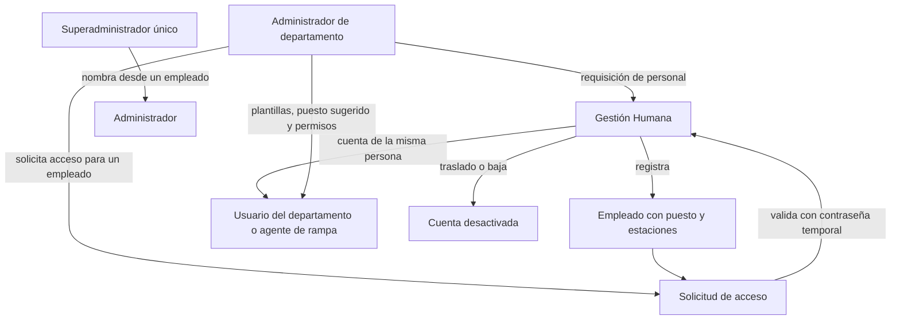

# Gobernanza de usuarios por departamento

Las cuentas internas de AVIAM se administran en dos niveles: un
superadministrador único y administradores por departamento. Gestión Humana
es dueña de las personas: solo un empleado registrado por ella puede recibir
acceso, y valida cada alta que piden los administradores. Las decisiones están
en [ADR-0015](../../docs/adr/0015-department-user-governance.md),
[ADR-0017](../../docs/adr/0017-employees-positions-and-access.md) y
[ADR-0019](../../docs/adr/0019-menu-option-permissions-and-department-notifications.md).

| Concepto | Dueño | Qué es |
| --- | --- | --- |
| Empleado | Gestión Humana | Expediente de la persona: identificación, departamento, puesto, estaciones, ingreso y baja. |
| Puesto | Gestión Humana | Cargo del organigrama de un departamento; los de rampa existen solo en Operaciones. |
| Perfil de acceso | Administrador del departamento | Plantilla o permisos que definen qué ve la persona en ELEVANT. |

## Niveles

| Nivel | Puede | No puede |
| --- | --- | --- |
| Superadministrador | Ver todos los departamentos, solicitudes y actividad; nombrar administradores desde un empleado registrado sin validación; gestionar usuarios de aerolíneas; convertir roles heredados. | Transferirse ni ser duplicado (índice único filtrado). Operar Finanzas u OCC. |
| Administrador | Todos los módulos de su departamento; pedir personal; solicitar acceso para sus empleados; elegir la plantilla sugerida de sus puestos; editar permisos y estaciones; desactivar, reactivar y restablecer claves de sus miembros; leer la actividad del departamento. | Crear administradores, personas o puestos; editar nombre o correo (son del expediente); gestionarse a sí mismo u otros administradores; conceder estaciones que no tiene el empleado o él mismo. |
| Miembro | Lo que su plantilla o sus permisos explícitos conceden. | Nada fuera de su departamento. |

> **Defecto abierto (6 de noviembre de 2026, posterior al commit verificado de
> esta nota; código de `8a79fe70`).** Restablecer la clave de un miembro
> (`POST governance/departments/{department}/users/{id}/password-reset`, que
> usan el administrador del departamento y el superadministrador) falla hoy con
> un error de servidor, igual que la ruta anterior del superadministrador
> (`POST governance/users/{id}/password-reset`): ambas piden un token a Identity
> ([`GeneratePasswordResetTokenAsync`](../../database/DevelopmentDB/Elevant.Persistence/Identity/EfDepartmentGovernanceStore.Users.cs)),
> y la API [registra Identity](../../database/DevelopmentDB/Elevant.Persistence/DependencyInjection.cs)
> sin proveedores de tokens. Ninguna prueba cubre esas rutas. Se cierra cuando
> la API registre los proveedores o la ruta deje de depender de ellos, como ya
> se hizo con la contraseña temporal de Clientes
> ([ADR-0037](../../docs/adr/0037-commercial-cycle-requests-drafts-amendments-and-portal-accounts.md));
> ver [Pendientes transversales](../12-backlog/pendientes-transversales.md).

## Permisos

Gestión Humana no programa turnos. `human_resources.schedules` solo concede
lectura, porque el OCC programa los turnos con `operations.planning.assign`.
Gestión Humana decide la disponibilidad con `human_resources.availability.decide`.

El catálogo vive en código (`DepartmentPermissionCatalog`) con el formato
`<departamento>.<opción>.<acción>`, por ejemplo `contracts.catalog.create` u
`operations.review.decide`.

- **Una opción por entrada del menú.** Cada opción del menú lateral es un
  módulo, con su sección; las funciones que viven dentro de una pantalla
  declaran su opción padre.
- **Columnas de la matriz.** Cada acción cae en una columna: Ver, Crear,
  Modificar, Eliminar u Otras acciones (aprobar, publicar, emitir, exportar,
  firmar…).
- **Ver se concede siempre.** Conceder cualquier acción concede también «Ver».
- **Subventanas.** Conceder una subventana (por ejemplo, Solicitudes de
  clausura dentro de Servicios) concede «Ver» de la pantalla que la contiene;
  prohibir esa pantalla prohíbe sus subventanas. La matriz ofrece por fila el
  selector rápido «Prohibido / Ver / Editar», con las casillas para el ajuste
  fino ([ADR-0019](../../docs/adr/0019-menu-option-permissions-and-department-notifications.md)).
- **Grants antiguos.** Los códigos anteriores a ADR-0019 (`*.manage`,
  `employees.terminate`, `attendance.record`…) se traducen al resolver el acceso,
  así que las plantillas guardadas siguen funcionando. Las plantillas (`iam.access_profiles`) se aplican en vivo: editar o
desactivar una plantilla cambia el acceso de sus miembros y rota su sello de
seguridad.

**Altas de la fase 1 del ciclo**, posteriores al commit verificado de esta
nota (código de `8a79fe70`;
[ADR-0037](../../docs/adr/0037-commercial-cycle-requests-drafts-amendments-and-portal-accounts.md)):

- `contracts.requests.cancel` cancela solicitudes comerciales;
- `contracts.drafts.delete` descarta borradores de contrato;
- `finance.packages.delete` descarta borradores de paquete y
  `finance.packages.retire` retira paquetes publicados.

En la misma fase, `contracts.catalog.delete` se rotula «Dar de baja» y la
verificación de solicitudes, «Verificar aerolínea y representante». Los grants
heredados `commercial.requests.full` y `commercial.requests.write` incluyen las
dos acciones nuevas de Contratos, y el alias `finance.packages.manage`, las dos
de paquetes. No hacen falta migraciones: el catálogo vive en código.

**Altas de la fase 2 del ciclo**, posteriores al commit verificado de esta nota
(código de `50e7778f`;
[ADR-0038](../../docs/adr/0038-preoperation-contract-lifecycle-permits-master-data-and-workforce-readiness.md)):

- `operations.master_data` («Datos maestros»): ver, crear y editar o desactivar
  terminales, posiciones y tipos de avión;
- `operations.devices` («Tablets»): ver, desvincular y revocar tablets.

El administrador de OCC hereda ambos módulos. Las estaciones las gestiona solo
el superadministrador. Los roles de representante y firmante del portal de una
aerolínea (`airline_portal.representative` y `airline_portal.signer`) son grants
de cuenta fuera del catálogo de departamentos, así que nunca entran en el acceso
de un departamento.

**Altas de la fase 3 del ciclo**, también posteriores al commit verificado
(código de `f2d5c52c` y de las correcciones de la revisión de sus bloques A, B
y C, `34e90aad`;
[ADR-0039](../../docs/adr/0039-operation-planning-coverage-offline-tablet-occ-review-and-reports.md)):

- `operations.planning.update` («Reprogramar, cancelar o desviar escalas»);
- `operations.review.reopen` («Reabrir operaciones aprobadas sin facturar»);
- `operations.incidents` («Incidencias»): ver, y reportar y gestionar
  incidencias. Es una subventana de Revisión.

El administrador de OCC las hereda. El relevo de un agente usa
`operations.planning.assign`, la exclusión de facturación usa
`operations.review.decide` y la reapertura de la cotización de un charter usa
`finance.charters.confirm`, que ya existían. El detalle de la escala, cuya
versión envían los comandos del mapa de posiciones, lo lee también quien tiene
`operations.positions_map.assign`, sin necesitar el «Ver» de Planificación.

**Cambios de la fase 4 del ciclo**, también posteriores al commit verificado
(código de `39a85a46`;
[ADR-0035](../../docs/adr/0035-direct-invoicing-simulated-ecf.md),
[ADR-0040](../../docs/adr/0040-billing-cycle-invoicing-from-operations-card-collections-credit-notes-and-payables.md)
y [Finanzas](finanzas-tarifas-cargos-y-cobros.md)):

- el menú de Finanzas queda en Inicio · Facturación (Por facturar, Facturas con
  sus pestañas Cobros y Estados de cuenta, Charters) · Cuentas por pagar
  (Facturas de proveedores, Proveedores, Gastos de empleados, Mis gastos) ·
  Reportes · Configuración · Usuarios del departamento
  ([menú](../../frontend/private-web/src/features/finance/shell/modules.js));
- se retiran los módulos de prefacturas, servicios aprobados, tratamientos
  tributarios y documentos fiscales. Sus códigos guardados se conservan como
  alias: `finance.approved_services.read` y `finance.preinvoices.read`
  resuelven a `finance.invoicing.read`, `finance.preinvoices.issue` y
  `.manage` a `finance.invoicing.issue`, y los demás (tributarios, fiscal,
  `finance.reconciliation.create`) no conceden nada, así que un perfil guardado
  no falla;
- `finance.reconciliation` se rotula «Facturas» y abre el PDF de toda factura
  de sus estaciones; «Por facturar» depende de `finance.invoicing.read`, y el
  PDF de la factura recién emitida, de `finance.invoicing.issue`, que desde la
  revisión del bloque B (`54e0e8a1`) solo abre las que emitió la propia cuenta:
  leer «Por facturar» sin emitir no abre facturas, aunque sí el estado de sus
  correos. Inicio, con su propio permiso de lectura, muestra cada sección según
  el permiso de su módulo;
- la única acción nueva es `finance.payables.reverse` («Anular facturas y
  revertir pagos»);
- `finance.expenses.create`, `.update` y `.manage` pasan a alias vacíos: el
  gasto propio nunca necesitó un código de Finanzas, y Finanzas recibe «Mis
  gastos» sin permiso;
- el perfil sembrado «Analista de facturación» de Development recibe
  `finance.notifications.read` y ya no tiene códigos de prefactura;
- la segregación de funciones de cuentas por pagar y gastos compara personas,
  no permisos: Development siembra una sola cuenta de Finanzas, que no aprueba
  una factura de proveedor que registró o envió ni da la aprobación final de un
  gasto que revisó por escalamiento. Para cerrar ese ciclo en Development hace
  falta que Gobernanza cree otra cuenta de Finanzas.

Un alias retirado solo se atribuye al departamento de su prefijo, para que una
plantilla guardada siga validando, y la normalización de los grants lo descarta
([catálogo](../../backend/Elevant.Domain/Governance/DepartmentPermissionCatalog.cs)).

El acceso efectivo se calcula en el servidor para cada petición. Private Web
sólo lo usa para mostrar u ocultar módulos y acciones (`GET governance/me/access`).

## Empleados, altas, traslados y bajas

1. El departamento puede pedir personal con una requisición (puesto, cantidad y
   motivo). Gestión Humana la atiende, la cubre o la rechaza con motivo.
2. Gestión Humana registra al empleado (`employees.create`): identificación
   real normalizada y única, número de empleado único, correo corporativo,
   departamento, puesto y estaciones. Un puesto de rampa crea su `RampAgent`.
3. El administrador elige un empleado de su departamento sin cuenta activa y
   solicita el acceso con un UUID propio. El tipo (web o rampa) sale del puesto,
   la plantilla viene precargada desde el puesto y las estaciones deben estar
   entre las del empleado y las del administrador.
4. Gestión Humana o el superadministrador la valida definiendo (o generando) la
   contraseña temporal, o la rechaza con motivo. Quien la envió no puede
   resolverla. La cuenta se emite para la misma persona del empleado y exige
   cambio de contraseña.
5. Un traslado (`employees.delete`) desactiva la cuenta, invalida sesiones,
   revoca estaciones y cancela solicitudes; el nuevo departamento solicita el
   acceso y la misma cuenta se reaprovisiona.
6. Una baja hace lo mismo y desactiva el agente de rampa; ninguna ruta reactiva
   la cuenta de un empleado dado de baja.

Posterior al commit verificado de esta nota (código de `50e7778f`;
[ADR-0038](../../docs/adr/0038-preoperation-contract-lifecycle-permits-master-data-and-workforce-readiness.md)):

- El traslado retira, con auditoría, los roles del departamento de origen y deja
  inerte su asignación. Ese departamento ya no reactiva ni edita al empleado
  (`employee_transferred`); solo la solicitud del nuevo departamento, validada
  por Gestión Humana, le devuelve el acceso.
- La baja, el traslado fuera de rampa, el paso a oficina y la desactivación del
  perfil de rampa liberan las coberturas, las operaciones no iniciadas, los
  turnos y las tablets del agente, y se rechazan si tiene una operación en
  curso o devuelta (`agent_has_operation_in_progress`).
- El traslado y la baja cancelan las solicitudes pendientes que había pedido
  esa persona, y no se valida una solicitud cuyo solicitante ya no administra
  el departamento (`requester_no_longer_administrator`).
- Gestión Humana recibe el aviso de cada solicitud de acceso, y la foto de una
  solicitud pendiente se conserva hasta resolverla.
- Al editar a un miembro, sus estaciones deben salir de su expediente
  (`stations_outside_employee`), también para el superadministrador.
- Las altas y ediciones de gobernanza aceptan una `Idempotency-Key` opcional y
  siempre responden con un código.

Las cuentas creadas antes de los expedientes aparecen en **Expedientes
pendientes**: Gestión Humana registra su identificación real y su puesto.

**Alta directa por el superadministrador.** Desde «Usuarios internos → Nuevo
usuario interno», el superadministrador registra el expediente y la cuenta en
un solo paso, sin solicitud ni validación de Gestión Humana. Puede crear un
administrador o un sub-usuario con permisos por opción y subventana. El alta
queda auditada como hecha por el superadministrador. Los agentes de rampa
siguen el flujo de solicitud.

## Notificaciones

Cada departamento con la opción «Notificaciones» recibe en pantalla las alertas
de lo que debe atender:

- **Gestión Humana:** altas por validar, requisiciones y disponibilidad.
- **Contratos:** solicitudes comerciales, comentarios y firmas de aerolíneas,
  clausuras, permisos enviados o por vencer, y cambios del ciclo del contrato
  (activación, suspensión, vencimiento y aviso a 30 días;
  [ADR-0024](../../docs/adr/0024-airline-permits-and-contract-lifecycle.md)).
- **Finanzas:** contratos por aprobar.

Solo las recibe quien también puede abrir la fuente; ver
[ADR-0019](../../docs/adr/0019-menu-option-permissions-and-department-notifications.md).

Posterior al commit verificado de esta nota (código de `8a79fe70`):

- Contratos también recibe que la cuenta del portal quedó lista para enviar un
  borrador y que Finanzas devolvió o aprobó sus precios
  ([ADR-0037](../../docs/adr/0037-commercial-cycle-requests-drafts-amendments-and-portal-accounts.md)).
- El aviso de un contrato por aprobar solo llega a quien, además de abrir la
  aprobación (`finance.contract_approvals.read`), cubre todas las estaciones de
  la versión
  ([ADR-0037](../../docs/adr/0037-commercial-cycle-requests-drafts-amendments-and-portal-accounts.md)).
- Finanzas también recibe las facturas pagadas con tarjeta
  ([ADR-0036](../../docs/adr/0036-simulated-card-payment.md)). Desde la fase 4
  (código de `39a85a46`) ya no existen las alertas de prefacturas aceptadas o
  disputadas: la aerolínea no acepta ni disputa
  ([ADR-0035](../../docs/adr/0035-direct-invoicing-simulated-ecf.md)).
- Desde la fase 2 (código de `50e7778f`;
  [ADR-0038](../../docs/adr/0038-preoperation-contract-lifecycle-permits-master-data-and-workforce-readiness.md)),
  Contratos recibe también que no pudo iniciarse una renovación automática,
  que se programó, se canceló o se cumplió una terminación, y que se retiró una
  versión. Los avisos que ya recibía al fijarse la vigencia de un contrato y al
  empezar una renovación automática ganaron título y destino. El aviso de
  vencimiento ya no es siempre a 30 días: usa los días de aviso que firmó la
  versión.
- Gestión Humana recibe un aviso antes del vencimiento de un carnet, una
  licencia de rampa o una habilitación de un agente.
- OCC recibe, en su feed operativo, que Gestión Humana liberó a un agente de una
  operación y que el agente asignado ya no tiene un documento vigente.
- Desde la fase 3 (código de `f2d5c52c`;
  [ADR-0039](../../docs/adr/0039-operation-planning-coverage-offline-tablet-occ-review-and-reports.md)),
  Finanzas recibe que OCC canceló o desvió un charter con prepago
  (`charter_cancelled`). OCC recibe en su feed operativo que el proveedor
  informó cancelado o desviado un vuelo importado, que un cambio de posición dejó
  una operación sin agente elegible y que una operación sin iniciar perdió su
  contrato.
- Desde la fase 4 (código de `39a85a46`;
  [ADR-0040](../../docs/adr/0040-billing-cycle-invoicing-from-operations-card-collections-credit-notes-and-payables.md)),
  Finanzas recibe `operation_ready_to_invoice` cuando OCC aprueba operaciones
  con servicios facturables, una por aerolínea, estación y día hábil, solo si
  también abre «Por facturar» (`finance.invoicing.read`); abre esa pantalla. El
  aviso de factura pagada con tarjeta (`invoice_paid`) llega a quien abre
  «Facturas».

**Pruebas.** Cada tipo tiene una prueba SQL que comprueba quién la recibe y quién
no, el filtro por estación, la marca de leída, la reaparición como no leída de
la misma fuente y la señal del feed de cambios. Las shells reciben la opción
`observeNotifications`, de modo que sus pruebas cubren la campana con su contador,
el aviso emergente con «Abrir» y el cajón de notificaciones.

## Actividad

Los inicios de sesión se auditan. Cada departamento lee su actividad
(inicios de sesión, accesos y operación de su gente según el historial de
asignaciones); Gestión Humana con `human_resources.audit.read` lee la
trazabilidad de personas de todos los departamentos y el superadministrador
lee todo, por periodos de hasta 92 días.

## Compatibilidad

- Cuentas creadas antes del modelo: su rol de departamento equivale a
  administrador y `ramp.agent@` a miembro de Operaciones.
- Roles `CUSTOM_*`: operan como miembros de Contratos hasta que el
  superadministrador los convierte en plantilla.
- Los endpoints `ramp-mobile-access-requests` siguen respondiendo pero están
  deprecados.
- La API acepta todavía la solicitud con persona escrita a mano y la creación
  directa de miembros (obsoleta); una entrega posterior las retirará
  (expand/contract, ADR-0017).

Posterior al commit verificado de esta nota (código de `50e7778f`;
[ADR-0038](../../docs/adr/0038-preoperation-contract-lifecycle-permits-master-data-and-workforce-readiness.md)):
un miembro con un rol `CUSTOM_*` conserva su acceso y, al editarlo, pasa a
`CONTRATOS`. `POST` y `PUT` en `governance/roles` y en `governance/users`
responden `410 legacy_governance_retired`, así que una solicitud de
`ramp-mobile-access-requests` ya solo se puede rechazar.

## Relacionados

- [Identidad, tenancy y autorización](identidad-tenancy-y-autorizacion.md)
- [Personal, roles y departamentos](personal-roles-y-departamentos.md)

## Fuentes

- [ADR-0015](../../docs/adr/0015-department-user-governance.md)
- [ADR-0017](../../docs/adr/0017-employees-positions-and-access.md)
- [ADR-0019](../../docs/adr/0019-menu-option-permissions-and-department-notifications.md)
- [API de empleados](../../backend/Elevant.Api/Controllers/HumanResourcesEmployeesController.cs)
- [Acceso por empleado](../../database/DevelopmentDB/Elevant.Persistence/Identity/EfDepartmentGovernanceStore.EmployeeAccess.cs)
- [Catálogo de permisos](../../backend/Elevant.Domain/Governance/DepartmentPermissionCatalog.cs)
- [Resolución de acceso](../../backend/Elevant.Application/Identity/DepartmentAccess.cs)
- [Store de gobernanza](../../database/DevelopmentDB/Elevant.Persistence/Identity/EfDepartmentGovernanceStore.cs)
- [API de gobernanza](../../backend/Elevant.Api/Controllers/DepartmentGovernanceController.cs)
