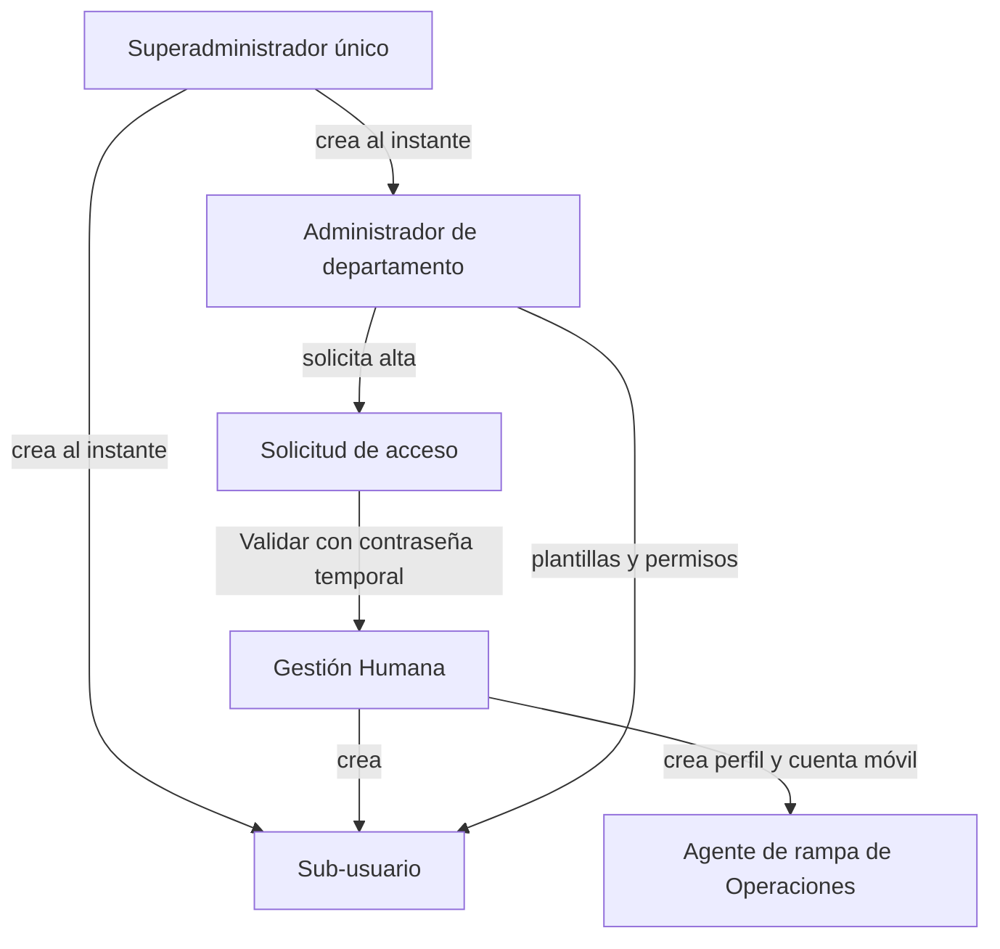

# Gobernanza de usuarios por departamento

Las cuentas internas de AVIAM se administran en dos niveles: un
superadministrador único y administradores por departamento. Gestión Humana
valida cada alta que piden los administradores. La decisión está en
[ADR-0015](../../docs/adr/0015-department-user-governance.md).

## Niveles

| Nivel | Puede | No puede |
| --- | --- | --- |
| Superadministrador | Ver todos los departamentos y solicitudes; crear administradores y sub-usuarios sin validación; gestionar usuarios de aerolíneas; convertir roles heredados. | Transferirse ni ser duplicado (índice único filtrado). Operar Finanzas u OCC. |
| Administrador | Todos los módulos de su departamento; solicitar altas; editar permisos, plantilla, datos y estaciones; desactivar, reactivar y restablecer claves de sus miembros. | Crear administradores; gestionarse a sí mismo u otros administradores; conceder estaciones que no tiene o permisos de otro departamento. |
| Miembro | Lo que su plantilla o sus permisos explícitos conceden. | Nada fuera de su departamento. |

## Permisos

El catálogo vive en código (`DepartmentPermissionCatalog`) con el formato
`<departamento>.<módulo>.<acción>`, por ejemplo `contracts.requests.approve` u
`operations.review.decide`. Conceder cualquier acción concede también la lectura
del módulo. Las plantillas (`iam.access_profiles`) se aplican en vivo: editar o
desactivar una plantilla cambia el acceso de sus miembros y rota su sello de
seguridad.

El acceso efectivo se calcula en el servidor para cada petición. Private Web
sólo lo usa para mostrar u ocultar módulos y acciones (`GET governance/me/access`).

## Altas y validación

1. El administrador envía una solicitud con un UUID propio (repetirla con el
   mismo UUID devuelve la misma solicitud).
2. Gestión Humana o el superadministrador la valida definiendo la contraseña
   temporal, o la rechaza con motivo. Quien la envió no puede resolverla.
3. Al validar se crea la cuenta con cambio de contraseña obligatorio. Para un
   agente de rampa se crean además la persona, el perfil `RampAgent`, sus scopes
   de estación y terminal y la cuenta `RAMP_AGENT`.

Gestión Humana consulta los perfiles de rampa en modo lectura; Operaciones los
mantiene después del alta dentro de sus estaciones.

## Compatibilidad

- Cuentas creadas antes del modelo: su rol de departamento equivale a
  administrador y `ramp.agent@` a miembro de Operaciones.
- Roles `CUSTOM_*`: operan como miembros de Contratos hasta que el
  superadministrador los convierte en plantilla.
- Los endpoints `ramp-mobile-access-requests` siguen respondiendo pero están
  deprecados.

## Relacionados

- [Identidad, tenancy y autorización](identidad-tenancy-y-autorizacion.md)
- [Personal, roles y departamentos](personal-roles-y-departamentos.md)

## Fuentes

- [ADR-0015](../../docs/adr/0015-department-user-governance.md)
- [Catálogo de permisos](../../backend/Elevant.Domain/Governance/DepartmentPermissionCatalog.cs)
- [Resolución de acceso](../../backend/Elevant.Application/Identity/DepartmentAccess.cs)
- [Store de gobernanza](../../database/DevelopmentDB/Elevant.Persistence/Identity/EfDepartmentGovernanceStore.cs)
- [API de gobernanza](../../backend/Elevant.Api/Controllers/DepartmentGovernanceController.cs)
