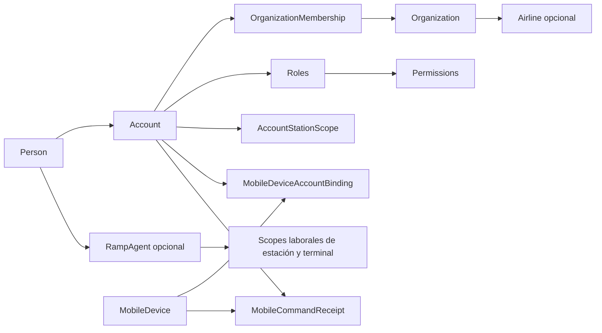

# Identidad, tenancy y autorización

El modelo separa quién es una persona, cómo inicia sesión, para qué organización trabaja y en qué estaciones puede actuar. Esta separación es la base de la autorización server-side; una selección de interfaz nunca reemplaza esas relaciones.

## Cadena de identidad

## Conceptos independientes

| Concepto | Qué responde | Regla persistente relevante |
| --- | --- | --- |
| `Person` | ¿Quién es el ser humano? | Identificación tipo-número única; email único cuando existe. |
| `Account` | ¿Qué credencial accede? | Una cuenta por persona; username normalizado único. |
| `OrganizationMembership` | ¿Con qué organización y calidad se relaciona? | Pareja cuenta-organización única; si ambas fechas existen, `ValidTo` no puede preceder a `ValidFrom`. El estado no se alinea automáticamente con esas fechas. |
| `Role` | ¿Qué agrupación de acceso usa en qué portal? | Nombre único; portal y `userType` propios. |
| `PermissionDefinition` | ¿Qué capacidad autorizable existe? | Código único; relación muchos-a-muchos con roles. |
| `AccountStationScope` | ¿Sobre qué estación puede actuar la cuenta? | Sólo una concesión activa por cuenta-estación. |
| `RampAgent` | ¿Cuál es el perfil laboral operativo? | Uno por persona en v1; tiene scopes laborales separados. |

## Tenant del portal de aerolínea

La regla documental es fail-closed:

1. autenticar la cuenta;
2. enumerar las membresías activas de tipo `AirlineClient`;
3. resolver exactamente un contexto de organización válido, o validar un contexto elegido explícitamente en el servidor;
4. fallar de forma cerrada si no existe contexto o hay más de uno y no se puede desambiguar;
5. obtener la organización asociada y su perfil `Airline`;
6. intersectar la operación con las estaciones autorizadas;
7. aplicar ese scope en cada consulta y escritura;
8. rechazar identificadores fuera del scope, aunque existan.

La unicidad persistida es por pareja cuenta-organización; por tanto, el modelo permite que una cuenta tenga membresías activas simultáneas en organizaciones distintas. El contexto multi-organización y su selección todavía no están definidos por un caso de uso.

Un `organizationId`, `airlineId` o `stationId` recibido desde Public Web sólo puede ser criterio de selección después de validarse contra la sesión. `localStorage`, filtros, rutas o menús ocultos no son controles de acceso.

## Acceso interno y móvil

El acceso interno combina cuenta activa, membresía interna, asignación de departamento con sus permisos de acción y scope de estación. Un rol global no debe habilitar automáticamente todas las aerolíneas o estaciones. El modelo de superadministrador único, administradores por departamento y validación de altas por Gestión Humana está en [Gobernanza de usuarios por departamento](gobernanza-por-departamento.md).

En persistencia, `MobileDevice`, `MobileDeviceAccountBinding`, `Account` y `MobileCommandReceipt` son conceptos separados. Se materializan la unicidad de `InstallationId`, un máximo de un binding no cerrado por dispositivo y el dedupe de recibos por `(MobileDeviceId, IdempotencyKey)`. El recibo referencia dispositivo y cuenta de forma independiente.

Para Mobile Agent, la futura API debe derivar cuenta, binding de dispositivo, perfil de agente y scopes laborales. De esas coherencias de autorización, el esquema sólo materializa el dedupe dispositivo-clave: no prueba que el binding siga activo, que la cuenta del recibo sea la enlazada, que la cuenta esté activa ni que el dispositivo no esté revocado al ejecutar. Tampoco alinea estado del recibo con `ProcessedAt`, resultado y error, ni implementa que un reintento devuelva exactamente el resultado almacenado. Enviar otro `agentId`, `personId` o `stationId` no debe ampliar permisos. La caché/outbox local conserva trabajo pendiente, pero no decide tenant ni estado canónico.

## Fase 2: roles dentro del portal y tablets compartidas

Posterior al commit verificado de esta nota: esta sección describe el código de
la fase 2 del ciclo (`50e7778f`;
[ADR-0038](../../docs/adr/0038-preoperation-contract-lifecycle-permits-master-data-and-workforce-readiness.md)).

- **Representantes y firmantes.** Dentro del tenant de una aerolínea, el
  representante y el firmante son grants de cuenta
  (`airline_portal.representative` y `airline_portal.signer` en
  `iam.account_permission_grants`), fuera del catálogo de departamentos, así que
  nunca entran en el acceso de un departamento. Solo ellos firman contratos y
  envían el permiso de operación; los demás usuarios del portal no pueden
  hacerlo
  ([roles](../../database/DevelopmentDB/Elevant.Persistence/Commercial/AirlinePortalRoles.cs)).
- **Tablets compartidas.** Una instalación tiene a lo sumo un vínculo abierto,
  como antes, pero ya no queda ligada a la primera cuenta: pasa al agente que
  inicia sesión, salvo que quien la tiene trabaje una operación en curso, y se
  libera al cerrar la sesión. OCC la desvincula o la revoca; una tablet
  revocada no vuelve a registrarse y su cuenta pierde sus sesiones, porque la
  revocación rota su sello de seguridad.

## Fase 3: la operación sigue a su agente

Posterior al commit verificado de esta nota: esta sección describe el código de
la fase 3 del ciclo (`f2d5c52c`;
[ADR-0039](../../docs/adr/0039-operation-planning-coverage-offline-tablet-occ-review-and-reports.md)).

- **Operación iniciada.** Una vez que el agente la inicia, la tablet la autoriza
  por la asignación abierta y el alcance de estación, sin exigir la posición
  activa ni el alcance de terminal, hasta que termina. Pasarla a otra persona es
  un relevo explícito de OCC.
- **Recibos.** Todo rechazo de regla de un comando de rampa con clave guarda su
  código en el recibo de la instalación, y un reintento con la misma clave y el
  mismo cuerpo devuelve ese mismo código; la misma clave con otro cuerpo
  responde `idempotency_conflict`. El chat y la observación de asistencia no
  usan ese recibo: se deduplican por su propia clave.
- **Evidencia en una tablet compartida.** Un `401`, un `403` o el cierre de
  sesión borran la credencial y las cachés, pero lo que ELEVANT no confirmó
  queda en el dispositivo, ligado a su cuenta: solo esa cuenta lo lee y lo envía
  al volver a entrar. Otro agente que use la tablet ve cuántos registros de otra
  cuenta hay, pero no puede verlos ni descartarlos. Eso incluye notas de
  incidencias y observaciones de asistencia: nada se borra solo. Siguen en la
  tablet hasta que su autor vuelve a entrar; entonces se envían, y él solo puede
  descartar los que ELEVANT rechazó.

## Vocabulario de ciclo de vida

| Tipo | Valores persistibles |
| --- | --- |
| Organización | `Active`, `Inactive` |
| Cuenta | `Active`, `PendingActivation`, `InvitationSent`, `Disabled`, `Blocked` |
| Invitación | `NotSent`, `Sent`, `Expired`, `Accepted` |
| Membresía | `Active`, `Suspended`, `Ended` |
| Tipo de membresía | `InternalStaff`, `AirlineClient` |
| Portal de rol | `BackOffice`, `RampMobileApp`, `AirlinePortal` |

Estos valores no definen por sí solos las transiciones ni la interacción entre estados. Por ejemplo, el modelo no especifica todavía si una cuenta activa con membresía suspendida puede conservar algún permiso de lectura.

## Lo que ya existe y lo que falta

Existe el esquema para cuentas ASP.NET Identity, roles, permisos, membresías y scopes. El seeder de Development crea anclas sintéticas mínimas para los tres portales, pero no constituye el catálogo definitivo de roles ni datos reales.

Posterior al commit verificado de esta nota (código de `39a85a46`): la API autentica con JWT y refresh rotativo ([ADR-0021](../../docs/adr/0021-rotating-refresh-tokens.md)), confirma el inicio de sesión del portal con un código por correo ([ADR-0022](../../docs/adr/0022-portal-email-verification.md)) y cada caso de uso resuelve organización, estaciones y permisos desde SQL. Las reglas anteriores siguen siendo invariantes que cada caso de uso nuevo debe materializar y probar, especialmente el aislamiento entre organizaciones y estaciones.

## Pruebas obligatorias futuras

- una cuenta de aerolínea nunca observa ni modifica otra organización;
- cero membresías válidas o varias membresías activas sin contexto inequívoco fallan de forma cerrada;
- un scope de estación revocado deja de autorizar inmediatamente;
- un agente no actúa fuera de sus scopes laborales vigentes;
- cuenta deshabilitada, bloqueada o membresía suspendida falla de forma cerrada;
- un recibo móvil con cuenta distinta del binding activo, binding cerrado, cuenta no activa o dispositivo revocado se rechaza, aunque la clave de idempotencia sea nueva;
- estado, `ProcessedAt`, resultado y error del recibo son coherentes, y un reintento devuelve exactamente el resultado persistido sin repetir el comando;
- IDs públicos inexistentes y existentes fuera de scope producen respuestas indistinguibles cuando sea necesario para evitar enumeración;
- auditoría registra decisiones administrativas sin copiar secretos o tokens.

## Relacionados

- [Índice de dominio](README.md)
- [Personal, roles y departamentos](personal-roles-y-departamentos.md)
- [Gobernanza de usuarios por departamento](gobernanza-por-departamento.md)
- [Entidades y relaciones v1](entidades-y-relaciones-v1.md)
- [Brechas y preguntas abiertas](brechas-y-preguntas-abiertas.md)

## Fuentes

- [Decisiones de identidad y tenant](../../docs/architecture/database-v1.md)
- [Configuración EF de identidad](../../database/DevelopmentDB/Elevant.Persistence/Persistence/Configurations/IdentityReferenceConfiguration.cs)
- [Seeder sintético de Development](../../database/DevelopmentDB/Elevant.Persistence/Persistence/Seed/DevelopmentDataSeeder.cs)
- [Regla de seguridad del portal](../../frontend/public-web/README.md)
- [Regla de autorización móvil](../../frontend/mobile-agent/README.md)
