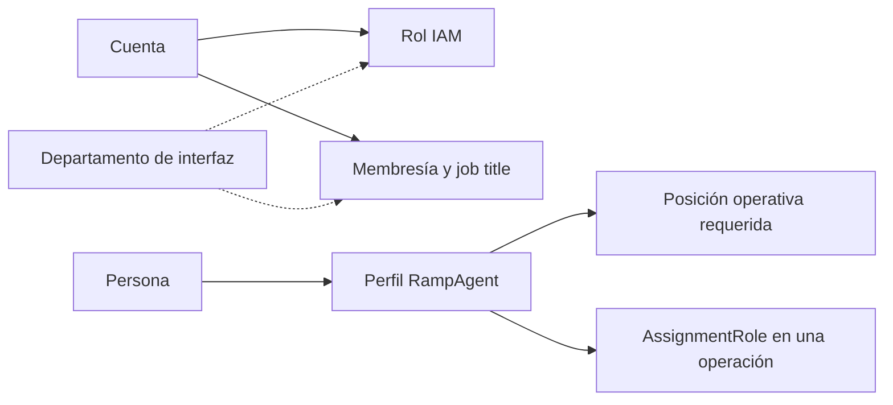

# Personal, roles y departamentos

ELEVANT necesita describir acceso, estructura organizacional y trabajo operativo sin mezclarlos. El modelo v1 persiste piezas distintas; Private Web aporta vocabulario de UX que aún no es taxonomía canónica del servidor.

## Seis conceptos que no son intercambiables

| Concepto | Ejemplo de función | Fuente de autoridad actual |
| --- | --- | --- |
| Rol IAM | Agrupa permisos dentro de un portal. | `ApplicationRole` y tablas IAM. |
| `userType` | Clasifica el tipo de usuario de un rol. | String persistido; taxonomía todavía abierta. |
| Job title | Describe la relación organizacional de una membresía. | `OrganizationMembership.JobTitle`. |
| Posición operativa | Función de rampa que puede exigir equipo/habilitación. | Catálogo `OperationalPosition`. |
| Rol de asignación | Papel contextual dentro de una operación concreta. | `OperationAgentAssignment.AssignmentRole`, hoy string. |
| Departamento | Gestión Humana, Contratos, Centro de Operaciones o Finanzas; agrupa cuentas y permisos. | Enum `Department` y `iam.department_assignments`; ver [gobernanza por departamento](gobernanza-por-departamento.md). |
| Empleado y puesto | Expediente de la persona y su cargo en el organigrama. | `hr.employees` y `hr.job_positions` (Gestión Humana); un puesto no es una posición operativa de rampa. |

## Actores comprobados

- personal interno AVIAM, con OCC, administración y departamentos operativos;
- agentes de rampa que trabajan desde tablets;
- contactos/usuarios de aerolíneas en el portal cliente.

El seeder sintético de Development prueba solamente anclas de acceso para Admin OCC, Ramp Agent y Airline Client. No demuestra que esos sean los únicos roles ni que su catálogo de permisos esté completo.

## Departamentos y roles observados en Private Web

Desde ADR-0015 los cuatro departamentos son una entidad de autorización del servidor; ver [Gobernanza de usuarios por departamento](gobernanza-por-departamento.md). Los términos siguientes del prototipo siguen siendo sólo vocabulario de interfaz.

El router del prototipo separa `ADMIN_OCC`, `GESTION_HUMANA`, `CONTRATOS` y `FINANZAS`. Sus mocks añaden términos como Analista OCC, Gestor de Contratos, Analista de Finanzas, Generalista de Gestión Humana, Agente de Rampa y Usuario de Aerolínea.

Estos nombres sirven para recorridos y conversación de producto. No deben:

- insertarse como permisos definitivos sólo porque aparecen en un menú;
- reemplazar `Role`, `Permission`, `Membership` o scopes;
- convertirse en enum sin acordar responsabilidades y compatibilidad;
- usarse para autorizar en el navegador.

## Perfil y planificación del agente

`RampAgent` vincula una persona con número de empleado, categoría, fecha de contratación, supervisor y estado activo. Sus capacidades operativas se construyen a partir de:

- scopes históricos de estación y terminal;
- turnos por fecha, hora local, bloque y posición;
- ciclos de habilitación por tipo de equipo;
- ciclos de permisos aeroportuarios;
- solicitudes de disponibilidad;
- requisitos de cobertura por estación, terminal, posición, bloque y vigencia.

Habilitación y permiso conservan ciclos numerados y una referencia al registro reemplazado. Sólo uno puede marcarse actual por agente/tipo. `vigente`, `por vencer` y `vencido` deben calcularse desde fechas y una referencia temporal explícita; no son filas maestras ni valores almacenados arbitrariamente.

## Elegibilidad: proyección, no entidad

La pantalla de planificación sugiere revisar cuenta activa, habilitación, permiso, turno y cobertura antes de asignar. Es una necesidad de dominio plausible, pero no existe un servicio de aplicación canónico que defina el algoritmo completo.

Antes de implementarlo deben decidirse, entre otros:

- zona horaria y tratamiento de turnos que cruzan medianoche;
- relación exacta entre posición, equipo y habilitación;
- prioridad entre scope de estación y terminal;
- efecto de disponibilidad aprobada, cuenta bloqueada o membresía suspendida;
- prevención de solapamientos de turnos y operaciones;
- explicación estable de cada motivo de no elegibilidad.

## Cobertura

`CoverageRequirement` expresa cantidad requerida por estación, terminal, posición, bloque y vigencia. La cobertura observada, faltante o excedente es un read model calculado contra asignaciones y agentes elegibles; no debe persistirse como contador autoritativo sin una decisión adicional.

## Relacionados

- [Índice de dominio](README.md)
- [Identidad, tenancy y autorización](identidad-tenancy-y-autorizacion.md)
- [Tiempo, estados y trazabilidad](tiempo-estados-y-trazabilidad.md)
- [Glosario canónico](glosario-canonico.md)

## Fuentes

- [Frontera y módulos de Private Web](../../frontend/private-web/README.md)
- [Roles de navegación, sólo prototipo](../../frontend/private-web/src/features/auth/roleRouting.js)
- [Taxonomía mock de usuarios](../../frontend/private-web/src/features/human-resources/users/usersMock.js)
- [Entidades y restricciones de personal](../../database/DevelopmentDB/Elevant.Persistence/Persistence/Configurations/WorkforceCommercialConfiguration.cs)
- [Anclas sintéticas de Development](../../database/DevelopmentDB/Elevant.Persistence/Persistence/Seed/DevelopmentDataSeeder.cs)
