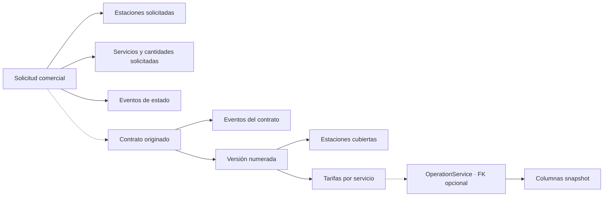
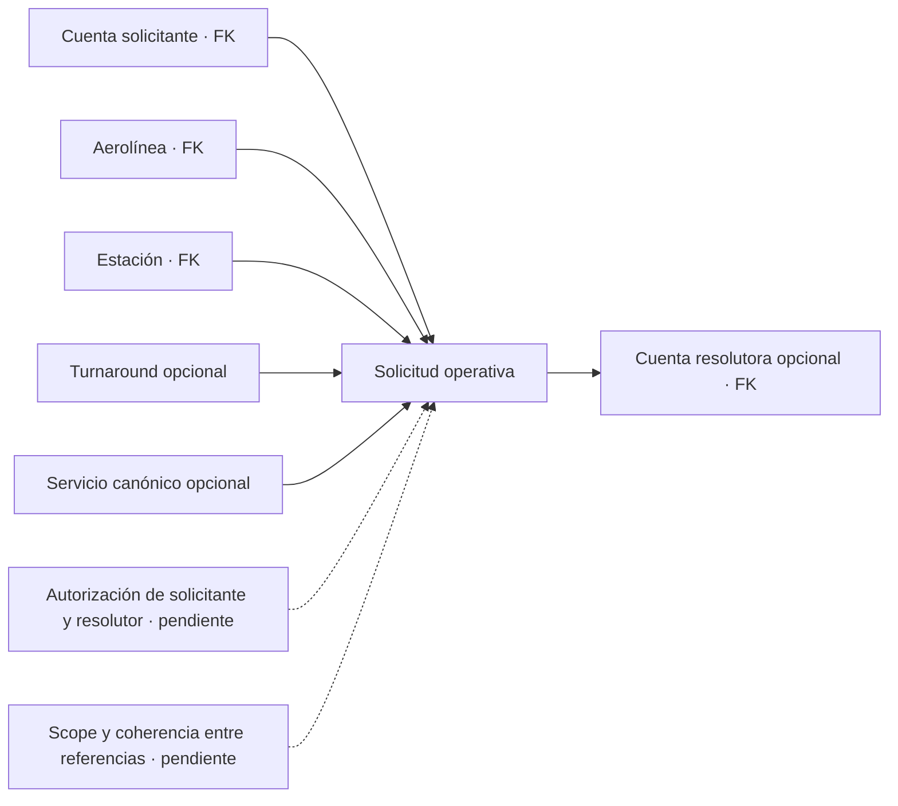

# Solicitudes, contratos y servicios

> [!NOTE]
> La revisión docente de octubre de 2026 cambió validaciones, permisos, notificaciones y otros comportamientos descritos aquí. El estado actual de cada punto está en [Correcciones de la revisión docente](../05-aplicaciones/correcciones-revision-docente-2026-10.md).

ELEVANT modela dos tipos de solicitud con propósitos distintos. La solicitud comercial inicia o amplía una relación de servicio; la solicitud operativa pide resolver una necesidad dentro de una estación y, opcionalmente, una escala concreta.

> El commit verificado del frontmatter describe la base anterior. Esta rama de
> integración agrega consultas tenant-scoped de solicitudes operativas y
> prefacturas publicadas; no está promocionada ni habilita nuevas transiciones.

## Dos procesos, dos identidades

| Dimensión | Solicitud comercial | Solicitud operativa |
| --- | --- | --- |
| Schema/entidad | `commercial.ServiceRequest` | `ops.OperationalServiceRequest` |
| Propósito | Afiliación o servicio adicional con impacto comercial | Necesidad de servicio durante la operación |
| Aerolínea | Opcional mientras se canoniza; conserva nombre/contacto | Obligatoria y ya canónica |
| Estación | Muchas mediante tabla puente | Una estación obligatoria |
| Turnaround | No se vincula directamente | Opcional |
| Servicio | Muchos ítems, cada uno con catálogo opcional y texto snapshot | Una definición opcional más nombre solicitado |
| Historia de estado | Tabla de eventos propia; tratarla como append-only es un diseño todavía pendiente de enforcement | Sólo estado actual en v1; auditoría transversal no equivale a historia dedicada |
| Actor | Contacto y cuenta revisora opcional | Cuenta solicitante obligatoria y resolutora opcional |

## Solicitud comercial y contrato



`CommercialRequestType` sólo contiene `Affiliation` y `AdditionalService`. Sus estados persistibles son `Pending`, `InReview`, `Approved`, `Rejected` y `Cancelled`. Cada ítem puede expresar cantidad estimada, unidad y vigencia solicitadas; fechas invertidas y cantidades no positivas son rechazadas por constraints. Desde [ADR-0037](../../docs/adr/0037-commercial-cycle-requests-drafts-amendments-and-portal-accounts.md) los cinco estados se usan: la solicitud pasa a `InReview` cuando Contratos verifica la aerolínea o confirma al representante, y termina aprobada, rechazada o cancelada, siempre con evento de estado y auditoría.

El contrato guarda aerolínea, código y estado general (`Draft`, `Active`, `Suspended`, `Terminated`, `Expired`). Sus versiones tienen número positivo, vigencia, moneda, términos y estado (`Draft`, `PendingFinanceApproval`, `Approved`, `Superseded`, `Rejected`). `Rejected` marca la versión que Contratos descartó antes de la aprobación, la que quedó abierta en un contrato terminado o, desde la fase 2, la versión aprobada que Contratos retiró antes de que ambas partes la firmaran; Finanzas nunca rechaza: devuelve la versión a `Draft`. Tarifas y estaciones pertenecen a la versión, no al contrato mutable.

En la rama `feat/finance-refinement`, el borrador hereda precio y unidad de la tarifa base de Finanzas en su moneda (USD o DOP) y «activar» envía la versión a `PendingFinanceApproval`: solo la aprobación de Finanzas la deja `Approved`; una devolución exige motivo y la regresa a `Draft`. Ver [Finanzas: tarifarios, cargos y cobros](finanzas-tarifas-cargos-y-cobros.md).

La rama de integración añade una lectura interna paginada de acuerdos (`GET /api/v1/contracts/agreements`) para personal con permiso `commercial.requests.read`. Incluye únicamente versiones `Approved` o `Superseded` con sus estaciones y tarifas. Esta lectura no autoriza crear ni alterar un contrato, ni confiere acceso de aerolínea: la lectura del portal sigue derivando su tenant por separado.

El esquema permite enlazar un contrato a una solicitud mediante `OriginatingServiceRequestId`, pero no prueba que la solicitud estuviera aprobada ni que perteneciera a la misma aerolínea del contrato. Tampoco impide vigencias de versiones solapadas. En la aplicación, solo la aprobación de una solicitud crea un contrato desde ella, y una renovación o una enmienda debe empezar después de la última versión aprobada; el esquema, por sí solo, sigue sin impedirlo.

En la rama de integración de Development, el portal dispone de una lectura
tenant-scoped y paginada de contratos publicados (`Approved` y versiones luego
`Superseded`). El historial vencido de la propia aerolínea permanece consultable.
La aerolínea también ve sus borradores (`Draft` y `PendingFinanceApproval`) como
copia de revisión con marca de agua, puede comentarlos y firma la versión aprobada
desde el portal (ADR-0024).

## Reglas de la fase 1 del ciclo (ADR-0037)

- **Una afiliación por aerolínea.** Aprobar se rechaza si la aerolínea ya tiene
  un contrato `Draft`, `Active` o `Suspended`, otra solicitud aprobada cuyo
  contrato sigue vivo, cuentas activas del portal o un código que pertenece a
  otra aerolínea. Quien ya opera amplía su contrato con una enmienda o una
  renovación. Con contratos solo terminados o vencidos puede volver a afiliarse.
- **Representante confirmado.** Aprobar exige que Contratos haya registrado
  quién confirmó al representante, cuándo y cómo.
- **Aerolínea propuesta.** Si la aerolínea no está en el catálogo, la solicitud
  guarda la propuesta del solicitante (nombre, país, ICAO, IATA opcional y
  sitio). Contratos la vincula a una ficha existente o crea una ficha
  verificada al revisarla.
- **ICAO sin IATA.** El ICAO es obligatorio; `ref.airlines.iata_code` admite
  nulos con un índice único filtrado.
- **Unidad de cobro.** Solicitud, borrador, enmienda y tarifas guardan el
  código de `ref.billing_units`; un nombre heredado se traduce sin reescribir
  filas.
- **Borrador.** Contratos agrega o quita servicios activos y estaciones antes
  de enviarlo a Finanzas. Un servicio dado de baja se conserva marcado y
  bloquea el envío hasta que se quita. Descartar deja la versión `Rejected` y,
  si el contrato nunca se activó, lo termina. Nada se borra.
- **Lo que ve la aerolínea.** Comenta su borrador también mientras Finanzas lo
  revisa, pero no recibe la tarifa base, los valores base de los cargos ni el
  motivo interno de una devolución de Finanzas.
- **Enmienda.** Parte de la versión que rige de un contrato activo o
  suspendido, hereda su fin y empieza después de su inicio. Desde la fase 2,
  la que rige es la aprobada y firmada por ambas partes, o la heredada con la
  que el contrato se activó (ver abajo).

## Vigencia, firmas y código definitivo (ADR-0025)

Después de que Finanzas aprueba las tarifas, Contratos confirma la vigencia
(inicio, fin), la renovación (manual o automática, con plazo y días de aviso) y
el preaviso y las condiciones de terminación (`PUT contract-versions/{id}/validity`,
permiso «Fijar vigencia y renovación»). En ese momento un contrato con código
`DRAFT-…` recibe su código definitivo `CTR-{año}-{n}`, porque el código forma
parte del contenido firmado.

Solo entonces se habilitan las firmas, en orden: primero la aerolínea desde el
portal y después AVIAM desde Contratos, ambas dibujadas en un canvas. El PDF
imprime cada firma y la sección de renovación. Al activarse el contrato (o al
completarse la firma de una renovación de un contrato activo) se envía el PDF
firmado por correo a la aerolínea y a los firmantes de AVIAM.

La renovación automática crea sola la versión siguiente los días de aviso antes
del fin; esa versión vuelve a pasar por Finanzas, la vigencia y las firmas.
Nada se prorroga sin firmas. Fuentes:
[store de documentos](../../database/DevelopmentDB/Elevant.Persistence/Commercial/EfContractDocumentStore.cs),
[reglas de vigencia](../../backend/Elevant.Application/Commercial/ContractValidity.cs) y
[ADR-0025](../../docs/adr/0025-contract-validity-and-drawn-signatures.md).

## Reglas de la fase 2 del ciclo (ADR-0038)

Posterior al commit verificado de esta nota: esta sección describe el código de
la fase 2 del ciclo (`50e7778f`). La fase 2 «Pre-operación»
([ADR-0038](../../docs/adr/0038-preoperation-contract-lifecycle-permits-master-data-and-workforce-readiness.md))
cambió qué versión rige y cómo termina un contrato:

- **Qué versión rige.** Rige una versión `Approved` firmada por ambas partes
  sobre la misma huella, desde su inicio. Una `Superseded` rige en las fechas
  que conservó, y la primera versión aprobada de un contrato que ya salió de
  `Draft` rige como exención heredada. La aprobación de Finanzas ya no
  reemplaza nada: la versión en vigor sigue rigiendo y facturándose hasta la
  segunda firma de la nueva. En esa firma, la anterior pasa a `Superseded` y
  termina, a más tardar, la víspera del nuevo inicio. Los vuelos aún no
  ejecutados que coinciden con las tarifas firmadas pasan a la versión nueva, y
  un servicio ejecutado conserva su tarifa
  ([reglas](../../backend/Elevant.Application/Commercial/ContractVersionGovernance.cs),
  [consultas](../../database/DevelopmentDB/Elevant.Persistence/Commercial/GoverningContractVersions.cs)
  y [reemplazo](../../database/DevelopmentDB/Elevant.Persistence/Commercial/ContractVersionSupersession.cs)).
- **Firmas.** AVIAM solo contrafirma la huella que firmó la aerolínea, y la
  firma y la vigencia no se pisan: corren serializadas. Del lado de la
  aerolínea solo firman sus representantes y firmantes. El contenido firmado
  incluye los recargos congelados y los paquetes. `SignedOn` del contrato es el
  día hábil de su primera activación; cada versión cuenta como firmada el día
  de su segunda firma.
- **Renovar** parte de la versión en vigor, también desde un contrato vencido,
  y copia tarifas, términos, estaciones, recargos negociados, exenciones y
  paquetes. Ni la renovación ni la enmienda se crean mientras otra versión
  aprobada espera las firmas.
- **Retirar una versión.** Contratos retira con motivo una versión aprobada
  que no rige. Pasa a `Rejected`, conserva su aprobación y sus firmas
  unilaterales quedan anuladas solo en la auditoría
  ([retirada](../../database/DevelopmentDB/Elevant.Persistence/Commercial/ContractVersionWithdrawal.cs)).
- **Terminar.** Un contrato activo o suspendido termina en una fecha que
  respete el preaviso firmado, o de inmediato por incumplimiento o mutuo
  acuerdo. `TerminatedOn` es el primer día sin cobertura; con una fecha futura
  el contrato conserva su estado hasta ese día, la terminación se puede
  cancelar y el barrido la ejecuta. Terminar cierra los borradores, retira las
  versiones aprobadas que todavía no rigen, y nada empieza en la fecha de
  terminación o después
  ([ciclo de vida](../../database/DevelopmentDB/Elevant.Persistence/Commercial/EfContractLifecycleStore.cs)).
- **Permiso de operación.** Contratos revoca con motivo un permiso verificado.
  El permiso queda `Revoked` y los contratos activos que se quedan sin un
  permiso usable se suspenden en la misma transacción; verificar un permiso
  nuevo los reanuda
  ([permisos](../../database/DevelopmentDB/Elevant.Persistence/Commercial/EfAirlinePermitStore.cs)).
- **Días.** Vigencias, firmas, permisos, terminaciones y barridos cuentan días
  hábiles de AVIAM (`America/Santo_Domingo`, o la zona de la estación), nunca
  el día UTC.

## Solicitud operativa



Sus estados persistibles son `Submitted`, `InReview`, `Accepted`, `Rejected`, `Completed` y `Cancelled`. El modelo registra cuándo se pidió, cuándo se necesita y cuándo se resolvió, pero sólo impide que `ResolvedAt` sea anterior a `RequestedAt`. Las flechas sólidas del diagrama son referencias persistidas; las punteadas son reglas futuras. Las FKs no garantizan que la cuenta solicitante tenga membresía activa de esa aerolínea, que posea scope de estación, que el turnaround pertenezca a la misma aerolínea y estación, que el servicio sea aplicable ni que la cuenta resolutora tenga permiso. Tampoco exigen `NeededAt >= RequestedAt` ni coherencia entre estado, resolutor, nota y fecha de resolución. En esta rama, `GET /api/v1/airline/portal/requests` filtra por la aerolínea del actor y descarta vínculos de turnaround incoherentes, sin afirmar que los registros históricos cumplan todas las invariantes pendientes. No existe todavía una matriz de transición, una historia específica de cambios ni endpoints que definan quién acepta, completa o cancela.

Las pruebas negativas deben intentar cada combinación fuera de scope o incoherente y comprobar un rechazo fail-closed sin crear ni resolver la solicitud.

## Servicio solicitado, contratado y ejecutado

```text
ServiceDefinition
  ├─ puede aparecer en un ítem de solicitud
  ├─ recibe tarifa dentro de ContractVersion
  └─ es FK obligatoria de una línea OperationService

ContractServiceRate
  └─ puede ser FK opcional de OperationService

OperationService
  └─ conserva unidad/precio/moneda en columnas snapshot
```

La definición de servicio es catálogo; la tarifa pertenece a una versión contractual; la ejecución pertenece a una operación. La FK opcional no garantiza que la tarifa sea la procedencia de los snapshots. Falta validar que precio y moneda sean all-or-none, que una línea contractualmente valorizada enlace una tarifa, que tarifa y línea compartan definición, que contrato y turnaround compartan aerolínea, que la versión esté aprobada, cubra la estación y sea vigente, y que unidad/precio/moneda se copien de forma consistente y permanezcan históricos.

### Lectura financiera en la rama de integración

La rama `feat/integrated-cycle-realtime` expone una lectura acotada de líneas
de operaciones cuya última entrega fue aprobada por OCC. Finanzas debe tener
rol interno y grant vigente de la estación. La cantidad, estado y unidad de
cada línea se contrastan con el snapshot inmutable presentado a OCC; el
importe sólo se calcula si el servicio se completó con cantidad positiva y
existen precio, moneda y unidad congelados válidos. Las inconsistencias se
muestran como líneas bloqueadas, sin importe facturable, en vez de omitirlas
silenciosamente. Una aprobación genera una pista durable dirigida a Finanzas
en la misma transacción; el feed vuelve a comprobar rol, membresía, estación
y estado de la operación. La misma rama añade una **prefactura interna no
fiscal**: Finanzas selecciona servicios de una sola aerolínea, estación y
moneda, y la API reserva cada línea fuente una sola vez con snapshots
inmutables de cantidad y tarifa. La solicitud tiene clave idempotente; el
detalle y la auditoría se guardan en SQL. Todavía no hay conciliación,
factura, pago ni recibo, y esto no acredita un despliegue al VPS.

La lista interna de prefacturas se consulta por estación con rol Finanzas,
membresía AVIAM y grant vigente. Devuelve páginas acotadas y detalles de
snapshots persistidos. En esta rama, el comando
`POST /api/v1/finance/preinvoices/{draftId}/submit` permite a Finanzas
publicar una prefactura `Draft` con al menos una línea. Revalida la concesión
de estación en una transacción serializable, cambia el estado una sola vez a
`Submitted` y guarda auditoría y avisos durables para Finanzas y aerolínea.
La misma clave devuelve una repetición; otra intención para la prefactura ya
enviada recibe conflicto. No es aprobación, factura ni cobro. El
antiguo adaptador `/api/finance/preinvoices` de la pantalla activa se retiró.

La aerolínea puede aceptar una prefactura `Submitted` propia mediante
`POST /api/v1/airline/portal/preinvoices/{preinvoiceId}/accept`. La API vuelve
a derivar la única organización vigente del actor, comprueba la pertenencia
de la prefactura en SQL y guarda transición `Accepted`, auditoría y avisos
durables en una transacción serializable. Un reintento del mismo actor y clave
es inocuo; otra intención recibe conflicto. Aceptar no equivale a conciliar,
facturar ni cobrar; la disputa puede registrarse, pero su resolución sigue
pendiente.

En la rama local, Finanzas puede emitir una factura **no fiscal** desde una
prefactura `Accepted` con `POST /api/v1/finance/invoices`. SQL crea un número
único y snapshots independientes de sus líneas, cambia la prefactura a
`Invoiced` y guarda auditoría y avisos en la misma transacción serializable.
La misma clave y actor devuelven la emisión anterior; una segunda intención
no duplica la factura. Finanzas la relee por estación autorizada y la aerolínea
por su tenant, sin exigir un contrato todavía vigente para conservar historial.
No es una factura tributaria, pago ni recibo y no está promovida al VPS.

Esta rama añade una lectura de prefacturas para el portal de la aerolínea. La
API deriva la organización de la membresía y filtra por `AirlineId` en SQL;
solo expone estados publicados (`Submitted`, `Disputed`, `Accepted`, `Invoiced`).
`Draft` y `Voided` no son visibles sin historial de publicación que distinga
una anulación interna de una posterior al envío. La lectura conserva importes
y fechas congelados tras vencer un contrato, pero no habilita por sí sola
emisión, pago ni descargas.

## Diferencias con Public Web

El prototipo del portal usa tipos como `SCHEDULE_CHANGE`, `SPECIAL_ASSISTANCE` y `OTHER`, además de una forma de solicitud ligada a vuelo y estados con nombres propios. También representa facturas, conciliaciones, disputas, documentos y notificaciones. Esos tipos orientan futuras conversaciones de producto, pero no son DTO OpenAPI ni amplían las entidades actuales.

Hasta acordar el contrato:

- no mapear por semejanza de strings;
- no guardar objetos completos del portal como JSON de negocio;
- no tratar `APPROVED` de la interfaz como una transición autorizada del servidor;
- no derivar facturación final únicamente de los snapshots operativos.

## Relacionados

- [Índice de dominio](README.md)
- [Glosario canónico](glosario-canonico.md)
- [Turnaround y operación](turnaround-y-operacion.md)
- [Brechas y preguntas abiertas](brechas-y-preguntas-abiertas.md)

## Fuentes

- [Modelo de base v1](../../docs/architecture/database-v1.md)
- [Enums comerciales](../../backend/Elevant.Domain/Enumerations/WorkforceCommercialEnums.cs)
- [Solicitud operativa](../../backend/Elevant.Domain/Entities/Operations/OperationalServiceRequest.cs)
- [Restricciones comerciales EF](../../database/DevelopmentDB/Elevant.Persistence/Persistence/Configurations/WorkforceCommercialConfiguration.cs)
- Tipos del portal, sólo prototipo
