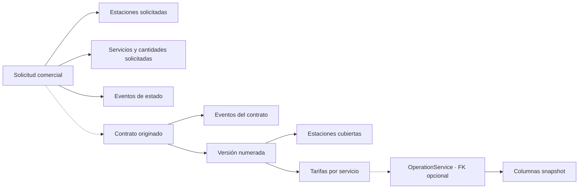
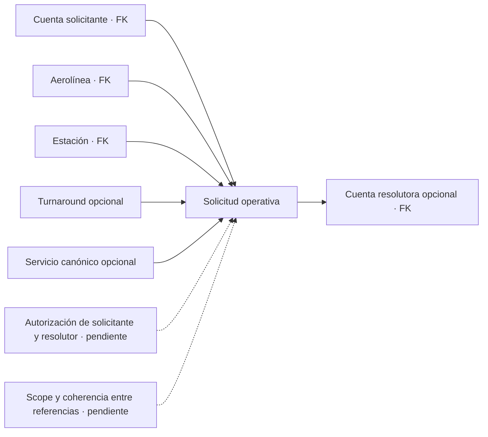

# Solicitudes, contratos y servicios

## Paquetes elegidos en la solicitud (rama local)

El catálogo público incluye versiones de paquetes publicadas, vigentes y con
componentes visibles, sin exponer precios. Afiliación y solicitud adicional
aceptan versiones de paquetes; la API conserva la elección, expande sus
componentes y deduplica los servicios. Dos paquetes que cubran el mismo
servicio se rechazan. La revisión de Contratos muestra paquetes, componentes y servicios,
y la aprobación enlaza las versiones elegidas con el borrador contractual.
La relación solicitud–contrato tiene índice único filtrado para impedir dos
contratos de una misma solicitud y preservar los contratos legados sin origen.
`GET /api/v1/airline/portal/commercial-requests` lista solo las solicitudes
de la aerolínea derivada de la cuenta autenticada. La migración se generó con
el script EF y el modelo no tiene cambios pendientes; no se ha desplegado.

## Firma electrónica contractual en esta rama

La solicitud adicional autenticada deriva la aerolínea de la sesión y sigue la
revisión de Contratos. Finanzas congela una versión nueva sin activarla. En el
modo `AcademicLocal`, limitado por configuración a Development/Test, el backend
genera el PDF individual con partes, servicios, paquetes, tarifas, estaciones,
vigencia y términos; conserva el borrador exacto y su SHA-256 en un directorio
privado. Contratos emite esa versión explícitamente. La cuenta AVIAM asignada
acepta primero y el representante verificado acepta después, ambos sobre el
hash del PDF revisado. PDF final y evidencia inmutables se verifican antes de
formalizar. La evidencia identifica la aceptación registrada y la ausencia de
certificación externa. La fecha de formalización evita habilitación retroactiva.

El mismo expediente por versión conserva método, hashes, plantilla, eventos,
actores y fechas. Adobe usa su propio adaptador y conciliación; sigue
deshabilitado hasta contar con plantilla aprobada, políticas, credenciales y
almacenamiento privado. Los contratos legados mantienen su estado sin firma
atribuida. Durante una publicación escalonada, el cliente solo interpreta como
legadas las páginas anteriores cuyos contratos carecen todos de campos de
firma. Véanse el [flujo comercial](../../docs/workflows/commercial-intake-and-governance.md),
la [migración inicial](../../database/DevelopmentDB/Elevant.Persistence/Persistence/Migrations/20261020000446_AddContractSigningEnvelope.cs),
la [migración de paquetes y aceptación](../../database/DevelopmentDB/Elevant.Persistence/Persistence/Migrations/20261022025008_AddRequestPackagesAndRecordedAcceptance.cs)
y el [runbook](../../docs/runbooks/contract-signing-activation.md).

ELEVANT modela dos tipos de solicitud con propósitos distintos. La solicitud comercial inicia o amplía una relación de servicio; la solicitud operativa pide resolver una necesidad dentro de una estación y, opcionalmente, una escala concreta.

> El commit verificado del frontmatter describe la base anterior. Esta rama de
> integración agrega consultas tenant-scoped de solicitudes operativas y
> prefacturas publicadas; no está promocionada ni habilita nuevas transiciones.

## Dos procesos, dos identidades

| Dimensión | Solicitud comercial | Solicitud operativa |
| --- | --- | --- |
| Schema/entidad | `commercial.ServiceRequest` | `ops.OperationalServiceRequest` |
| Propósito | Afiliación o servicio adicional con impacto comercial | Necesidad de servicio durante la operación |
| Aerolínea | Opcional mientras se canoniza; conserva nombre/contacto | Obligatoria y ya canónica |
| Estación | Muchas mediante tabla puente | Una estación obligatoria |
| Turnaround | No se vincula directamente | Opcional |
| Servicio | Muchos ítems, cada uno con catálogo opcional y texto snapshot | Una definición opcional más nombre solicitado |
| Historia de estado | Tabla de eventos propia; tratarla como append-only es un diseño todavía pendiente de enforcement | Sólo estado actual en v1; auditoría transversal no equivale a historia dedicada |
| Actor | Contacto y cuenta revisora opcional | Cuenta solicitante obligatoria y resolutora opcional |

## Solicitud comercial y contrato



`CommercialRequestType` sólo contiene `Affiliation` y `AdditionalService`. Sus estados persistibles son `Pending`, `InReview`, `Approved`, `Rejected` y `Cancelled`. Cada ítem puede expresar cantidad estimada, unidad y vigencia solicitadas; fechas invertidas y cantidades no positivas son rechazadas por constraints.

El contrato guarda aerolínea, código y estado general (`Draft`, `Active`, `Suspended`, `Terminated`, `Expired`). Sus versiones tienen número positivo, vigencia, moneda, términos y estado (`Draft`, `Approved`, `Superseded`, `Rejected`). Tarifas y estaciones pertenecen a la versión, no al contrato mutable.

En la rama `feat/finance-refinement`, el borrador hereda precio y unidad de la tarifa base de Finanzas en su moneda (USD o DOP) y «activar» envía la versión a `PendingFinanceApproval`: solo la aprobación de Finanzas la deja `Approved`; una devolución exige motivo y la regresa a `Draft`. Ver [Finanzas: tarifarios, cargos y cobros](finanzas-tarifas-cargos-y-cobros.md).

La rama de integración añade una lectura interna paginada de acuerdos (`GET /api/v1/contracts/agreements`) para personal con permiso `commercial.requests.read`. Incluye únicamente versiones `Approved` o `Superseded` con sus estaciones y tarifas. Esta lectura no autoriza crear ni alterar un contrato, ni confiere acceso de aerolínea: la lectura del portal sigue derivando su tenant por separado.

El esquema permite enlazar un contrato a una solicitud mediante `OriginatingServiceRequestId`, pero no prueba que la solicitud estuviera aprobada ni que perteneciera a la misma aerolínea del contrato. Tampoco impide vigencias de versiones solapadas. Esas son invariantes pendientes de aplicación y pruebas.

En la rama de integración de Development, el portal dispone de una lectura
tenant-scoped y paginada de contratos publicados (`Approved` y versiones luego
`Superseded`). El historial vencido de la propia aerolínea permanece consultable;
no se exponen borradores ni se habilita aprobar o editar contratos. Esta lectura
no implementa todavía el alta de afiliación ni el flujo de aprobación.

## Solicitud operativa



Sus estados persistibles son `Submitted`, `InReview`, `Accepted`, `Rejected`, `Completed` y `Cancelled`. El modelo registra cuándo se pidió, cuándo se necesita y cuándo se resolvió, pero sólo impide que `ResolvedAt` sea anterior a `RequestedAt`. Las flechas sólidas del diagrama son referencias persistidas; las punteadas son reglas futuras. Las FKs no garantizan que la cuenta solicitante tenga membresía activa de esa aerolínea, que posea scope de estación, que el turnaround pertenezca a la misma aerolínea y estación, que el servicio sea aplicable ni que la cuenta resolutora tenga permiso. Tampoco exigen `NeededAt >= RequestedAt` ni coherencia entre estado, resolutor, nota y fecha de resolución. En esta rama, `GET /api/v1/airline/portal/requests` filtra por la aerolínea del actor y descarta vínculos de turnaround incoherentes, sin afirmar que los registros históricos cumplan todas las invariantes pendientes. No existe todavía una matriz de transición, una historia específica de cambios ni endpoints que definan quién acepta, completa o cancela.

Las pruebas negativas deben intentar cada combinación fuera de scope o incoherente y comprobar un rechazo fail-closed sin crear ni resolver la solicitud.

## Servicio solicitado, contratado y ejecutado

```text
ServiceDefinition
  ├─ puede aparecer en un ítem de solicitud
  ├─ recibe tarifa dentro de ContractVersion
  └─ es FK obligatoria de una línea OperationService

ContractServiceRate
  └─ puede ser FK opcional de OperationService

OperationService
  └─ conserva unidad/precio/moneda en columnas snapshot
```

La definición de servicio es catálogo; la tarifa pertenece a una versión contractual; la ejecución pertenece a una operación. La FK opcional no garantiza que la tarifa sea la procedencia de los snapshots. Falta validar que precio y moneda sean all-or-none, que una línea contractualmente valorizada enlace una tarifa, que tarifa y línea compartan definición, que contrato y turnaround compartan aerolínea, que la versión esté aprobada, cubra la estación y sea vigente, y que unidad/precio/moneda se copien de forma consistente y permanezcan históricos.

### Lectura financiera en la rama de integración

La rama `feat/integrated-cycle-realtime` expone una lectura acotada de líneas
de operaciones cuya última entrega fue aprobada por OCC. Finanzas debe tener
rol interno y grant vigente de la estación. La cantidad, estado y unidad de
cada línea se contrastan con el snapshot inmutable presentado a OCC; el
importe sólo se calcula si el servicio se completó con cantidad positiva y
existen precio, moneda y unidad congelados válidos. Las inconsistencias se
muestran como líneas bloqueadas, sin importe facturable, en vez de omitirlas
silenciosamente. Una aprobación genera una pista durable dirigida a Finanzas
en la misma transacción; el feed vuelve a comprobar rol, membresía, estación
y estado de la operación. La misma rama añade una **prefactura interna no
fiscal**: Finanzas selecciona servicios de una sola aerolínea, estación y
moneda, y la API reserva cada línea fuente una sola vez con snapshots
inmutables de cantidad y tarifa. La solicitud tiene clave idempotente; el
detalle y la auditoría se guardan en SQL. Todavía no hay conciliación,
factura, pago ni recibo, y esto no acredita un despliegue al VPS.

La lista interna de prefacturas se consulta por estación con rol Finanzas,
membresía AVIAM y grant vigente. Devuelve páginas acotadas y detalles de
snapshots persistidos. En esta rama, el comando
`POST /api/v1/finance/preinvoices/{draftId}/submit` permite a Finanzas
publicar una prefactura `Draft` con al menos una línea. Revalida la concesión
de estación en una transacción serializable, cambia el estado una sola vez a
`Submitted` y guarda auditoría y avisos durables para Finanzas y aerolínea.
La misma clave devuelve una repetición; otra intención para la prefactura ya
enviada recibe conflicto. No es aprobación, factura ni cobro. El
antiguo adaptador `/api/finance/preinvoices` de la pantalla activa se retiró.

La aerolínea puede aceptar una prefactura `Submitted` propia mediante
`POST /api/v1/airline/portal/preinvoices/{preinvoiceId}/accept`. La API vuelve
a derivar la única organización vigente del actor, comprueba la pertenencia
de la prefactura en SQL y guarda transición `Accepted`, auditoría y avisos
durables en una transacción serializable. Un reintento del mismo actor y clave
es inocuo; otra intención recibe conflicto. Aceptar no equivale a conciliar,
facturar ni cobrar; la disputa puede registrarse, pero su resolución sigue
pendiente.

En la rama local, Finanzas puede emitir una factura **no fiscal** desde una
prefactura `Accepted` con `POST /api/v1/finance/invoices`. SQL crea un número
único y snapshots independientes de sus líneas, cambia la prefactura a
`Invoiced` y guarda auditoría y avisos en la misma transacción serializable.
La misma clave y actor devuelven la emisión anterior; una segunda intención
no duplica la factura. Finanzas la relee por estación autorizada y la aerolínea
por su tenant, sin exigir un contrato todavía vigente para conservar historial.
No es una factura tributaria, pago ni recibo y no está promovida al VPS.

Esta rama añade una lectura de prefacturas para el portal de la aerolínea. La
API deriva la organización de la membresía y filtra por `AirlineId` en SQL;
solo expone estados publicados (`Submitted`, `Disputed`, `Accepted`, `Invoiced`).
`Draft` y `Voided` no son visibles sin historial de publicación que distinga
una anulación interna de una posterior al envío. La lectura conserva importes
y fechas congelados tras vencer un contrato, pero no habilita por sí sola
emisión, pago ni descargas.

## Diferencias con Public Web

El prototipo del portal usa tipos como `SCHEDULE_CHANGE`, `SPECIAL_ASSISTANCE` y `OTHER`, además de una forma de solicitud ligada a vuelo y estados con nombres propios. También representa facturas, conciliaciones, disputas, documentos y notificaciones. Esos tipos orientan futuras conversaciones de producto, pero no son DTO OpenAPI ni amplían las entidades actuales.

Hasta acordar el contrato:

- no mapear por semejanza de strings;
- no guardar objetos completos del portal como JSON de negocio;
- no tratar `APPROVED` de la interfaz como una transición autorizada del servidor;
- no derivar facturación final únicamente de los snapshots operativos.

## Relacionados

- [Índice de dominio](README.md)
- [Glosario canónico](glosario-canonico.md)
- [Turnaround y operación](turnaround-y-operacion.md)
- [Brechas y preguntas abiertas](brechas-y-preguntas-abiertas.md)

## Fuentes

- [Modelo de base v1](../../docs/architecture/database-v1.md)
- [Enums comerciales](../../backend/Elevant.Domain/Enumerations/WorkforceCommercialEnums.cs)
- [Solicitud operativa](../../backend/Elevant.Domain/Entities/Operations/OperationalServiceRequest.cs)
- [Restricciones comerciales EF](../../database/DevelopmentDB/Elevant.Persistence/Persistence/Configurations/WorkforceCommercialConfiguration.cs)
- Tipos del portal, sólo prototipo
