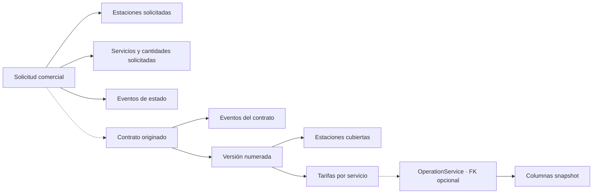
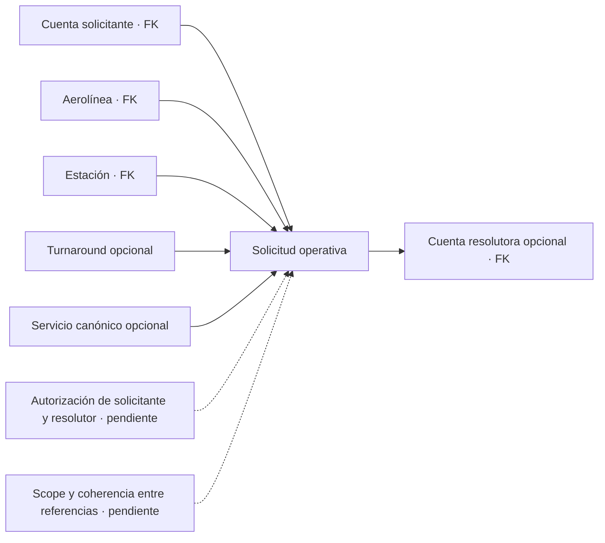

# Solicitudes, contratos y servicios

ELEVANT modela dos tipos de solicitud con propósitos distintos. La solicitud comercial inicia o amplía una relación de servicio; la solicitud operativa pide resolver una necesidad dentro de una estación y, opcionalmente, una escala concreta.

## Dos procesos, dos identidades

| Dimensión | Solicitud comercial | Solicitud operativa |
| --- | --- | --- |
| Schema/entidad | `commercial.ServiceRequest` | `ops.OperationalServiceRequest` |
| Propósito | Afiliación o servicio adicional con impacto comercial | Necesidad de servicio durante la operación |
| Aerolínea | Opcional mientras se canoniza; conserva nombre/contacto | Obligatoria y ya canónica |
| Estación | Muchas mediante tabla puente | Una estación obligatoria |
| Turnaround | No se vincula directamente | Opcional |
| Servicio | Muchos ítems, cada uno con catálogo opcional y texto snapshot | Una definición opcional más nombre solicitado |
| Historia de estado | Tabla de eventos propia; tratarla como append-only es un diseño todavía pendiente de enforcement | Sólo estado actual en v1; auditoría transversal no equivale a historia dedicada |
| Actor | Contacto y cuenta revisora opcional | Cuenta solicitante obligatoria y resolutora opcional |

## Solicitud comercial y contrato



`CommercialRequestType` sólo contiene `Affiliation` y `AdditionalService`. Sus estados persistibles son `Pending`, `InReview`, `Approved`, `Rejected` y `Cancelled`. Cada ítem puede expresar cantidad estimada, unidad y vigencia solicitadas; fechas invertidas y cantidades no positivas son rechazadas por constraints.

El contrato guarda aerolínea, código y estado general (`Draft`, `Active`, `Suspended`, `Terminated`, `Expired`). Sus versiones tienen número positivo, vigencia, moneda, términos y estado (`Draft`, `Approved`, `Superseded`, `Rejected`). Tarifas y estaciones pertenecen a la versión, no al contrato mutable.

El esquema permite enlazar un contrato a una solicitud mediante `OriginatingServiceRequestId`, pero no prueba que la solicitud estuviera aprobada ni que perteneciera a la misma aerolínea del contrato. Tampoco impide vigencias de versiones solapadas. Esas son invariantes pendientes de aplicación y pruebas.

En la rama de integración de Development, el portal dispone de una lectura
tenant-scoped y paginada de contratos publicados (`Approved` y versiones luego
`Superseded`). El historial vencido de la propia aerolínea permanece consultable;
no se exponen borradores ni se habilita aprobar o editar contratos. Esta lectura
no implementa todavía el alta de afiliación ni el flujo de aprobación.

## Solicitud operativa



Sus estados persistibles son `Submitted`, `InReview`, `Accepted`, `Rejected`, `Completed` y `Cancelled`. El modelo registra cuándo se pidió, cuándo se necesita y cuándo se resolvió, pero sólo impide que `ResolvedAt` sea anterior a `RequestedAt`. Las flechas sólidas del diagrama son referencias persistidas; las punteadas son reglas futuras. Las FKs no garantizan que la cuenta solicitante tenga membresía activa de esa aerolínea, que posea scope de estación, que el turnaround pertenezca a la misma aerolínea y estación, que el servicio sea aplicable ni que la cuenta resolutora tenga permiso. Tampoco exigen `NeededAt >= RequestedAt` ni coherencia entre estado, resolutor, nota y fecha de resolución. No existe todavía una matriz de transición, una historia específica de cambios ni endpoints que definan quién acepta, completa o cancela.

Las pruebas negativas deben intentar cada combinación fuera de scope o incoherente y comprobar un rechazo fail-closed sin crear ni resolver la solicitud.

## Servicio solicitado, contratado y ejecutado

```text
ServiceDefinition
  ├─ puede aparecer en un ítem de solicitud
  ├─ recibe tarifa dentro de ContractVersion
  └─ es FK obligatoria de una línea OperationService

ContractServiceRate
  └─ puede ser FK opcional de OperationService

OperationService
  └─ conserva unidad/precio/moneda en columnas snapshot
```

La definición de servicio es catálogo; la tarifa pertenece a una versión contractual; la ejecución pertenece a una operación. La FK opcional no garantiza que la tarifa sea la procedencia de los snapshots. Falta validar que precio y moneda sean all-or-none, que una línea contractualmente valorizada enlace una tarifa, que tarifa y línea compartan definición, que contrato y turnaround compartan aerolínea, que la versión esté aprobada, cubra la estación y sea vigente, y que unidad/precio/moneda se copien de forma consistente y permanezcan históricos.

## Diferencias con Public Web

El prototipo del portal usa tipos como `SCHEDULE_CHANGE`, `SPECIAL_ASSISTANCE` y `OTHER`, además de una forma de solicitud ligada a vuelo y estados con nombres propios. También representa facturas, conciliaciones, disputas, documentos y notificaciones. Esos tipos orientan futuras conversaciones de producto, pero no son DTO OpenAPI ni amplían las entidades actuales.

Hasta acordar el contrato:

- no mapear por semejanza de strings;
- no guardar objetos completos del portal como JSON de negocio;
- no tratar `APPROVED` de la interfaz como una transición autorizada del servidor;
- no derivar facturación final únicamente de los snapshots operativos.

## Relacionados

- [Índice de dominio](README.md)
- [Glosario canónico](glosario-canonico.md)
- [Turnaround y operación](turnaround-y-operacion.md)
- [Brechas y preguntas abiertas](brechas-y-preguntas-abiertas.md)

## Fuentes

- [Modelo de base v1](../../docs/architecture/database-v1.md)
- [Enums comerciales](../../backend/Elevant.Domain/Enumerations/WorkforceCommercialEnums.cs)
- [Solicitud operativa](../../backend/Elevant.Domain/Entities/Operations/OperationalServiceRequest.cs)
- [Restricciones comerciales EF](../../database/DevelopmentDB/Elevant.Persistence/Persistence/Configurations/WorkforceCommercialConfiguration.cs)
- [Tipos del portal, sólo prototipo](../../frontend/public-web/src/lib/portal/types.ts)
