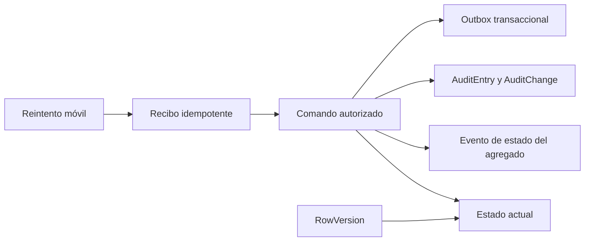

# Tiempo, estados y trazabilidad

El dominio distingue fecha civil, hora local e instante global. También separa estado actual, historia específica del proceso, auditoría transversal y concurrencia; ninguno sustituye a los demás.

## Modelo temporal

| Tipo | Uso |
| --- | --- |
| `DateTimeOffset(3)` | Instantes globales: creación, actualización, ocurrencia, asignación, envío, revisión y sincronización. La convención documental exige UTC. |
| `date` / `DateOnly` | Fechas civiles: día de operación, vigencia contractual, contratación, permisos, habilitaciones y cobertura. |
| `time(0)` / `TimeOnly` | Inicio y fin local de un turno. Se interpreta con la zona IANA de la estación. |
| Zona IANA | `Station.IanaTimeZone` identifica la regla local; evita fijar offsets permanentes. |

Un tramo de vuelo conserva `ScheduledAt`, `EstimatedAt` y `ActualAt`. En lenguaje de aviación corresponden al tipo de tiempo de llegada o salida según `FlightDirection`; el modelo no crea seis columnas separadas STA/ETA/ATA/STD/ETD/ATD.

## Capas de trazabilidad

| Capa | Responde | No responde por sí sola |
| --- | --- | --- |
| Estado actual | ¿Cómo está ahora el registro? | ¿Cómo llegó ahí? |
| Evento de estado | ¿Qué cambio de estado ocurrió, cuándo, por quién y por qué? | Todos los campos que cambiaron. |
| Auditoría | ¿Qué acción/cambio se atribuye y con qué correlación/scope? | Semántica completa del workflow. |
| Outbox | ¿Qué evento espera publicación/reintento, cuántos intentos lleva, cuál fue el último error y cuándo se procesó? | Un resultado de negocio, estado de UI o chat; `OutboxMessage` no posee campo de resultado. |
| Recibo móvil | ¿Qué estado, resultado o error quedó persistido para una combinación dispositivo-clave? | Autorización, coherencia entre esos campos o garantía ejecutable de replay. |
| `RowVersion` | ¿La escritura compite con otra versión? | Historial o resolución automática del conflicto. |

## Inventario de estados

| Área | Objeto | Valores |
| --- | --- | --- |
| IAM | organización | `Active`, `Inactive` |
| IAM | cuenta | `Active`, `PendingActivation`, `InvitationSent`, `Disabled`, `Blocked` |
| IAM | invitación | `NotSent`, `Sent`, `Expired`, `Accepted` |
| IAM | membresía | `Active`, `Suspended`, `Ended` |
| Personal | disponibilidad | `Pending`, `Approved`, `Rejected`, `Cancelled` |
| Comercial | solicitud | `Pending`, `InReview`, `Approved`, `Rejected`, `Cancelled` |
| Comercial | contrato | `Draft`, `Active`, `Suspended`, `Terminated`, `Expired` |
| Comercial | versión | `Draft`, `Approved`, `Superseded`, `Rejected` |
| Operación | turnaround | `Scheduled`, `Confirmed`, `InProgress`, `Completed`, `Cancelled`, `Diverted` |
| Operación | ground operation | `Planned`, `Assigned`, `InProgress`, `PendingReview`, `InReview`, `Approved`, `Returned`, `Cancelled` |
| Operación | ejecución de servicio | `Planned`, `InProgress`, `Completed`, `NotPerformed`, `Exception` |
| Operación | hito | `Pending`, `Estimated`, `Actual`, `Missed` |
| Operación | template checklist | `Draft`, `Published`, `Retired` |
| Operación | checklist | `NotStarted`, `InProgress`, `Submitted` |
| Operación | incidente | `Open`, `InReview`, `Resolved`, `Closed` |
| Operación | envío | `PendingReview`, `InReview`, `Approved`, `Returned` |
| Operación | solicitud operativa | `Submitted`, `InReview`, `Accepted`, `Rejected`, `Completed`, `Cancelled` |
| Mobile | comando | `Received`, `Processed`, `Rejected`, `Failed` |

## Historia explícita y ausencia deliberada

Tienen tablas de eventos de estado: turnaround, operación en tierra, servicio ejecutado, solicitud comercial y contrato. Tienen registros naturalmente históricos: ciclos, scopes, asignaciones, versiones, respuestas, envíos y decisiones.

No tienen una historia de estado dedicada en v1: cuenta, membresía, disponibilidad, solicitud operativa, checklist, incidente y comando móvil. Podrían quedar cubiertos por auditoría cuando los casos de uso lo implementen, pero esa cobertura no debe suponerse hoy.

`NO ACTION` evita borrados en cascada, pero los constraints EF revisados no convierten eventos operativos/comerciales, respuestas, envíos o decisiones en registros append-only. Además, el rol de aplicación de Development tiene `UPDATE` y `DELETE` sobre `commercial` y `ops`. Preservarlos sin mutación sigue siendo un diseño pendiente de enforcement y pruebas.

Auditoría es distinta: ese rol recibe `SELECT` e `INSERT`, no `UPDATE` ni `DELETE`, por lo que existe protección append-only a nivel de permisos para ese principal, no una inmutabilidad universal frente a cuentas privilegiadas. El outbox tampoco pertenece a la expectativa append-only: su forma contempla mutar `ProcessedAt`, `AttemptCount` y `LastError`. Hoy no existe publisher/caso de uso en la capa Application y el principal de API no recibe permiso sobre `infra.outbox_messages`.

## Invariantes de tiempo ya materializados

- fin de vigencia, asignación o resolución no puede preceder al inicio correspondiente donde existe constraint;
- un incidente no puede reportarse antes de ocurrir ni resolverse antes del reporte;
- un comando móvil expira después de recibirse y sólo puede procesarse después de recibido;
- versiones, ciclos y revisiones usan números positivos;
- timestamps auditables tienen precisión de milisegundo y defaults de servidor.

## Reglas todavía abiertas

- matriz de transiciones y actores autorizados por objeto;
- política de reloj y tolerancia para comandos offline;
- turnos nocturnos que cruzan fecha civil;
- orden y desempate entre fuentes manuales, internas, aerolínea y proveedor;
- retención de auditoría, outbox y recibos móviles;
- redacción de valores sensibles antes de `AuditChange`, errores o metadata JSON;
- coherencia transaccional entre `CurrentStatus`, evento de estado, auditoría y outbox.
- enforcement append-only y pruebas que rechacen modificación o borrado de eventos, respuestas, envíos y decisiones ya emitidos.
- coherencia entre estado, `ProcessedAt`, resultado y error de recibos móviles, más replay exacto del resultado sin repetir el comando.

## Relacionados

- [Índice de dominio](README.md)
- [Turnaround y operación](turnaround-y-operacion.md)
- [Identidad, tenancy y autorización](identidad-tenancy-y-autorizacion.md)
- [Brechas y preguntas abiertas](brechas-y-preguntas-abiertas.md)

## Fuentes

- [Convenciones de base v1](../../docs/architecture/database-v1.md)
- [Enums operativos](../../backend/Elevant.Domain/Enumerations/OperationsEnums.cs)
- [Enums de integración y auditoría](../../backend/Elevant.Domain/Enumerations/IntegrationAuditEnums.cs)
- [Convenciones EF](../../database/DevelopmentDB/Elevant.Persistence/Persistence/ModelBuilderExtensions.cs)
- [Configuración EF de outbox](../../database/DevelopmentDB/Elevant.Persistence/Persistence/Configurations/PlatformConfiguration.cs)
- [Composición actual de Application](../../backend/Elevant.Application/DependencyInjection.cs)
- [Permisos de la aplicación en Development](../../database/DevelopmentDB/scripts/bootstrap/provision-development.sql)
