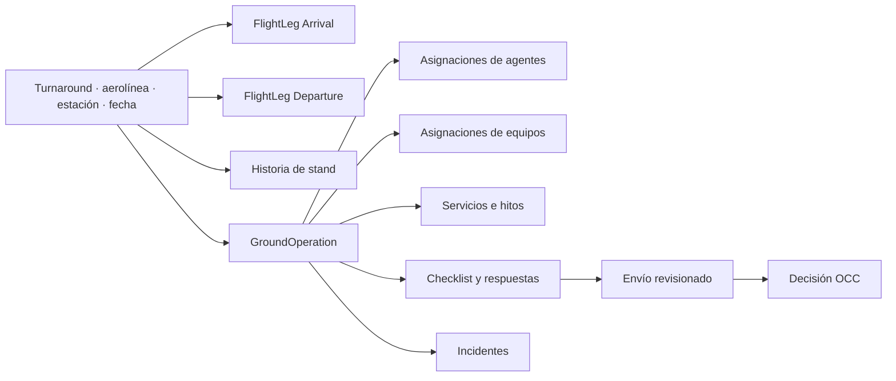
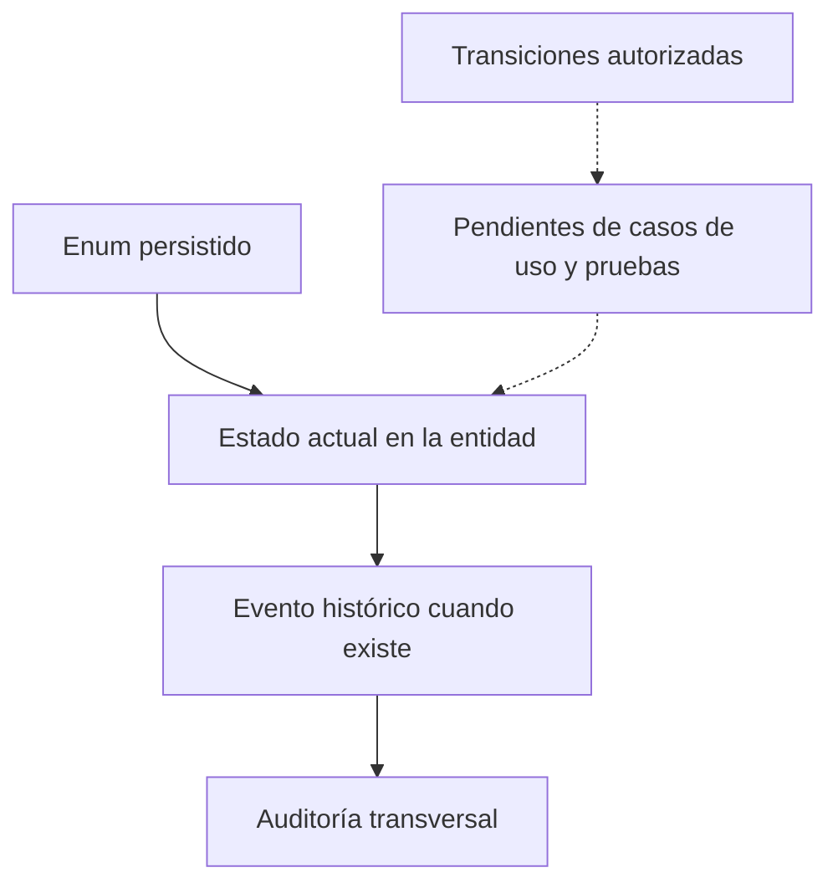

# Turnaround y operación en tierra

> [!NOTE]
> La revisión docente de octubre de 2026 cambió validaciones, permisos, notificaciones y otros comportamientos descritos aquí. El estado actual de cada punto está en [Correcciones de la revisión docente](../05-aplicaciones/correcciones-revision-docente-2026-10.md).

`Turnaround` representa la escala completa que AVIAM planifica en una estación. `GroundOperation` representa su ejecución en tierra. La separación permite conservar horarios y procedencia de los vuelos sin mezclar asignaciones, servicios, checklist, incidentes o revisión.

## Anatomía de una escala

Un turnaround guarda código de operación, aerolínea, estación, fecha civil, tipo/matrícula opcionales, estado actual y procedencia. Cada tramo guarda dirección, número de vuelo, origen, destino y sus tiempos programado, estimado y real. La unicidad turnaround-dirección materializa como máximo una llegada y una salida.

## Vocabulario de estado persistido

Los siguientes son conjuntos de valores, no una matriz de transición:

| Objeto | Estados disponibles |
| --- | --- |
| Turnaround | `Scheduled`, `Confirmed`, `InProgress`, `Completed`, `Cancelled`, `Diverted` |
| Operación en tierra | `Planned`, `Assigned`, `InProgress`, `PendingReview`, `InReview`, `Approved`, `Returned`, `Cancelled` |
| Servicio ejecutado | `Planned`, `InProgress`, `Completed`, `NotPerformed`, `Exception` |
| Hito | `Pending`, `Estimated`, `Actual`, `Missed` |
| Checklist | `NotStarted`, `InProgress`, `Submitted` |
| Envío | `PendingReview`, `InReview`, `Approved`, `Returned` |
| Incidente | `Open`, `InReview`, `Resolved`, `Closed` |

El modelo dispone de historias explícitas para turnaround, operación y servicio. Checklist, envío, decisión e incidente conservan sus propios registros. No hay código de aplicación que defina de forma completa qué actor puede mover cada estado, las precondiciones ni las transiciones prohibidas.

## Planificación y recursos

- Un turnaround sólo puede tener una asignación de stand abierta.
- Una operación sólo puede asignar una vez al mismo agente mientras la relación permanezca abierta.
- Un activo de equipo sólo puede participar en una asignación abierta a la vez.
- `OperationalPosition` expresa la función/habilitación requerida; `AssignmentRole` es un texto contextual de la asignación y su taxonomía aún no está cerrada.
- Los intervalos de asignación no pueden terminar antes de empezar, pero el esquema no impide todos los solapamientos entre operaciones o recursos.
- Un vuelo solo se planifica si un contrato `Active`, firmado y no terminado tiene una versión `Approved` o `Superseded` que cubre esa fecha en esa estación; es una sola regla para Planificación, vuelos manuales y asignación ([ADR-0027](../../docs/adr/0027-occ-ready-contracts-and-stand-locations.md)). El vuelo manual guarda esa versión en `contract_version_id`; los vuelos anteriores quedan sin ella.
- Una posición (`ref.stands`) puede tener latitud y longitud WGS84 que OCC ubicó en el mapa; sin ellas, el mapa usa una referencia interna sin verificar.

## Servicios e hitos

Cada línea de `OperationService` exige una definición canónica y posee una FK opcional `ContractServiceRateId`. También conserva cantidad contratada, cantidad ejecutada y unidad obligatoria; precio y moneda snapshot son opcionales. La FK y esas columnas independientes no demuestran por sí solas procedencia contractual ni que el snapshot se haya copiado de esa tarifa.

Antes de tratar una tarifa como origen autorizado, un caso de uso debe validar y probar que:

- precio y moneda están ambos ausentes o ambos presentes, y una línea con precio contractual referencia una tarifa;
- la tarifa corresponde al mismo `ServiceDefinitionId` de la línea;
- su versión contractual cubre la estación de la operación, pertenece a la misma aerolínea del turnaround, está `Approved` y es vigente en la fecha acordada;
- unidad y precio se copian de la tarifa y moneda de su versión de forma consistente al crear la línea, y el snapshot histórico no se revaloriza después.

Ninguna de esas coherencias cruzadas está materializada hoy por las FKs o constraints de `OperationService`.

Los hitos separan tiempo planeado, estimado y real e identifican su procedencia. La definición de los códigos de hito, SLA y reglas de cumplimiento aún necesita contrato de aplicación; un dashboard no debe inventarlos como columnas autoritativas.

## Checklist, incidentes y revisión

1. Un template posee versiones con vigencia e ítems ordenados; el código y el orden son únicos dentro de cada versión.
2. La pareja operación-versión identifica una instancia de checklist y la pareja checklist-ítem identifica una respuesta. Las FKs no prueban que el ítem respondido pertenezca a la versión instanciada.
3. Un envío numera la revisión y conserva quién/cuándo la presentó. Sus FKs no prueban que el checklist y el envío apunten a la misma operación.
4. Una cuenta revisora emite como máximo una decisión por envío: aprobar o devolver. El esquema no alinea automáticamente el outcome con el estado actual del envío.
5. `OperationSubmission` no captura un snapshot de respuestas: varios envíos pueden referenciar el mismo checklist y `ChecklistAnswer` sigue siendo mutable. Conservar una corrección como nueva revisión sin alterar contenido o decisión anterior es el diseño esperado, pero la unicidad y `NO ACTION` no impiden un `UPDATE` o `DELETE`. El comportamiento append-only aún necesita enforcement y una estrategia de versionado o snapshot.

Las pruebas negativas deben rechazar, como mínimo, una respuesta con un ítem de otra versión, un envío con el checklist de otra operación, la mutación de respuestas ya enviadas y una decisión incompatible con el estado del envío.

Los incidentes registran tipo, severidad, descripción y tiempos de ocurrencia, reporte y resolución. Las fotografías o archivos reales no están resueltos en v1 y no deben guardarse como blobs improvisados.

## Procedencia de datos de vuelo

`OperationalDataSource` admite `Internal`, `Manual`, `AirlineClient` y `ExternalProvider`. Turnaround, tramo, hito y eventos relevantes conservan fuente y, cuando corresponde, referencia/observación externa. El enum no decide precedencia, reconciliación ni confianza entre fuentes; esa política sigue abierta.

Los vuelos que informa el proveedor (AeroDataBox) entran como **propuestas**, nunca como escalas. Una escala importada guarda `Source = ExternalProvider`, `ExternalProvider = AeroDataBox` y la referencia del tramo; sus tramos reciben después las horas revisadas y reales del proveedor. La escala solo se crea cuando OCC confirma la llegada con su salida ([ADR-0028](../../docs/adr/0028-aerodatabox-flight-feed-with-unit-budget.md)).

## Estado de disponibilidad

En el commit histórico indicado en el frontmatter, Mobile Agent y Private Web presentaban recorridos prototípicos y la API todavía no ofrecía esos casos de uso. Esa observación no describe por sí sola la rama de integración posterior ni certifica un ciclo end-to-end desplegado.

### Cambio en la rama de integración de Development

La rama `feat/integrated-cycle-realtime` añade un caso de uso para que OCC cree una escala manual desde planificación. La API deriva el alcance de estación de la cuenta vigente, exige una única versión contractual aprobada y vigente para aerolínea/estación/fecha, valida ruta y fecha local, reserva una posición activa sin solapamiento y registra llegada, salida, operación planificada, historia, auditoría y aviso recuperable para la aerolínea en una transacción. El UUID de intención permite repetir el mismo cuerpo sin duplicar la escala. Un segundo comando OCC programa un turno local de agente para la estación y terminal derivadas de la escala; exige cobertura de toda la operación, aptitud vigente y ausencia de otro turno para el día. Después OCC refresca elegibilidad y usa el ETag nuevo para el despacho habitual. Programar el turno no asigna por sí solo, no factura y no debe confundirse con una promoción al VPS; el resto del ciclo continúa en implementación.

## Cobertura de posiciones por turno

En la rama de la fase 3, bloque 2 ([ADR-0030](../../docs/adr/0030-position-coverage-per-shift-and-combined-stands.md)), OCC asigna a cada agente **las posiciones que cubre durante una ventana de su turno**, en lugar de asignar vuelo a vuelo.

**Reglas.** Las aplica [PositionCoveragePolicy](../../backend/Elevant.Application/Operations/PositionCoveragePolicy.cs):
- máximo de posiciones por terminal (3 por defecto; la Terminal B del ejemplo, 2);
- licencia de conducir y vehículo para más de 2 posiciones;
- habilitación de puente en la Terminal B y en las posiciones con puente;
- mentor para agentes con menos de 3 meses;
- turno que cubra toda la ventana;
- sin ausencias aprobadas ni solapes.

Cada rechazo devuelve el código de la regla incumplida.

**Posiciones combinadas.** Son reglas entre posiciones que OCC configura y aplica [StandConstraintPolicy](../../backend/Elevant.Application/Operations/StandConstraintPolicy.cs):
- «X ocupada anula Y»;
- «X ocupada limita Y a estrecho».

Una colocación imposible se rechaza. En el mapa, la posición anulada aparece inhabilitada con la posición que la anula.

**El vuelo sigue a la posición.** Cuando la posición de una escala cambia antes de iniciar la operación, [CoverageReassignment](../../database/DevelopmentDB/Elevant.Persistence/Operations/CoverageReassignment.cs) mueve la operación al agente que cubre la nueva posición a la hora del bloqueo:
- libera la asignación anterior;
- avisa a los dos agentes;
- respeta el máximo de 3 operaciones simultáneas.

OCC también puede liberar al agente manualmente; la operación vuelve a `Planned`.

**Verificación.** La [prueba SQL](../../backend/tests/Elevant.IntegrationTests/Persistence/SqlServerMigrationTests.Coverage.cs) cubre:
- reglas;
- configuración;
- liberación;
- reasignación por cambio de posición;
- rechazo por posición anulada.

No se ha verificado en el VPS.

## Formularios AVIAM y firmas

Los formularios de AVIAM ya no se transcriben: se generan desde el registro de la operación ([ADR-0032](../../docs/adr/0032-aviam-forms-signatures-and-walkaround.md)).

- **Orden de Servicio en Rampa** (F-RAM-AVL-MAG 04): firman el representante de la aerolínea y AVIAM.
- **Reporte de Vuelo** (F-OCC-AVL-6.2.12/A9): firma el coordinador.
- **Check-List y Reporte Diario del Puente** (F-MGO-AVL 8.14.1/A1-A2): firma el operador; solo existe si la operación tiene el checklist del puente.

**Contenido y huella.**
- El [ensamblador](../../database/DevelopmentDB/Elevant.Persistence/Operations/OperationDocumentAssembler.cs) arma un contenido determinista; su JSON canónico se hashea con SHA-256.
- Las tres hojas comparten un número: estación + id interno con 9 dígitos (`PUJ000000123`).
- Una firma solo se acepta contra la huella que vio el firmante; si el contenido cambió, la API responde 409.
- Solo se guarda la versión firmada (`ops.operation_document_versions`, inmutable). Las firmas (`ops.operation_document_signatures`) son de solo inserción, una por rol y versión.
- Si cambia un dato facturable, ese formulario tiene otra huella y pide firmar de nuevo; los demás conservan sus firmas.

**PDF.** El [renderizador](../../backend/Elevant.Infrastructure/Operations/OperationDocumentPdfRenderer.cs) dibuja cada hoja como el papel, con la firma en trazos y la huella en el pie. OCC los descarga desde la revisión; la aerolínea ve y descarga en su portal solo la última Orden de Servicio firmada por completo.

**Walk-around.** `ops.operation_damage_marks` guarda la posición en la silueta (0–1), la nota y, opcionalmente, una foto JPEG o PNG en almacenamiento privado con su SHA-256. Las fotos no entran en la huella: se anexan al PDF del Reporte de Vuelo.

**Fuera de este bloque:** el formulario de charter sin contrato (falta el formulario literal) y la valoración de recargos (bloque 5).

## Relacionados

- [Glosario canónico](glosario-canonico.md)
- [Entidades y relaciones v1](entidades-y-relaciones-v1.md)
- [Tiempo, estados y trazabilidad](tiempo-estados-y-trazabilidad.md)
- [Brechas y preguntas abiertas](brechas-y-preguntas-abiertas.md)

## Fuentes

- [Decisiones de base v1](../../docs/architecture/database-v1.md)
- [Entidad Turnaround](../../backend/Elevant.Domain/Entities/Operations/Turnaround.cs)
- [Enums operativos](../../backend/Elevant.Domain/Enumerations/OperationsEnums.cs)
- [Restricciones EF de operaciones](../../database/DevelopmentDB/Elevant.Persistence/Persistence/Configurations/OperationsConfiguration.cs)
- [Permisos de la aplicación en Development](../../database/DevelopmentDB/scripts/bootstrap/provision-development.sql)
- [Recorrido observado en Mobile Agent](../../frontend/mobile-agent/README.md)
