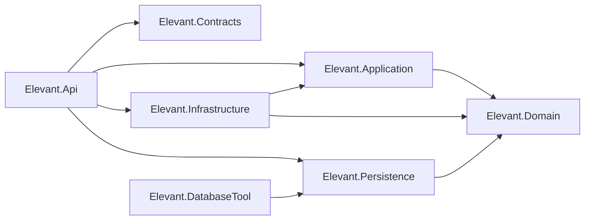
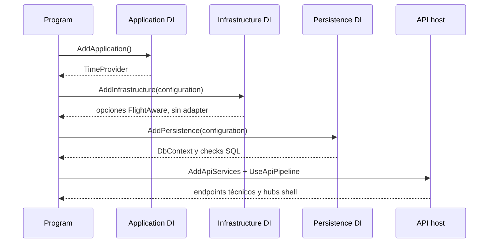

# Backend .NET, capas y dependencias

El backend es un monolito modular entregable como un único proceso ASP.NET Core. Clean Architecture se materializa mediante proyectos y referencias dirigidas hacia Domain; no mediante microservicios. Persistence y DatabaseTool están físicamente bajo `database/DevelopmentDB`, pero forman parte de la misma solución y del mismo grafo productivo.

## Línea base técnica

| Elemento | Estado comprobado |
| --- | --- |
| Target framework | Todos los proyectos heredan `net10.0` desde `Directory.Build.props`. |
| SDK | `global.json` fija `10.0.300` y permite roll-forward a la última feature band estable compatible. |
| Paquetes | Versiones centralizadas en `Directory.Packages.props`. |
| Restore | Cada proyecto mantiene `packages.lock.json`; CI activa locked mode. |
| Compilación | Nullable, implicit usings, análisis recomendado, estilo y build determinista se configuran en la raíz. |
| Arquitectura | Una prueba lee los `.csproj`, compara exactamente sus referencias y rechaza ciclos. |

## Grafo productivo exacto

Éste es el grafo exigido por [ProjectDependencyTests](../../backend/tests/Elevant.ArchitectureTests/Architecture/ProjectDependencyTests.cs), no una convención informal.

## Responsabilidad y contenido actual

### `Elevant.Domain`

Responsabilidad: entidades, enumeraciones, excepciones y hechos de dominio sin ASP.NET Core, EF Core ni proveedores.

Implementado:

- entidades para identidad, referencia, workforce, comercial, operaciones, integración y auditoría;
- bases `Entity<TId>` y `AuditableEntity`;
- colección y limpieza de eventos mediante el marker `IDomainEvent`;
- enumeraciones persistibles y una excepción base.

Límite actual: el repositorio sólo contiene el marker de evento y la excepción abstracta; no hay eventos concretos ni una capa completa de comportamiento/invariantes en Domain. Muchas restricciones vigentes se materializan hoy en el modelo EF y SQL, no en métodos de agregado.

### `Elevant.Application`

Responsabilidad: casos de uso y puertos orientados a lo que esos casos necesitan.

Implementado:

- registro de `TimeProvider.System`;
- puerto neutral `IFlightInformationProvider` y sus tipos de consulta/resultado.

No implementado: no existe una carpeta `Features` ni handlers de negocio. Los vertical slices descritos en su README siguen siendo un patrón objetivo, no funcionalidad disponible.

### `Elevant.Contracts`

Responsabilidad: formas públicas HTTP independientes de Domain y EF.

Implementado:

- `SystemPingResponse`, publicado por el único endpoint versionado;
- tipos comunes de paginación preparados para futuros endpoints.

Límite actual: los tipos de paginación no aparecen en el OpenAPI vigente porque no existe un endpoint que los use. No hay DTO de vuelos, operaciones, contratos, usuarios o autenticación.

### `Elevant.Infrastructure`

Responsabilidad: adaptadores y proveedores externos no persistentes detrás de puertos de Application.

Implementado: binding de opciones para el shell de FlightAware.

No implementado: adapter de `IFlightInformationProvider`, `HttpClient`, transporte, resiliencia y llamadas reales. La clase `FlightAwareClient` está vacía y no se registra.

### `Elevant.Persistence`

Responsabilidad: EF Core, SQL Server, ASP.NET Core Identity, mappings, migraciones y seed de Development.

Su proyecto sólo referencia Domain. El `RootNamespace` continúa como `Elevant.Infrastructure` para preservar la historia y los namespaces existentes, aunque la frontera física se llame `Elevant.Persistence` y viva en `database/DevelopmentDB`.

### `Elevant.Api`

Responsabilidad: composition root y transporte HTTP.

`Program.cs` compone, en orden, Application, Infrastructure, Persistence y servicios API; después construye el pipeline. El proyecto referencia esas implementaciones y Contracts porque es el borde que las une.

Implementado:

- controllers y versionado por segmento;
- CORS, rate limiting, forwarded headers y HTTPS redirection configurables;
- Problem Details, manejo global de excepciones, health y readiness;
- Swagger/OpenAPI en ambientes permitidos;
- mapeo de dos hubs SignalR;
- probes especiales de contenedor antes de construir el host.

No implementado: autenticación, autorización efectiva, controllers de negocio y dispatch de casos de uso/eventos.

### `Elevant.DatabaseTool`

Responsabilidad: ejecutable one-shot para verificar el destino y sembrar fixtures sintéticos de Development. Sólo referencia Persistence. El bundle EF de migración se ejecuta por una ruta separada; DatabaseTool no forma parte del request path de la API.

## Flujo de composición

Persistence falla al iniciar si falta `ConnectionStrings:ElevantDatabase`. Eso demuestra una dependencia de runtime explícita; no demuestra que el catálogo sea correcto hasta que readiness valide nombre y marcador.

## Qué protegen —y qué no— las pruebas de arquitectura

Protegen:

- conjunto exacto de referencias entre siete proyectos;
- ausencia de ciclos en ese grafo;
- independencia interna de Domain y Contracts;
- dirección Application → Domain, Infrastructure → Application/Domain y Persistence → Domain.

No protegen automáticamente:

- que un controller no inyecte `ElevantDbContext`, porque Api referencia Persistence para componerlo;
- que una entidad EF no se devuelva por HTTP;
- que toda regla de negocio viva en Domain/Application;
- límites entre módulos dentro de un mismo proyecto;
- compatibilidad semántica del contrato público.

Esas restricciones requieren revisión, pruebas de slice y verificaciones de OpenAPI además del test de referencias.

## Patrón para una capacidad futura

Una capacidad real debería atravesar las fronteras así:

1. Domain expresa vocabulario e invariantes demostradas.
2. Application agrupa comando/consulta, validación de caso, handler y puertos pequeños.
3. Infrastructure o Persistence implementan esos puertos sin filtrar sus detalles.
4. Contracts define requests/responses HTTP separados.
5. Api traduce transporte, identidad y resultado; el controller no ejecuta reglas.
6. Las pruebas cubren reglas, handler, persistencia/frontera y contrato generado.

Este patrón es un objetivo aceptado. No se debe interpretar como evidencia de slices que todavía no existen.

## Verificación

- Compara los siete `.csproj` con [ProjectDependencyTests](../../backend/tests/Elevant.ArchitectureTests/Architecture/ProjectDependencyTests.cs).
- Revisa [Program](../../backend/Elevant.Api/Program.cs) para la composición real.
- Busca implementaciones concretas y registros DI; una interfaz, un DTO o un comentario no demuestran que exista un caso de uso.
- Confirma el SDK y las reglas comunes en [`global.json`](../../global.json) y [`Directory.Build.props`](../../Directory.Build.props).

Esta nota no certifica build/test de un commit posterior ni salud operativa de un host.

## Relacionados

- [Índice de Arquitectura](README.md)
- [Sistema y fronteras de confianza](sistema-y-fronteras-de-confianza.md)
- [Datos, EF Core, migraciones y persistencia](datos-ef-migraciones-y-persistencia.md)
- [Decisiones, restricciones y riesgos](decisiones-restricciones-y-riesgos.md)
