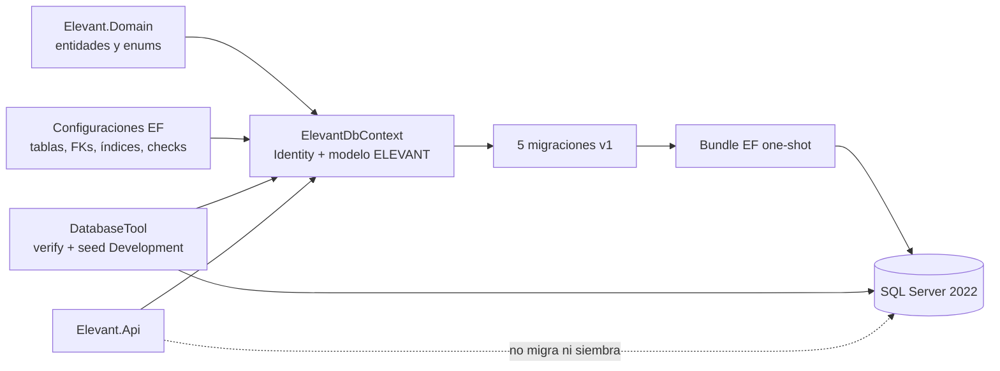
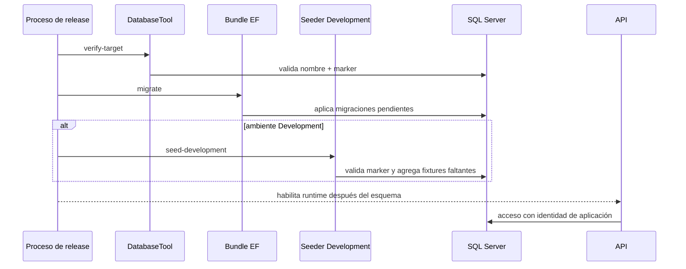

# Datos, EF Core, migraciones y persistencia

`database/DevelopmentDB/Elevant.Persistence` es la fuente ejecutable del modelo SQL compartido por la única API. La carpeta se llama DevelopmentDB porque contiene el tooling operativo vigente, pero sus migraciones representan la cadena normal de esquema que Development y una futura Production aplicarían sobre bases físicas separadas.

El modelo persistente existe y es amplio; eso no significa que la API ya exponga sus operaciones. Hoy EF puede materializar entidades, relaciones y constraints mientras Application y los endpoints de negocio siguen pendientes.

## Componentes y responsabilidades

## Modelo EF actual

`ElevantDbContext` hereda de `IdentityDbContext<ApplicationUser, ApplicationRole, long>`. Integra las tablas de ASP.NET Core Identity con las entidades de identidad, catálogos, personal, comercial, operaciones, mobile, auditoría y outbox de ELEVANT.

### Schemas

| Schema | Responsabilidad persistente actual |
| --- | --- |
| `infra` | marcador de ambiente, historial EF y outbox persistente |
| `iam` | cuentas Identity, personas, organizaciones, memberships, roles, permisos y scopes de estación |
| `ref` | catálogos compartidos de aviación, estación, servicio y equipos |
| `hr` | agentes, scopes, habilitaciones, turnos, disponibilidad y cobertura |
| `commercial` | solicitudes, contratos, versiones, estaciones y tarifas |
| `ops` | turnaround, tramos, ejecución, asignaciones, servicios, checklists, incidentes y revisión |
| `integration` | dispositivos, bindings de cuenta y receipts idempotentes de Mobile |
| `audit` | entradas de auditoría y cambios por campo |

El inventario detallado está en [schema-v1](../../docs/database/schema-v1.md). La existencia de una tabla de auditoría, outbox o receipt no demuestra que un handler la escriba: el código de aplicación correspondiente todavía no existe.

### Convenciones verificadas

- SQL Server usa compatibility level `160` y retry del proveedor EF.
- El historial de migraciones vive en `infra.__EFMigrationsHistory`.
- Las tablas y columnas se normalizan a `snake_case` desde el modelo.
- `AuditableEntity` obtiene `PublicId` único, timestamps con precisión 3 y `rowversion`.
- Los mappings definen índices únicos, precisiones, longitudes y check constraints por agregado.
- La prueba de modelo exige que ninguna foreign key de negocio use cascade delete.
- Precio contractual y snapshot de servicio ejecutado usan precisión fija `decimal(19,4)`; la moneda snapshot usa `char(3)`.
- La idempotencia persistente de Mobile tiene un índice único por dispositivo + clave.

Estas son restricciones físicas. No reemplazan validaciones de identidad, autorización, transición de estado o coherencia entre varios agregados que deban implementarse como casos de uso.

## Cadena de migraciones v1

| Orden | Migración | Alcance principal |
| --- | --- | --- |
| 1 | `20260817200402_V1_01_Platform` | schema `infra` y outbox |
| 2 | `20260817201128_V1_02_IdentityReference` | Identity, organizaciones, scopes y catálogos |
| 3 | `20260817201608_V1_03_WorkforceCommercial` | personal, planificación laboral, solicitudes y contratos |
| 4 | `20260817202135_V1_04_Operations` | turnaround, vuelos, ejecución, checklists, incidentes y revisión |
| 5 | `20260817202420_V1_05_MobileAudit` | dispositivos, receipts idempotentes y auditoría |

La prueba `MigrationPolicyTests` inspecciona las operaciones `Up` y rechaza `InsertDataOperation` y SQL que empiece con `INSERT`, `UPDATE`, `DELETE` o `MERGE`. Por tanto, las migraciones modelan esquema y no seed de negocio. Esa prueba no prueba que todo `Down` sea seguro ni que un cambio futuro sea backward-compatible: cada migración requiere revisión y pruebas de upgrade.

## Identidad del destino

Una ejecución de schema o seed se protege en capas:

1. `DatabaseTargetGuard` exige declarar `Development` o `Production`.
2. La cadena debe apuntar al nombre físico exacto esperado por ese ambiente.
3. Production requiere una segunda confirmación explícita del nombre.
4. `DatabaseInstanceVerifier` exige exactamente un marker `infra.database_instances` con `id=1` y ambiente coincidente.

El marker se crea antes de EF y `PlatformConfiguration` lo excluye de migraciones. Esto permite verificar la identidad del destino antes de modificar el esquema. Readiness de la API reutiliza nombre y marker para detectar una conexión cruzada o ambigua.

## Ciclo de migración, seed y runtime

`container-entrypoint.sh` ejecuta `verify-target` antes del bundle. El comando `seed-development` es diferente de `migrate`. La API sólo registra `ElevantDbContext`; no llama `Migrate`, `EnsureCreated`, `EnsureDeleted` ni `DevelopmentDataSeeder` al iniciar.

## Seed de Development

El seeder comprobado:

- exige marker `Development`;
- valida una credencial sintética mínima recibida desde configuración externa;
- ejecuta bajo estrategia de reintento y transacción serializable;
- utiliza identificadores y fechas deterministas;
- busca cada fixture y sólo agrega el faltante;
- no tiene una ruta de seed para Production.

Su idempotencia significa que repetirlo no duplica sus anchors conocidos. No significa que repare cualquier modificación manual ni que pueda convertir datos de Production en fixtures. Los datos existentes que coinciden con sus claves se conservan.

## Separación de ambientes

| Aspecto | Development | Production |
| --- | --- | --- |
| Base física esperada | `ElevantDevelopmentDb` | `ElevantProductionDb` |
| Cadena de esquema | Las cinco migraciones v1 | La misma cadena cuando exista rollout aprobado |
| Seed de negocio | Sintético, determinista y explícito | Prohibido |
| Estado verificable en el repo | Tooling, Compose, migraciones y seed implementados | Carpeta reservada sólo con `.gitkeep` |

El repositorio no permite concluir que Production exista o esté desplegada. Tampoco autoriza copiar datos, credenciales, volúmenes o backups entre ambientes.

## Límites y riesgos persistentes

- La tabla `infra.outbox_messages` no tiene publisher/worker implementado; hoy es capacidad de persistencia, no entrega de eventos.
- `integration.mobile_command_receipts` materializa deduplicación, pero no hay endpoint o handler que procese comandos offline.
- Las entidades con eventos sólo tienen infraestructura base; no existe dispatch de eventos de dominio.
- Varias reglas de workflow requieren enforcement en Application/Domain; foreign keys y checks no prueban transición o autorización.
- “Historial” o “append-only” es una intención para ciertos registros, pero el modelo por sí solo no niega `UPDATE`/`DELETE` a todas las identidades; no debe presentarse como garantía universal.
- Revertir binario de API no revierte un esquema ya aplicado; los cambios incompatibles necesitan expand/contract y coordinación.

## Verificación

1. Enumera las migraciones bajo `Persistence/Migrations` en el commit indicado.
2. Compara el snapshot con `ElevantDbContext` y las cinco clases de configuración.
3. Ejecuta la prueba de modelo para convenciones críticas y la prueba de política de migración.
4. Busca llamadas a `Migrate`, seed o `EnsureCreated` dentro de `backend/Elevant.Api`; no deben existir.
5. Contrasta guard, marker y entrypoint antes de afirmar que un destino está protegido.

Esta revisión demuestra diseño versionado, no que una instancia viva haya aplicado la última migración.

## Relacionados

- [Índice de Arquitectura](README.md)
- [Backend .NET, capas y dependencias](backend-dotnet-capas-y-dependencias.md)
- [Entidades y relaciones v1](../03-dominio/entidades-y-relaciones-v1.md)
- [Tiempo, estados y trazabilidad](../03-dominio/tiempo-estados-y-trazabilidad.md)
- [Decisiones, restricciones y riesgos](decisiones-restricciones-y-riesgos.md)
