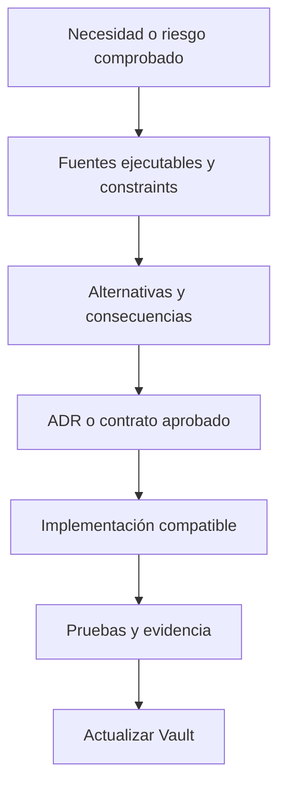

# Decisiones, restricciones y riesgos

Esta nota resume decisiones aceptadas y las contrasta con el código vigente. Una ADR expresa intención; sólo el código y las pruebas demuestran cuánto está implementado. Los riesgos enumerados no significan que el scaffold sea defectuoso: muestran qué falta antes de convertir el modelo y los prototipos en un producto autorizado de extremo a extremo.

## Decisiones aceptadas y grado de materialización

| Decisión | Estado en el repositorio | Límite actual |
| --- | --- | --- |
| ADR-0001 · Monorepositorio | Implementada | Un solo repo contiene backend, tres clientes, paquete API, DB, docs y ops. Los límites aún dependen de reglas y revisión además de carpetas. |
| ADR-0002 · .NET 10 | Implementada | SDK, target, paquetes centrales y lockfiles están fijados; cada cambio debe seguir compilando/probando esa línea. |
| ADR-0003 · Monolito modular | Implementada en estructura | Un proceso API y grafo de proyectos acíclico. Los módulos/casos de uso de negocio todavía no están construidos. |
| ADR-0004 · APIs externas centralizadas | Frontera implementada, adapter pendiente | Application define el puerto FlightAware; no existe transporte real. |
| ADR-0005 · API remota de Development | Decisión arquitectónica aceptada | Los clientes tienen configuración para un origen remoto; esta nota no certifica el estado de un host vivo. |
| ADR-0006 · Development/Production separados | Guardas y límites de repo implementados | Development tiene tooling; Production sigue reservada y requiere diseño/rollout independiente. |
| ADR-0007 · Cliente TypeScript generado | Implementada para el contrato mínimo | Snapshot, descriptor, Orval y wrapper existen; sólo `GetSystemPing` está disponible. |
| ADR-0014 · Release API ligada a fingerprint OpenAPI | Implementada en CI/CD | Descriptor, snapshot, Swagger y etiqueta OCI deben coincidir; la huella prueba igualdad canónica, no compatibilidad semántica ni una atestación externa. |

Los ADR-0008 a ADR-0013 sobre empaquetado y operación de Development
pertenecen principalmente a CI/CD y Operaciones. ADR-0014 sí aparece aquí
porque separa identidad del contrato y procedencia de release. Ninguna de estas
decisiones se usa para inferir disponibilidad, despliegue o recuperación de un
runtime vivo.

## Restricciones no negociables

### Producto y confianza

- Los tres clientes deben consumir una única API, propietaria de una única base lógica por ambiente; los adaptadores prototípicos todavía no cumplen todo ese recorrido.
- Ningún cliente consulta SQL Server ni un proveedor de aviación directamente.
- Tenant, estación, agente y permisos deberán derivarse y validarse en servidor; nunca se confiará en un ID o rol del cliente. Ese enforcement HTTP sigue pendiente.
- Los mocks, storage de navegador y outbox del dispositivo no son fuentes canónicas.

### Código

- Domain no depende de proyectos ELEVANT ni frameworks de infraestructura.
- Application sólo depende de Domain.
- Contracts no depende de otros proyectos ELEVANT y no expone entidades EF.
- Infrastructure depende de Application/Domain; Persistence depende de Domain.
- Api es composition root, no capa de reglas.
- DatabaseTool es one-shot y no entra en el request path.

### Datos y contratos

- EF Core migrations son la historia del esquema normal.
- API no migra ni siembra al arrancar.
- Migraciones no transportan DML de negocio; Development seed es explícito y Production no se siembra.
- OpenAPI gobierna el contrato cliente/servidor sólo para operaciones existentes.
- `source.json` identifica el contrato mediante versión, ruta y fingerprint;
  commit, run e imagen se obtienen del manifiesto OCI inmutable de la release.
- Cambios incompatibles requieren versión o rollout API-first coordinado; cliente y API pueden desplegarse de forma independiente.
- REST conserva la verdad; SignalR no constituye confirmación durable.

### Integraciones y secretos

- Un proveedor externo se encapsula detrás de un puerto neutral y adapter de Infrastructure.
- Credenciales, tokens y cadenas de conexión entran desde configuración privada y no se hornean en bundles o contratos.
- Errores y observabilidad no filtran secretos, bodies externos ni PII.

## Mecanismos de enforcement

| Regla | Enforcement actual | Cobertura |
| --- | --- | --- |
| Grafo de proyectos y ausencia de ciclos | `ProjectDependencyTests` | Automática y exacta a nivel de `ProjectReference`. |
| Modelo SQL, no-cascade y convenciones críticas | Pruebas de integración de Persistence | Automática para invariantes enumeradas; no para toda regla de negocio. |
| Destino de DB | Guard de ambiente/nombre/confirmación + marker | Automática en tooling/readiness. |
| Contrato mínimo HTTP | Prueba de diagnostics + snapshot OpenAPI | Automática para `GetSystemPing`; no existen contratos de negocio. |
| Unión contrato/release | Igualdad descriptor/snapshot/Swagger, etiqueta OCI, política de paths y resolver de linaje | Automática para identidad canónica y procedencia exacta; no juzga compatibilidad semántica. |
| Separación DTO/EF y controllers delgados | Reglas AGENTS + revisión | No hay analizador que impida toda violación dentro de Api. |
| Tenant/RBAC/station scope | Diseño y modelo persistente | Sin enforcement HTTP porque autenticación/casos de uso no están implementados. |
| Historial append-only | Tablas/eventos y algunas restricciones | No existe una garantía universal contra `UPDATE`/`DELETE`. |

## Riesgos priorizados

### R1 · Autenticación y autorización ausentes — bloqueante para negocio

Hay tablas Identity y esquema Bearer futuro, pero no pipeline de autenticación ni rutas protegidas. Incorporar endpoints de negocio antes de JWT/session, resolución de membresía, RBAC y scope de estación permitiría depender sólo de privacidad de red o datos enviados por el cliente.

**Cierre verificable:** flujo de autenticación aprobado, handlers y middleware, policies por audiencia, pruebas cross-tenant/cross-station y OpenAPI seguro.

### R2 · Modelo persistente sin casos de uso — riesgo de falsa completitud

La base v1 representa gran parte del dominio, mientras Application no contiene slices y OpenAPI sólo publica ping. Una tabla o enum puede parecer una capacidad terminada aunque no exista workflow, transición, autorización o response pública.

**Cierre verificable:** implementar cada capacidad verticalmente y marcarla como disponible sólo cuando Domain/Application/API/tests/cliente estén conectados.

### R3 · Reglas de dominio concentradas en EF — riesgo de coherencia

Domain contiene entidades mayormente mutables, un marker de eventos y una excepción base; no contiene todavía comportamiento suficiente para demostrar todos los invariantes. SQL cubre foreign keys, índices y checks, pero no toda coherencia temporal, autorización o transición entre agregados.

**Cierre verificable:** reglas acordadas en aggregates/services/slices, pruebas unitarias y de integración, y constraints adicionales sólo cuando sean correctos para todos los flujos.

### R4 · Hubs mapeados sin seguridad ni contratos — latente

Los hubs están vacíos, pero sus rutas existen y no exigen autorización. Hoy no transportan datos de negocio; activarlos sin handshake autenticado, groups, scope, payload/version y estrategia de reconexión crearía fuga o estado divergente.

**Cierre verificable:** contrato de eventos, authorization policies, tests de aislamiento y regla REST-after-reconnect.

### R5 · Outbox, eventos e idempotencia sólo persistentes — riesgo de asumir ejecución

Existen `outbox_messages`, `MobileCommandReceipt` y una colección base de domain events. No existe dispatcher/publisher, handler de comandos Mobile ni dispatch de eventos. El esquema prepara el mecanismo, pero nada procesa automáticamente esas filas.

**Cierre verificable:** transacción de escritura + captura de evento, worker reanudable, retry/dead-letter/telemetría, handler idempotente y pruebas de duplicado/fallo.

### R6 · FlightAware sin contrato operativo — integración desconocida

No están confirmados producto contratado, cuotas, campos, auth, licencia, timeouts o degradación; no hay adapter registrado. Rellenar el shell con supuestos o devolver vacío como éxito ocultaría el riesgo.

**Cierre verificable:** requisitos y proveedor confirmados, adapter probado contra simulador, secrets por ambiente y políticas de resiliencia observables.

### R7 · Dependencias cartográficas demo — preparación para Production pendiente

Private Web usa styles/tiles públicos y CSP explícita. Su disponibilidad, términos, privacidad y capacidad no constituyen una selección productiva.

**Cierre verificable:** proveedor/licencia aprobados, URLs por ambiente, límites/fallback y revisión CSP/privacidad.

### R8 · Production sólo es frontera — no confundir diseño con plataforma

La separación y guardas están diseñadas, pero `database/ProductionDB` no contiene implementación. Ninguna nota de arquitectura autoriza crear o desplegar Production.

**Cierre verificable:** plan explícito separado, threat model, identidades/redes/secrets/backups propios, release compatible y aceptación operacional.

### R9 · Acceso humano Development omite reglas API — aceptado con límite

CRUD por SSMS sobre datos sintéticos es una excepción deliberada. Puede producir estados que un futuro caso de uso rechazaría; SQL sólo conserva sus constraints físicos.

**Control actual:** cuentas individuales y no DDL; mantener datos sintéticos y usar la anomalía para fortalecer validaciones, nunca para inferir un comportamiento Production.

## Discrepancias documentales reconciliadas

La documentación inicial del scaffold quedó atrás cuando se incorporaron los
clientes ejecutables, el modelo v1 y las cinco migraciones. En esta
reconciliación, [Arquitectura general](../../docs/architecture/overview.md) y
[Visión del sistema](../../docs/architecture/system-overview.md) ya distinguen
ese estado del flujo de negocio aún pendiente. Los resúmenes de
[monolito modular](../../docs/architecture/modular-monolith.md) y
[reglas de dependencia](../../docs/architecture/dependency-rules.md) incluyen
ahora Persistence y DatabaseTool.

Ésta es una corrección documental, no la implementación de autenticación,
handlers o integraciones externas. Para describir comportamiento actual, la
precedencia sigue siendo código, migraciones, OpenAPI y pruebas; el grafo exacto
se comprueba en los `.csproj` y `ProjectDependencyTests`.

## Decisiones todavía desconocidas

| Pregunta | Estado | Evidencia necesaria para cerrarla |
| --- | --- | --- |
| ¿Qué proveedor/flujo de identidad se usará? | Desconocido | ADR de identidad, threat model y contrato probado. |
| ¿Cómo se traducirán roles, memberships y station scopes a policies? | Desconocido | Matriz de autorización y tests negativos por audiencia. |
| ¿Cuál es el primer slice de negocio y su rollout compatible? | Desconocido | Prioridad de producto, endpoint OpenAPI y plan API-first. |
| ¿Qué reglas de transición deben vivir en Domain vs Application vs SQL? | Parcial | Casos de uso y matrices de estado aprobadas. |
| ¿Cómo se publicarán outbox/domain events? | Desconocido | Diseño de worker, entrega, retries y observabilidad. |
| ¿Qué SLA/plan/licencia se contratará para datos de vuelos y mapas? | Desconocido | Decisión de proveedor y contratos vigentes. |
| ¿Qué object storage, retención y autorización se usarán? | Diferido | Diseño de evidencia binaria y privacidad. |
| ¿Cuándo extraer un servicio del monolito? | Sin necesidad demostrada | Métricas de escala, ownership, regulación o aislamiento de fallos. |

## Regla de decisión futura

No se crean microservicios, adapters genéricos, tablas, eventos o abstracciones “por si acaso”. Una extracción sólo se justifica con evidencia de escala distinta, ciclo independiente sostenido, ownership claro, regulación o aislamiento imposible de resolver en el monolito.

## Verificación

- Lee cada ADR como decisión y después busca su enforcement en código/tests.
- Usa [ProjectDependencyTests](../../backend/tests/Elevant.ArchitectureTests/Architecture/ProjectDependencyTests.cs) para el grafo real.
- Revisa la composición de API y busca autenticación/policies antes de afirmar seguridad.
- Busca workers, handlers y implementaciones concretas antes de afirmar outbox, idempotencia o proveedores activos.
- Contrasta cualquier documento antiguo con las migraciones y el snapshot OpenAPI del commit.

Esta nota no reemplaza un threat model, ADR futuro o plan de rollout.

## Relacionados

- [Índice de Arquitectura](README.md)
- [Backend .NET, capas y dependencias](backend-dotnet-capas-y-dependencias.md)
- [Datos, EF Core, migraciones y persistencia](datos-ef-migraciones-y-persistencia.md)
- [OpenAPI, HTTP y SignalR](openapi-http-y-signalr.md)
- [Integraciones externas](integraciones-externas.md)
- [Brechas de dominio](../03-dominio/brechas-y-preguntas-abiertas.md)
