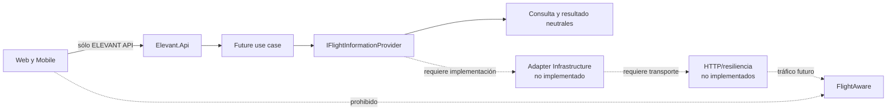
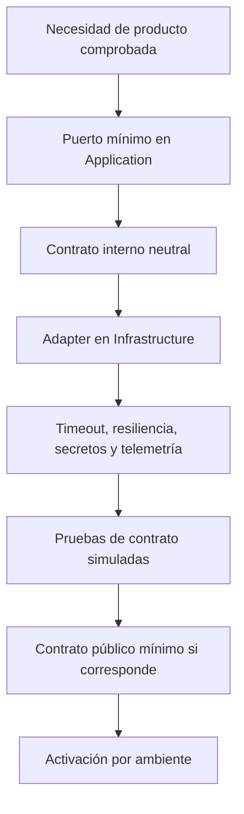

# Integraciones externas

ELEVANT separa una integración de negocio de un proveedor concreto: Application define el puerto mínimo, Infrastructure adapta transporte y modelos, y los clientes sólo consumen la API ELEVANT para datos operacionales de proveedores. El feed de vuelos de pago es **AeroDataBox** ([ADR-0028](../../docs/adr/0028-aerodatabox-flight-feed-with-unit-budget.md)); FlightAware sigue como frontera futura sin conectar.

## Feed de vuelos AeroDataBox

Solo el servidor llama al proveedor, y solo desde `FlightFeedSynchronizer` (el worker de cada minuto y «Actualizar ahora» de OCC). La única llamada de pago es FIDS por aeropuerto: 2 unidades, hasta 12 h, llegadas y salidas juntas, con el aeropuerto contrario incluido.

- **Cuándo:** cada mitad del día una vez; mañana una vez desde las 18:00; refresco cada 15 min cerca de un vuelo contratado, cada 60 min si quedan vuelos, nunca si no hay. Al 80 % del presupuesto el intervalo se duplica; al límite (1 200 por día y 38 000 por mes, UTC) se detiene.
- **Cuánto:** un día de actividad máxima gasta 100–200 unidades, alrededor del 12 % del plan de 40 000 al mes.
- **Seguridad del gasto:** registro de cada llamada en `integration.provider_usage_entries`, un único turno por proveedor en `integration.provider_sync_leases`, pausa tras cuota agotada (hasta el día siguiente), clave rechazada (6 h), 429 (`Retry-After`) o fallos (espera creciente hasta 1 h).
- **Qué se guarda:** los tramos de todas las aerolíneas activas registradas, como propuestas que OCC importa o descarta (`integration.external_flight_proposals`); antes de la fase 2, solo los de aerolíneas con contrato (ver [Fase 2](#fase-2-feed-ampliado-y-proveedor-simulado)). Todas las aerolíneas vistas alimentan `ref.airline_registry_entries`, que la verificación de aerolíneas consulta antes de Wikidata y OpenFlights; los aeropuertos contrarios completan `ref.airports` con zona horaria y coordenadas. Ambas cosas sin unidades extra.
- **Apagado por defecto:** sin `AeroDataBox:Enabled` y clave no hay llamadas. En CI nunca se llama; la única prueba real es opt-in (`ELEVANT_LIVE_AERODATABOX=1`, 2 unidades).

Pendiente: enlazar OpenSky con los vuelos importados y mostrar el consumo en Superadministración.

*Posterior al commit verificado de esta nota (PR A3,
[ADR-0042](../../docs/adr/0042-occ-air-picture-and-map-flights.md)):* la
imagen aérea del mapa del OCC reconoce sus aviones (adsb.fi, con adsb.lol de
relevo) como vuelos de ELEVANT por matrícula y por *callsign*; el tráfico de
OpenSky sigue sin enlazar ([Tráfico aéreo en vivo](#tráfico-aéreo-en-vivo-adsbfi-y-adsblol)).

### Fase 2: feed ampliado y proveedor simulado

Posterior al commit verificado de esta nota: esta sección describe el código de
la fase 2 del ciclo (`50e7778f`;
[ADR-0038](../../docs/adr/0038-preoperation-contract-lifecycle-permits-master-data-and-workforce-readiness.md)).

- **Qué se guarda ahora.** Los tramos de todas las aerolíneas activas
  registradas, sin unidades extra porque llegan en la misma respuesta. OCC ve
  aparte las que no tienen contrato en vigor ese día, como candidatas a
  charter, y nunca ve las de un contrato suspendido o vencido en la estación.
  El ritmo de lecturas y el conteo de tramos contratados siguen contando solo
  las contratadas.
- **Importar.** OCC elige el tipo de avión, que se sugiere desde el modelo
  informado, la posición y el modo charter sin contrato. Una propuesta
  descartada se restaura mientras su vuelo no haya pasado.
- **Proveedor simulado.** `SimulatedAirportFlightFeed` es un segundo adaptador
  del mismo puerto. Responde un horario determinista de las aerolíneas activas
  registradas, sin red, con su propio nombre de proveedor (`Simulated`): su
  registro de uso, su turno y su consumo no se mezclan con los de AeroDataBox,
  y no alimenta `ref.airline_registry_entries`. Se activa con
  `SimulatedFlightFeed__Enabled`, apagado por defecto. La API se niega a
  arrancar si se activa fuera de los entornos `Development` o `Test` o junto con
  AeroDataBox
  ([registro](../../backend/Elevant.Infrastructure/DependencyInjection.cs) y
  [adaptador](../../backend/Elevant.Infrastructure/Integrations/SimulatedFlightFeed/SimulatedAirportFlightFeed.cs)).
- **Dónde se activa.** Solo el overlay de Compose del arnés E2E, en
  `database/DevelopmentDB`, lo enciende
  ([guía local](../../docs/workflows/local-development.md#recorrido-e2e-del-ciclo-completo)).
  La plantilla del VPS Development
  ([`compose.development.api.yml`](../../backend/compose.development.api.yml))
  no lo define, así que allí el feed sigue siendo AeroDataBox.

### Fase 3: el feed y las escalas que planifica OCC

Posterior al commit verificado de esta nota: esta sección describe el código de
la fase 3 del ciclo (`f2d5c52c`) y la corrección de los hallazgos pendientes de
la revisión de su bloque A (`52141adb`), que esa verificación no cubre
([ADR-0039](../../docs/adr/0039-operation-planning-coverage-offline-tablet-occ-review-and-reports.md)).
Lo que informa el proveedor nunca reemplaza una decisión de OCC:

- **Sin escalas duplicadas.** Importar un par que coincide con una escala
  abierta de la misma estación, aerolínea, número de vuelo normalizado y día
  local lo vincula a esa escala (`linked`) y completa la matrícula si falta y
  el tipo de avión si la escala no lo tiene, siempre que el tipo no esté fijo y
  la posición que ya ocupa lo admita (si no lo admite, `409 stand_unavailable`
  con `reasons`, como la llegada y «Editar vuelo»); el alta manual del mismo
  vuelo se rechaza (`flight_already_planned`).
- **La llegada de OCC prevalece.** Desde que OCC registra la llegada, el tramo
  es `Manual` y las lecturas siguientes ya no reescriben su hora real.
- **Cancelado o desviado.** Si el proveedor informa cancelado o desviado un
  vuelo importado, OCC recibe un aviso una sola vez y decide; el feed no cambia
  la escala.
- **Código legible.** La escala importada recibe el código
  `{ESTACIÓN}-{AAAAMMDD}-{NNN}`, como la manual.

### Vuelos demo: sin proveedor externo

Posterior al commit verificado de esta nota: esta sección describe el código de
`cba00f73` ([ADR-0041](../../docs/adr/0041-demo-flights-and-punta-cana-stands.md)),
que esa verificación no cubre.

- **Sin proveedor.** Los vuelos demo que dispara Superadministración son dos
  propuestas de un proveedor propio, `Demo`, que la API escribe sin ninguna
  llamada de red; un worker las hace avanzar con el reloj del servidor
  ([almacén](../../database/DevelopmentDB/Elevant.Persistence/Integration/EfDemoFlightStore.cs)).
- **Fuera del feed pagado.** `GetActivityAsync` excluye sus propuestas y sus
  escalas: nunca adelantan una lectura de AeroDataBox ni gastan unidades. La
  revisión de OCC no empareja tramos de proveedores distintos, y una propuesta
  demo descartada no se restaura.
- **Sin coincidencias con el tráfico real.** Ningún registro emite su matrícula
  (`HIDM01` a `HIDM99`), y el aeropuerto contraparte sale de `ref.airports` o
  de un catálogo interno con datos públicos de referencia.
- **Activación.** `DemoFlights:Mode` es `Disabled` por defecto y en
  `appsettings.Production.json`, y `Enabled` en `appsettings.Development.json`;
  la API se niega a arrancar con `Enabled` fuera de los entornos `Development`,
  `Test` o `Testing`
  ([guía de integraciones](../../docs/architecture/external-integrations.md)).

### Tráfico aéreo en vivo: adsb.fi y adsb.lol

Posterior al commit verificado de esta nota: esta sección describe el código
del PR A3 «Imagen aérea y vuelos para el mapa» (`77dff268` a `e098ccde`), que
esa verificación no cubre
([ADR-0042](../../docs/adr/0042-occ-air-picture-and-map-flights.md)).

- **Por el servidor.** El puerto `IAirTrafficProvider` tiene un solo adaptador
  para la familia readsb v2, con dos perfiles, adsb.fi y adsb.lol
  ([perfiles](../../backend/Elevant.Infrastructure/Integrations/AirTraffic/ReadsbProfile.cs)
  y [adaptador](../../backend/Elevant.Infrastructure/Integrations/AirTraffic/ReadsbAirTrafficProvider.cs)).
  Solo el worker de la API llama a la red; los navegadores leen
  `GET occ/map/air-picture`, y la CSP no cambia.
- **Relevo.** `AirTraffic:Providers` es una lista ordenada. Tras tres fallos
  seguidos de la red activa toma el turno la siguiente, y la primera se vuelve
  a probar cada 10 minutos, o cuando pase su `Retry-After` si pide más. Si esa
  prueba falla, la red activa responde la misma lectura, así que la imagen no
  espera ni cambia de estado por ella
  ([relevo](../../backend/Elevant.Infrastructure/Integrations/AirTraffic/FailoverAirTrafficProvider.cs)).
- **Licencias y crédito.** adsb.fi es de uso personal y no comercial y pide
  citarla con un enlace a su página; adsb.lol publica bajo ODbL 1.0. Cada
  respuesta lleva el crédito de la red en `source`, y cada mapa que dibuje
  estos aviones mostrará «Datos de aeronaves: {source.name}» con su enlace.
  Antes de un uso comercial de adsb.fi hace falta su permiso escrito, cambiar
  a adsb.lol o un receptor ADS-B propio.
- **Solo con demanda.** Sin nadie leyendo la imagen no hay ninguna llamada.
  Mientras alguien la lee, y hasta 15 minutos después, hay una lectura de la
  red cada 10 segundos para todas las pantallas, con esperas tras un rechazo o
  un fallo y nunca un reintento en bucle
  ([servicio](../../backend/Elevant.Application/Operations/AirPicture/AirPictureService.cs)).
  adsb.lol, además, se detiene en 450 lecturas por día UTC sin clave.
- **Nada se guarda.** La imagen y las estelas viven en la memoria de la API:
  no hay tabla, registro de uso ni migración.
- **Vuelos de ELEVANT.** La imagen reconoce los vuelos de ELEVANT por
  matrícula y por *callsign*, y nunca un vuelo demo. Eso cierra, para la red
  nueva, el pendiente de enlazar el tráfico con los vuelos importados
  ([ADR-0028](../../docs/adr/0028-aerodatabox-flight-feed-with-unit-budget.md)).
- **Activación.** `AirTraffic:Enabled` es `false` por defecto y en
  `appsettings.Production.json`, y `appsettings.Development.json` lo enciende
  con `AdsbFi` y `AdsbLol`, sin variables nuevas en el VPS
  ([registro](../../backend/Elevant.Infrastructure/DependencyInjection.cs)).
  El overlay del arnés E2E lo apaga, y una lectura a mano contra la red real
  es un paso aparte y deliberado
  ([guía local](../../docs/workflows/local-development.md)). La clave opcional
  de adsb.lol solo llega por configuración secreta.
- **Comprobación del operador.** El VPS de Development tiene que alcanzar
  `opendata.adsb.fi`, y `api.adsb.lol` para el relevo. La
  [guía de integraciones](../../docs/architecture/external-integrations.md)
  da la línea de curl que el operador corre a mano antes de desplegar, nunca
  desde CI.

Private Web sí descarga estilos/tiles cartográficos públicos directamente en el navegador. Esa dependencia visual es real y está limitada por CSP, pero no suministra información operacional canónica ni rompe la regla que prohíbe consultar proveedores de aviación desde los clientes.

## Inventario por estado

| Integración o dependencia | Estado comprobado | Flujo actual | No debe asumirse |
| --- | --- | --- | --- |
| AeroDataBox FIDS | Implementado ([ADR-0028](../../docs/adr/0028-aerodatabox-flight-feed-with-unit-budget.md)) | Worker y «Actualizar ahora» del servidor, con presupuesto de unidades | Ninguna pantalla llama al proveedor; sin clave no hay llamadas. |
| FlightAware/AeroAPI | Objetivo con shell | Binding de opciones únicamente | No hay `HttpClient`, adapter, autenticación, request, respuesta, caché o tráfico real. |
| Puerto `IFlightInformationProvider` | Implementado como interfaz | Ningún consumidor/implementación registrado | La existencia del puerto no devuelve vuelos ni valida el contrato del proveedor. |
| Referencias externas en turnaround/flight leg | Implementadas | La importación de OCC las completa con `AeroDataBox` y la referencia del tramo; las lecturas posteriores actualizan horas estimadas y reales. Con el proveedor simulado del arnés E2E, el proveedor es `Simulated` | No hay reconciliación automática con escalas manuales. *Posterior al commit verificado: desde la fase 3, la importación se vincula a la escala abierta del mismo vuelo y día local, y no se actualiza un tramo cuya llegada registró OCC.* |
| OpenFreeMap/OpenMapTiles/MapLibre demo | Implementado en Private Web | El navegador carga estilos/tiles para mapas; CSP permite orígenes concretos. *Posterior al commit verificado:* desde el PR M2 ([ADR-0043](../../docs/adr/0043-occ-maps-one-engine.md)), teselas vectoriales por TileJSON y glifos Noto Sans de `tiles.openfreemap.org`; el estilo es propio y va en el bundle. El estilo de demostración de MapLibre ya no se usa, aunque su origen siga en la CSP, y los dos mapas auxiliares del dashboard conservan los estilos publicados de OpenFreeMap hasta U3 | No son fuente de estado operativo ni integración de vuelos. OpenFreeMap es un servicio público sin acuerdo de servicio. |
| Object storage S3-compatible | *Posterior al commit verificado:* implementado | La API escribe medios, PDF financieros y evidencias de rampa en un bucket privado y guarda metadatos y hash en SQL ([medios](medios-comerciales-privados.md)) | Que el bucket de un ambiente vivo esté configurado; la retención sigue abierta. |
| Chat y notificaciones | *Posterior al commit verificado:* internos de ELEVANT | Chat, notificaciones y correo SMTP salen de la API; los hubs solo envían `ChangedV1` ([feed de cambios](feed-de-cambios-operativos.md)) | Que exista un proveedor externo de mensajería o notificaciones push con la app cerrada. |
| Vuelos demo | *Posterior al commit verificado:* simulados por la propia API y apagados por defecto ([ADR-0041](../../docs/adr/0041-demo-flights-and-punta-cana-stands.md)) | Superadministración dispara dos propuestas del proveedor `Demo`; tras la importación de OCC, un worker marca el aterrizaje y el despegue como lo haría el feed | Que exista un proveedor externo, una llamada de red o un gasto de unidades de AeroDataBox. |
| adsb.fi (tráfico ADS-B) | *Posterior al commit verificado:* implementado; apagado por defecto y encendido en Development ([ADR-0042](../../docs/adr/0042-occ-air-picture-and-map-flights.md)) | La API la lee cada 10 s solo mientras alguien lee la imagen aérea del OCC, y sirve la imagen desde memoria con el crédito de la red en cada respuesta | Uso comercial (su licencia es personal y no comercial), trazas del proveedor, datos guardados o cobertura completa en tierra. |
| adsb.lol (relevo) | *Posterior al commit verificado:* implementado como relevo, con la misma activación ([ADR-0042](../../docs/adr/0042-occ-air-picture-and-map-flights.md)) | Toma el turno tras tres fallos seguidos de adsb.fi y se detiene en 450 lecturas por día UTC sin clave | Que haya una clave configurada, trazas o un ritmo según su cuota. |
| Pasarela de tarjeta | *Posterior al commit verificado:* simulada y apagada por defecto ([ADR-0036](../../docs/adr/0036-simulated-card-payment.md), [ADR-0040](../../docs/adr/0040-billing-cycle-invoicing-from-operations-card-collections-credit-notes-and-payables.md)) | `CardPayments:Mode` es `Disabled` por defecto y en `appsettings.Production.json`; `Simulated` solo arranca en Development, Test o Testing y aprueba o rechaza en memoria las tarjetas de prueba, sin red | Que exista una pasarela real o que un cobro mueva dinero. |
| Proveedor fiscal (DGII) | *Posterior al commit verificado:* sin integración | La simulación fiscal de ADR-0018 (modos `LocalSimulation` y `ProviderSandbox`) salió del producto en la fase 4; la factura es un e-CF simulado que nada transmite ([Finanzas](../03-dominio/finanzas-tarifas-cargos-y-cobros.md)) | Transmisión, firma o aceptación de la DGII. |

## Frontera FlightAware

### Implementado

Application define una consulta neutral con:

- número de vuelo opcional;
- origen/destino opcionales;
- fecha de salida opcional.

El resultado neutral puede representar ID del proveedor, número, aeropuertos, horarios programados y estado. Estas formas son internas de Application; no son DTO HTTP ni prueban qué campos ofrece el producto externo contratado.

Infrastructure define:

- `FlightAwareOptions` con `BaseUrl` y `ApiKey` para configuración externa;
- `AddFlightAwareShell`, que sólo enlaza esa sección de opciones;
- una clase `FlightAwareClient` vacía, expresamente no registrada.

`AddInfrastructure` llama al shell, pero no registra una implementación de `IFlightInformationProvider`. La configuración presente no activa tráfico.

### Falta antes de activar

- caso de uso y finalidad exactos;
- producto/plan y documentación oficial vigentes;
- autenticación y custodia de credencial por ambiente;
- adapter registrado y mapeo de modelos/errores;
- timeout, cancelación, cuotas, caché, reintentos seguros y circuit breaker;
- política de degradación visible y datos que pueden persistirse;
- observabilidad sin payloads sensibles;
- pruebas de contrato con servidor simulado, sin cuota real en CI.

Estas tareas son criterios de diseño documentados, no capacidades presentes.

## Datos externos en el modelo persistente

`Turnaround` incluye `Source`, `ExternalProvider`, `ExternalReference` y `SourceObservedAt`; `FlightLeg` conserva fuente, referencia y momento observado. EF crea unicidad filtrada para proveedor + referencia en turnaround.

Eso prepara trazabilidad de procedencia. No decide:

- cuál proveedor gana ante discrepancias;
- cómo se empareja un vuelo externo con una escala existente;
- qué campos pueden sobrescribirse;
- frecuencia de actualización y freshness;
- retención, licencia o derecho de uso;
- degradación cuando el proveedor no responde.

Esas reglas necesitan un caso de uso y pruebas; no se deducen de columnas.

## Mapas en Private Web

En el commit histórico verificado, dos componentes MapLibre usaban estilos públicos:

- el mapa de monitoreo utiliza un estilo demo de MapLibre;
- el mapa de posiciones utiliza estilos de OpenFreeMap/OpenMapTiles y atribución de OpenStreetMap;
- ambos permiten reemplazar el style URL mediante configuración pública de Next.js;
- la CSP del runtime autoriza explícitamente los orígenes revisados de styles/tiles.

Esta integración ocurre directamente desde el navegador porque entrega cartografía visual pública, no credenciales ni datos operacionales de un proveedor de aviación. Aun así introduce disponibilidad, términos de uso, privacidad de red del navegador y licenciamiento que deben revisarse antes de Production. Los styles demo no son una selección de proveedor productivo.

En el árbol local de `feat/adminocc-redesignall`, Monitoreo y Posiciones conservan sus consultas y operaciones sin montar mapas. Panorama concentra los tres mapas operativos y permanece protegido. La vista `FlightMonitoringPage` sustituye la referencia de código retirado; la metadata superior conserva su alcance histórico. Véase [Private Web](../05-aplicaciones/private-web-aviam.md) para las capacidades actuales de esta rama sin despliegue.

### Desde el PR M2: un estilo propio sobre las teselas de OpenFreeMap

Posterior al commit verificado de esta nota: esta sección describe el código del PR M2 «Motor único y estilo NOC» (`314c124b` a `c0b20127`), que esa verificación no cubre ([ADR-0043](../../docs/adr/0043-occ-maps-one-engine.md)). Lo anterior se conserva como historia.

- **Qué pide el navegador.** Monitoreo, Mapa de posiciones, Planificación y la plataforma de la consola dibujan con un solo motor y un estilo propio, construido en código y servido en el bundle ([estilo](../../frontend/private-web/src/features/maps/style/occStyle.js)). A `tiles.openfreemap.org` el navegador solo le pide la TileJSON del planeta, sus teselas vectoriales y los glifos Noto Sans (Regular, Bold e Italic, las únicas familias que sirve). No hay sprite ni estilo remoto en esos mapas.
- **Sin variables de estilo.** Se retiraron `NEXT_PUBLIC_FLIGHT_MAP_STYLE_LIGHT`, `NEXT_PUBLIC_FLIGHT_MAP_STYLE_DARK`, `NEXT_PUBLIC_POSITIONS_MAP_STYLE_LIGHT` y `NEXT_PUBLIC_POSITIONS_MAP_STYLE_DARK`, que podían apuntar a un origen fuera de la CSP ([`.env.example`](../../frontend/private-web/.env.example)). Cambiar de proveedor de teselas es ahora un cambio de código y de la CSP.
- **El estilo de demostración de MapLibre ya no se usa.** Monitoreo dejó `demotiles.maplibre.org`, que sigue en la CSP hasta que un cambio aparte lo retire de los tres archivos que la afirman ([política](../../frontend/private-web/src/config/securityHeaders.mjs)).
- **Excepción hasta U3.** Los dos mapas auxiliares del dashboard (región y meteorología) conservan los estilos publicados de OpenFreeMap, con su sprite, hasta que se retire el dashboard actual.
- **Si OpenFreeMap falla,** el mapa sigue con las posiciones y los datos de ELEVANT y lo avisa. Los créditos de OpenStreetMap, OpenFreeMap y OpenMapTiles están en cada mapa.
- **Sin Google Maps.** Las variantes de Google y `@googlemaps/js-api-loader` se retiraron del código y de las dependencias: ningún otro proveedor de mapas llega al navegador.

## Evidencia binaria y object storage

El objetivo documentado es almacenar los binarios —por ejemplo, fotos o documentos— en un servicio S3-compatible y conservar en SQL sólo metadata/object keys. El commit verificado ya tenía el adapter S3 privado de los PDF financieros y el contrato de carga y descarga de medios comerciales (`CommercialMediaController`).

*Posterior al commit verificado (código de `39a85a46`): la API guarda en el mismo bucket privado, con metadatos y SHA-256 en SQL, los medios comerciales, los PDF financieros, los comprobantes de cuentas por pagar y gastos y las fotos del walk-around de la tableta ([medios](medios-comerciales-privados.md)). La retención, el antivirus y el cifrado de los objetos siguen abiertos.*

No se improvisa BLOB SQL ni almacenamiento persistente local.

## Regla para incorporar un proveedor

- Un SDK o DTO externo no entra a Domain, Contracts o clientes.
- La credencial nunca aparece en bundles, OpenAPI, logs o Problem Details.
- Los reintentos se limitan a operaciones seguras/idempotentes.
- Un fallo externo se traduce a semántica controlada; una colección vacía ficticia no simula éxito.
- Cambiar de proveedor no obliga a cambiar el producto salvo que cambie una necesidad real.

## Verificación

1. Busca implementaciones de `IFlightInformationProvider`; sólo existe la interfaz.
2. Revisa el registro DI: sólo se enlazan opciones.
3. Inspecciona `FlightAwareClient`: no contiene operaciones.
4. Busca `HttpClient`, endpoints o headers del proveedor dentro de esa integración; no existen.
5. Contrasta los componentes de mapa y su CSP para separar dependencia visual implementada de integración operacional futura.

Esta evidencia no confirma un contrato comercial externo, cuota, SLA o disponibilidad. Esos datos permanecen desconocidos hasta una decisión explícita.

## Relacionados

- [Índice de Arquitectura](README.md)
- [Sistema y fronteras de confianza](sistema-y-fronteras-de-confianza.md)
- [OpenAPI, HTTP y SignalR](openapi-http-y-signalr.md)
- [Decisiones, restricciones y riesgos](decisiones-restricciones-y-riesgos.md)
- [Brechas de dominio](../03-dominio/brechas-y-preguntas-abiertas.md)
