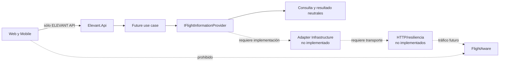
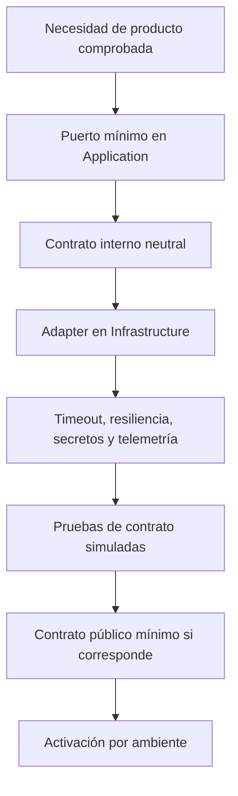

# Integraciones externas

ELEVANT separa una integración de negocio de un proveedor concreto: Application define el puerto mínimo, Infrastructure adapta transporte y modelos, y los clientes sólo consumen la API ELEVANT para datos operacionales de proveedores. En el backend actual no existe ninguna llamada externa funcional. FlightAware está preparado como frontera futura, no como servicio conectado.

Private Web sí descarga estilos/tiles cartográficos públicos directamente en el navegador. Esa dependencia visual es real y está limitada por CSP, pero no suministra información operacional canónica ni rompe la regla que prohíbe consultar proveedores de aviación desde los clientes.

## Inventario por estado

| Integración o dependencia | Estado comprobado | Flujo actual | No debe asumirse |
| --- | --- | --- | --- |
| FlightAware/AeroAPI | Objetivo con shell | Binding de opciones únicamente | No hay `HttpClient`, adapter, autenticación, request, respuesta, caché o tráfico real. |
| Puerto `IFlightInformationProvider` | Implementado como interfaz | Ningún consumidor/implementación registrado | La existencia del puerto no devuelve vuelos ni valida el contrato del proveedor. |
| Referencias externas en turnaround/flight leg | Implementadas como columnas/mappings | Pueden almacenar procedencia si un caso de uso futuro las completa | No existe ingestión, sincronización ni reconciliación externa. |
| OpenFreeMap/OpenMapTiles/MapLibre demo | Implementado en Private Web | El navegador carga estilos/tiles para mapas; CSP permite orígenes concretos | No son fuente de estado operativo ni integración de vuelos. |
| Object storage S3-compatible | Diferido | Ninguno | No hay bucket, adapter, metadata contractual, uploads ni persistencia binaria aprobada. |
| Chat/notificaciones externas | Diferido o prototipo | Stores/adaptadores de prototipo y hubs vacíos | No hay proveedor, contrato backend o entrega durable real. |

## Frontera FlightAware

### Implementado

Application define una consulta neutral con:

- número de vuelo opcional;
- origen/destino opcionales;
- fecha de salida opcional.

El resultado neutral puede representar ID del proveedor, número, aeropuertos, horarios programados y estado. Estas formas son internas de Application; no son DTO HTTP ni prueban qué campos ofrece el producto externo contratado.

Infrastructure define:

- `FlightAwareOptions` con `BaseUrl` y `ApiKey` para configuración externa;
- `AddFlightAwareShell`, que sólo enlaza esa sección de opciones;
- una clase `FlightAwareClient` vacía, expresamente no registrada.

`AddInfrastructure` llama al shell, pero no registra una implementación de `IFlightInformationProvider`. La configuración presente no activa tráfico.

### Falta antes de activar

- caso de uso y finalidad exactos;
- producto/plan y documentación oficial vigentes;
- autenticación y custodia de credencial por ambiente;
- adapter registrado y mapeo de modelos/errores;
- timeout, cancelación, cuotas, caché, reintentos seguros y circuit breaker;
- política de degradación visible y datos que pueden persistirse;
- observabilidad sin payloads sensibles;
- pruebas de contrato con servidor simulado, sin cuota real en CI.

Estas tareas son criterios de diseño documentados, no capacidades presentes.

## Datos externos en el modelo persistente

`Turnaround` incluye `Source`, `ExternalProvider`, `ExternalReference` y `SourceObservedAt`; `FlightLeg` conserva fuente, referencia y momento observado. EF crea unicidad filtrada para proveedor + referencia en turnaround.

Eso prepara trazabilidad de procedencia. No decide:

- cuál proveedor gana ante discrepancias;
- cómo se empareja un vuelo externo con una escala existente;
- qué campos pueden sobrescribirse;
- frecuencia de actualización y freshness;
- retención, licencia o derecho de uso;
- degradación cuando el proveedor no responde.

Esas reglas necesitan un caso de uso y pruebas; no se deducen de columnas.

## Mapas en Private Web

Dos componentes MapLibre usan estilos públicos:

- el mapa de monitoreo utiliza un estilo demo de MapLibre;
- el mapa de posiciones utiliza estilos de OpenFreeMap/OpenMapTiles y atribución de OpenStreetMap;
- ambos permiten reemplazar el style URL mediante configuración pública de Next.js;
- la CSP del runtime autoriza explícitamente los orígenes revisados de styles/tiles.

Esta integración ocurre directamente desde el navegador porque entrega cartografía visual pública, no credenciales ni datos operacionales de un proveedor de aviación. Aun así introduce disponibilidad, términos de uso, privacidad de red del navegador y licenciamiento que deben revisarse antes de Production. Los styles demo no son una selección de proveedor productivo.

## Evidencia binaria y object storage

El objetivo documentado es almacenar futuros binarios —por ejemplo, fotos o documentos— en un servicio S3-compatible y conservar en SQL sólo metadata/object keys. En el commit verificado:

- no existe adapter de object storage;
- no existe contrato HTTP de carga/descarga;
- Mobile mantiene evidencia real deshabilitada;
- no se debe improvisar BLOB SQL ni almacenamiento persistente local.

Proveedor, cifrado, límites, tipos, retención, autorización, URLs de descarga y borrado siguen sin decidir.

## Regla para incorporar un proveedor

- Un SDK o DTO externo no entra a Domain, Contracts o clientes.
- La credencial nunca aparece en bundles, OpenAPI, logs o Problem Details.
- Los reintentos se limitan a operaciones seguras/idempotentes.
- Un fallo externo se traduce a semántica controlada; una colección vacía ficticia no simula éxito.
- Cambiar de proveedor no obliga a cambiar el producto salvo que cambie una necesidad real.

## Verificación

1. Busca implementaciones de `IFlightInformationProvider`; sólo existe la interfaz.
2. Revisa el registro DI: sólo se enlazan opciones.
3. Inspecciona `FlightAwareClient`: no contiene operaciones.
4. Busca `HttpClient`, endpoints o headers del proveedor dentro de esa integración; no existen.
5. Contrasta los componentes de mapa y su CSP para separar dependencia visual implementada de integración operacional futura.

Esta evidencia no confirma un contrato comercial externo, cuota, SLA o disponibilidad. Esos datos permanecen desconocidos hasta una decisión explícita.

## Relacionados

- [Índice de Arquitectura](README.md)
- [Sistema y fronteras de confianza](sistema-y-fronteras-de-confianza.md)
- [OpenAPI, HTTP y SignalR](openapi-http-y-signalr.md)
- [Decisiones, restricciones y riesgos](decisiones-restricciones-y-riesgos.md)
- [Brechas de dominio](../03-dominio/brechas-y-preguntas-abiertas.md)
