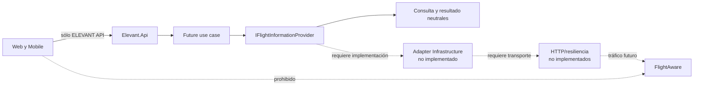
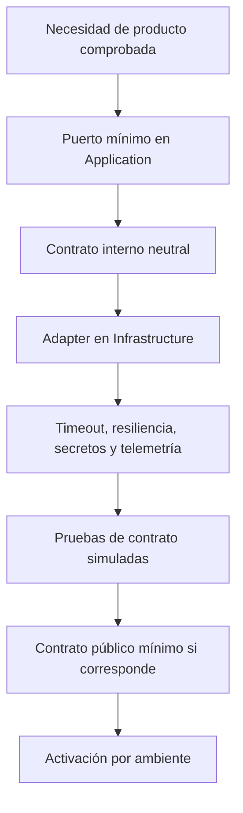

# Integraciones externas

ELEVANT separa una integración de negocio de un proveedor concreto: Application define el puerto mínimo, Infrastructure adapta transporte y modelos, y los clientes sólo consumen la API ELEVANT para datos operacionales de proveedores. El feed de vuelos de pago es **AeroDataBox** ([ADR-0028](../../docs/adr/0028-aerodatabox-flight-feed-with-unit-budget.md)); FlightAware sigue como frontera futura sin conectar.

## Feed de vuelos AeroDataBox

Solo el servidor llama al proveedor, y solo desde `FlightFeedSynchronizer` (el worker de cada minuto y «Actualizar ahora» de OCC). La única llamada de pago es FIDS por aeropuerto: 2 unidades, hasta 12 h, llegadas y salidas juntas, con el aeropuerto contrario incluido.

- **Cuándo:** cada mitad del día una vez; mañana una vez desde las 18:00; refresco cada 15 min cerca de un vuelo contratado, cada 60 min si quedan vuelos, nunca si no hay. Al 80 % del presupuesto el intervalo se duplica; al límite (1 200 por día y 38 000 por mes, UTC) se detiene.
- **Cuánto:** un día de actividad máxima gasta 100–200 unidades, alrededor del 12 % del plan de 40 000 al mes.
- **Seguridad del gasto:** registro de cada llamada en `integration.provider_usage_entries`, un único turno por proveedor en `integration.provider_sync_leases`, pausa tras cuota agotada (hasta el día siguiente), clave rechazada (6 h), 429 (`Retry-After`) o fallos (espera creciente hasta 1 h).
- **Qué se guarda:** los tramos de todas las aerolíneas activas registradas, como propuestas que OCC importa o descarta (`integration.external_flight_proposals`); antes de la fase 2, solo los de aerolíneas con contrato (ver [Fase 2](#fase-2-feed-ampliado-y-proveedor-simulado)). Todas las aerolíneas vistas alimentan `ref.airline_registry_entries`, que la verificación de aerolíneas consulta antes de Wikidata y OpenFlights; los aeropuertos contrarios completan `ref.airports` con zona horaria y coordenadas. Ambas cosas sin unidades extra.
- **Apagado por defecto:** sin `AeroDataBox:Enabled` y clave no hay llamadas. En CI nunca se llama; la única prueba real es opt-in (`ELEVANT_LIVE_AERODATABOX=1`, 2 unidades).

Pendiente: enlazar OpenSky con los vuelos importados y mostrar el consumo en Superadministración.

*Posterior al commit verificado de esta nota (PR A3,
[ADR-0042](../../docs/adr/0042-occ-air-picture-and-map-flights.md)):* la
imagen aérea del mapa del OCC reconoce sus aviones (adsb.fi, con adsb.lol de
relevo) como vuelos de ELEVANT por matrícula y por *callsign*; el tráfico de
OpenSky sigue sin enlazar ([Tráfico aéreo en vivo](#tráfico-aéreo-en-vivo-adsbfi-y-adsblol)).
Desde el PR U3, también posterior, ninguna pantalla lee el tráfico de OpenSky:
su único consumidor, el mapa regional de Panorama, se retiró, y
`GET occ/traffic/aircraft` queda sin uso hasta que un paso aparte lo retire
([ADR-0044](../../docs/adr/0044-occ-noc-visual-system.md)).

### Fase 2: feed ampliado y proveedor simulado

Posterior al commit verificado de esta nota: esta sección describe el código de
la fase 2 del ciclo (`50e7778f`;
[ADR-0038](../../docs/adr/0038-preoperation-contract-lifecycle-permits-master-data-and-workforce-readiness.md)).

- **Qué se guarda ahora.** Los tramos de todas las aerolíneas activas
  registradas, sin unidades extra porque llegan en la misma respuesta. OCC ve
  aparte las que no tienen contrato en vigor ese día, como candidatas a
  charter, y nunca ve las de un contrato suspendido o vencido en la estación.
  El ritmo de lecturas y el conteo de tramos contratados siguen contando solo
  las contratadas.
- **Importar.** OCC elige el tipo de avión, que se sugiere desde el modelo
  informado, la posición y el modo charter sin contrato. Una propuesta
  descartada se restaura mientras su vuelo no haya pasado.
- **Proveedor simulado.** `SimulatedAirportFlightFeed` es un segundo adaptador
  del mismo puerto. Responde un horario determinista de las aerolíneas activas
  registradas, sin red, con su propio nombre de proveedor (`Simulated`): su
  registro de uso, su turno y su consumo no se mezclan con los de AeroDataBox,
  y no alimenta `ref.airline_registry_entries`. Se activa con
  `SimulatedFlightFeed__Enabled`, apagado por defecto. La API se niega a
  arrancar si se activa fuera de los entornos `Development` o `Test` o junto con
  AeroDataBox
  ([registro](../../backend/Elevant.Infrastructure/DependencyInjection.cs) y
  [adaptador](../../backend/Elevant.Infrastructure/Integrations/SimulatedFlightFeed/SimulatedAirportFlightFeed.cs)).
- **Dónde se activa.** Solo el overlay de Compose del arnés E2E, en
  `database/DevelopmentDB`, lo enciende
  ([guía local](../../docs/workflows/local-development.md#recorrido-e2e-del-ciclo-completo)).
  La plantilla del VPS Development
  ([`compose.development.api.yml`](../../backend/compose.development.api.yml))
  no lo define, así que allí el feed sigue siendo AeroDataBox.

### Fase 3: el feed y las escalas que planifica OCC

Posterior al commit verificado de esta nota: esta sección describe el código de
la fase 3 del ciclo (`f2d5c52c`) y la corrección de los hallazgos pendientes de
la revisión de su bloque A (`52141adb`), que esa verificación no cubre
([ADR-0039](../../docs/adr/0039-operation-planning-coverage-offline-tablet-occ-review-and-reports.md)).
Lo que informa el proveedor nunca reemplaza una decisión de OCC:

- **Sin escalas duplicadas.** Importar un par que coincide con una escala
  abierta de la misma estación, aerolínea, número de vuelo normalizado y día
  local lo vincula a esa escala (`linked`) y completa la matrícula si falta y
  el tipo de avión si la escala no lo tiene, siempre que el tipo no esté fijo y
  la posición que ya ocupa lo admita (si no lo admite, `409 stand_unavailable`
  con `reasons`, como la llegada y «Editar vuelo»); el alta manual del mismo
  vuelo se rechaza (`flight_already_planned`).
- **La llegada de OCC prevalece.** Desde que OCC registra la llegada, el tramo
  es `Manual` y las lecturas siguientes ya no reescriben su hora real.
- **Cancelado o desviado.** Si el proveedor informa cancelado o desviado un
  vuelo importado, OCC recibe un aviso una sola vez y decide; el feed no cambia
  la escala.
- **Código legible.** La escala importada recibe el código
  `{ESTACIÓN}-{AAAAMMDD}-{NNN}`, como la manual.

### Vuelos demo: sin proveedor externo

Posterior al commit verificado de esta nota: esta sección describe el código de
`cba00f73` ([ADR-0041](../../docs/adr/0041-demo-flights-and-punta-cana-stands.md)),
que esa verificación no cubre.

- **Sin proveedor.** Los vuelos demo que dispara Superadministración son dos
  propuestas de un proveedor propio, `Demo`, que la API escribe sin ninguna
  llamada de red; un worker las hace avanzar con el reloj del servidor
  ([almacén](../../database/DevelopmentDB/Elevant.Persistence/Integration/EfDemoFlightStore.cs)).
- **Fuera del feed pagado.** `GetActivityAsync` excluye sus propuestas y sus
  escalas: nunca adelantan una lectura de AeroDataBox ni gastan unidades. La
  revisión de OCC no empareja tramos de proveedores distintos, y una propuesta
  demo descartada no se restaura.
- **Sin coincidencias con el tráfico real.** Ningún registro emite su matrícula
  (`HIDM01` a `HIDM99`), y el aeropuerto contraparte sale de `ref.airports` o
  de un catálogo interno con datos públicos de referencia.
- **Activación.** `DemoFlights:Mode` es `Disabled` por defecto y en
  `appsettings.Production.json`, y `Enabled` en `appsettings.Development.json`;
  la API se niega a arrancar con `Enabled` fuera de los entornos `Development`,
  `Test` o `Testing`
  ([guía de integraciones](../../docs/architecture/external-integrations.md)).

### Lecturas de referencia bajo demanda

*Posterior al commit verificado* (15 de noviembre de 2026, nota del
[ADR-0028](../../docs/adr/0028-aerodatabox-flight-feed-with-unit-budget.md)): además del FIDS, la API lee de
AeroDataBox cuatro datos de referencia, y solo cuando una pantalla los muestra:

| Lectura | *Tier* / unidades | Caché | Tope día / mes | Pantalla |
|---|---|---|---|---|
| Flota de una aerolínea | 3 / 6 | 7 días | 30 / 300 | Bandeja de Contratos y catálogo de Superadministración (aviso, no bloquea) |
| Aeronave por matrícula | 1 / 1 | 1 día | 40 / 1 200 | Inspector de la consola, cajón de Mapa de posiciones, diálogo de importación |
| Rutas diarias del aeropuerto | 3 / 6 | 24 h | 12 / 200 | Capa «Rutas desde Punta Cana» |
| Demoras actuales (**apagada**: el plan Starter no la incluye; `AeroDataBox__DelaysEnabled`) | 3 / 6 | 1 h | 48 / 1 500 | Pastilla «Demoras PUJ» y demoras del origen o destino en el inspector, ocultas mientras esté apagada |

- **Contabilidad.** Cada llamada queda en `integration.provider_usage_entries` con su lectura como `Operation` y el
  disparador `OnDemand`. El presupuesto del feed cuenta ahora solo la operación `fids`.
- **Techo común.** `PlanMonthlyUnitLimit` es el techo de todas las operaciones del proveedor.
- **Estados, no errores.** Un tope alcanzado o un proveedor caído responden un estado en el 200 («Límite diario
  alcanzado»), con el último valor guardado si lo hay.
- **Caché en memoria.** Vive en la memoria de la API: un reinicio la vacía, pero los topes siguen acotando el gasto.
- **Vuelos demo.** Las matrículas demo nunca se consultan.

### Tráfico aéreo en vivo: adsb.fi y adsb.lol

Posterior al commit verificado de esta nota: esta sección describe el código
del PR A3 «Imagen aérea y vuelos para el mapa» (`77dff268` a `e098ccde`), que
esa verificación no cubre
([ADR-0042](../../docs/adr/0042-occ-air-picture-and-map-flights.md)).

- **Por el servidor.** El puerto `IAirTrafficProvider` tiene un solo adaptador
  para la familia readsb v2, con dos perfiles, adsb.fi y adsb.lol
  ([perfiles](../../backend/Elevant.Infrastructure/Integrations/AirTraffic/ReadsbProfile.cs)
  y [adaptador](../../backend/Elevant.Infrastructure/Integrations/AirTraffic/ReadsbAirTrafficProvider.cs)).
  Solo el worker de la API llama a la red; los navegadores leen
  `GET occ/map/air-picture`, y la CSP no cambia.
- **Relevo.** `AirTraffic:Providers` es una lista ordenada. Tras tres fallos
  seguidos de la red activa toma el turno la siguiente, y la primera se vuelve
  a probar cada 10 minutos. Si esa prueba falla, la red activa responde la
  misma lectura, así que la imagen no espera ni cambia de estado por ella. A
  una red que responde 429 no se le vuelve a preguntar, ni en esa prueba ni en
  un relevo, hasta que pase su `Retry-After` (al menos un minuto y como mucho
  un día); mientras tanto, la red activa conserva el turno
  ([relevo](../../backend/Elevant.Infrastructure/Integrations/AirTraffic/FailoverAirTrafficProvider.cs)).
- **Licencias y crédito.** adsb.fi es de uso personal y no comercial y pide
  citarla con un enlace a su página; adsb.lol publica bajo ODbL 1.0. Cada
  respuesta lleva el crédito de la red en `source`, y cada mapa que dibuja
  estos aviones muestra «Datos de aeronaves: {source.name}» con su enlace (ver
  el punto siguiente).
  Antes de un uso comercial de adsb.fi hace falta su permiso escrito, cambiar
  a adsb.lol o un receptor ADS-B propio.
- **Dónde se ve el crédito (PR M5).** *También posterior al commit
  verificado* ([ADR-0043](../../docs/adr/0043-occ-maps-one-engine.md)):
  mientras hay aviones en pantalla, el mapa del OCC da el crédito «Datos de
  aeronaves: {source.name}», con el enlace a la red y, si lo hay, a su
  licencia, en dos sitios: su atribución, plegada por omisión, y una línea
  siempre a la vista abajo a la izquierda del mapa
  ([estado del tráfico](../../frontend/private-web/src/features/maps/ui/MapSourceStatus.jsx)).
  El nombre y las URL llegan en `source`; el texto se escapa y solo una URL
  `https:` se vuelve enlace
  ([atribución](../../frontend/private-web/src/features/maps/core/attribution.js)).
  En M5 lo mostraban Monitoreo de vuelos, el único mapa que dibujaba el
  tráfico, y el laboratorio de mapas, con una red sintética. Desde el PR M6 lo
  muestran también, dentro del marco del OCC, Mapa de posiciones y la vista
  «Mapa» de Planificación. Desde el PR U3 lo muestra también la consola de
  Panorama, que además nombra la red en su línea de procedencia, bajo el mapa
  («Aviones: {red}, hace N s.»). El navegador nunca llama a adsb.fi ni a
  adsb.lol: lee `occ/map/air-picture` de la API, y la CSP no cambia.
- **Solo con demanda.** Sin nadie leyendo la imagen no hay ninguna llamada.
  Mientras alguien la lee, y hasta 15 minutos después, hay una lectura de la
  red cada 10 segundos para todas las pantallas, con esperas tras un rechazo o
  un fallo y nunca un reintento en bucle
  ([servicio](../../backend/Elevant.Application/Operations/AirPicture/AirPictureService.cs)).
  adsb.lol, además, se detiene en 450 lecturas por día UTC sin clave. Desde el
  PR M5, quien la lee es el mapa de Monitoreo de vuelos en el OCC, cada 10
  segundos mientras su pestaña se ve; con la pestaña oculta deja de leerla.
  Desde el PR M6 la leen también, al mismo ritmo, Mapa de posiciones y la vista
  «Mapa» de Planificación, esta solo mientras muestra su mapa. Desde el PR U3 la
  lee también, al mismo ritmo, la consola de Panorama, la pantalla con la que
  abre el OCC: con el tráfico encendido, iniciar sesión como OCC ya basta para
  que la API lea la red.
- **Nada se guarda.** La imagen y las estelas viven en la memoria de la API:
  no hay tabla, registro de uso ni migración.
- **Vuelos de ELEVANT.** La imagen reconoce los vuelos de ELEVANT por
  matrícula y por *callsign*, y nunca un vuelo demo. Eso cierra, para la red
  nueva, el pendiente de enlazar el tráfico con los vuelos importados
  ([ADR-0028](../../docs/adr/0028-aerodatabox-flight-feed-with-unit-budget.md)).
- **Activación.** `AirTraffic:Enabled` es `false` por defecto y en
  `appsettings.Production.json`, y `appsettings.Development.json` lo enciende
  con `AdsbFi` y `AdsbLol`, sin variables nuevas en el VPS
  ([registro](../../backend/Elevant.Infrastructure/DependencyInjection.cs)).
  El overlay del arnés E2E lo apaga, y una lectura a mano contra la red real
  es un paso aparte y deliberado
  ([guía local](../../docs/workflows/local-development.md)). La clave opcional
  de adsb.lol solo llega por configuración secreta.
- **Comprobación del operador.** El VPS de Development tiene que alcanzar
  `opendata.adsb.fi`, y `api.adsb.lol` para el relevo. La
  [guía de integraciones](../../docs/architecture/external-integrations.md)
  da la línea de curl que el operador corre a mano antes de desplegar, nunca
  desde CI.

### Clima del aeródromo: aviationweather.gov

Posterior al commit verificado de esta nota: esta sección describe el código
del PR M8 (API) «Clima del aeródromo por la API (METAR y TAF)» (`65f9446f` y
`eeac6d1e`), que esa verificación no cubre
([ADR-0043](../../docs/adr/0043-occ-maps-one-engine.md)).

- **Por el servidor.** El puerto `IAerodromeWeatherSource` tiene un adaptador
  para la Data API de aviationweather.gov, del Aviation Weather Center de NOAA
  ([adaptador](../../backend/Elevant.Infrastructure/Integrations/AviationWeather/AviationWeatherSource.cs)),
  que lee el METAR y el TAF del aeropuerto de una estación. El servicio no
  admite CORS, así que solo lo llama la API; un navegador lo lee solo a
  través de `GET occ/weather`, y la CSP no cambia.
- **Quién lo lee (PR M8, mapas).** *También posterior al commit verificado*
  ([ADR-0043](../../docs/adr/0043-occ-maps-one-engine.md)): Private Web lo lee
  por `GET occ/weather` en Monitoreo de vuelos, dentro del marco del OCC, en
  Mapa de posiciones, en Planificación y en el panel de meteorología de la
  consola actual, cada pantalla con su propio sondeo de 10 minutos con la
  pestaña a la vista y nunca con `occ_planning`
  ([hook](../../frontend/private-web/src/features/weather/useMdpcWeather.js) y
  [servicio](../../frontend/private-web/src/services/weatherService.js)). El
  navegador ya no pide el METAR actual a Iowa Environmental Mesonet: solo el
  historial de 6 horas de ese panel lo sigue leyendo, hasta que U3 lo retire, y
  su origen sigue en la CSP hasta un cambio aparte
  ([Private Web](../05-aplicaciones/private-web-aviam.md)).
- **Dónde se ve el crédito.** Mientras el viento en pista está en pantalla, la
  atribución del mapa, plegada por omisión, suma «Clima: NOAA Aviation Weather
  Center», con su enlace, y la ficha del viento lleva «No oficial»: ELEVANT
  retransmite el servicio y no da un parte para despachar
  ([atribución](../../frontend/private-web/src/features/maps/core/attribution.js)).
  *Planificado (U3):* la pastilla del clima de la consola nueva lo mostrará
  junto al viento y el QNH.
- **Solo cuando alguien lo pide.** La API llama al servicio solo cuando alguien
  lee el clima y guarda lo que responde, por aeropuerto: el METAR 5 minutos y
  el TAF 30. Con el servicio respondiendo son como mucho 2 llamadas cada 5
  minutos por aeropuerto, muy por debajo del límite de 100 consultas por minuto
  de la Data API. Tras un fallo sirve lo guardado y espera de 1 a 15 minutos
  antes de volver a preguntar, nunca en bucle.
- **Estado y crédito.** El estado (`Live`, `Stale`, `Unavailable` o
  `Disabled`) viaja en un 200, y cada respuesta lleva el crédito «NOAA Aviation
  Weather Center» con su enlace, también con el clima apagado.
- **Nada se guarda.** Lo que responde el servicio vive en la memoria de la API:
  no hay tabla, registro de uso ni migración. Las pruebas usan respuestas
  sintéticas y nunca llaman al servicio.
- **Activación.** `AviationWeather:Enabled` es `false` por defecto y en
  `appsettings.Production.json`, y `appsettings.Development.json` lo enciende,
  sin variables nuevas en el VPS
  ([registro](../../backend/Elevant.Infrastructure/DependencyInjection.cs)).
  El overlay del arnés E2E lo apaga, y una lectura a mano contra el servicio
  real es un paso aparte y deliberado
  ([guía local](../../docs/workflows/local-development.md)). No hay clave.
- **Comprobación del operador.** El VPS de Development tiene que alcanzar
  `aviationweather.gov`. La
  [guía de integraciones](../../docs/architecture/external-integrations.md)
  da la línea de curl que el operador corre a mano antes de desplegar, nunca
  desde CI.

Private Web sí descarga estilos/tiles cartográficos públicos directamente en el navegador. Esa dependencia visual es real y está limitada por CSP, pero no suministra información operacional canónica ni rompe la regla que prohíbe consultar proveedores de aviación desde los clientes.

## Inventario por estado

| Integración o dependencia | Estado comprobado | Flujo actual | No debe asumirse |
| --- | --- | --- | --- |
| AeroDataBox FIDS | Implementado ([ADR-0028](../../docs/adr/0028-aerodatabox-flight-feed-with-unit-budget.md)) | Worker y «Actualizar ahora» del servidor, con presupuesto de unidades | Ninguna pantalla llama al proveedor; sin clave no hay llamadas. |
| FlightAware/AeroAPI | Objetivo con shell | Binding de opciones únicamente | No hay `HttpClient`, adapter, autenticación, request, respuesta, caché o tráfico real. |
| Puerto `IFlightInformationProvider` | Implementado como interfaz | Ningún consumidor/implementación registrado | La existencia del puerto no devuelve vuelos ni valida el contrato del proveedor. |
| AeroDataBox: flota, aeronave, rutas y demoras | *Posterior al commit verificado:* implementado; las demoras, apagadas porque el plan Starter no las incluye (nota del 15 de noviembre de 2026 en el ADR-0028) | La API, bajo demanda, con caché en memoria y topes por día y mes | Ninguna pantalla llama al proveedor; sin clave no hay llamadas; nunca para vuelos demo. |
| Referencias externas en turnaround/flight leg | Implementadas | La importación de OCC las completa con `AeroDataBox` y la referencia del tramo; las lecturas posteriores actualizan horas estimadas y reales. Con el proveedor simulado del arnés E2E, el proveedor es `Simulated` | No hay reconciliación automática con escalas manuales. *Posterior al commit verificado: desde la fase 3, la importación se vincula a la escala abierta del mismo vuelo y día local, y no se actualiza un tramo cuya llegada registró OCC.* |
| OpenFreeMap/OpenMapTiles/MapLibre demo | Implementado en Private Web | El navegador carga estilos/tiles para mapas; CSP permite orígenes concretos. *Posterior al commit verificado:* desde el PR M2 ([ADR-0043](../../docs/adr/0043-occ-maps-one-engine.md)), teselas vectoriales por TileJSON y glifos Noto Sans de `tiles.openfreemap.org`; el estilo es propio y va en el bundle. El estilo de demostración de MapLibre ya no se usa, aunque su origen siga en la CSP, y los dos mapas auxiliares del dashboard conservan los estilos publicados de OpenFreeMap hasta U3. Desde U3 solo los usa el mapa satelital del detalle de meteorología de Panorama, mientras ese detalle está abierto | No son fuente de estado operativo ni integración de vuelos. OpenFreeMap es un servicio público sin acuerdo de servicio. |
| OpenStreetMap (ODbL) y OurAirports | *Posterior al commit verificado:* fuentes en tiempo de build del plano de MDPC (PR M3, [ADR-0043](../../docs/adr/0043-occ-maps-one-engine.md)) | Dos scripts manuales las extraen una vez; el plano generado se versiona y va en el bundle de Private Web ([datos](../../frontend/private-web/src/features/maps/airport/data/README.md)). Desde el PR M8, los mapas del OCC dibujan también los aeropuertos de la región y las radioayudas del mismo extracto de OurAirports | Que el navegador o la API las consulten: no hay llamada en tiempo de ejecución, ni origen nuevo, ni cambio de la CSP. |
| Object storage S3-compatible | *Posterior al commit verificado:* implementado | La API escribe medios, PDF financieros y evidencias de rampa en un bucket privado y guarda metadatos y hash en SQL ([medios](medios-comerciales-privados.md)) | Que el bucket de un ambiente vivo esté configurado; la retención sigue abierta. |
| Chat y notificaciones | *Posterior al commit verificado:* internos de ELEVANT | Chat, notificaciones y correo SMTP salen de la API; los hubs solo envían `ChangedV1` ([feed de cambios](feed-de-cambios-operativos.md)) | Que exista un proveedor externo de mensajería o notificaciones push con la app cerrada. |
| Vuelos demo | *Posterior al commit verificado:* simulados por la propia API y apagados por defecto ([ADR-0041](../../docs/adr/0041-demo-flights-and-punta-cana-stands.md)) | Superadministración dispara dos propuestas del proveedor `Demo`; tras la importación de OCC, un worker marca el aterrizaje y el despegue como lo haría el feed | Que exista un proveedor externo, una llamada de red o un gasto de unidades de AeroDataBox. |
| adsb.fi (tráfico ADS-B) | *Posterior al commit verificado:* implementado; apagado por defecto y encendido en Development ([ADR-0042](../../docs/adr/0042-occ-air-picture-and-map-flights.md)) | La API la lee cada 10 s solo mientras alguien lee la imagen aérea del OCC, y sirve la imagen desde memoria con el crédito de la red en cada respuesta. Desde el PR M5, el mapa de Monitoreo de vuelos la dibuja con ese crédito a la vista; desde el PR M6, también Mapa de posiciones y la vista «Mapa» de Planificación, y desde el PR U3, la consola de Panorama | Uso comercial (su licencia es personal y no comercial), trazas del proveedor, datos guardados o cobertura completa en tierra. |
| adsb.lol (relevo) | *Posterior al commit verificado:* implementado como relevo, con la misma activación ([ADR-0042](../../docs/adr/0042-occ-air-picture-and-map-flights.md)) | Toma el turno tras tres fallos seguidos de adsb.fi y se detiene en 450 lecturas por día UTC sin clave | Que haya una clave configurada, trazas o un ritmo según su cuota. |
| aviationweather.gov (METAR y TAF) | *Posterior al commit verificado:* implementado en la API; apagado por defecto y encendido en Development ([ADR-0043](../../docs/adr/0043-occ-maps-one-engine.md)). Desde el PR M8 (mapas), Private Web lo lee por la API | La API lee el METAR y el TAF del aeropuerto de la estación solo cuando alguien pide `occ/weather`, los guarda unos minutos en memoria y los sirve con el crédito de NOAA y su estado en un 200. Monitoreo de vuelos, Mapa de posiciones, Planificación y el panel de meteorología de la consola lo piden cada 10 minutos, y los mapas dibujan el viento en pista con ese crédito | Que sea apto para despacho (se rotula «No oficial»), que una pantalla muestre ya el TAF o que se guarde. |
| Iowa Environmental Mesonet (METAR) | *Posterior al commit verificado:* solo el historial del panel de meteorología de la consola actual (PR M8, mapas, [ADR-0043](../../docs/adr/0043-occ-maps-one-engine.md)) | El navegador le pide los METAR de MDPC de las últimas 6 horas cuando alguien amplía ese panel; el METAR actual ya llega por la API | Que sea oficial o tenga acuerdo de servicio, o que su origen haya salido de la CSP: sale en un cambio aparte, cuando U3 retire ese panel. |
| NASA GIBS (GOES-East e IMERG) | *Posterior al commit verificado:* implementado en Private Web, en el panel de meteorología de la consola actual y, desde el PR M8 (mapas, [ADR-0043](../../docs/adr/0043-occ-maps-one-engine.md)), en el lienzo de los mapas del OCC | El navegador lee de `gibs.earthdata.nasa.gov` la hora de cada imagen y sus teselas fijadas a esa hora: el panel de la consola actual, y los mapas del OCC solo con la capa encendida en Región o Aproximación, cada 10 minutos. Mientras se dibujan, la atribución dice «NASA GIBS» | Que sea radar u observación local: IMERG estima la lluvia y puede retrasarse varias horas. |
| Pasarela de tarjeta | *Posterior al commit verificado:* simulada y apagada por defecto ([ADR-0036](../../docs/adr/0036-simulated-card-payment.md), [ADR-0040](../../docs/adr/0040-billing-cycle-invoicing-from-operations-card-collections-credit-notes-and-payables.md)) | `CardPayments:Mode` es `Disabled` por defecto y en `appsettings.Production.json`; `Simulated` solo arranca en Development, Test o Testing y aprueba o rechaza en memoria las tarjetas de prueba, sin red | Que exista una pasarela real o que un cobro mueva dinero. |
| Proveedor fiscal (DGII) | *Posterior al commit verificado:* sin integración | La simulación fiscal de ADR-0018 (modos `LocalSimulation` y `ProviderSandbox`) salió del producto en la fase 4; la factura es un e-CF simulado que nada transmite ([Finanzas](../03-dominio/finanzas-tarifas-cargos-y-cobros.md)) | Transmisión, firma o aceptación de la DGII. |

## Frontera FlightAware

### Implementado

Application define una consulta neutral con:

- número de vuelo opcional;
- origen/destino opcionales;
- fecha de salida opcional.

El resultado neutral puede representar ID del proveedor, número, aeropuertos, horarios programados y estado. Estas formas son internas de Application; no son DTO HTTP ni prueban qué campos ofrece el producto externo contratado.

Infrastructure define:

- `FlightAwareOptions` con `BaseUrl` y `ApiKey` para configuración externa;
- `AddFlightAwareShell`, que sólo enlaza esa sección de opciones;
- una clase `FlightAwareClient` vacía, expresamente no registrada.

`AddInfrastructure` llama al shell, pero no registra una implementación de `IFlightInformationProvider`. La configuración presente no activa tráfico.

### Falta antes de activar

- caso de uso y finalidad exactos;
- producto/plan y documentación oficial vigentes;
- autenticación y custodia de credencial por ambiente;
- adapter registrado y mapeo de modelos/errores;
- timeout, cancelación, cuotas, caché, reintentos seguros y circuit breaker;
- política de degradación visible y datos que pueden persistirse;
- observabilidad sin payloads sensibles;
- pruebas de contrato con servidor simulado, sin cuota real en CI.

Estas tareas son criterios de diseño documentados, no capacidades presentes.

## Datos externos en el modelo persistente

`Turnaround` incluye `Source`, `ExternalProvider`, `ExternalReference` y `SourceObservedAt`; `FlightLeg` conserva fuente, referencia y momento observado. EF crea unicidad filtrada para proveedor + referencia en turnaround.

Eso prepara trazabilidad de procedencia. No decide:

- cuál proveedor gana ante discrepancias;
- cómo se empareja un vuelo externo con una escala existente;
- qué campos pueden sobrescribirse;
- frecuencia de actualización y freshness;
- retención, licencia o derecho de uso;
- degradación cuando el proveedor no responde.

Esas reglas necesitan un caso de uso y pruebas; no se deducen de columnas.

## Mapas en Private Web

En el commit histórico verificado, dos componentes MapLibre usaban estilos públicos:

- el mapa de monitoreo utiliza un estilo demo de MapLibre;
- el mapa de posiciones utiliza estilos de OpenFreeMap/OpenMapTiles y atribución de OpenStreetMap;
- ambos permiten reemplazar el style URL mediante configuración pública de Next.js;
- la CSP del runtime autoriza explícitamente los orígenes revisados de styles/tiles.

Esta integración ocurre directamente desde el navegador porque entrega cartografía visual pública, no credenciales ni datos operacionales de un proveedor de aviación. Aun así introduce disponibilidad, términos de uso, privacidad de red del navegador y licenciamiento que deben revisarse antes de Production. Los styles demo no son una selección de proveedor productivo.

En el árbol local de `feat/adminocc-redesignall`, Monitoreo y Posiciones conservan sus consultas y operaciones sin montar mapas. Panorama concentra los tres mapas operativos y permanece protegido. La vista `FlightMonitoringPage` sustituye la referencia de código retirado; la metadata superior conserva su alcance histórico. Véase [Private Web](../05-aplicaciones/private-web-aviam.md) para las capacidades actuales de esta rama sin despliegue.

### Desde el PR M2: un estilo propio sobre las teselas de OpenFreeMap

Posterior al commit verificado de esta nota: esta sección describe el código del PR M2 «Motor único y estilo NOC» (`314c124b` a `c0b20127`), que esa verificación no cubre ([ADR-0043](../../docs/adr/0043-occ-maps-one-engine.md)). Lo anterior se conserva como historia.

- **Qué pide el navegador.** Monitoreo, Mapa de posiciones, Planificación y la plataforma de la consola dibujan con un solo motor y un estilo propio, construido en código y servido en el bundle ([estilo](../../frontend/private-web/src/features/maps/style/occStyle.js)). A `tiles.openfreemap.org` el navegador solo le pide la TileJSON del planeta, sus teselas vectoriales y los glifos Noto Sans (Regular, Bold e Italic, las únicas familias que sirve). No hay sprite ni estilo remoto en esos mapas.
- **Sin variables de estilo.** Se retiraron `NEXT_PUBLIC_FLIGHT_MAP_STYLE_LIGHT`, `NEXT_PUBLIC_FLIGHT_MAP_STYLE_DARK`, `NEXT_PUBLIC_POSITIONS_MAP_STYLE_LIGHT` y `NEXT_PUBLIC_POSITIONS_MAP_STYLE_DARK`, que podían apuntar a un origen fuera de la CSP ([`.env.example`](../../frontend/private-web/.env.example)). Cambiar de proveedor de teselas es ahora un cambio de código y de la CSP.
- **El estilo de demostración de MapLibre ya no se usa.** Monitoreo dejó `demotiles.maplibre.org`, que sigue en la CSP hasta que un cambio aparte lo retire de los tres archivos que la afirman ([política](../../frontend/private-web/src/config/securityHeaders.mjs)).
- **Excepción hasta U3.** Los dos mapas auxiliares del dashboard (región y meteorología) conservan los estilos publicados de OpenFreeMap, con su sprite, hasta que se retire el dashboard actual. *Desde el PR U3* ya no hay mapa regional, y el de meteorología vive dentro del detalle de la píldora del clima de Panorama: con el estilo publicado y su sprite, solo se monta mientras ese detalle está abierto. El plan pasa el satélite a una capa del mapa único en M8.
- **Si OpenFreeMap falla,** el mapa sigue con las posiciones y los datos de ELEVANT y lo avisa. Los créditos de OpenStreetMap, OpenFreeMap y OpenMapTiles están en cada mapa.
- **Sin Google Maps.** Las variantes de Google y `@googlemaps/js-api-loader` se retiraron del código y de las dependencias: ningún otro proveedor de mapas llega al navegador.

### Desde el PR M3: OpenStreetMap (ODbL) y OurAirports, fuentes en tiempo de build

Posterior al commit verificado de esta nota: esta sección describe el código del PR M3 «Datos de MDPC y aeródromo» (`152eb092` a `c14baf17`), que esa verificación no cubre ([ADR-0043](../../docs/adr/0043-occ-maps-one-engine.md)).

- **Qué aportan.** El plano propio del aeropuerto de Punta Cana, con el que los mapas del OCC dibujan el aeródromo, sale de dos fuentes abiertas: un extracto de OpenStreetMap (pistas, calles de rodaje, plataformas, terminales, líneas de posición, puertas y puntos de espera a 4 km del aeropuerto) y las filas de OurAirports de MDPC, sus radioayudas y los aeropuertos de la región. Lo completan los puntos internos de las posiciones, que siguen sin ser oficiales.
- **Cuándo se consultan.** Solo a mano y una vez, con dos scripts: uno pide el extracto a la API de Overpass ([script](../../frontend/private-web/scripts/maps/fetch-mdpc-osm.mjs)) y el otro baja las tablas del espejo de OurAirports en GitHub. Lo que bajan se versiona, y un generador sin red arma con ello el plano, que también se versiona y va en el bundle. Ni las pruebas, ni el CI, ni `npm run build`, ni el navegador, ni la API llaman a esas fuentes: no hay llamada en tiempo de ejecución, ni origen nuevo, ni cambio de la CSP.
- **Licencias.** OpenStreetMap es ODbL 1.0: el mapa da el crédito «© OpenStreetMap contributors (ODbL) · OurAirports» mientras dibuja el aeródromo, y el extracto y el plano derivado se ofrecen bajo esa licencia. OurAirports es de dominio público. No se copian coordenadas del AIP ni de las cartas del aeropuerto. El detalle, la fecha de cada extracto y cómo se regenera el plano están en el [README de los datos](../../frontend/private-web/src/features/maps/airport/data/README.md).
- **Qué no es.** No es una integración de datos operativos: el plano es geometría de referencia, todavía sin la firma del dueño del producto y del OCC, y no dice qué pista está en uso ni qué posición está ocupada.

### Desde el PR M8: referencias, satélite y clima en el lienzo único

Posterior al commit verificado de esta nota: esta sección describe el código del PR M8 (mapas) «Capas aeronáuticas y clima en el mapa» (`1c0f2482` a `d5e35d68`), que esa verificación no cubre ([ADR-0043](../../docs/adr/0043-occ-maps-one-engine.md)).

- **El clima, por la API.** El viento en pista de los mapas sale del METAR que la API trae de aviationweather.gov (ver [Clima del aeródromo](#clima-del-aeródromo-aviationweathergov)): el navegador no llama a ese servicio. A Iowa Environmental Mesonet solo le pide el historial de 6 horas del panel de meteorología de la consola actual, hasta que U3 lo retire.
- **NASA GIBS en el lienzo único.** Las nubes infrarrojas de GOES-East y la lluvia estimada de IMERG, que el panel de la consola dibujaba en un mapa propio, pasan al mapa del OCC: solo en Región y Aproximación, y apagadas por omisión. El navegador pide a `gibs.earthdata.nasa.gov`, un origen que la CSP ya permite, la hora de cada imagen solo mientras alguien la enciende, y otra vez cada 10 minutos con la pestaña a la vista; después pide sus teselas fijadas a esa hora, nunca las de la imagen «más reciente» sin hora. El crédito «NASA GIBS» va en esas fuentes, así que la atribución lo muestra solo mientras se dibujan ([capas](../../frontend/private-web/src/features/maps/traffic/weatherLayers.js)).
- **OurAirports.** Los aeropuertos de la región y las radioayudas PNA y PCA salen de `region.context.json`, del extracto a mano del PR M3, de dominio público ([datos](../../frontend/private-web/src/features/maps/airport/data/README.md)), y los ejes de pista extendidos, de los umbrales y rumbos de OurAirports del plano. No hay llamada en tiempo de ejecución. Van en una fuente propia con el crédito «OurAirports», así que la atribución lo muestra solo mientras se dibuja alguno de ellos ([capas](../../frontend/private-web/src/features/maps/style/referenceLayers.js)).
- **VATSpy, no.** El plan permitía extraer a mano, una vez, un polígono aproximado de la FIR Santo Domingo del proyecto VATSpy (CC BY-SA 4.0), con su crédito solo mientras se viera la capa. El 14 de noviembre de 2026 su archivo `FIRBoundaries.dat` ya no estaba publicado (GitHub respondió 404): no hay extracto, ni capa, ni crédito, ni ninguna llamada a VATSpy, y el mapa no dibuja la FIR.
- **Sin origen nuevo.** La CSP no cambia; el origen de Iowa Mesonet sale en un cambio aparte cuando nada lo lea.

## Evidencia binaria y object storage

El objetivo documentado es almacenar los binarios —por ejemplo, fotos o documentos— en un servicio S3-compatible y conservar en SQL sólo metadata/object keys. El commit verificado ya tenía el adapter S3 privado de los PDF financieros y el contrato de carga y descarga de medios comerciales (`CommercialMediaController`).

*Posterior al commit verificado (código de `39a85a46`): la API guarda en el mismo bucket privado, con metadatos y SHA-256 en SQL, los medios comerciales, los PDF financieros, los comprobantes de cuentas por pagar y gastos y las fotos del walk-around de la tableta ([medios](medios-comerciales-privados.md)). La retención, el antivirus y el cifrado de los objetos siguen abiertos.*

No se improvisa BLOB SQL ni almacenamiento persistente local.

## Regla para incorporar un proveedor

- Un SDK o DTO externo no entra a Domain, Contracts o clientes.
- La credencial nunca aparece en bundles, OpenAPI, logs o Problem Details.
- Los reintentos se limitan a operaciones seguras/idempotentes.
- Un fallo externo se traduce a semántica controlada; una colección vacía ficticia no simula éxito.
- Cambiar de proveedor no obliga a cambiar el producto salvo que cambie una necesidad real.

## Verificación

1. Busca implementaciones de `IFlightInformationProvider`; sólo existe la interfaz.
2. Revisa el registro DI: sólo se enlazan opciones.
3. Inspecciona `FlightAwareClient`: no contiene operaciones.
4. Busca `HttpClient`, endpoints o headers del proveedor dentro de esa integración; no existen.
5. Contrasta los componentes de mapa y su CSP para separar dependencia visual implementada de integración operacional futura.

Esta evidencia no confirma un contrato comercial externo, cuota, SLA o disponibilidad. Esos datos permanecen desconocidos hasta una decisión explícita.

## Relacionados

- [Índice de Arquitectura](README.md)
- [Sistema y fronteras de confianza](sistema-y-fronteras-de-confianza.md)
- [OpenAPI, HTTP y SignalR](openapi-http-y-signalr.md)
- [Decisiones, restricciones y riesgos](decisiones-restricciones-y-riesgos.md)
- [Brechas de dominio](../03-dominio/brechas-y-preguntas-abiertas.md)
