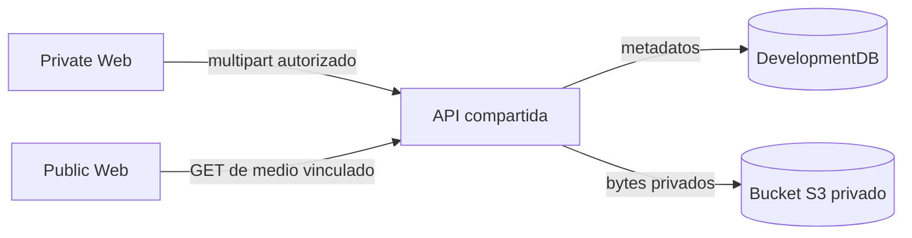

# Medios comerciales privados

El código de esta rama admite fotos y videos de servicios, logos editados por
Superadministración y fotos de perfiles internos. La persona selecciona o
arrastra un archivo; la API valida el formato, la firma, el tamaño, el propósito
y los permisos antes de escribirlo en un bucket S3 privado. SQL reserva el
identificador y los metadatos bajo un límite por cuenta antes de enviar bytes;
si el envío falla, la reserva no vinculada entra en la limpieza diferida. La
lectura pública por UUID requiere
que el medio esté vinculado a un servicio activo y publicado o a una ficha de
aerolínea publicada. Un avatar vinculado exige un actor interno autorizado.
El editor interno puede leer medios de servicios aún no publicados con el
permiso de lectura del catálogo. Las cargas tienen un límite por actor de
100 archivos y 250 MiB por 24 horas, serializado por cuenta en SQL. Un medio
nuevo se puede vincular durante seis días; un proceso horario elimina objetos
que pasen siete días sin vincularse a un registro. La separación evita una
carrera entre vinculación y limpieza. El proceso necesita permiso de borrado
en el bucket.

Los siete servicios de Development incluyen fotos específicas en las dos
webs. El catálogo histórico AVIAM tiene 51 entradas, de las cuales cuatro
quedan archivadas para nuevas solicitudes. Veintidós tienen un icono local
obtenido de sitios oficiales; las restantes usan una placa que dice
«Referencia AVIAM». La imagen por sí sola no verifica razón social, códigos
aeronáuticos ni operación vigente. Las ediciones de Superadministración no
son sobrescritas por el enriquecimiento del fixture.

Esta nota describe **implementación en el repositorio**, no un despliegue
aceptado en el VPS. La [preparación del almacén](../../ops/dokploy/media-storage/README.md)
requiere un recurso Garage aislado, secretos en Environment privado, backup del
par de volúmenes y una prueba de restauración antes de promover la API. El
[flujo comercial](../../docs/workflows/commercial-intake-and-governance.md)
define los actores y el orden del contrato.
