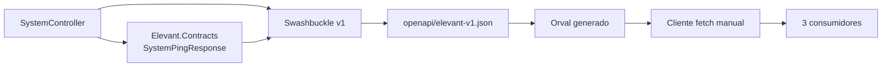
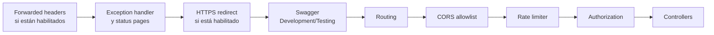
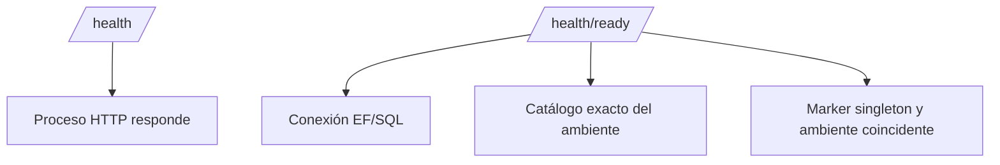

# OpenAPI, HTTP y SignalR

La API dispone de una frontera HTTP endurecida para crecer, pero su contrato público útil continúa siendo mínimo. OpenAPI v1 contiene una sola operación: `GetSystemPing`. Health/readiness son endpoints de plataforma y los dos hubs SignalR son shells sin mensajes de negocio.

## Superficie actual

| Ruta | Mecanismo | Estado | Contrato observable |
| --- | --- | --- | --- |
| `GET /api/v1/system/ping` | Controller versionado | Implementado y en OpenAPI | `200` con `SystemPingResponse`; `429` y `500` como Problem Details. |
| `GET /health` | ASP.NET Health Checks | Implementado, fuera de OpenAPI | Liveness del proceso; predicate vacío, no consulta SQL. |
| `GET /health/ready` | ASP.NET Health Checks | Implementado, fuera de OpenAPI | Comprueba conexión EF, SQL y coherencia de catálogo/marker de ambiente. |
| `/swagger/v1/swagger.json` | Swashbuckle | Implementado sólo en ambientes permitidos | Documento v1; no está mapeado en Production. |
| `/hubs/operations` | SignalR | Shell técnico | Ruta conectable sin métodos o eventos estables. |
| `/hubs/notifications` | SignalR | Shell técnico | Ruta conectable sin métodos o eventos estables. |

No existen endpoints HTTP de autenticación, vuelos, turnarounds, contratos, personal, operaciones, Mobile, auditoría o integraciones externas.

## Contrato OpenAPI vigente

`SystemPingResponse` tiene cuatro campos no nulos serializados en camelCase:

- `application`;
- `status`;
- `environment`;
- `timestampUtc`.

La operación tiene nombre estable `GetSystemPing`, usado como `operationId`. El snapshot versionado y la prueba de integración exigen exactamente las respuestas `200`, `429` y `500` con sus media types correspondientes.

### Qué sí es contrato

- rutas, verbos y versión expuestos por el documento;
- `operationId`;
- códigos y content types declarados;
- schemas, required y nulabilidad;
- semántica documentada de Problem Details.

### Qué no es contrato

- clases EF o tablas;
- tipos internos de Application/Domain;
- props y fixtures de los prototipos;
- una ruta futura escrita en un README;
- la sola presencia de un esquema Bearer;
- nombres tentativos de eventos SignalR.

## Cliente TypeScript compartido

`@elevant/api-client` separa tres piezas:

1. snapshot OpenAPI revisable;
2. código generado por Orval;
3. una capa manual `fetch` sin estado global.

En el commit verificado, su API útil sólo ofrece `getSystemPing`. La fábrica:

- exige un origen HTTP(S) absoluto, sin path, query, fragment ni credenciales;
- impide que una ruta salga del origen configurado;
- solicita un token opcional justo antes de cada request y lo elimina de los headers temporales después;
- rechaza un `Authorization` durable en `defaultHeaders`;
- propaga `AbortSignal` y conserva `AbortError`;
- valida la forma de la respuesta exitosa;
- transforma fallos HTTP y respuestas malformadas en `ElevantApiError` sin retener URL, body crudo ni `ProblemDetails.detail`; errores de red de `fetch` conservan su excepción original.

Los tres clientes incorporan la dependencia y pueden construir la fábrica, pero sus recorridos de negocio no pueden migrar hasta que OpenAPI publique esas operaciones. La presencia del paquete no demuestra integración funcional más allá de `ping`.

## Pipeline HTTP

El orden relevante es:

### Versionado y serialización

- La versión por defecto es 1.0 y se lee del segmento URL.
- El explorer sustituye la versión y agrupa como `v1`.
- JSON usa camelCase.
- Los controllers aplican una política fixed-window por IP de cliente.

### CORS

Los orígenes se leen de configuración, se descartan valores vacíos y se deduplican sin distinguir mayúsculas. Si hay allowlist, la política permite cualquier header/método y credentials únicamente para esos orígenes exactos.

Una preflight de origen desconocido puede responder HTTP `204` pero sin `Access-Control-Allow-Origin` ni `Access-Control-Allow-Credentials`. Para el navegador eso es rechazo CORS; no debe confundirse con autenticación ni con un firewall.

Mobile Agent no está sujeto a CORS porque es nativo. Sigue necesitando autenticación y autorización de aplicación.

### Proxy, HTTPS y rate limiting

- Forwarded headers sólo pueden habilitarse con proxies o redes conocidas explícitas; se exige simetría y existe límite de saltos.
- HTTPS redirection depende de configuración y está activada en el archivo Production.
- La política por defecto usa ventana fija, sin cola; el valor por defecto es 100 permisos por 60 segundos.
- `RequireRateLimiting` se aplica a controllers. Las rutas health y hubs no reciben esa política en el mapeo actual.

Estas medidas endurecen transporte y disponibilidad. No sustituyen permisos de negocio.

### Errores

Una excepción inesperada se registra internamente y produce un 500 genérico con Problem Details y `traceId`. Status code pages generan una respuesta genérica para otros códigos sin cuerpo. La respuesta pública no incluye stack trace ni texto de la excepción.

## Readiness y liveness

`/health` excluye todos los checks registrados. `/health/ready` selecciona los etiquetados `ready`, incluyendo el check de DbContext y el check de destino. Un `200` de liveness no demuestra que SQL sea utilizable; readiness tampoco demuestra que exista un caso de negocio autorizado.

## Autenticación: reservada, no implementada

Swagger registra un security scheme HTTP Bearer/JWT cuya descripción dice que es futuro. El host registra `AddAuthorization`, pero:

- no registra `AddAuthentication` ni un handler JWT;
- no ejecuta `UseAuthentication`;
- no exige autorización sobre controllers o hubs;
- el snapshot no declara un security requirement para `GetSystemPing`.

Por eso no puede afirmarse que JWT, RBAC, tenant o station scope funcionen. Las tablas Identity y el callback de token del cliente son preparación estructural, no una autenticación end-to-end.

## SignalR

Las rutas `/hubs/operations` y `/hubs/notifications` están mapeadas y las clases heredan de `Hub`, pero están vacías. Los nombres de eventos enumerados en el README de hubs son futuros y no constituyen contrato.

Antes de enviar datos reales faltan, como mínimo:

- autenticación del handshake y autorización por usuario/tenant/estación;
- nombres, payloads, versión y compatibilidad de eventos;
- grupos y revocación;
- límites de payload y manejo de reconexión/duplicados;
- estrategia multi-réplica/backplane si se escala el host.

REST debe conservar la verdad: después de reconectar o recibir un aviso, el cliente vuelve a consultar el recurso canónico.

## Verificación

- Abre [el snapshot OpenAPI](../../packages/api-client/openapi/elevant-v1.json) y enumera `paths` antes de asumir una operación.
- Compara [SystemController](../../backend/Elevant.Api/Controllers/V1/SystemController.cs), [SwaggerConfiguration](../../backend/Elevant.Api/OpenApi/SwaggerConfiguration.cs) y la prueba de diagnostics.
- Revisa el mapeo real en [ApplicationBuilderExtensions](../../backend/Elevant.Api/Extensions/ApplicationBuilderExtensions.cs).
- Inspecciona las clases de hubs: una ruta mapeada no implica mensajes implementados.
- Busca `AddAuthentication`, `UseAuthentication` y `[Authorize]`; no aparecen en el backend del commit verificado.

La revisión del repositorio no demuestra disponibilidad o códigos HTTP de un ambiente vivo.

## Relacionados

- [Índice de Arquitectura](README.md)
- [Sistema y fronteras de confianza](sistema-y-fronteras-de-confianza.md)
- [Backend .NET, capas y dependencias](backend-dotnet-capas-y-dependencias.md)
- [Integraciones externas](integraciones-externas.md)
- [Fronteras de clientes](../02-producto/fronteras-de-clientes.md)
