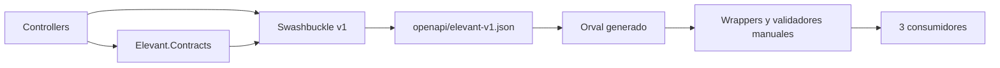
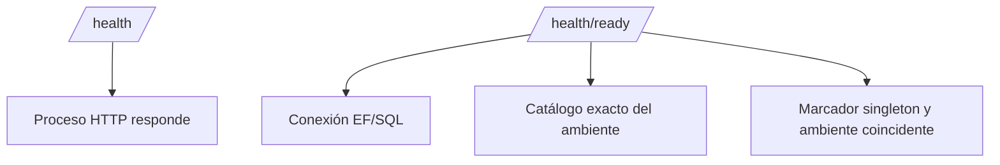

# OpenAPI, HTTP y SignalR

La API publica en OpenAPI v1 las 400 operaciones del commit verificado,
repartidas por prefijo en [API compartida](../05-aplicaciones/api-compartida.md).
Todas salvo 15 declaran el esquema Bearer; las anónimas son las de sesión,
activación y restablecimiento de cuenta, el catálogo y las solicitudes
públicas, los medios publicados, las opciones de afiliación y
`GetSystemPing`. Health, readiness y los hubs SignalR quedan fuera del
documento. Esta nota describe el repositorio, no un ambiente vivo.

## Superficie fuera de las operaciones de negocio

| Ruta | Mecanismo | Contrato observable |
| --- | --- | --- |
| `GET /api/v1/system/ping` | Controller versionado y en OpenAPI | `200` con `SystemPingResponse`; `429` y `500` como Problem Details. |
| `GET /health` | Health checks, anónimo | Liveness del proceso; no consulta SQL. |
| `GET /health/ready` | Health checks, anónimo | Conexión EF, SQL y coherencia del catálogo y el marcador del ambiente. |
| `/swagger/v1/swagger.json` | Swashbuckle | Development y, con `Swagger:Enabled`, Testing; nunca Production. |
| `/hubs/operations` y `/hubs/notifications` | SignalR, con Bearer | `ChangedV1` con un `eventId`. |
| `/hubs/public-catalog` | SignalR, anónimo | `CatalogChangedV1` sin datos. |

## Contrato OpenAPI vigente

El snapshot se refresca desde la API compilada, se normaliza y fija su digest;
el workflow del cliente comprueba que la salida generada no tenga deriva.

### Qué sí es contrato

- rutas, verbos y versión expuestos por el documento;
- `operationId`;
- códigos y content types declarados;
- schemas, `required` y nulabilidad;
- el esquema Bearer de cada operación protegida;
- la semántica de Problem Details y de su `code`.

### Qué no es contrato

- clases EF o tablas;
- tipos internos de Application o Domain;
- props y fixtures de los prototipos;
- una ruta escrita en un README que el documento no publica;
- el título en inglés de un Problem Details, que ningún cliente muestra.

## Cliente TypeScript compartido

`@elevant/api-client` separa el snapshot revisable, el código generado por
Orval y una [capa manual](../../packages/api-client/src/client.ts) sin estado
global. La fábrica exige un origen HTTP(S) absoluto sin path ni credenciales,
pide el token justo antes de cada request y no lo conserva en headers
durables, propaga `AbortSignal`, valida cada respuesta (rechaza las claves
desconocidas) y convierte los fallos en errores con el `code` de Problem
Details, sin retener la URL, el cuerpo crudo ni el `detail`. Los tres clientes
lo consumen desde su código fuente, sin paso de compilación.

## Pipeline HTTP

```mermaid
flowchart LR
    FH[Forwarded headers\nsi están habilitados]
    ERR[Exception handler\ny status pages]
    HTTPS[HTTPS redirect\nsi está habilitado]
    SW[Swagger\nDevelopment/Testing]
    ROUTE[Routing]
    ORIGIN[Origen de hubs]
    CORS[CORS allowlist]
    SIZE[no-store y límite de cuerpo]
    RATE[Rate limiter]
    AUTHN[Authentication]
    AUTHZ[Authorization]
    END[Controllers, health y hubs]

    FH --> ERR --> HTTPS --> SW --> ROUTE --> ORIGIN --> CORS --> SIZE --> RATE --> AUTHN --> AUTHZ --> END
```

([pipeline](../../backend/Elevant.Api/Extensions/ApplicationBuilderExtensions.cs))

### Versionado y serialización

- La versión por defecto es 1.0 y se lee del segmento de la URL.
- JSON usa camelCase.
- Las respuestas marcadas como privadas salen con `Cache-Control: no-store`.
- Un cuerpo mayor que el límite del endpoint responde 413 antes de leerse.

### CORS

Los orígenes se leen de configuración, sin vacíos ni duplicados. Con
allowlist, la política admite credenciales solo para esos orígenes exactos y
expone la cabecera `ETag`. Una preflight de origen desconocido no recibe
`Access-Control-Allow-Origin`: para el navegador es un rechazo, no una
autenticación. Mobile Agent es nativo y no depende de CORS.

### Proxy, HTTPS y rate limiting

- Los forwarded headers solo se habilitan con proxies o redes conocidas.
- La redirección HTTPS depende de configuración y está activa en el archivo
  de Production.
- El limitador usa una ventana fija sin cola por dirección de la conexión: 100
  permisos por 60 segundos por defecto y 10 para crear sesiones.

### Errores

Cada salida 4xx y 5xx de un controller es Problem Details; las de negocio
llevan un `code` estable en `Extensions`
([GovernanceResults](../../backend/Elevant.Api/Controllers/GovernanceResults.cs)).
Una excepción inesperada se registra y produce un 500 genérico con `traceId`,
sin stack trace ni texto de la excepción. Los status code pages cubren los
códigos sin cuerpo. Una escritura retirada que un cliente anterior todavía
puede llamar responde `410` con su `code` (`legacy_governance_retired` y, en
Finanzas, `legacy_finance_route_retired`;
[ADR-0040](../../docs/adr/0040-billing-cycle-invoicing-from-operations-card-collections-credit-notes-and-payables.md)),
y la ruta de un módulo borrado responde `404` a una sesión válida.

## Readiness y liveness

Un `200` de liveness no demuestra que SQL sea utilizable, y readiness no
demuestra que un caso de negocio esté autorizado.

## Autenticación y autorización

- **Bearer JWT** HMAC-SHA256 de tipo `at+jwt`, con emisor, audiencia y
  vigencia validados y 30 segundos de tolerancia
  ([composición](../../backend/Elevant.Api/Extensions/ServiceCollectionExtensions.cs)).
  Cada petición comprueba además que el sello de seguridad del token coincida
  con el vigente de la cuenta: cuando la cuenta renueva su sello, por ejemplo
  al cambiar credenciales o estado, los tokens anteriores dejan de servir.
  Cerrar la sesión revoca toda la familia de refresh tokens.
- **Política fallback autenticada:** todo controller y hub exige sesión salvo
  que declare `AllowAnonymous`.
- **Autorización de negocio** en cada caso de uso: departamento, permiso,
  organización y estación se resuelven desde SQL, nunca desde el navegador.
- El navegador solo puede enviar el token por `access_token` en la query hacia
  `/hubs/operations` y `/hubs/notifications`; fuera de esas rutas se ignora.

## SignalR

| Hub | Autenticación | Mensaje | Quién lo envía |
| --- | --- | --- | --- |
| [`/hubs/operations`](../../backend/Elevant.Api/Hubs/OperationsHub.cs) | Bearer | `ChangedV1` `{ eventId }` | El despachador, al usuario destinatario |
| [`/hubs/notifications`](../../backend/Elevant.Api/Hubs/NotificationsHub.cs) | Bearer | `ChangedV1` `{ eventId }` para el recurso `notifications` | El despachador, al usuario destinatario |
| [`/hubs/public-catalog`](../../backend/Elevant.Api/Hubs/PublicCatalogHub.cs) | Anónimo | `CatalogChangedV1` sin datos | Los comandos del catálogo, a todos, con un intento de 2 segundos |

Las clases de hub no tienen métodos de cliente: el servidor solo empuja. El
[despachador](../../backend/Elevant.Api/Hubs/AccountChangeDispatchWorker.cs)
proyecta el outbox SQL a `infra.account_changes` y luego emite el aviso; si el
envío falla, la entrega garantizada sigue siendo el feed HTTP
(`GET /api/v1/changes`, [controlador](../../backend/Elevant.Api/Controllers/AccountChangesController.cs)).
Arranca solo con `Realtime:AccountChangeDispatcherEnabled`, que es `false` por
defecto y `true` en `appsettings.Development.json`. Un WebSocket de navegador
solo se acepta desde un origen de la allowlist
([guarda](../../backend/Elevant.Api/Hubs/HubOriginGuard.cs)).

> [!WARNING] Documentación desfasada
> [`docs/architecture/realtime.md`](../../docs/architecture/realtime.md) y el
> [README de hubs](../../backend/Elevant.Api/Hubs/README.md) todavía describen
> hubs sin eventos y una lista de «eventos futuros». El código de esta sección
> prevalece: el único evento por cuenta es `ChangedV1`.

Siguen pendientes la estrategia multi-réplica (backplane) si se escala el host
y la medición de latencia en el VPS.

## Verificación

- Abre [el snapshot OpenAPI](../../packages/api-client/openapi/elevant-v1.json)
  y recorre `paths` antes de asumir una operación.
- Compara el [pipeline](../../backend/Elevant.Api/Extensions/ApplicationBuilderExtensions.cs)
  con [la composición de servicios](../../backend/Elevant.Api/Extensions/ServiceCollectionExtensions.cs).
- Revisa [SwaggerConfiguration](../../backend/Elevant.Api/OpenApi/SwaggerConfiguration.cs)
  y el [filtro Bearer](../../backend/Elevant.Api/OpenApi/BearerSecurityOperationFilter.cs).
- Las pruebas de [diagnóstico](../../backend/tests/Elevant.IntegrationTests/Api/DiagnosticsEndpointsTests.cs)
  y del [feed](../../backend/tests/Elevant.IntegrationTests/Api/AccountChangesEndpointsTests.cs)
  fijan las respuestas técnicas y el cursor.

## Relacionados

- [Índice de Arquitectura](README.md)
- [Feed de cambios operativos](feed-de-cambios-operativos.md)
- [Sistema y fronteras de confianza](sistema-y-fronteras-de-confianza.md)
- [Backend .NET, capas y dependencias](backend-dotnet-capas-y-dependencias.md)
- [Integraciones externas](integraciones-externas.md)
- [Fronteras de clientes](../02-producto/fronteras-de-clientes.md)
