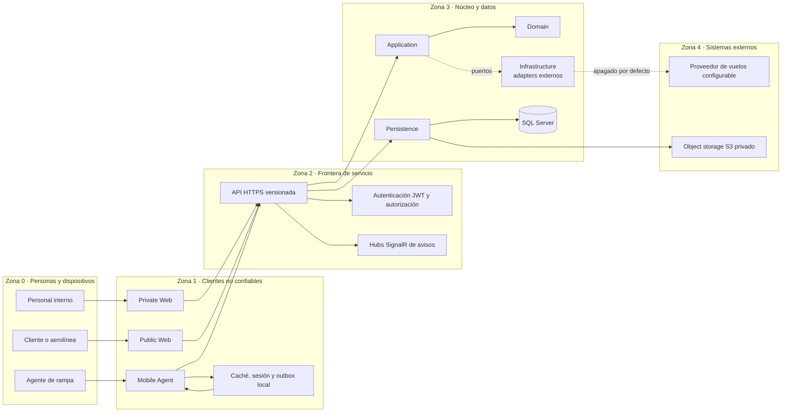

# Sistema y fronteras de confianza

ELEVANT concentra el estado y las reglas previstas en una API compartida. Private Web, Public Web y Mobile Agent son consumidores no confiables: pueden presentar datos, guardar caché y solicitar operaciones, pero no deciden tenant, estación, agente, permisos ni el resultado canónico de una transacción.

La arquitectura combina una regla duradera —todo acceso de producto atraviesa la API— con su materialización en el código. Posterior al commit verificado de esta nota (código de `39a85a46`): la API autentica con JWT, autoriza cada caso de uso por departamento, organización y estación, y los tres clientes la consumen. La privacidad de red de Development reduce alcance; no sustituye JWT, RBAC ni autorización por tenant/estación.

## Zonas de confianza

Las líneas punteadas marcan puertos o capacidades que dependen de configuración. Posterior al commit verificado de esta nota, la flecha de los clientes a la API es la ruta real de sus flujos; solo quedan adaptadores heredados del prototipo en partes de Private Web.

## Matriz de confianza

Posterior al commit verificado de esta nota: la columna «Estado actual»
describe el código de `39a85a46`.

| Origen | Puede aportar | No es autoridad sobre | Estado actual |
| --- | --- | --- | --- |
| Private Web | intención del usuario, filtros, IDs públicos, token de sesión | roles internos, alcance entre aerolíneas, estación autorizada | Consume la API con sesión; el menú solo muestra lo que el servidor permite. Quedan adaptadores heredados del prototipo en partes de la interfaz. |
| Public Web | intención del cliente, parámetros de consulta, token de sesión | tenant, afiliación, stations visibles, permisos de escritura | Portal con sesión real; el servidor deriva organización y estaciones de las membresías vigentes. |
| Mobile Agent | intención/comandos y caché/cola locales; ID de instalación + clave idempotente | identidad del agente, estaciones, autorización, resultado canónico | Envía cada comando con la clave de su instalación y concilia el resultado del servidor. |
| API | transporte, composición y resolución de identidad/scope | datos del proveedor sin validación, claims inventados por el cliente | JWT, política fallback autenticada y 400 operaciones en OpenAPI. |
| Application/Domain | casos de uso, reglas y puertos | HTTP, SQL, SDK de proveedor | Casos de uso de las cuatro fases del ciclo. |
| Persistence/SQL | constraints y estado persistido | autorización completa de un workflow por sí sola | 57 migraciones y los stores de los casos de uso. |
| Proveedor externo | observaciones externas adaptadas | modelo interno, autorización ELEVANT, verdad contractual | AeroDataBox y OpenSky detrás de puertos, apagados por defecto. |

## Flujo objetivo de una petición de negocio

1. El cliente configura un origen de API por ambiente y envía una solicitud HTTPS versionada.
2. La API autentica la identidad y deriva del lado servidor organización, rol, agente y scopes; posterior al commit verificado de esta nota, este paso está implementado.
3. El controller traduce HTTP a un caso de uso; no contiene reglas ni consulta `ElevantDbContext` directamente.
4. Application coordina la operación y Domain evalúa invariantes que no pertenecen al transporte.
5. Persistence carga o guarda el estado mediante EF Core; un puerto de Application, implementado por un adapter de Infrastructure, encapsula cualquier proveedor externo.
6. La API proyecta el resultado a un DTO de `Elevant.Contracts` y responde con códigos y Problem Details documentados.
7. Un aviso SignalR (`ChangedV1`) puede invalidar la vista; el cliente vuelve a consultar REST para recuperar verdad canónica.

En el commit verificado solo se podía recorrer de extremo a extremo la ruta técnica de `system/ping`. Posterior a ese commit, los casos de uso de las cuatro fases del ciclo siguen este flujo ([Recorridos de extremo a extremo](../02-producto/recorridos-end-to-end.md)).

## Reglas que cruzan todas las zonas

### Clientes

- Una variable pública de Next o Expo nunca contiene un secreto.
- El navegador o dispositivo no convierte un `organizationId`, `stationId`, `agentId` o rol recibido/enviado en autorización.
- La caché local, el almacenamiento del navegador y los mocks son reemplazables y descartables.
- Mobile necesita idempotencia de servidor para escrituras reintentables; posterior al commit verificado de esta nota, los handlers de rampa la aplican con los recibos por instalación.

### API y backend

- Los contratos públicos se separan de entidades Domain/EF.
- CORS sólo gobierna navegadores; no protege Mobile ni autentica a nadie.
- `AllowedHosts`, forwarded headers y rate limiting son protecciones de transporte, no reglas de tenant.
- Los errores públicos no revelan configuración, cadenas de conexión, cuerpos externos ni stack traces.

### Datos e infraestructura

- La conexión SQL entra mediante configuración secreta y Persistence rechaza una cadena ausente.
- Development y una futura Production no comparten base, identidad, datos ni credenciales.
- La API no usa una identidad administrativa ni ejecuta migraciones/seed al arrancar.
- Los clientes jamás acceden directamente a SQL Server o a un proveedor de aviación.

## Excepción humana de Development

El repositorio documenta acceso humano controlado por SSMS para manipular datos sintéticos en Development. Esa ruta está fuera del runtime del producto: usa cuentas individuales, permite CRUD limitado y niega DDL/administración. No autoriza a incorporar conexión SQL en un frontend, Mobile Agent, script compartido o futura Production.

## Brecha de seguridad del commit verificado y su cierre

En el commit verificado de esta nota, el host registraba `AddAuthorization`, pero no configuraba autenticación ni ejecutaba `UseAuthentication`, y OpenAPI describía el esquema Bearer como futuro.

Posterior a ese commit (código de `39a85a46`), la brecha está cerrada:

- la API registra JWT Bearer y ejecuta `UseAuthentication` y `UseAuthorization` con una política fallback autenticada ([composición](../../backend/Elevant.Api/Extensions/ServiceCollectionExtensions.cs));
- cada caso de uso resuelve identidad, organización, rol y estación desde SQL;
- las operaciones protegidas declaran Bearer en OpenAPI;
- la red privada sigue limitando quién llega a Development, pero no sustituye esas fronteras.

Siguen abiertos los controles de [riesgos y controles pendientes](../10-seguridad/riesgos-y-controles-pendientes.md).

## Verificación

- La composición y el pipeline se reproducen desde [ApplicationBuilderExtensions](../../backend/Elevant.Api/Extensions/ApplicationBuilderExtensions.cs) y [ServiceCollectionExtensions](../../backend/Elevant.Api/Extensions/ServiceCollectionExtensions.cs).
- La frontera de los tres clientes está en [frontend/AGENTS.md](../../frontend/AGENTS.md) y en sus README.
- El registro SQL y la exigencia de una cadena externa están en [Persistence/DependencyInjection](../../database/DevelopmentDB/Elevant.Persistence/DependencyInjection.cs).
- La excepción humana, sus límites y la separación respecto del runtime están en [Acceso seguro a la base](../../docs/security/database-access.md).

Esto no demuestra la topología o salud de un ambiente vivo. Esa evidencia pertenece al área de Operaciones.

## Relacionados

- [Índice de Arquitectura](README.md)
- [Backend .NET, capas y dependencias](backend-dotnet-capas-y-dependencias.md)
- [OpenAPI, HTTP y SignalR](openapi-http-y-signalr.md)
- [Identidad, tenancy y autorización](../03-dominio/identidad-tenancy-y-autorizacion.md)
- [Política de evidencia](../08-gobernanza/fuentes-y-evidencia.md)
