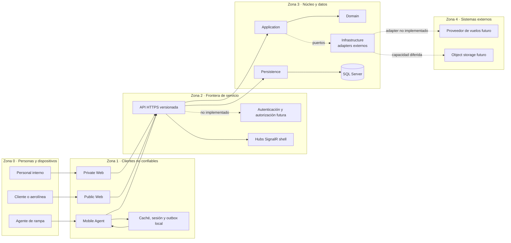

# Sistema y fronteras de confianza

ELEVANT concentra el estado y las reglas previstas en una API compartida. Private Web, Public Web y Mobile Agent son consumidores no confiables: pueden presentar datos, guardar caché y solicitar operaciones, pero no deciden tenant, estación, agente, permisos ni el resultado canónico de una transacción.

La arquitectura combina una regla duradera —todo acceso de producto atraviesa la API— con una realidad todavía incompleta: la API sólo expone una superficie técnica mínima y no autentica usuarios. La privacidad de red de Development reduce alcance; no sustituye JWT, RBAC ni autorización por tenant/estación.

## Zonas de confianza

Las líneas punteadas marcan capacidades objetivo o diferidas. La flecha de los clientes a la API muestra la frontera obligatoria, no que todos sus flujos actuales ya usen endpoints reales.

## Matriz de confianza

| Origen | Puede aportar | No es autoridad sobre | Estado actual |
| --- | --- | --- | --- |
| Private Web | intención del usuario, filtros, IDs públicos, token futuro | roles internos, alcance entre aerolíneas, estación autorizada | Interfaz ejecutable; gran parte del negocio sigue en adaptadores de prototipo/mock. |
| Public Web | intención del cliente, parámetros de consulta, token futuro | tenant, afiliación, stations visibles, permisos de escritura | Landing y portal demostrativos; autenticación y aislamiento real no están conectados a la API .NET. |
| Mobile Agent | intención/comandos y caché/outbox locales; ID de instalación + clave idempotente son el contrato objetivo | identidad del agente, estaciones, autorización, resultado canónico | Prototipo nativo: su cola usa una clave local provisional, no envía todavía la identidad/idempotencia del modelo servidor ni consume casos de negocio de la API .NET. |
| API | transporte, composición y futura resolución de identidad/scope | datos del proveedor sin validación, claims inventados por el cliente | Sólo scaffold técnico; no hay autenticación ni controllers de negocio. |
| Application/Domain | casos de uso, reglas y puertos | HTTP, SQL, SDK de proveedor | Fronteras creadas; los casos de uso de negocio aún no existen. |
| Persistence/SQL | constraints y estado persistido | autorización completa de un workflow por sí sola | Modelo v1 y migraciones implementados. |
| Proveedor externo | observaciones externas adaptadas | modelo interno, autorización ELEVANT, verdad contractual | No hay tráfico ni adapter funcional en el backend. |

## Flujo objetivo de una petición de negocio

1. El cliente configura un origen de API por ambiente y envía una solicitud HTTPS versionada.
2. La API autentica la identidad y deriva del lado servidor organización, rol, agente y scopes; **este paso todavía no está implementado**.
3. El controller traduce HTTP a un caso de uso; no contiene reglas ni consulta `ElevantDbContext` directamente.
4. Application coordina la operación y Domain evalúa invariantes que no pertenecen al transporte.
5. Persistence carga o guarda el estado mediante EF Core; un puerto de Application, implementado por un adapter de Infrastructure, encapsula cualquier proveedor externo.
6. La API proyecta el resultado a un DTO de `Elevant.Contracts` y responde con códigos y Problem Details documentados.
7. Un aviso SignalR futuro puede invalidar la vista; el cliente vuelve a consultar REST para recuperar verdad canónica.

Hoy sólo se puede recorrer de extremo a extremo la ruta técnica de `system/ping` y los checks de plataforma; el flujo anterior es la frontera de diseño para los futuros casos de negocio.

## Reglas que cruzan todas las zonas

### Clientes

- Una variable pública de Vite, Next o Expo nunca contiene un secreto.
- El navegador o dispositivo no convierte un `organizationId`, `stationId`, `agentId` o rol recibido/enviado en autorización.
- La caché local, el almacenamiento del navegador y los mocks son reemplazables y descartables.
- Mobile necesita idempotencia de servidor para escrituras reintentables; la tabla de receipts existe, pero no el handler HTTP que la use.

### API y backend

- Los contratos públicos se separan de entidades Domain/EF.
- CORS sólo gobierna navegadores; no protege Mobile ni autentica a nadie.
- `AllowedHosts`, forwarded headers y rate limiting son protecciones de transporte, no reglas de tenant.
- Los errores públicos no revelan configuración, cadenas de conexión, cuerpos externos ni stack traces.

### Datos e infraestructura

- La conexión SQL entra mediante configuración secreta y Persistence rechaza una cadena ausente.
- Development y una futura Production no comparten base, identidad, datos ni credenciales.
- La API no usa una identidad administrativa ni ejecuta migraciones/seed al arrancar.
- Los clientes jamás acceden directamente a SQL Server o a un proveedor de aviación.

## Excepción humana de Development

El repositorio documenta acceso humano controlado por SSMS para manipular datos sintéticos en Development. Esa ruta está fuera del runtime del producto: usa cuentas individuales, permite CRUD limitado y niega DDL/administración. No autoriza a incorporar conexión SQL en un frontend, Mobile Agent, script compartido o futura Production.

## Brecha de seguridad actual

El host registra `AddAuthorization`, pero no configura autenticación, no ejecuta `UseAuthentication` y no marca endpoints con requisitos de autorización. OpenAPI contiene un esquema Bearer descrito explícitamente como futuro. Por tanto:

- la red privada puede limitar quién llega al scaffold de Development;
- la aplicación todavía no demuestra identidad, tenant, rol o scope;
- ningún endpoint de negocio debe exponerse hasta implementar y probar esas fronteras;
- las tablas Identity y el seed no equivalen a un login HTTP funcional.

## Verificación

- La composición y el pipeline se reproducen desde [ApplicationBuilderExtensions](../../backend/Elevant.Api/Extensions/ApplicationBuilderExtensions.cs) y [ServiceCollectionExtensions](../../backend/Elevant.Api/Extensions/ServiceCollectionExtensions.cs).
- La frontera de los tres clientes está en [frontend/AGENTS.md](../../frontend/AGENTS.md) y en sus README.
- El registro SQL y la exigencia de una cadena externa están en [Persistence/DependencyInjection](../../database/DevelopmentDB/Elevant.Persistence/DependencyInjection.cs).
- La excepción humana, sus límites y la separación respecto del runtime están en [Acceso seguro a la base](../../docs/security/database-access.md).

Esto no demuestra la topología o salud de un ambiente vivo. Esa evidencia pertenece al área de Operaciones.

## Relacionados

- [Índice de Arquitectura](README.md)
- [Backend .NET, capas y dependencias](backend-dotnet-capas-y-dependencias.md)
- [OpenAPI, HTTP y SignalR](openapi-http-y-signalr.md)
- [Identidad, tenancy y autorización](../03-dominio/identidad-tenancy-y-autorizacion.md)
- [Política de evidencia](../08-gobernanza/fuentes-y-evidencia.md)
