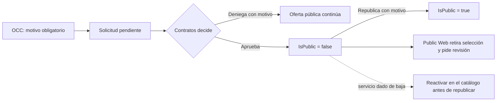

# Clausura comercial de servicios

OCC pide la clausura comercial de un servicio y Contratos la decide. La
capacidad está en `Development`; esta nota no acredita su promoción al VPS.
La fase 1 del ciclo operativo le dio salida a los casos que se atascaban
([ADR-0037](../../docs/adr/0037-commercial-cycle-requests-drafts-amendments-and-portal-accounts.md)).
La [guía de recorrido](../../docs/workflows/commercial-intake-and-governance.md#clausura-comercial-solicitada-por-occ)
contiene los permisos, rutas y límites operativos.

La clausura afecta la **comercialización global para solicitudes nuevas**. No
retira el servicio de contratos existentes, operaciones, historia ni de
`IsActive`. El expediente conserva nombre del servicio, autor, motivos,
decisión y reapertura. Un índice SQL impide dos solicitudes pendientes del
mismo servicio. Las decisiones y la reapertura exigen versiones vigentes;
el solicitante no puede decidir su propia petición (`closure_self_decision`).

## Clausura, ocultar y dar de baja

Contratos tiene tres maneras de sacar un servicio de la oferta, y no son
equivalentes:

| Acción | Efecto | Contratos vigentes y OCC |
| --- | --- | --- |
| Clausura aprobada | Lo saca del catálogo público por pedido de OCC, con expediente. | Lo siguen usando. |
| Ocultar del catálogo | Desmarca «Visible al público» desde el catálogo. | Lo siguen usando. |
| Dar de baja | Comando con motivo: sale del catálogo, de los contratos nuevos y de la operación. | Se rechaza mientras un contrato en vigor o en aprobación lo use (`service_in_active_contract`). |

Desde la fase 1:

- **Aprobar una clausura** funciona aunque el servicio ya esté oculto o dado de
  baja; solo lo despublica si seguía público. Así una solicitud de OCC nunca se
  queda sin salida.
- **Republicar** un servicio dado de baja responde `service_retired`: primero
  se reactiva en el catálogo. Tampoco se republica si ya es público, si hay
  una clausura pendiente o si ninguna clausura aprobada lo mantiene oculto.
- El **PUT del catálogo** no publica un servicio que una clausura aprobada
  mantiene oculto (`closure_requires_reopen`): se republica desde la
  clausura, con motivo.
- La pantalla muestra «Republicar» solo si el servicio está activo, avisa cuando
  la clausura pendiente es de un servicio ya oculto y explica cada código en
  español y en inglés (el espacio OCC es bilingüe). Ante un `409` relee el
  listado.
- La decisión y la reapertura aceptan una `Idempotency-Key` y repiten el
  resultado guardado ante un reintento con el mismo cuerpo. Toda falla de
  regla, estado o versión trae un código de Problem Details; la falta de
  permiso responde el `403` genérico, sin código, salvo
  `closure_self_decision`.

## Acceso y avisos

OCC ve el carrusel publicado en **Notificaciones → Servicios** y puede pedir
clausura de un servicio publicado, sin editar ni decidir. Contratos tiene
bandeja en **Servicios** y puede aprobar, denegar y republicar. Los permisos
de lectura, solicitud, decisión y reapertura se conceden por separado. Todas
las acciones exigen membresía AVIAM interna activa y autorización actual de la
API.

La mutación, auditoría y pistas para cuentas autorizadas se guardan en la
misma transacción. Una edición ordinaria del catálogo también avisa a OCC con
permiso de lectura de clausuras, y el feed revalida ese permiso al leerse.
SignalR anuncia la invalidación; las pantallas releen por HTTP y usan sondeo
al recuperar conexión o foco. Después del commit que cambia
visibilidad, el hub público anuncia la actualización. Public Web conserva
aerolínea y representante si desaparece un servicio seleccionado, muestra su
nombre y vuelve al paso de servicios. Si el recibo de un envío se perdió,
consulta un comprobante con el mismo UUID y contenido, sin repetir la escritura.
Si no hubo commit, exige una nueva confirmación de servicios antes de enviar.
Ninguna ruta de clausura envía correos.
